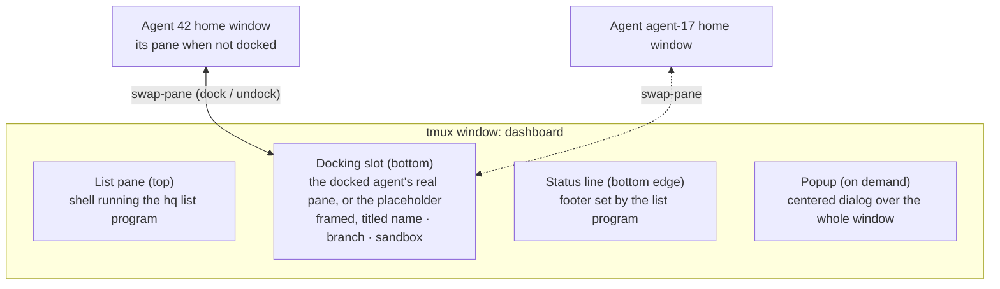
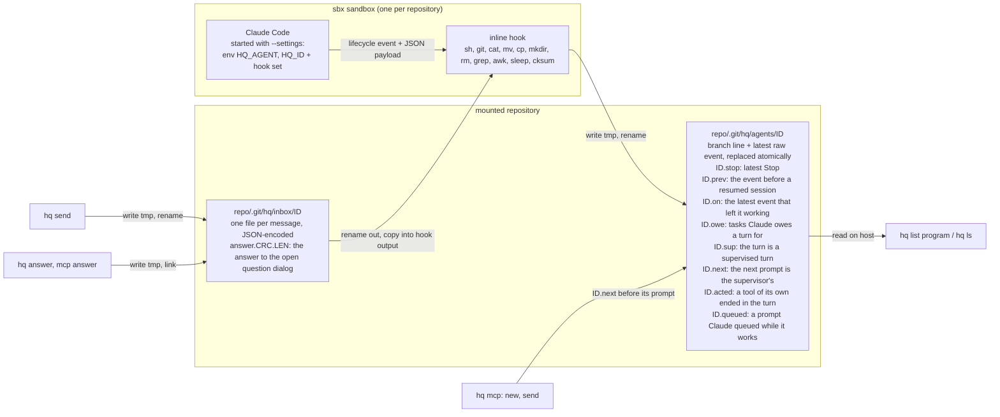
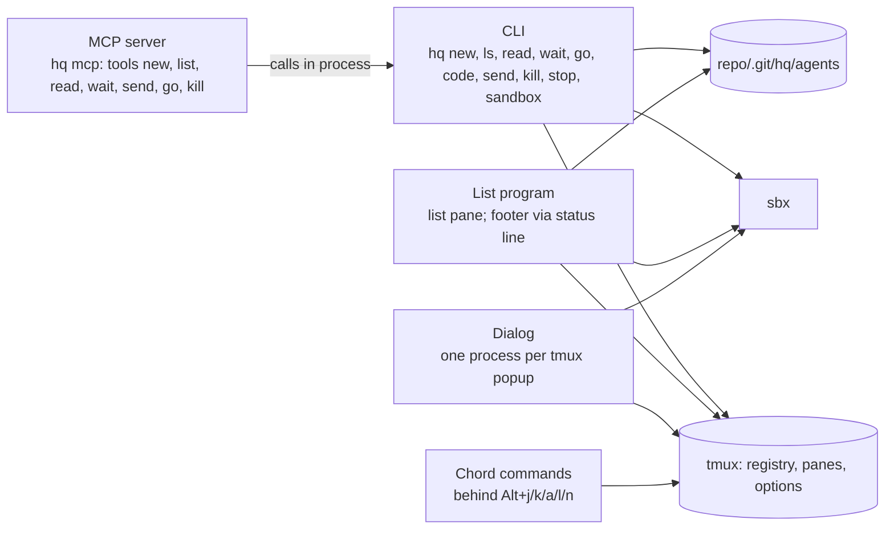
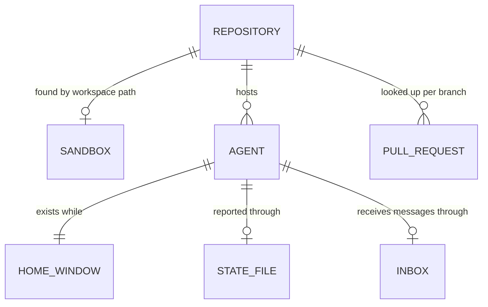

# hq - design

Version 1.0 (draft, in progress)

HOW hq is built. The WHAT is `docs/requirements/spec.md`; this document cites it by section (`§5`), scenario (`S4`) and acceptance (`§10`) and never restates it. Decisions that are hard to reverse live in `docs/adr/`.

## 1. Overview & design drivers

The architecturally significant requirements, in priority order. When two pull in different directions, the higher one wins.

1. **The givens** (§2, ADR 0001). State leaves a sandbox only through the mounted repository; sessions are tmux entities. Non-negotiable.
2. **The docked session is the real session** (§6.1, S3). The agent's own tmux pane is shown and used in the dashboard; nothing is mirrored or previewed. This makes the dashboard a composition of tmux panes rather than a single full-screen program that draws everything.
3. **No daemon** (§8, ADR 0002). Every command works with no dashboard running; only the dashboard observes state and notifies.
4. **Identical behaviour on both platforms** (§2, §8, S13): macOS with iTerm2, and WSL with Windows Terminal, both with plain tmux (ADR 0008). Platform-specific code sits behind one adapter.
5. **Timeliness and exactness** (§5, §10): state visible within 1 s, `ended` within 2 s, exactly one notification per attention event.
6. **Install footprint** (§8, §11): one command per platform, no service.
7. **Phase 2 headroom** (spec, Phase 2): the supervisor drives hq through the CLI's own commands (3.12); a flat row model, sorting and filtering kept separable.

## 2. Constraints & assumptions

Constraints are the spec's givens (§2) and constraints (§8); they are not repeated here. Assumptions below; if one proves false, the decisions that cite it are reopened.

- **A1 - Builders.** hq is built mostly by Claude Code agents working the repository's issues, under the owner's review. Technology is chosen for being agent-friendly and reviewable, not for a team's existing language skills.
- **A2 - Users.** The owner on macOS and a small team (2-6 people) on Windows/WSL. Each person runs their own hq; nothing is shared between machines.
- **A3 - Scale.** Per machine, typically 3-10 concurrent agents, rarely above 15, across 1-5 repositories. At this scale, polling tmux and state files several times a second is negligible, so incremental or event-driven machinery is not justified by load.

## 3. High-level architecture

### 3.1 Dashboard composition

The dashboard is one tmux window built from tmux's own parts ([ADR 0007](../adr/0007-dashboard-is-tmux-composition.md)):



- **List pane.** A shell that runs the list program. The list program owns the list, the cursor, the keys of §6.2-6.5, and the footer text. On `q` it exits and hq takes every client off the `hq` session (3.11), so the terminal gets back what it had before `hq`; the shell stays in the list pane with a hint, seen only by a terminal attached without hq, and `hq` or `hq dash` starts the list there again.
- **Docking slot.** Holds exactly one pane: the docked agent's own pane, or the placeholder with the hint of S1/S6. Docking swaps the agent's pane in from its home window; the pane it replaces goes back to its own home. The agent's process, scrollback and cursor are never interrupted. Every home window is kept at the slot's size (tmux `resize-window`, when an agent's window is made and whenever the layout is applied, and again for the two windows a dock involves, in the same tmux call), so a swap never changes a pane's size and tmux sends the agent no resize: Claude redraws its whole screen on each resize and tmux keeps every cleared screen in the history (#130).
- **The slot follows the cursor.** The list program docks the cursor's row once the cursor has rested for 150 ms after the user's last move (`↑`/`↓`, a click on a row, a search letter); each move restarts the wait, so a held key (repeating every 30-90 ms by default on macOS and Windows) docks only where it stops. These docks leave the keys on the list; `⏎`, a search's `⏎` and a New agent dialog's agent dock with the keys. Only the user's moves dock: a refresh or re-sort moves the cursor with its agent, never to another, and the welcome of a new agent started elsewhere (`hq new`, `hq mcp`; spec S2) takes the cursor and the slot only when nothing is docked. A dock made elsewhere (a chord, `hq go`) moves the cursor to its agent (3.7); the list tells its own docks apart by the refresh that follows, so a refresh collected while its own dock was on the way does not pull the cursor back to the previous row. When the docked agent goes, the cursor takes its row's place without docking it, and the placeholder stays (S6).
- **Placeholder.** Not a shell: a hidden hq command that shows the hint, hides the cursor and takes no commands. Anything it is given (keys, a paste, a click, since it asks tmux for the mouse) is swallowed and puts the keys back on the list pane, so the list's keys keep working. Its pane is marked as hq's placeholder and kept when its program ends, so the home window it waits in never closes with its agent; `hq` starts it afresh when it is not running hq's program, which also replaces the shell an older hq left there, wherever it waits.
- **Frame and title.** The slot is framed on all four sides by the surround (`#16181D`, the design's colour). tmux cannot draw a box with corners inside a window (a border's ends always meet another border as a junction) and colours a border cell by whichever neighbouring pane it finds first from the active one, so the frame is tonal, not a line: two margin panes one column wide either side of the slot (role `spacer`, running the placeholder program with no hint, so a click there puts the keys back on the list) and the status line take the surround; every pane border is drawn in the surround's colour on the surround, so it is invisible whichever pane owns it. Pane statuses sit at the bottom (`pane-border-status bottom`): the list starts on the window's first row (no rule above the header), the border row between list and slot is the list pane's status, which shows the slot's title `▸ name · branch · sandbox` (or `▸ placeholder`) filled in the slot's colour exactly as wide as the slot, so title row and slot read as one area; the slot's own status row below it is the bottom margin. tmux draws a pane's status four columns narrower than the pane up to 3.5 and two from 3.6 on; on 3.6 and later the title's last two columns are given the surround's colour. The docked pane is four columns narrower than the terminal, which is what Claude sees. The terminal is titled `hq - agents`.
- **Where the keys are** (spec §6.1, #128). The side with the keys, the list or the docked session, is on the terminal's own background (tmux's `terminal` colour, not `default`, which in a pane's status row means the border's style; #117), the other on the surround. tmux draws a window's active pane in `window-active-style` and the others in `window-style`, and redraws them whenever the active pane changes, whatever changed it (Alt+l, a click, docking, a dialog's action), so the look follows the keys with no hq process involved. The dashboard window's own styles are the slot's: active the terminal's background, inactive the surround with the default text colour `#9CA3AF`, which dims what the session draws in the terminal's text colour; cells Claude draws in colours of its own keep them. Being the window's, they are taken by whichever agent's pane is docked and stay behind when it goes home: the pane itself carries no style, and its home window has none, so there it looks as tmux's defaults make it. The list pane has its own: active the terminal's background, inactive the surround, its text keeping the list program's colours. The margins are the surround either way, and so is the placeholder, which also has both styles of its own (the surround, text dimmed): it never holds the keys, and a click on it, which gives it the keys for the moment before it hands them back to the list, does not flash it. The title row is drawn from the list pane's `pane-border-format`, which loops over the window's panes (`#{P:}`) to take the slot pane's `pane_active`: the terminal's background and the title in the accent `#A78BFA` while the docked session is the active pane, the surround and the dim `#5C626C` otherwise, the placeholder (role `slot`) always the latter. tmux redraws pane statuses with the borders on every change of the active pane. Every `hq` sets these styles again, so a dashboard styled by an older hq is brought up to date in place, placeholders waiting in home windows included. Esc is not bound: Claude uses it (3.7).
- **Docked row's outline.** The design draws a rounded lavender box around the docked row within the row's own height. A terminal row is one line of cells, so a box needs a line above and a line below the row for its edges. Those lines could only come from the session below (the list's height is fixed, spec §6.1), from the list rows (6 at 24 lines, 3 below), or by pushing the rows apart around the docked one, which the design does not do; and they would move with the docked row as the list scrolls and re-sorts. Cell attributes do not draw it either: an overline takes each cell's text colour, so the top edge would change colour along the row (the state column), and overline and underline colours depend on the terminal and on tmux's terminal features. So the outline is the box's two sides: a lavender `│` in the margin column at each end of the row, reaching the edges the box does, taking no extra line and holding on any background, the cursor's included (#33, #102).
- **Footer.** tmux's status line, content set by the list program (key hints; the `/name` search while typing, `/ag · 1 match: agent-17`, §6.3). Cleared when the list program exits.
- **Dialogs.** tmux popups centered over the whole window, each running an hq dialog (§6.6). The list keeps refreshing underneath; the popup holds all keys and clicks while open.
- **Layout.** The list pane's height is re-applied on every resize: header + 6 rows + footer, 3 rows in a terminal below 24 rows (§6.1, S12); the slot takes the rest. The margins beside the slot are set back to one column each at the same time, since tmux shares a change of width among all panes of a row. The terminal's height is tmux's window height plus the session's status lines, which tmux takes from the terminal, so the classic 80x24 terminal (a 23-line window) shows 6 rows.
- **Agent home windows.** Every agent has a home window in the same tmux session, holding its pane while it is not docked. They are invisible to the user: the footer replaces tmux's window list, and the terminal shows only the dashboard window.
- **Finding the parts.** Like the home windows (3.3), the dashboard window and its panes are found by tmux options hq sets on them: the window is marked as the dashboard, each pane carries its role (list, slot or spacer, the margins beside the slot), and the list program records its process on the list pane while it runs, so `hq` knows whether to start it again. The session's look (colours, margins, titles, a status line that is only the footer) is set on the `hq` session and the dashboard window alone, never on the tmux server's global options, and reapplied on every `hq`.

Satisfies: §6.1, §6.4 (drawn by the list program), §6.6, S1, S3, S6, S8, S12; driver 2.

### 3.2 Platforms

Plain tmux on both platforms ([ADR 0008](../adr/0008-plain-tmux-on-both-platforms.md)). On macOS the dashboard is an ordinary `tmux attach` inside an iTerm2 window; on WSL, the same inside Windows Terminal. The terminal only hosts tmux; everything hq shows is drawn by tmux and the list program, so both platforms share one code path for the dashboard.

**Decision:** tmux 3.4 or newer on both platforms. Notifications come mostly from agents that are not docked, whose panes sit in hidden home windows, and tmux passes their sequences to the terminal only with `allow-passthrough all` (3.4; 3.3 passes only from the visible pane, 3.2a not at all). hq checks the version at install and at start and exits 3 with the remedy (`hq: tmux 3.2a is too old, 3.4 or newer needed (Ubuntu 24.04 ships it)`). WSL baseline: Ubuntu 24.04; macOS gets a current tmux from Homebrew.
Every tmux command hq runs, and the attach of the dashboard, carries `-u`: the list, the slot title and the popups draw lines and marks beyond ASCII, which tmux shows as `_` to a client whose locale (`LC_ALL`, `LC_CTYPE`, `LANG`) does not say UTF-8, as on a Linux shell with no locale set (#41). The terminals hq runs in (iTerm2, Windows Terminal) take UTF-8 whatever the locale says.

**Alternatives considered:** a fallback for older tmux (a bell from the hidden window): a second code path with weaker behaviour, no text, against spec §5 (kind and branch named).

Satisfies: §2, §5 (notifications from hidden panes), §8 (identical behaviour), §11 (prerequisites), S13; driver 4.

### 3.3 Agent registry

**Decision:** tmux is the registry. An agent exists exactly while its home window exists in the `hq` session; what hq knows at launch (name, repository path, sandbox, start time, the `new` marker) is stored on that window as tmux user options, and an `ending` marker while `hq sandbox restart` takes the agent down (sbx lists a stopping sandbox as running for the seconds the stop takes, S9). Every command and the list program read agents from tmux; there is no registry file.
**Rationale:** with no daemon (ADR 0002), the only always-current record of what runs is tmux itself; a separate file would duplicate it and go stale when a window dies outside hq.
**Consequences:** an agent that ended keeps its window, its dead pane kept readable, until it is killed (S7); removing the window frees the name (§4.2). Removing a window ends only the host side of `sbx run`, and Claude keeps running inside the sandbox, so killing an agent first ends its Claude session there (SIGTERM through `sbx exec`, found by the agent id it was launched with), waits a few seconds for it to exit, then removes the window (S6, S10). This holds whatever the pane's state: a pane also dies when only its host-side `sbx run` ends, and Claude then runs on in the sandbox, so an ended agent's session is signalled too, and since there is no pane to watch, the wait asks the sandbox (`pgrep` through `sbx exec`) until the process is gone. Only an agent with nothing left to end in its sandbox is left alone: `sbx ls` lists the sandbox as not running (or not at all) and the session went with it, as the list shows the agent ended (5.1) - its pane dead, or still running while its latest report is older than sbx's answer. Nothing runs there, and `sbx exec` would start the sandbox again. sbx is asked once per kill, before the agents' reports are read, as the list does (#87); the kill waits for that answer as the list does (at most a few seconds when sbx hangs), and when sbx fails or does not answer, every agent's session is signalled. The docked agent is known from where the panes are: its own pane, marked with its id, sits in the slot, and the placeholder waits in its home window; the list's other session state (the cursor) is a session option. Both survive `q` and detach as long as tmux runs (S1, S8, S9). An agent's pane carries what must travel with it when docked (its id, staying readable after it ends, passthrough). Staying readable takes two pane options: the dead pane is kept, and the pane has no alternate screen, because Claude draws in the alternate screen and tmux throws that screen away when Claude leaves it, taking the session with it. It also takes hq's session program, a hidden hq command each agent's pane runs `sbx run` through: when a session is cut off (its sandbox stopped, or `sbx run` ended from outside), `sbx run` resets the terminal (`ESC c`) as it exits, and tmux clears the screen, pushing the session into the history, so the dead pane would show only tmux's `Pane is dead` line. Once `sbx run` has ended, the session program draws the pane's latest lines again at the bottom of its screen, each run of blank lines as one, and exits with `sbx run`'s status. The lines come from the last screenful only, the pane's height up to the last line printed: Claude redraws its whole screen on every resize, as on every dock and undock, clearing the screen first (never the history), and tmux pushes each screen it clears into the history (`scroll-on-clear`), so the lines above the last screenful are Claude's earlier screens, each starting with the same banner and conversation, and taken from there they stacked in the dead pane. Those copies stay in the history: `scroll-on-clear` off would keep them out but lose the last screen when `sbx run` resets the terminal, and clearing the history would take with it what only the history holds, the parts of a long conversation that left the screen. Folding the blank runs keeps the conversation in view: Claude pads the rows above its prompt box, and a dead pane made smaller, as docking does, keeps its bottom lines. The line above tmux's `Pane is dead` line is left blank, since tmux marks it as wrapped and a resize would join the last line drawn to it. A screen that shows the latest lines already, as after most `/exit`s, is left as it is; the history keeps everything, the last screen twice and each screen a resize replaced. Removing a docked agent's window first sends its pane home, so the slot gets the placeholder back (S6). Sort and view must survive a tmux restart (§6.2), so they live in a small per-user preferences file. Agent state does not live here; it comes from the hooks (section 3.4).
**Alternatives considered:** a registry file in the user's home (duplicates tmux, goes stale).
**Satisfies:** §4.1 (`ls`, `go`, `kill`, `stop`), §4.2 (name uniqueness and reuse), §6.2 (remembered sort and view), S1, S7, S8, S9; drivers 1, 3.

### 3.4 State channel

Hooks are injected when hq starts Claude and write the agent's state into the repository's `.git` ([ADR 0009](../adr/0009-hooks-injected-at-launch.md)); no repository setup.



- **Identity.** A fresh id per agent, generated at `hq new`, stored on the home window (3.3) and passed to Claude as `HQ_ID`. Stable across `/clear`; never confused with an earlier agent that reused the name.
- **One copy of the script.** The hook script travels once, in the environment `--settings` sets (`HQ_HOOK`), and every hook runs `sh -c 'eval "$HQ_HOOK"' hq-hook KIND [SEQUENCE]`: seven hooks with a copy each made the settings far longer. The script sends its own errors nowhere, once at its start (`exec 2>/dev/null`) rather than on every command: nobody reads a hook's stderr.
- **Settings written out as the session starts.** The agent's window does not carry the settings: its command, which tmux bounds at 16 KiB (`command too long`; the same in tmux 3.4 to 3.7c), says `--settings hq-settings:NAME:ID`, and `hq __session`, which runs every agent's session (3.3), puts `state.Settings` for that name and id and the platform's notification sequence in its place before it runs `sbx run`. The settings are then an argument of `sbx run` only, bounded by the 32 KiB command line Windows takes for `sbx.exe` on WSL (the tests hold them to 24 KiB), and the hook script takes no room from the first prompt, which keeps nearly all of tmux's 16 KiB. Only the argument after the first `--settings` is a reference, so a prompt that reads like one stays as typed. `hq new` measures the window's command before tmux does and says by how much the prompt is too long, under the prompt in the New agent dialog (#40).
- **Events used.** Prompt submitted -> `working`; Stop -> `question` or `done`; a dialog opening (PermissionRequest: a question dialog such as AskUserQuestion, or a permission prompt) -> `needs input` at once; the end of that dialog's tool (PostToolUse or PostToolUseFailure) while it is open -> `working`; an MCP elicitation (Elicitation, below) -> `needs input` at once, and its form answered at the agent (ElicitationResult) -> `working`; Notification of kind permission prompt or agent needs input -> `needs input` when no dialog is open; session end -> `ended` (also detected from tmux and sbx, section 5); SessionStart -> `done`, without a notification. Until the first event an agent is `starting`, and so is one whose latest event hq cannot read: the hook stores what Claude gave it, and a Claude cut off while it fed the hook an event (killed during its SessionEnd) gives a part of it or nothing; the branch and the latest Stop's last message still stand (#73). Verified with Claude Code 2.1.283 in sbx (#124): Claude fires SessionStart about 2 s after `sbx run` starts it, before any prompt, with `source` `startup`; with a PROMPT it runs the SessionStart hooks to their end before it fires UserPromptSubmit (a SessionStart hook made to take 3 s delayed UserPromptSubmit by 3 s), so SessionStart is always a session's first report and never overwrites a later one. Without it an agent started without a PROMPT stayed `starting` with its `new` marker until the user's first prompt, while Claude waited at its prompt. `--resume` fires it with `source` `resume` and the same session id; `/clear` fires SessionEnd (`reason` `clear`) and, at once, SessionStart with `source` `clear` and a new session id. hq's SessionStart hooks match `startup|clear` and `resume`: after each Claude waits at its prompt, so the agent is `done`, the last message `-` for a new agent and the latest Stop's otherwise (after `/clear` this also ends the moment of `ended` its SessionEnd gave, and the session id hq resumes at a restart is the new one). A compaction (`compact`), which may come in the middle of a turn, is not matched. A resumed session starts in the repository, not in the worktree its conversation left (verified: its SessionStart and later events carry the repository as `cwd`), so its hook first keeps the state file as `ID.prev`, unless that file is itself a resumed start (restarted again before any prompt), and hq takes the branch, worktree and last message from it until the next report. Verified with Claude Code 2.1.283 in sbx (#71): even with permissions bypassed, AskUserQuestion fires PreToolUse and PermissionRequest as its dialog appears, and answering it fires PostToolUse at once; Claude's own permission-prompt Notification ("Claude needs your permission") follows about 6 s after the dialog appeared and only while it is still open, so the hook drops it when the dialog is already reported. The hook writes a tool's end only when it closes the open dialog (the same tool name), so tools ending while the agent works never rewrite the file and `working` keeps its age, and another agent's tool (a background subagent's) does not close the dialog unless it is the same tool. A permission prompt that is granted returns to `working` when its tool has run. A question dialog's PermissionRequest (matcher `AskUserQuestion`) also runs a second hook, of kind `hold`, with a `timeout` of 86400 s, which writes nothing and holds for hq's answer (*Answers*, below).
- **MCP elicitations (#100).** Verified with Claude Code 2.1.302 (#89, #100; payloads in `internal/state/testdata`): Claude runs the Elicitation hooks before it draws an MCP server's form and draws it as soon as they end with no decision, so hq's Elicitation hook only reports: it writes the event as the agent's state, as the PermissionRequest hook does for a dialog, prints the `needs input` notification (3.5) and no decision, and never holds, so the form is drawn at once (a hook that held would show the user the tool's card and `running Elicitation hooks…` in place of the form, #89). The agent is `needs input` at the Elicitation event, about 6 s before Claude's own Notification for it (`elicitation_dialog`, and `elicitation_url_dialog` for a URL-mode form), which hq's Notification hook no longer matches, so it adds nothing. The payload has `mcp_server_name`, `message`, `mode` (`form` with `requested_schema`; `url` with `url` and `elicitation_id`) and no `agent_id`, the agent's own and a background subagent's alike, with the main turn's `prompt_id`. Answered at the agent, accepted, declined or cancelled (Esc included), the form fires ElicitationResult (`action`, and `content` on accept) 7-61 ms after the answer; a URL-mode form fires it when accepted, though Claude Code then keeps a `waiting for completion` panel (`Reopen URL`, `Skip confirmation`) in place of the prompt box until the server confirms or the user skips or cancels it, past the turn's end (the `elicit` server sends no completion); hq shows the agent as its hooks say meanwhile, `working` and then the turn's end, and reads nothing of that panel. The hook writes it only while a form is open: the agent is `working`, with its turn's last message, as after a PostToolUse at a dialog, and the turn counts as acted on (no early Esc rewinds it, below). A form that another Elicitation hook answers (one in the user's own settings) is never drawn and fires no ElicitationResult: the end of a tool of that server (`mcp__SERVER__…`) closes it, and the screen's Claude at work (the dialog verdict, below) stays the fallback. Whose it is follows the rule of a subagent's dialog (below): no PreToolUse hook is added to tell them apart, which would fire on every tool call of every agent and not tell the agent from a subagent calling the same server. The form's schema is read on the host for `hq read` (3.12): its properties in their order, those of type `string`, `number`, `integer` or `boolean`, their options from `enum` (titled by `enumNames`) or `oneOf`'s `const` and `title`, and their default; a property hq cannot read in full (a list, a nested object) is left out and keywords it does not know are ignored, so a schema read in part still gives the message and the fields it could read. hq answers no elicitation: a hook can answer one only while it holds, and holding hides the form from whoever is at the agent; answering waits for Claude Code to draw the form while Elicitation hooks run, as it draws AskUserQuestion's dialog while PermissionRequest hooks run ([anthropics/claude-code#103115](https://github.com/anthropics/claude-code/issues/103115), #95). An agent launched by hq 0.6.3 or older keeps its hooks, and with them the Notification, until it is relaunched.
- **Background work.** A turn that ends while background subagents still run is not the agent's end (spec §5, #38): Claude goes on by itself when they finish. Verified with Claude Code 2.1.291 (#38): the Stop of such a turn carries `background_tasks`, `[]` when nothing runs and otherwise one entry per running task (`{"id": ..., "type": "subagent", "status": "running", "description": ..., "agent_type": ...}`; a background shell command the same with `"type": "shell"` and its `command`, a running workflow with `"type": "workflow"` and its `name`, its agents not listed; a watch with `"type": "monitor"`, #62 below); the only status ever seen is `running`, a finished task is not in the list, and nothing else in the payload differs. The payload is one line of compact JSON. When background work ends, Claude wakes the agent with a UserPromptSubmit whose `prompt` starts with `<task-notification>`, then Stop; a wake-up can arrive in the middle of a turn, so the two are not paired, and a prompt the user sends while a subagent runs ends with a Stop that still lists it. With several subagents (three, finishing 25 s apart) Claude runs one wake-up turn per finished subagent, and each intermediate Stop lists the ones still running. The Agent tool has no foreground mode in a default session: asked to wait for a subagent, Claude still ends its turn with the subagent listed and is woken later (a foreground subagent, seen only with `CLAUDE_CODE_DISABLE_BACKGROUND_TASKS=1`, ends before the turn's single Stop with `[]`). No `idle_prompt` Notification came while a subagent ran. SubagentStart and SubagentStop fire too but are noisy (a SubagentStop with an empty `agent_type` follows every main Stop), and the Agent tool's input never says that a launch is in the background; the list at Stop makes counting unnecessary. So the hook decides at each Stop: when a task of `background_tasks` has the status `running` and is neither a shell command nor a watch (a `monitor` task) the agent itself started (an agent that left a dev server running would never be `done`, nor one that published an artifact; a subagent's command or watch, below, counts), and the turn did not end with a question, the Stop leaves the agent `working`. The hook walks the list in awk, reading each task's `type` and `status`; text inside a task's strings is only ever data. Such a Stop is kept beside the state file as `ID.on`, and as `ID.stop` for the last message, and the state file is left alone: its time is the user's prompt, so `AGE` keeps counting from there, and the hook prints no notification. Claude's wake-up while the state file says working is kept as `ID.on` too, for the same reason; any other prompt, Stop or session event is written as before and removes `ID.on`. When the state file does not say working at such a Stop (a Notification's `needs input`, a dialog whose end was never reported), the Stop is written there as well, and the reader takes a Stop equal to `ID.on` for working, from then on; but never over a subagent's dialog (a PermissionRequest carrying `agent_id`, as a subagent's tool events do), which is still open: the agent needs input until it is answered, and its answer leaves it working at its prompt, `ID.on` still beside it. A question, the `[]` Stop of the closing turn, and a wake-up after `done` or `question` are ordinary reports: `question` with its notification, `done` with its notification, `working`. The reader (`state.Report.Kept`) applies `ID.on` only where the hook can have meant it: a Stop beside a state file that says working, or equal to it; a wake-up beside one that says working. Its time is the agent's latest report, which keys the window records below; the state file's time stays the moment the state counts from. An agent whose latest report is such a Stop is `working` at its prompt: its screen looks exactly like a rewound turn's (below), so it is not read at all until the next report, and Esc there, which fires no hook and does not stop the subagents, changes nothing. A session that starts, resumes or ends removes `ID.on`, so the subagents of the session before are forgotten; one that outlives `/clear` wakes the new session (verified: SessionEnd `clear`, SessionStart `clear`, later UserPromptSubmit and a Stop with `[]`), which reads as any prompt and turn end. A hook injected by an older hq writes no `ID.on`, and its Stops read as before, so its agent keeps the old behaviour until relaunched. hq sets no timeout: if Claude never runs the closing turn the agent stays `working` until its next event or its end. **Work that finishes together.** Subagents that finish within a second or two of each other still get a wake-up turn each, and the list is already empty at the Stop of an earlier one (verified, three finishing together: Stop with one running, Stop `[]`, wake-up 20 ms later, Stop `[]`; the same when a subagent is stopped: Stop `[]`, then a wake-up with the status `killed`). Every wake-up names its task (`<task-id>`), also with a prompt of the user's queued at the same time (verified: two UserPromptSubmits, never one for both). So the hook keeps the ids of the tasks that run, less those Claude woke for, in `ID.owe`: those it saw running at a Stop, and those the agent started, taken from the PostToolUse of the tool that started them (verified: the Agent tool's response is `{"isAsync":true,"status":"async_launched","agentId":ID,...}`, the Workflow tool's `{"status":"async_launched","taskId":ID,...}`, a foreground subagent's `"status":"completed"`; a subagent's own tool events carry `agent_id` beside `hook_event_name`, and what a subagent starts is not the agent's), so background work is known before any Stop lists it, as when the user interrupts the turn that started it. The ids are kept one a line, rewritten at each Stop by the same awk, and a Stop with any id left is kept like one with a task running: `working`, no notification. That also covers a subagent the user has stopped, and subagents that end during a turn of the user's: the user's prompt keeps the ids. The reader tells the two apart by the kept Stop's own list (`Report.Owed`: nothing running). For an owed agent the wake-up comes at once or not at all, so its screen is read again: at rest (the prompt box, no `esc to interrupt`, no spinner, whatever the box holds; `state.Idle`) and unchanged for 2 s, the agent is `done` with its turn's message, since it was first seen at rest, recorded and entered like a rewound turn (below; `@hq_restseen`, `@hq_turnend`, where a fixed mark stands for the message: the agent's own text is never stored on a window, 7.3), without a notification, as no hook runs; one `hq ls` looks again after 2 s for it, as for a rewind. So a wake-up that never comes cannot leave an agent `working` with nothing running. An id that no longer runs is marked in the file once it has held back a turn end (`!ID`). A marked id holds back another only when Claude woke for one of the listed tasks since the last Stop (the wake-up leaves a `+` line, which the next Stop uses up): the wake-ups for tasks that ended together follow one another, so one that did not come by then is not coming, and it holds back one turn end. The user's next prompt drops the marked ones too; a wake-up that names no task drops them all, as nothing can be told paid, and so does a session's start or end. The task a wake-up pays is the one named first in it; an id further down is the subagent's report, only ever data. Costs of the bound, both needing two things at the same moment: when tasks end together and a wake-up for something not listed (the agent's own shell command ending) comes between their wake-ups, or another hook blocks a Stop so that Claude stops again with no wake-up in between, the marked id is dropped and the agent is `done`, notified, and `done` again at the wake-up that follows. The other way round (any wake-up keeping every marked id) would let one wake-up that never comes silence every closing turn until the user's next prompt, which is the worse fault. **A subagent's shell command (counted, #60).** A subagent that starts a shell command in the background and stops is reported finished, with an interim result, and the list then holds the `shell` task alone; when the command ends Claude wakes the subagent, which goes on and reports again under the same id (verified with Claude Code 2.1.291, #38: Stop with the subagent, PostToolUse of the subagent's Bash with `"backgroundTaskId":ID` and the subagent's `agent_id`, wake-up, Stop with the shell alone, 55 s later SubagentStart, wake-up, Stop `[]`; again on 2.1.295, #60: the subagent's console says `Agent "..." finished`, footer `1 shell still running`, the subagent with an empty circle in the agent list, so no source, screen included, lists it as running). Neither sanctioned way for a subagent to wait keeps it running: a foreground `sleep` is blocked by Claude Code, which points to `run_in_background` or the Monitor tool, and the Monitor tool's until-loop is reported as a task of its own, a `monitor` (the console says `1 shell, 1 monitor`; first taken for a second `shell` task, set right in #62), the subagent ending its turn the same way; so this is the shape of every subagent waiting on anything slow, a CI run above all. The hook therefore counts such a command: the PostToolUse of a subagent's tool (it carries `agent_id`) whose response names a task, `backgroundTaskId` for Bash, `taskId` for the Monitor tool (read from Claude Code 2.1.296's tool definition; seen in a payload with 2.1.302, `testdata/post-tool-subagent-monitor.json`, #99), adds a line `~ID` to `ID.owe`; at a Stop a running `shell` or `monitor` task whose id has such a line counts as running work, and the line is kept, while a line whose task the Stop does not list running is dropped, so an id recorded for a command that ended before the next Stop cannot hold the agent `working` by itself. Claude wakes the subagent for the command, not the agent, so no turn is owed for it: the subagent, woken, is listed as `subagent` until it reports, and the rules above take it from there. A `shell` task with no such line, the agent's own, stays uncounted (and so does a `monitor` task, since #62 below). The reader (`Report.Owed`) reads the same lines, so an agent whose subagent's command runs is not owed a turn and its screen at rest is not read. The user's prompt keeps the lines, a wake-up that names no task and a session's start or end drop them, as they do the other ids. The price, chosen by the project lead: a subagent that leaves a dev server running and reports looks exactly like one waiting on its command (the wake-up's note is the same interim one, and a subagent's final report cannot be told from it), and its agent stays `working`, with the subagent's last message in `LAST`, until the server ends; this was built in #38 and reverted for that reason. A `done` with a notification while the work goes on, recurring at every wait for CI, is the worse fault, and a server a subagent left behind is a cleanup bug better seen than hidden. A command a subagent only watches was seen to end without the subagent being woken again (#60): its line goes when its task leaves the list, as any other. **The agent's own watch (not counted, #62).** The task types seen so far are `subagent`, `shell`, `workflow` and `monitor`. A `monitor` task is a watch: the Monitor tool's until-loop, or the watch Claude Code arms by itself when the agent publishes an artifact with the Artifact tool (verified with hq 0.5.0, 13.10.2026: the Stop after the agent's final report carried `"background_tasks":[{"id":"sjbxxhmjo","type":"monitor","status":"running","description":"live updates for artifact https://claude.ai/artifact/<id> (auto-armed on publish)"}]`, nothing else; the Artifact tool's PostToolUse says nothing of `async_launched`; the agent's own `/tasks` lists it under *Background - System tasks*, "auto-replying to comments"). Such a watch runs until the session ends or the user stops it, and wakes the agent only when somebody comments on the artifact, so with the rule above every turn of that session ended `working`, with the final report in `LAST`, `hq wait` never returning and no notification: nothing in hq could end it, as `Report.Owed` was false. So a `monitor` task joins `shell` in the rule: a running task counts as owed when its type is neither `shell` nor `monitor`; a `shell` or `monitor` task counts only when `ID.owe` holds its `~ID`, a subagent's (the `K=tool` branch is unchanged: nothing is recorded for the artifact watch, and a subagent's Monitor keeps recording its `taskId`), and `payload.busy` mirrors it. Considered and not chosen: a positive list (`subagent` and `workflow` count, anything else only with `~ID`), which matches the spec's wording but would make a new task type of Claude Code's that is real work end `done` early, the worse fault; unknown types keep counting. **The agent's own tasks (shown, #78).** What the rule above does not count is shown beside the state, never changing it (spec §5 *Own tasks*): a `shell` or `monitor` task the latest Stop lists `running`, whose id has no `~ID` line in `ID.owe`, is one of the agent's own tasks, shown by the task's `command` (a shell) or `description` (a watch) from the same payload; one whose id has a `=ID` line (the agent's own Monitor watch, below) is a watch, by its description, whatever type the Stop gives it. `payload.ownTasks` and `payload.busy` read the same list and the same `~ID` lines, one the inverse of the other for `shell` and `monitor`, so a change to one is a change to both; the `=ID` lines change only how an own task is shown, never whether it is one. `state.Report.Own` gives them only while the report is `done` or `question` from that Stop as the latest event: a Stop the hook kept leaves the report `working`, and a prompt, a dialog, a SessionStart or a SessionEnd has no turn end of its own. The row model keeps them only while its state is still that report's, the same state since the same moment (`agent.keepOwnTasks`), so a turn end read off the screen (`@hq_turnend`, an Esc), a dialog of Claude's own, an ended agent and a report of the session before show none, and the JSON field and the LAST prefix always agree. The artifact watch is left out by its description ending `(auto-armed on publish)` (the payload above), the only thing in the payload that tells it from a watch of the agent's own; the description is looked at whatever the task's type, as Claude Code 2.1.302 lists a Monitor tool's watch as a `shell` (below) and may list the artifact watch so too. Should Claude Code describe it otherwise, it shows as an own task: fail-safe, since no state depends on the list, and preferred to dropping every `monitor` task, which would hide the watches the agent keeps itself. The list is that turn end's, refreshed by the turn Claude takes when a task ends: a task stopped by hand without a turn stays listed until the next turn end (spec §5). Older hooks: an agent started by an hq before 0.6.0 writes `ID.stop` but no `~ID` lines (#60), and its hooks are of the generation of today's (`@hq_inbox` `2`), so hq cannot tell them apart. Such an agent shows a shell command or watch one of its subagents started as an own task while it runs, on the `done` its older hook gave anyway, until it is relaunched (`hq sandbox restart`); one started before 0.3.4 (#38) keeps no `ID.owe` at all, with the same outcome. Shown, not hidden: the command does run, and hiding every task of an older agent would hide its own too. **The agent's own Monitor watch (marked, #99).** A watch the agent keeps with the Monitor tool is not a `monitor` task in Claude Code 2.1.302 (QA of #97, `testdata/stop-own-monitor.json`): its Stop lists it as `"type":"shell"`, with a `b`-prefixed id as a Bash command's, the Monitor's `description` and its `command`, while Claude's footer counts it as `1 monitor`; a subagent's watch is listed the same way (`testdata/stop-subagent-monitor.json`). Only the tool's PostToolUse tells them apart: `"tool_name":"Monitor"` with `"tool_response":{"taskId":ID,...}` (`testdata/post-tool-own-monitor.json`), where Bash has `backgroundTaskId`. So the hook's `K=tool` branch, for a Monitor tool's end with no `agent_id`, adds a line `=ID` to `ID.owe`. It is told by the tool's name, not by `taskId` alone: the Workflow tool's response carries a `taskId` too, with `async_launched`, and stays owed work, recorded as a plain id as before. The mark is never work: `busy` in the awk and `payload.busy` do not read it, the Stop's rewrite does not take it for an id owed a turn, and the checks that ask whether anything is owed a turn (the supervised mark, 3.5) look for a line that is not `=ID` (`grep '^[^=]'`, where an empty file was enough before), so a turn end that leaves only the agent's own watch running is the agent's end and notifies as before, supervised or not. It lives as `~ID` does: the Stop that rewrites the list keeps it while that Stop lists its task running as the agent's own and drops it at the first that does not; the user's prompt keeps it, and a wake-up that names no task and a session's start or end drop it with the rest. The reader (`payload.ownTasks`) then shows that task as a `monitor`, by its description: `1 monitor · ` in LAST, `own task: monitor  <description>` in `hq read`, `"type":"monitor"` in `own_tasks`. The `monitor` type is still what the artifact watch has (#62), and a `monitor` task is shown by its description should Claude report one; the artifact watch is left out by its description whether marked or not. Older hooks: an agent started by hq 0.6.3 or older has no `=ID` lines and shows its Monitor watch as a shell, by its command (`1 shell · `), until it is relaunched. No new hooks generation (`@hq_inbox` stays `2`): a generation is what hq asks before doing something only newer hooks can take (an inbox message, a supervised prompt), and nothing hq does depends on the mark; hq reads it where the hook wrote it, and an older agent's list simply has none, with the outcome above. The mark costs the hook about 200 bytes: its script was 7805 bytes then, under the budget a unit test holds it to (*Answers*, below, for that budget now). **A turn the user interrupted.** Such a turn is `done` from its screen (below); the hooks know nothing of that, and Claude's wake-up, kept as `ID.on`, leaves the state file's time, the interrupted prompt's. The row model sees the turn end it recorded since that prompt (`@hq_turnend` of an earlier report), so the agent works since the wake-up: the time of `ID.on` while it is the wake-up, which the first look to see it stores in the window's `@hq_wokeseen`, keyed by the prompt's report and that turn end, for the reports after it (a kept Stop, a later wake-up of the same work) and for every other process. If no hq looked during the closing turn, the time stays the interrupted prompt's. The same record dates an agent woken late after the 2 s rule above made it `done`. The id of a started task is appended to `ID.owe` while a wake-up may be rewriting the file (read, then rename): an id lost that way is learned at the turn's Stop as before, unless the user interrupts that turn.
- **Turns the user ends.** Some turns end at the user's hand with no hook at all: cancelling a dialog with Esc, interrupting a turn at work with Esc, and refusing a permission prompt (Esc or No) fire no PostToolUse, PostToolUseFailure or Stop, and Claude's `idle_prompt` Notification comes 60 s after a Stop, never after these (verified with Claude Code 2.1.283 in sbx, #71, #72). Claude then waits at its prompt. So the collection shared by `hq ls`, the list program and the chords (3.8) also looks at the screen of every agent whose hooks said `working` or `needs input` at least 500 ms ago, all of them in one tmux call per refresh: when Claude waits at its prompt box (a rule, the input line starting with `❯`, a rule, then only the footer, which does not offer `esc to interrupt`) and has printed `● User declined to answer questions` or `⎿  Interrupted` since the user's last prompt, with nothing of its own below the line (no spinner, reply or card: Claude at work there is on a turn that shows no prompt of its own, one it woke itself for or took from its queue after the Esc, below), the agent is `done` with `User declined to answer questions` or `Interrupted` as its last message. While a turn is at work Claude's footer offers `esc to interrupt`, so a working agent is never read as ended, whatever its output holds. The moment hq first saw it and the last message are kept on the home window (`@hq_turnend`, keyed by the state file's time it overrules), so `AGE` counts from then in `hq ls` and the list alike, and the agent stays `done` whatever its screen shows of the turn until the next hook report: the next prompt appears on the screen a moment before its hook reports, and the agent does not flash back to the state the turn end overruled (its screen is still read for a dialog of Claude's own, below). It sends no notification: no hook runs, and the user is at the agent (spec §5). The lines matched are Claude Code 2.1.283's, recorded as test fixtures; a Claude that draws them otherwise leaves the agent as its hooks said, never a false `done`. The 500 ms keep a screen that lags behind the hooks from overruling them.
- **The screen with subagents running.** Claude Code 2.1.291 lists the agents below its footer while subagents run: `● main`, then a line for each subagent (`◯ general-purpose  Run the tests   7s · ↓ 26.5k tokens`, its time counting), so the prompt box is found above that list, however long (recorded as test fixtures); `hq send` needs it to type a message into the box of an agent working only on subagents (it sits at its prompt: the box at rest and empty, Claude's faint suggestion aside). The turn Claude wakes itself for shows no `❯` line, only `● Agent "..." finished`, so a line of a turn the user ended earlier can still stand above the box with nothing of the user's below it: while an agent works on a turn Claude woke itself for (the wake-up kept beside the state file, or written as the report after `done`, a question or a dialog), such a line is its turn's end only as the last thing Claude said: with a bullet line (`● `) below it, the wake-up's notice or a reply, it is an earlier turn's (`state.EndedLast`; a screen recorded as a test fixture).
- **Rewound turns.** An Esc early in a turn, before Claude has committed anything (about 2-3.5 s into a turn without tools), rewinds it instead: the prompt leaves the transcript and goes back into the input box, and Claude prints no line and runs no hook, so the screen looks like Claude waiting at its prompt after the previous turn (verified with Claude Code 2.1.283 in sbx, #99). No single screen tells this from a turn at work: the footer drops `esc to interrupt` while the user types into the box and in a narrow pane (50 columns), and Claude shows no spinner while its reply streams. What does tell is that a turn at work keeps changing its screen (the spinner redraws several times a second, the reply grows; in the samples taken, a working agent's screen never stayed the same for more than about half a second), while a rewound one stays still. So a `working` agent's screen is at rest when it shows the prompt box at the bottom, a footer without `esc to interrupt`, no spinner line (a glyph and a word ending in `…`, as `✶ Brewing…`) since the last prompt, and in the box nothing or the prompt the hooks reported (`UserPromptSubmit`'s `prompt`, whitespace aside), which is what the rewind puts back; text the user typed during the turn, or a `/` menu that hides the turn, is neither. The first look that sees it at rest stores the moment and a fingerprint of the screen in the home window's `@hq_restseen`, keyed like `@hq_turnend` by the report; a later look, from any process, that sees the same screen at rest 2 s or more after it makes the agent `done` with `Interrupted`, since that first moment, and records it in `@hq_turnend` like the turns above. A screen that changed in between starts over. The list looks every 250 ms, so it shows the end within about 2 s; `hq ls`, which looks once, looks again after 2 s when an agent's screen is at rest with its prompt back in the box, so a single `hq ls` shows it too (with an empty box, as after the user cleared it or while a narrow pane streams, it does not wait, and the next look decides). A rewind right after a turn the user ended leaves that turn's `Interrupted` or declined line above the box, which alone would read as this turn's end; so when the box holds the reported prompt and the last prompt shown sent above it is another, the line is taken for the earlier turn's and the rule above decides (an interrupt that puts its prompt back in the box leaves it sent above too; with the box emptied the two cannot be told apart, and the agent shows `done` at once, with the earlier line's message).
- **A turn Claude has acted on (#77).** Only an early Esc rewinds a turn, before Claude has committed anything, so once a tool of the agent's own has ended in the turn a screen at rest is no rewind. It is not a safe sign of a turn's end either: in the sbx template (fullscreen, the `clean-view` mod, no `esc to interrupt`) a working agent was read at rest, unchanged for 2 s, 8 s into a silent foreground Bash command that a run of earlier commands had preceded, and shown `done` with `Interrupted` for the 2.5 minutes until its next hook report. The screen hq read then was not captured, and in captures of the same command (Claude Code 2.1.301, a fresh session, an agent of hq's at 80x24, a cold page cache) the spinner showed on every frame. So the hook marks the turn when a PostToolUse or PostToolUseFailure without an `agent_id` comes in: `ID.acted` beside the state file, which leaves the state file and the agent's time alone, and which the next prompt, Stop or session event removes (a wake-up kept while the agent works goes on with the same turn and leaves it, and so does a prompt Claude queues, below); the mark holds the turn's `prompt_id`. While the mark is there, or after a dialog of its hooks' that the screen saw answered (*The dialog verdict*, which before ended no turn at rest at all), a screen at rest ends the turn only when it shows a tool the user cut short, the one Esc of such a turn that prints no line in the sbx template: the turn's card is the last thing Claude drew at the left edge above the box, collapsed to its summary and marked `×` (`│ ▸ 2 komendy · × · 5,1 s │`), and it stays so for 2 s like a rewind. A tool at work keeps its card open with the spinner below it, a command that failed marks the open card `×` while the turn goes on with its spinner, and a turn that ended by itself has its reply below the card; an Esc while Claude thinks or writes after a tool prints `⎿  Interrupted`, which the rule for turns the user ends reads. Before the turn's first tool has ended (a silent first command, or a turn spent on a foreground subagent, whose tools carry `agent_id`) there is no mark, and the rule for rewound turns stands. An agent started by an older hq writes no mark, and its screen at rest still reads as a rewind.
- **A prompt Claude queues (#82).** A prompt typed while the agent works is queued by Claude, and Claude Code runs UserPromptSubmit when it queues the prompt, not when it takes it (verified with Claude Code 2.1.301 in the sbx template, #82, against the transcript's `queue-operation` lines: the hook 6-9 ms before the `enqueue`, none at the `dequeue`). Claude takes it in one of two ways. At the next end of a tool of the agent's own it takes it into the turn at work (`remove`, a `queued_command` attachment, one Stop). When no such tool ends before the turn's Stop, it takes it right after that Stop as a turn of its own, after any slash command queued before it (`/clear`: SessionEnd `reason` `clear`, SessionStart `source` `clear`, then the prompt), and no hook reports that turn until its first tool ends or its Stop. Prompts queued together are taken together, as one turn. Before this the agent showed `done`, with the message of the turn before, for the whole of that turn. Every event of a turn carries its `prompt_id`, the queued prompt's UserPromptSubmit too, which carries the id of the turn at work, while a prompt that starts a turn gets an id of its own, and the queued prompt's turn runs under a third id that first shows on its tool events and its Stop. So the hook takes a prompt for queued when the state file says working and the prompt's `prompt_id` is the state file's or `ID.acted`'s (a turn taken from the queue is known by its first tool's end). It writes the prompt as before, keeps a copy as `ID.queued`, and leaves `ID.acted` alone: the turn at work goes on. A tool of the agent's own that ends drops `ID.queued`. A Stop the hook blocks to deliver messages goes on with the same turn, and Claude takes nothing into it (verified: the queued prompt was dequeued after the second Stop), so the hand-over waits for the next Stop. A Stop with the same `prompt_id` as `ID.queued` hands over: it gives `ID.stop`, the turn's message, removes `ID.on` and `ID.acted`, and makes the state file the queued prompt, dated now. The agent is then `working`, the prompt that turn runs on, and no notification fires. `ID.queued` stays, its id now `ID.stop`'s, so that a SessionEnd `clear` right after leaves the state file alone, and the SessionStart `clear` after that writes the queued prompt again with the new session's id (for `hq sandbox restart`, 3.6), dated from that start, a few milliseconds later. Any other prompt, Stop or session event drops it. A Stop with another `prompt_id` is an ordinary report. **Esc with a prompt queued (#88).** The user interrupts the turn at work with Esc, which fires no Stop, and Claude runs the queued prompt at once as a turn of its own (the dequeue 60 ms after the Esc), under a `prompt_id` of its own, with no hook until its first tool ends or its Stop; the state file is the queued prompt as written when it was queued, so hq showed `done` with `Interrupted` from the Esc (the screen's line, recorded against that report) to that Stop, and `hq wait` returned at the Esc. Two things hand over then. The screen: Claude Code 2.1.302 in the sbx template draws the prompt it took in one of two ways (`state.TookQueued`, fixtures `screen-fs-queued-*`). With the interrupted turn's reply streaming, the queued line above the box goes and no `❯` line is drawn: only `⎿  Interrupted` and, below it, Claude at work on the queued prompt (its spinner, then its reply or card), with no prompt of the user's between; a wake-up turn looks the same and the hooks tell it (`Report.Woken`). With the interrupted turn still thinking (2.1.301 in the issue's run too), the prompt is drawn sent, as `❯` and its text right below the `Interrupted` line, with Claude at work below it. While a prompt is still queued it is drawn as a `❯` line right above the box, with `ctrl+x ctrl+s to send now` under it and nothing of Claude's below, so neither way reads it as taken, and the line above it counts for nothing. So the look, seeing that with the copy `ID.queued` pending (its `prompt_id` not the latest Stop's, `Report.Queued`) beside a report that says working, hands over itself: it renames `ID.queued` onto the state file, dated now, and removes `ID.on` and `ID.acted` (`state.TakeQueued`), as the hook's Stop does, then reads the report again: `working` on the queued prompt since then, in every process, and the turn-end record of the report before falls away. The rename is the claim: of two processes one hands over, and a hook that has just taken the copy away (its Stop, a tool's end) is never written over. A look in the moment between the Esc and the dequeue sees the line alone and records a turn end; the next look that sees Claude at work on the queued prompt hands over all the same, and the record, keyed by the report before, falls away. Of `ID.acted` hq removes only the turn at work's mark (it holds that turn's `prompt_id`, the copy's too), never one the hook has just written for the queued turn's own tool. The hook: the end of a tool of the agent's own whose `prompt_id` is not `ID.queued`'s (the state file's too), with the copy pending and no wake-up kept in `ID.on`, is the first event of that turn, and hands over the same way (less `ID.stop`), dated then, for a look that never saw the screen; `ID.acted` is then that turn's. A wake-up kept while the turn at work went on (`Report.Woken`) looks the same on the screen and carries a `prompt_id` of its own, so neither side hands over while one is kept: the agent stays on the turn at work's report until the queued turn's Stop. No PreToolUse hook is added for it: it would run on every tool call of every agent, and the screen shows the hand-over within one look. A queued turn with no tools is handed over by the screen alone; unseen, it stays `working` on the earlier report until its Stop, which is right in state. Esc twice (the queued turn interrupted at once) leaves two `Interrupted` lines and Claude idle: `done`, `Interrupted`, whether or not a look saw the first. Not covered: a `/clear` queued before the prompt and then Esc (the SessionEnd and SessionStart of the `/clear` are ordinary reports, as `ID.queued` is not taken at a Stop). a prompt queued in a turn taken from the queue before any tool of that turn has ended, whose id no hook has reported yet, is taken for a turn of its own, and that turn's end is `done` as before. Esc on a turn taken from the queue before any tool of it has ended (Claude puts its prompt back in the box), then the box emptied and `/clear` at the idle agent, finds `ID.queued` still there, as no hook fires for any of it: the agent reads `working` on the stale prompt again until its screen at rest ends that as a rewind (`done`, `Interrupted`; 10 s after the `/clear` in a run, the status line's animation keeping the screen from staying still for 2 s, #79). The race where a prompt is queued between Claude taking what was queued at a tool's end and that tool's PostToolUse hook (about 70 ms) is not covered either. An agent started by an older hq keeps the old behaviour until it is relaunched.
- **Claude's own dialogs.** Claude Code draws some dialogs of its own in place of its prompt box, outside any turn, and no hook reports them: at a session's start ("Make auto mode your default permission mode?", trusting the folder; Claude Code 2.1.285, #29) and after a turn, opened by a slash command (`/effort` asks "Change effort level?" when the conversation is cached for the current level; `/model` shows its picker; Claude Code 2.1.300, #66). Until the user answers one, Claude takes no prompt. So the collection also looks at the screen of every agent waiting at its prompt (`done` or `question`, by its hooks or by a turn end hq saw, or `working` only on background work, where nothing else on its screen is read; #70), in the same tmux call as the others, once its report is 500 ms old (`state.OwnDialog`): with no prompt box on the screen, below the last rule (a line of `─`, or of `▔`, which Claude Code 2.1.300 draws above a dialog after a turn and which may carry text such as `● high · /effort`), a title, a text and two or more options on consecutive lines, one marked `❯`, their numbers and a scroll arrow aside. While it shows one, the agent is `needs input`, with the title as its last message, and `hq read` gives the title, the options and the text (`asks`). The moment hq first saw that dialog is kept on the home window (`@hq_dialogseen`, keyed by the report and a fingerprint of the dialog's title and text, so moving the cursor, scrolling its options or resizing the pane keeps it), so `AGE` counts from then in every process and `hq wait` returns the agent once (Entered after a moment). A look that finds the agent at its prompt again closes the record (`REPORT -`), so a dialog opened again during the same report counts from when it is seen; the agent is then as its hooks or its turn end say, with their moment, so answering a dialog is no new state for `hq wait`. Closing such a dialog fires no hook, so a message left meanwhile goes with the agent's next prompt, and `hq send` says that instead of "when it stops". No notification is sent for it: notifications come from Claude's hooks (ADR 0010). `hq answer` picks its options with keys (below, ADR 0014). When the capture fails, a dialog whose record is open for the agent's current report stands, since its recorded moment, as a turn end hq saw does, so the row does not drop back to `done` for a refresh; what it asks is not recorded, so `asks` is null until the next look sees it. The cost is one screen capture per refresh for every agent at its prompt, all in the one call (about 2 ms for 20 screens with tmux 3.6). The rule is built on captures of the real dialogs (`internal/state/testdata/screen-own-*.txt`), and no other captured screen matches it but an MCP elicitation, which Claude Code 2.1.301 draws the same way and the hooks report (below).
- **The dialog verdict (#70).** Whether an agent is at a dialog, whose, since when and what it asks is decided in one place, the agent's dialog verdict (`agent.Dialog`): the hooks' (a PermissionRequest, or a Notification with no dialog open), a subagent's, Claude's own (above), or none. A subagent's dialog is told by its event: its PermissionRequest carries `agent_id`, as its tool events do; its MCP elicitation carries none, the same payload as the agent's own, its Elicitation event and Claude's Notification alike (verified with Claude Code 2.1.301 and 2.1.302, a background subagent calling an MCP tool that elicits, #70, #89), so a dialog the hooks report while the agent waits at its prompt on background work (beside the turn end the hook keeps, `Report.Kept`) is a subagent's, as the agent has no turn then. Limit: a subagent's elicitation while the agent still works on its own turn cannot be told from the agent's own and counts as the agent's, so the screen may close it when it shows the agent at work. `hq read` hands it the report's detail and shows the asks it gets back (the detail's for the hooks' and a subagent's, the screen's for Claude's own); `hq send` words its answer from it. The rule: **the hooks open `needs input`; the screen may close it on clear evidence; an unclear screen keeps it.** Claude's own dialogs aside, the screen never opens one. A dialog the hooks reported closes when the screen shows Claude at work (`state.AtWork`: the footer offers `esc to interrupt`, or the spinner shows above the box since the user's last prompt with any label, `^[·✢✳✶✻✽*] .*…`, which a finished turn's `✻ Worked for 7s` and a main agent's `✻ Waiting for 1 background agent to finish` do not match; the spinner is the last line Claude starts at the left edge above the box, as only indented lines follow it (a tip, the todo list, the effort), so a line of a reply that reads like one, indented under its bullet or in a card, is not): the user answered it and Claude works on, as after an MCP elicitation, whose answer no hook reports, or a long tool approved in a permission prompt, whose PostToolUse comes only when it ends. The agent is then `working`, since the dialog's report, with the latest Stop's message as its last (`state.Report.LastStop`), as after a PostToolUse; `hq wait` does not return it. The moment hq first saw it is kept on the home window (`@hq_answered`, keyed by the report), so a later look at a screen that tells nothing keeps the agent working, and from then on its screen is read as any working agent's, with one exception: a screen at rest is no rewind for it (only an early Esc rewinds a turn, before Claude has acted on it, and a dialog means it has), so the bare box, which a reply streaming shows too, closes nothing by this path either (a tool the user cut short still ends the turn, as for any turn Claude has acted on, below); the lines Claude prints for a turn the user ended still end it, and its hooks' Stop does. Anything else keeps `needs input`: the dialog itself, a narrow pane (its footer drops the hint), and the bare prompt box, which a reply streaming shows too (Claude Code 2.1.301 draws no spinner then), so the box closes nothing. The lines Claude prints for a turn the user ended (`Interrupted`, `User declined to answer questions`) still close it as above; AskUserQuestion's "Chat about this" prints the same line and then writes a reply in the same turn, which is Claude at work below the line: the dialog answered, `working` until the turn's Stop (#88; before, `done` with the line's message while the reply was written). A subagent's dialog closes by its hooks only, whatever the screen shows: Claude draws it in the main pane exactly as the agent's own, and its answer leaves the main agent waiting on its subagents at the bare box. When the hooks reported a dialog, it is theirs, even when the screen reads as one of Claude's own: the screen is not read for a dialog of Claude's own while a hook's dialog is open. Verified with Claude Code 2.1.301 in an sbx sandbox with a template's managed settings (fullscreen renderer, a status line, mods drawing tool calls in cards, a PermissionRequest hook that approves every request): no working screen there shows `esc to interrupt`, and a tool at work labels the spinner with its description (`· elicit: ask_color… (5s · ↓ 86 tokens)`), which the spinner's earlier pattern (`\S+…`) missed and so took for a screen at rest; widening it changed no reading of the earlier captures. The captures are test fixtures (`internal/state/testdata/screen-fs-*.txt`); no permission prompt could be drawn there.
- **The first record wins.** Several hq processes look at the same agents at once (the list refreshing, `hq ls` in a script, a chord), and each may be the first to see a moment the hooks do not date: a turn the user ended (`@hq_turnend`), a screen first at rest (`@hq_restseen`), a dialog of Claude's own first seen (`@hq_dialogseen`), Claude at work after a dialog the hooks reported (`@hq_answered`; it keeps its moment as the others do, though the agent's time stays the dialog's report), an end nothing dated (`@hq_endseen`). A process that read the window options, found no record and then wrote its own would overwrite the record another process stored in between, and `AGE` would jump back (#100). So a record is stored only if the option does not already hold one of the same thing (the same report, the same screen, the same start), in one tmux call that both checks and sets (`if-shell -F` on `#{m:KEY*,#{@hq_...}}`, then `set-option`) and prints what the option holds after it (`display-message -p`); the tmux server runs the whole call before another client's (an integration test races eight writers), so of racing processes the first wins, and each shows the moment the stored record says, its own or the winner's.
- **Entered after a moment (`hq wait`).** `hq wait` returns an agent that entered `done`, `question`, `needs input` or `ended` after its `--since` (spec §4.1), and its processes, one call after another and beside the list and `hq ls`, must agree on whether that happened before or after a moment, with nothing watching between two calls. So each compares a moment derived only from what every process reads, the state file and the window records: the moment from which any look could see the agent in its state (`Agent.Entered`). It is the moment `AGE` counts from except where that is dated before the state can be seen. A state the hooks report: the state file's time. A turn the user ended with a line on the screen: the `@hq_turnend` record's moment, when hq first saw it. A rewind: that record holds the moment its screen was first seen at rest, which `AGE` counts from, but the turn is decided 2 s later, so the moment plus 2 s; a rewind is told from an `Interrupted` line by the `@hq_restseen` record of the same report carrying the same moment. A dialog of Claude's own: the `@hq_dialogseen` record's moment. `ended`: the earliest of the session-end report, the first-seen end (`@hq_endseen`) and the pane's death plus 1 s, since tmux dates a death to the whole second. A look beginning at N finds the waited-on agents whose moment is after `--since` and no later than N - 250 ms, and prints N - 250 ms (never before `--since`) as the next call's `--since`. A look that finds one does not return yet: the look after it, 250 ms later, returns what it finds, with its own N - 250 ms, and the agents the first found that it no longer does (one that moved on meanwhile still entered its state after `--since`), so agents whose moments are within 250 ms of each other come back in one call (#116). The 250 ms are for what a look may not see yet although it is dated: a state file's time is set as the hook writes its temporary file, a moment before the rename puts it in place, and a record's moment is taken just before the screen is captured and the record stored. What entered later falls into the next window; consecutive calls' windows meet without overlap, so a change between two calls is returned once, by the next call. Without `--since` the window starts after the call's first look, so an agent already in such a state is not returned, including one whose turn end or end that look is the first to see. `hq ls --json` and `hq read --json` print, as `next_since`, the same N - 250 ms for a look beginning at N, and `hq send --json` and `hq answer --json` the moment 250 ms before they leave the message or the answer: a `hq wait` from there returns every change the result could not have shown, such as the reply to the message, however late it is called; the price is that a state entered in those 250 ms may be returned once although the result showed it. What a result could not have shown is every agent's change for `hq ls --json` and `hq wait` (of the agents waited on), but only the one agent's for `hq read`, `hq send` and `hq answer`: another agent's change before their moment that no `hq wait` returned is lost from there, so a watch takes its `--since` from `hq wait` and `hq ls --json` alone (3.12). An agent waited on that the last look saw and this one does not (killed; a kill usually shows `ended` first, from the session-end report SIGTERM makes Claude write) is returned as `ended` at once, since no later look can see it. Costs: a reported state is returned 500-750 ms after its time, an end dated only by the pane's death up to 1.75 s after it (as `ended` in 5.1, within §10's 2 s); a state file rewritten without a change of state counts as entering it again.
- **Branch.** Hooks run in Claude's current directory, which moves into the worktree Claude creates (`CLAUDE_PROJECT_DIR` stays at the repository). The hook asks git there for the checked-out branch and writes it as a header line (`branch NAME`) before the payload: git answers inside the sandbox, where the path is valid on both platforms, so the host never maps sandbox paths to find a branch. Empty before the first event and on a detached HEAD. The payload's `cwd` is kept as the worktree path (for `hq code`, M4).
- **Interpretation on the host.** The hook stores the raw payload after the branch line; hq derives the state, the time it was entered, the one-line last message and takes the branch. `question` vs `done`: the last assistant message ends with `?`, the rule proven by a `notify.sh` hook in one of the team's application repositories.
- **Last message.** `last_assistant_message` of Stop; while `needs input`, what the dialog asks (the first question of AskUserQuestion; for a permission prompt the tool and its description or command; an MCP elicitation's message, or its server when it has none), or the Notification's own message when it came without a dialog. The hook also keeps the latest Stop payload as `ID.stop`, so a `working` or `ended` agent still shows its previous reply. It writes `ID.stop` before it renames the Stop into the state file, the last file it writes: once the state file says the turn ended, `ID.stop` holds that Stop (and `hq read` dates the reply by it) and no copy of the hook's is left beside them (#123; it wrote `ID.stop` after, from a copy of the state file, so a look in between saw the agent `done` beside the previous `.stop` and the copy). An `ended` agent's `AGE` counts from when its session ended, never from its last report or its start: the session-end report's time when there is one (`/exit`); otherwise when its pane died, which tmux keeps for a dead pane (`#{pane_dead_time}`, whole seconds; a killed or crashed Claude, a launch that failed); otherwise when hq first saw it `ended` (a sandbox stopped while the pane lives on, a restart's `ending` marker, or a tmux too old to date a dead pane), which the first `hq ls` or list refresh to see it stores in the window's `@hq_endseen` together with the start time and the last report it belongs to, so every later look, from any process, shows the same `AGE`, and a relaunch or a report after it starts over: a record from before the agent's last report is not its end (#104). Ended rows are then ordered newest end first (spec §6.2).
- **Messages (`hq send`, [ADR 0012](../adr/0012-hq-send-messages-cross-into-the-sandbox.md)).** The host leaves each message as one file in the agent's inbox, `.git/hq/inbox/ID`, named by the time it was sent in nanoseconds (zero-padded, so names sort in the order sent), a random part, `.sup` when the supervisor sent it (3.5), and `.now` for `--now`; written as a dot file and renamed into place, it holds the text already encoded as the inside of a JSON string (after the escapes and control characters but newlines and tabs are stripped; at most 8 KiB), so the hook copies bytes and needs no encoder. Whoever renames a message out of the inbox first delivers it, the hook into a directory of its own (`.taken.PID`) or `hq send` (`.taken-*`), so each is delivered once without a lock (an integration test races both). The hook delivers everything waiting, oldest first, each prefixed `Message from the user (hq send): ` and separated by a blank line: on Stop as `{"decision":"block","reason":...}`, so Claude goes on and stops again (with `stop_hook_active`, and blocked again only if another message came in meanwhile); the blocked Stop writes no report and prints no notification, so the agent stays `working` and the stop after it notifies once. On UserPromptSubmit as `additionalContext`, riding along with the prompt. On PostToolUse only when one of the messages has `.now`, as `additionalContext` with the tool's result; not on a subagent's tool (its payload carries `agent_id`, and Claude hands that result to the subagent), nor on PostToolUseFailure. While a dialog is open no Stop or tool end of it comes, so a message waits for its end. For an agent that waits at its prompt (`done`, `question`), `hq send` reads its screen as for rewound turns: once the prompt box is at rest and empty on two captures 150 ms apart that show the same screen, it takes the messages out of the inbox and types them in as one bracketed paste through a tmux buffer of the pane's own (`set-buffer` in parts of 4 KiB, `paste-buffer -p -d`), then Enter 300 ms later, so their lines stay one prompt and no key in them acts; with anything in the box, or no box, for 4 s (a capture every 150 ms), it leaves them for the next prompt's hook. It then captures every 150 ms, up to 3 s, until the box no longer holds what it typed (`state.BoxText`), so that consecutive sends follow one another: the next one meets what Claude does with the prompt, not the prompt still in the box. Claude Code 2.1.304 (#125) takes a slash command out of the box a few tenths of a second after Enter, and `/model NAME` then shows a panel in place of the box (a `▔` edge, no rules) for about 2 s, so the screen is not at rest for about 2.5 s; a send that decided from one capture right after another send met either and left its message for a prompt that never came, since a slash command fires no hook. A message left waiting so for an agent at its prompt is typed in by hq itself wherever it looks at the agents (`hq ls`, `hq read`, each look of `hq wait`, and the list, which runs one round at a time beside its refresh): once the oldest message has waited 6 s (its name gives the moment it was sent; `hq send` has delivered or given up by then), on one look of two captures, as `hq send` does but without waiting for the box. A look takes every message waiting, as `hq send` does, so one that types in an older message takes a newer one a running `hq send` has just left with it, and a message left for a `starting` agent (which `hq send` waits for up to 30 s) may be typed in by a look; each is still delivered once, and that `hq send` says it was taken. It reads the screen with its styles (`capture-pane -e`), because Claude draws hints in the empty box faint: a session that has just started shows a placeholder there (`Try "create a util logging.py that..."`, seen with Claude Code 2.1.283 in QA, recorded as a fixture), which read as text would keep a new agent from ever getting a message typed in; faint text on the input line is not counted, while what the user types never is faint. A `starting` agent is waited for up to 30 s, then left to its hooks. Verified with Claude Code 2.1.283 in sbx (#135): a blocked Stop continues the turn, and Claude shows the reason in the session as `Stop hook error: <reason>` (recorded as a screen fixture); both `additionalContext`s reach Claude; a multi-line bracketed paste and Enter submit one prompt; a background subagent's PostToolUse carries `agent_id`. Agents started before this have hooks that ignore the inbox, so hq marks those that deliver (`@hq_inbox`, set at `hq new` and at a relaunch) and `hq send` refuses the others with the remedy.
- **Answers (`hq answer`, [ADR 0013](../adr/0013-question-dialogs-are-answered-through-their-own-hook.md)).** A question dialog (AskUserQuestion) is answered through its own PermissionRequest hook, verified with Claude Code 2.1.302 (#89, #90). Beside the hook that reports the dialog, its PermissionRequest runs the hook of kind `hold`, matched to `AskUserQuestion`, with `timeout` 86400 (honoured, #89; at the timeout Claude sends SIGTERM and the dialog stays open). It writes nothing: it waits until the state file is the dialog's report, the same bytes as its own copy of the payload (the reporting hook may write it a moment after the `hold` hook starts; it waits up to 10 s), then looks every 0.2 s for the answer's file in the agent's inbox, `answer.CRC.LEN`, named for that report by its POSIX `cksum` and length, which hq computes the same way from the state file it read (`state.Questions`). It takes the file by renaming it and prints it as its decision, so whoever renames it first has it: the hook, or `hq answer` taking it back (`state.WithdrawAnswer`). It ends with no output once the state file is no longer the dialog's report (the dialog answered at the terminal, whose PostToolUse the reporting hook writes; a prompt, a Stop, a session's end; the agent removed), never taking an answer after that: Claude does not stop it when the dialog closes, only at the session's end (#89, case 2d). A subagent's dialog (its payload carries `agent_id`) is not held for. A name per report keeps the answer to one dialog from being taken by another dialog's hook, even an answer left a moment too late for its own (unless the two reports are the same bytes: the same questions asked again in the same turn). The decision is written whole on the host (`state.Questions.Decision`): an allow whose `updatedInput` is the dialog's tool input, copied as Claude gave it, with `answers` added, keyed by the question's text: an option's label for a single choice, a list of labels for a multi-select question, which Claude joins with `, `, or free text, stripped and capped at 8 KiB as a message is; a cancel is a deny with `interrupt: true`, which leaves `User declined to answer questions` and ends the turn with no Stop, as Esc does (#89, case 5). The file is written aside and hard-linked into place, so the hook never reads half of it and a second answer to the same dialog is refused while one waits (`state.ErrAnswerWaiting`); answers left for other dialogs, which no hook takes any more, go when a new one is left. `hq answer` refuses first what it does not answer (the dialog verdict; the hooks' generation, `@hq_inbox` 3 or later; the report's detail, which tells a question dialog from a permission prompt or a Notification), reads the questions again from the state file and refuses when the file's moment no longer gives the dialog's id, validates the whole answer, leaves the file, waits up to 3 s for the hook to take it and takes it back otherwise, then waits up to 5 s for the dialog to close: the state file the end of AskUserQuestion, whose `tool_input.answers` (one string per question) it compares with what it sent, as strings, since a label holding `, ` cannot be told from two labels (#89); or the look no longer at that dialog, as after a cancel, which only the screen shows. The dialog's id is six hex characters of FNV-1a over the moment of the dialog's report in nanoseconds (`state.DialogID`), the moment the open dialog is keyed on; `hq ls --json`, `hq read` and the supervisor's `list` and `read` give it as `dialog` while the agent needs input. **Prerequisite in the sbx template:** its own PermissionRequest hooks do not answer AskUserQuestion; they print nothing for it. Claude takes a bare `allow` for AskUserQuestion as the first result and ignores later ones (#89, case 3), so in a sandbox whose template has such a hook (the agents' template had an auto-approve hook that answered every request, until it was changed to stay silent for AskUserQuestion during #89 and #90) the agent ignores hq's answer. A sandbox keeps the template it was created with, so it is recreated after the template changes; a sandbox created before its template changed still has such a hook (#128: reported as a Claude Code 2.1.304 change, reproduced on 2.1.304 only with the template's former hook, answered with its current one). So before it leaves an answer or a cancel, `hq answer` looks at the sandbox's template: it prints the managed settings (`/etc/claude-code/managed-settings.json`, then `managed-settings.d/*.json`) with `sbx exec`, takes the command hooks of PermissionRequest whose matcher takes `AskUserQuestion` (none, `*`, the name, or a pattern matching it whole; `state.AskHooks`), Claude anchors a matcher's pattern (`Ask` does not take AskUserQuestion, verified with 2.1.304), and runs each once with `sbx exec`, the dialog's payload on its standard input, for at most 10 s (`timeout`, coreutils; without it, unbounded), in `sbx exec`'s directory and environment, not the session's: a hook that answers by those could pass the look. A hook that prints a decision (`state.Decides`) is named in the refusal, at once and with the cause, in place of an answer left, taken by the hook that holds and ignored by Claude, a 5 s wait, and a retry told the hook no longer holds. Such a dialog is answered at the agent only: Claude took the template's bare allow when the dialog opened, so fixing the template afterwards does not help it (seen with Claude Code 2.1.304, #128); a sandbox recreated from the fixed template does. A sandbox hq cannot look into, or a hook that fails, is passed: the answer goes on as before, and one not closed within 5 s names the likely cause, another PermissionRequest hook answering first (the repository's settings, a plugin, or the template where hq could not run its hooks). The stub `sbx` maps an argument `/etc/claude-code` of `exec` under its sandbox's own root, so the host's managed settings never count in tests. The look costs one `sbx exec`, and one more per such hook, on each answer to a question dialog. Verified with Claude Code 2.1.302 in #90, in the plain setup with a stand-in for an auto-approve hook that stays silent for AskUserQuestion: the reporting hook, which prints the dialog's notification, does not keep Claude from taking the held answer. The hold costs the hook about 390 bytes, which took its script to 8,325 bytes beside the elicitation's report (#100): over the 8 KiB it had been kept within, so its budget is 9 KiB now, still well within the 24 KiB of the settings.
- **Answers to Claude's own dialogs (`hq answer`, [ADR 0014](../adr/0014-dialogs-of-claudes-own-are-answered-with-keys.md), #120).** A dialog of Claude's own fires no hook, so `hq answer` picks its option with keys in the agent's pane, `tmux send-keys` of `Down`, `Up` or `Enter` by their names, one per call (`Tmux.Press`). The dialog verdict carries the fingerprint of its record on the window (`@hq_dialogseen`), from the look's screen or, when the capture failed, from the record itself; `hq answer` checks the request against the dialog's id as for a question dialog, then captures the pane afresh (`state.ViewOwnDialog`: what the dialog asks, the option its `❯` is on, and whether its list scrolls) and goes on only when the fresh dialog has the same fingerprint (`agent.Dialog.Shows`). It refuses a list that scrolls (a `↑` or `↓` before an option, a `…` line below them: the picker of `/model`), text, several options and `--cancel` (`state.OwnView.Pick`), and a screen that shows another dialog, or none (answered at the agent first, with its state). It then presses `Down` or `Up` toward the option, one key at a time, and captures every 100 ms until the `❯` has moved, at most 2 s per key; the dialog changed meanwhile, or the `❯` not moved, it stops with nothing picked. On the option it presses `Enter`, then looks at the agent every 100 ms, up to 5 s, until it is at no dialog or another one (the look closes the record once the screen shows the box). `--json`'s `next_since` is the moment before the first key. No hook is involved, so the hooks' generation is not checked. Claude Code 2.1.304 (#120) redraws the `❯` within 0.1 s of a key and wraps round at the ends; hq moves only toward the option, and gives up after as many keys as the dialog has options. The question whether to trust the folder is out of reach: Claude Code 2.1.304 asks it before any hook runs, so the agent is `starting`, which the look does not read for a dialog. The fake Claude's `/effort LEVEL` asks as Claude Code 2.1.304 does, only when a turn has run since the start or the last change (otherwise it sets the level at once), and its dialog takes keys the same way: it turns its terminal non-canonical while the dialog is open, so each arrow reaches it as it is pressed.
- **Long replies (#64).** The hook writes the whole Stop payload, `last_assistant_message` included, so a long reply makes a large state file: an 82,000-character reply made 86 KB, which the 64 KiB cap of 7.3 once refused as "not a state file", leaving the agent `starting` for good with no reply, no `hq wait`, no notification and messages that never left the inbox. The cap is now 16 MiB, a bound against planted files rather than a limit on what an agent says; the hook is unchanged, so running agents need no relaunch. Three consequences: (1) **parsed once per change**: `state.Read` keeps each agent's report with the size, type and modification time of the files it came from (`ID`, `.stop`, `.prev`, `.on`, `.owe`) and parses anew only when one of them changes, so the list's 250 ms refresh (5.1) pays one `lstat` per file for a long reply, not a read and a JSON parse; (2) **paged reply**: `hq read` (and the MCP `read`) gives the reply in pages of 32 KiB (`reply_size`, `next_offset`, `--offset N --since TIME`), each page cut where a UTF-8 character begins; a page is tied to the read that gave its offset through that read's `next_since`: a reply whose `.stop` file was written after that read began (`next_since` plus the settle time of "Entered after a moment") is another reply, and the page is refused, saying so, rather than joining two replies; (3) **never silent**: a regular state file over the cap is still the agent's report: `ID` over it makes the agent `done` (the only report of that size an agent gives is a turn's end), and `LAST` and the reply say `[report too large to read: N MiB]`; `.stop` over it gives that as the last message and the reply. Rejected: capping the reply in the hook (every running agent would need a relaunch, and the reply would be lost), and reading the head and tail of an oversized file (a partial JSON parse is the defensive parsing 7.3 avoids).
- **No task list (rejected, #133).** `hq read` was to show the tasks Claude tracks for itself. Claude Code 2.1.283 offers its task tools (TaskCreate, TaskUpdate) only to older models by default (Opus 4.7 and before, Sonnet 4, Haiku 4.5), so the agents' model keeps no task list, and turning them on (`CLAUDE_CODE_ENABLE_TODO_TOOLS`) would change Claude's defaults, which hq does not do. So hq neither enables the tools nor reads a list.
- **Location.** The main repository's `.git/hq/`, found from any of Claude's worktrees through git's common directory. Never tracked, no ignore rule.
- **Lifetime.** An agent's files live as long as the agent: when hq removes it (`hq kill`, `hq stop`, the Kill dialog, `k` on an ended row), it deletes that agent's `ID`, `ID.stop`, `ID.prev`, `ID.on`, `ID.owe`, `ID.sup`, `ID.next` and its inbox with any message or answer still waiting after its window, when its session has ended and nothing reads them any more. Only the removed agent's files go, by id: agents of other tmux servers (another worktree's `scripts/local-dev.sh`, a tester) report to the same directory, and hq cannot tell whether an unknown id is gone or lives elsewhere, so it never prunes other files. A killed Claude writes its session-end report on SIGTERM, so the files go only after its process is gone, whether its pane lived or not. A session that outlives the kill's wait may write its file once more; that file stays.

Satisfies: §4.1 (`hq wait`, `hq send`), §5 (states, age, last message, no setup), §5.1 (messages), §8 (no repository files), S2, S4, S5, S11; drivers 1, 3.

### 3.5 Notifications

The agent's injected hook sends the notification ([ADR 0010](../adr/0010-hooks-send-notifications.md)): on Stop it returns `Question: <branch>` or `Done: <branch>` (the `?` rule in `awk`), on a dialog opening (an MCP elicitation's form included, #100) and on a Notification that comes with no dialog open `Needs input: <branch>`, as a `terminalSequence` that Claude writes to its pane and tmux passes to the terminal. hq bakes the platform's notification sequence into the hook at launch (3.10), and every agent window gets `allow-passthrough all` when it is made (3.2; it is a pane option, so it is set per window rather than on the session). tmux drops a bare OSC 9, and Claude accepts from a hook only OSC and BEL, not tmux's passthrough wrapper; Claude wraps the sequence itself when `TMUX` is set, which sbx does not pass into the sandbox, so the injected settings set it (verified with Claude 2.1.283). The branch is the one the hook reads for the state file, or the directory's name when HEAD is detached; it loses control characters, `\` and `"` so it cannot break the JSON or add a sequence of its own, and neither it nor the message is ever used as a format. Only Stop, a dialog opening and the attention Notifications carry the sequence; the prompt, tool-end and session-end hooks print none (the prompt and tool-end hooks print only messages, 3.4), a Stop blocked to deliver messages prints none either, and the Notification Claude sends seconds after a dialog it already reported is dropped, so a dialog notifies once. A turn the user ends with Esc runs no hook and notifies nothing (3.4). No hq process takes part, so exactly-once holds by construction. tmux passes the sequence only to a terminal attached to the `hq` session, and `q` detaches it (3.11), so after `q` notifications stop until `hq` (ADR 0007, 0010).

**Supervised turns (spec §5, #46).** The hook sends the notification (ADR 0010), so it is the hook that must know, at a Stop, whether every prompt of the turn came from the supervisor. Two things tell it, both written by hq on the host into the directories the hook already works in. A message's file name says who sent it: `send` of `hq mcp` adds `.sup` to it (before `.now`), `hq send` from a shell does not (3.4). And a prompt hq gives an agent for the supervisor is announced: before `new` of `hq mcp` releases an agent that has a PROMPT, and before its `send` types into an agent's prompt box a prompt made only of the supervisor's messages, hq writes an empty `ID.next` beside the state file, its word that the agent's next prompt is the supervisor's. The hook keeps what it learns in `ID.sup`, which exists while the turn is a supervised turn:

- A prompt that is not Claude's wake-up takes `ID.next` by renaming it, so the word counts once, and a prompt that finds none is the user's. With it the hook writes `ID.sup`, unless something of the user's may be under way. That is: a message of theirs goes along with the prompt; or, with no `ID.sup` there already, a turn is owed for background work (`ID.owe` holds an id, one that has held back a turn end included, read before the prompt drops those) or the state file says working (a turn of the user's at work, should their prompt and hq's cross, or one they interrupted, which no hook reports). Work of both notifies (spec §5). With `ID.sup` there already, everything under way is the supervisor's, and it stays. Without the word the hook removes `ID.sup`: a prompt of the user's makes the turn theirs, also in the middle of a supervised turn.
- Delivering messages (at a Stop, with a prompt, after a tool) removes `ID.sup` when one of them is the user's. The supervisor's own change nothing: its message into a turn the user started leaves the turn the user's, and into its own turn leaves that supervised.
- A Stop that is the agent's end prints no notification while `ID.sup` exists, and then removes it unless a turn is still owed (`ID.owe`, as after a question with subagents running): the mark does not outlast what the supervisor sent. A dialog and a Notification print theirs whatever it says, and neither they nor the dialog's answer touch it: dialogs stay the user's, and answering one does not make the turn theirs.
- Claude's wake-up changes nothing, so the closing turns are of the turn that started the work, a supervised turn the user interrupted included (no Stop removed its mark).
- A session's start, resume or end removes `ID.sup`, so what wakes a new session notifies. It leaves `ID.next`: a new session reports its start before its first prompt (3.4).

Nothing else reads `ID.sup`: the row, `hq ls`, `hq read` and `hq wait` cannot tell a supervised turn (spec §5). The commands learn that they run for the supervisor from the MCP server, which calls them in process (3.12); typed in a shell they leave no mark, so only `hq mcp` counts, and every MCP client is the supervisor. `ID.next` must never fall to a prompt the user sends later. `send` therefore waits until the hook has taken it, looking every 50 ms, and takes it back itself after 3 s (Claude reports a prompt as it is sent) or when typing fails; `hq sandbox restart` takes back the one of a first prompt the session never got to, as the relaunch starts without that prompt. Whenever hq cannot write the word, or took it back, the prompt is the user's: every failure errs towards a notification. An agent's window says which generation its hooks are (`@hq_inbox`, `2` from this rule on); `send` announces nothing to an agent with older hooks, which ignore both files, so such an agent notifies at every turn end until it is relaunched. Costs, all but the last towards a notification. A prompt hq typed for the supervisor that Claude takes up more than 3 s later (one that waits behind a closing turn begun at the same moment) is the user's. The supervisor's prompt after a turn of the user's that they interrupted is taken for one into a turn at work, and notifies at its end (spec §5); the two cannot be told apart by the hook, and the other reading would hide the end of a turn of the user's. A shell command the agent itself started is not in `ID.owe` (a subagent's is, as `~ID`, and keeps the mark while it runs), so nothing says whose it was: the turn Claude takes when it ends after the turn's end finds no mark and notifies (spec §5), also when a supervised turn started it. The gaps left: a supervised turn the user interrupted with nothing owed keeps its mark until the next prompt, so a turn Claude takes meanwhile for a shell command of an earlier turn of the user's ends without a notification; and an `ID.next` whose prompt never comes, with no hq left to take it back (an `hq mcp` ended within those 3 s, or a first prompt Claude never took, without a relaunch), makes the user's next prompt the supervisor's.
**Alternatives considered:** comparing in the hook the prompt Claude reports with the text hq typed (it would have to match Claude's own encoding of a pasted prompt byte for byte, which nothing guarantees); a variable in the settings' environment (it lasts the session, and a supervised turn is a turn's property, not an agent's); deciding on the host (no hq process takes part in a notification: ADR 0002, 0010).

Satisfies: §5 (exactly one notification per attention or done event, docked or not, kind and branch; none for the `done` and `question` of a supervised turn), §10, S4, S5, S5c, Phase 2; drivers 3, 5.

### 3.6 Sandboxes

**Decision:** hq resolves DIR to the main repository root (through git, so a subdirectory or one of Claude's worktrees is the same repository) and finds that repository's sandbox by workspace path in `sbx ls --json`, not by name. With none, the first `hq new` creates it under sbx's default name; the one-time Claude login happens in the docked session (S2). An agent's home window runs `sbx run --name <sandbox> -- --settings '<env + hooks>' [prompt]`, through hq's session program (3.3).
**Rationale:** lookup by workspace path cannot collide on two repositories with the same folder name and adopts sandboxes the user created by hand.
**Satisfies:** §2 (one sandbox per repository), §4.1 (`hq new`, `hq sandbox`), S2, S11.

- **`hq sandbox restart REPO`** (S9): after confirmation (`-y` skips it, no terminal refuses, as `hq kill`), stop and start the sandbox, then relaunch each of the repository's agents in its own pane (`respawn-pane`, through hq's session program, 3.3), same window, same name, same id, with `--resume <last Claude session id>` taken from the agent's last state file, so each conversation continues. The window is never removed, so the row stays through the restart (`ended` from the `ending` marker, then `starting`), the name stays taken, and a docked agent, whose pane is in the slot, stays docked with its frame. The window's start time moves to the relaunch, set only after the pane is respawned and the `ending` marker is gone, so no refresh sees the new session ended (and dates that end) as it starts (#104); the state file, kept, is the previous session's until the new one reports: a report older than the start gives the branch, worktree and last message, not the state (5.1), so the row reads `starting` with what it last said, until the resumed session reports its start (SessionStart, 3.4) and the row is `done` with the same branch, worktree and last message, kept through `ID.prev`. Start times are kept to the millisecond so a relaunch in the same second as the last report is told apart. After `sbx stop` hq waits for the agents' panes to die (at most the kill's wait), so no hook of the old session writes after the relaunch. sbx has no start command: running anything in a stopped sandbox (`sbx exec`) starts it, which also restarts a sandbox without agents. The session id is read before the stop and passed only when it has the form of a Claude session id, since the sandbox writes the state file; an agent that never reported, or whose session never had a prompt (its latest report a SessionStart of a new session), starts fresh: Claude keeps no conversation for such a session, and `--resume` with its id fails with `No conversation found` (verified with Claude Code 2.1.283 in sbx, #124; after `/clear` it does keep one). An agent killed while the sandbox restarts is not relaunched.
- **What a sandbox is created with** (spec §11, #58): `sbx create --quiet [--template IMAGE] [--static-mcp A,B] claude WORKSPACE`. The image and the servers are the `sandbox` object of the per-user preferences file (`template`, a string; `staticMcp`, a list of names registered with `sbx mcp add`), each replaced by `HQ_SBX_TEMPLATE` or `HQ_SBX_STATIC_MCP` (comma-separated) when that is set and not blank; with neither, the command is the one without them. The user writes the object and hq only reads it, so a write of the file for the list's modes or the update check keeps it as the user left it. `sbx run --name` and the lookup by workspace path do not change: the flags only mean something at creation, and a sandbox created by hand with them is adopted like any other. hq neither pulls nor checks the image; when `sbx create` fails while a setting is in effect, the error is sbx's (`Failure`) followed by `created with sandbox.template IMAGE (WHERE), sandbox.staticMcp A,B (WHERE)`, WHERE being the variable or the file's path, named once for two settings from the file, since sbx's error does not say which hq setting it came from.
- **`hq sandbox rm REPO`**: refused while agents of the repository run (§4.1), then hq asks and runs `sbx rm --force` (sbx would otherwise ask a second time). REPO is a directory in the repository, its name as `hq ls` shows it, matched against the base name of each sandbox's workspace, or the sandbox's own name as `sbx ls` shows it (#113), which also tells apart two repositories of the same name.

### 3.7 Keys and mouse

**Decision:** prefix-free Alt+letter chords, bound in tmux for the `hq` session only, work anywhere in the dashboard, including while typing to Claude in the docked session:

| Chord | Action | Mirrors in the list |
|---|---|---|
| `Alt+j` / `Alt+k` | dock next / previous row | `j` / `k` |
| `Alt+a` | dock the first agent needing attention, skipping the one docked now | view `a` |
| `Alt+l` | toggle focus between list and session | - |
| `Alt+n` | New agent dialog | `n` |

Docking by chord moves the cursor to the newly docked row. Esc is deliberately no focus key: Claude uses it to interrupt, cancel dialogs and rewind (Esc Esc), so it reaches Claude unchanged; `Alt+l` and clicks move the keys (#128). Each chord runs an internal hq command that performs the swap, so it works whatever the list program is doing. Kill stays `k`, `y` (`Enter` means No, ADR 0004).
**Rationale:** walked through the triage, kill, new-agent and name-jump flows: the triage loop is one chord per hop without leaving the keyboard. Alt+Enter (Claude Code's newline), Alt+arrows (word movement in Claude's input; Windows Terminal's pane focus) and Alt+Space (Windows system menu) collide; home-row letters mirroring the list keys do not. Skipping the docked agent in `Alt+a` avoids re-docking an agent whose answer has not yet been reported (up to one refresh tick).
**Alternatives considered:** Alt+arrows and Alt+Enter (collisions above); the tmux prefix (two keystrokes, and tmux's default prefix Ctrl+B is a Claude Code key); function keys (off the home row, need Fn on Mac laptops).
**Satisfies:** §6.3, §6.5 (in-session dock previous/next/first needing attention, focus switching), S3, S4; drivers 2, 4.

- **Option as Alt on macOS.** iTerm2 sends Option as a special character by default; hq's installation adds an iTerm2 dynamic profile with Option as Esc+, and hq switches the dashboard's tab to that profile when it attaches (3.11). No user setup (spec §5, §11).
- **Mouse.** tmux mouse mode on for the `hq` session only. Clicks in the list go to the list program (row: cursor; strip item: action, §6.3, §6.4); clicks in the docked pane focus it and pass to Claude; an open popup takes all clicks (§6.6). Inside `hq` a drag selects through tmux (copy mode); the terminal's own selection stays one modifier away (Option-drag in iTerm2, Shift-drag in Windows Terminal), and other tmux sessions keep the server's setting.

### 3.8 Components of the hq binary

One binary, five roles; they share the row model and never talk to each other directly: tmux and the state files are the only shared state.



- **List program.** Bubble Tea and Lip Gloss: header, rows, action strip, scroll hint (§6.1-6.4), mouse from tmux, colours degrading on terminals with fewer colours. Sets the footer through the `hq` session's status line and clears it on exit.
- **Dialog.** A short-lived hq process in a tmux popup, same library, styled as the mocks (§6.6). It performs its own action (kill, start); the list sees the result on its next tick. It stays open to show an error under a field (duplicate name). `Alt+n` opens the same New agent dialog anywhere. The popup runs a hidden hq command; tmux draws its frame and holds the client's keys, and the list, which opened it, refreshes on while it waits for it to close.
- **Row model.** One model for `hq ls` (plain columns, `--json`), `hq wait` (the rows it returns, as `hq ls` gives them) and the list program (§4.1, §6.1). `hq read` shows the same row, pending messages included, with the agent's detail, read from its state files: the last Stop's reply with its lines kept (stripped as in 7.3), and what the open dialog asks in full. Every role reads the agents through one **look** (`agent.Look`, glossary): it collects the home windows with the state files and sbx's answer, captures the screens of the agents the hooks leave unsettled in one tmux call (3.4), keeps what it saw first-wins on their windows, and dates the ends and wake-ups it sees; it never fails (a failed capture leaves the hooks' states, a failed write leaves the record unapplied), and a screen at rest asks the caller for a second look `RestDelay` later. Its store is tmux's screens and window options, a fake in the command tests. The row carries the agent's own tasks (3.4, #78): `own_tasks` in the JSON of `hq ls`, `hq read` and `hq wait` (each `type` and `text` in full, `[]` when none), one `own task:` line each in `hq read`, cut as LAST is, and a prefix before LAST in `hq ls` and the list program, their count in Claude Code's footer wording and a dot (`1 shell · `, `1 shell, 1 monitor · `, `agent.OwnPrefix`), dim in the list's row; `last` in the JSON stays the message alone, and where the list drops LAST (below 100 columns) the prefix goes with it.
- **MCP server.** `hq mcp`, started by Claude Desktop or Claude Code over its standard input and output; each tool calls the CLI command of the same name inside the process, with its output as the tool's result (3.12).
- **Platform adapter.** Every role reaches `sbx`, the editor, the browser, the notification sequence and the configuration of Claude Desktop and of Claude Code on Windows through it (3.10); nothing else knows the platform.

Satisfies: §4.1, §6.1-6.6, S2, S6, Phase 2; drivers 2, 3, 7.

### 3.9 Distribution and updates

**Decision:** on every `v*` tag the release workflow cross-compiles hq (macOS arm64/amd64, Linux amd64/arm64) and attaches the binaries to the GitHub release, beside the notes written by `scripts/release.sh`. The repository is public, so everything reads the release's public URLs over HTTPS with no login and no `gh`. First install is one command: `curl -fsSL https://github.com/rkrysinski/hq/releases/latest/download/install.sh | sh`; `install.sh` puts the binary in `~/.local/bin/hq` and, on macOS, the iTerm2 profile of 3.7. `hq update` does the same from inside hq with Go's HTTP client: latest release, download, verify, replace itself in one step. hq looks for a newer release at most once a day and never makes a command wait for the answer (spec §4.2): the answer is cached in the per-user preferences file, and every command reads only the cache. A user command that finds the check due starts it in a detached hq and exits; the dashboard's list checks in its own background. After its output, a user command in a terminal adds the update notice on stderr when the cache holds a newer release; `hq --version` shows the hint, and the dashboard's header shows the newer release after the running version (`· v0.9.2 → v0.9.3 hq update`, spec §6.1).
**Rationale:** one command on both platforms with no tooling beyond `curl` and no login; `gh` stays what it is for the user anyway, the pull request lookup (5.2), and is optional. A command that asked GitHub itself would be as slow as GitHub, or fail with it; a detached check costs a command one process start a day. No daemon (ADR 0002).
**Alternatives considered:** `gh release download` (a login and `gh` for every user, needed only while the repository was private; the first implementation); the GitHub API for the latest tag (`api.github.com/repos/.../releases/latest`: a second base URL, and 60 unauthenticated requests an hour per address, shared behind a company's NAT); asking GitHub inline with a short timeout (still a wait on every due command, and offline a failure to hide); the next command reading what a previous one fetched in-process (a command would still wait on it); a Homebrew tap (poor on WSL); `go install` (every machine needs the Go toolchain).
**Satisfies:** §4.1 (`hq update`, `--version`), §4.2 (update notice, no command waits on GitHub), §6.1 (update hint), §8 (one-command install), §11; drivers 3, 6.

- A release holds `hq-<os>-<arch>` for each platform, `install.sh` and `SHA256SUMS`, at `https://github.com/rkrysinski/hq/releases/download/<tag>/<file>`. The latest release's tag is where `.../releases/latest` redirects (`.../releases/tag/<tag>`; a repository without releases redirects to its releases page, a private or missing one answers 404). `install.sh` (with `curl`) and `hq update` read that tag first and then download both files from that release, so the binary and its checksums always come from the same release, even while another is published. `HQ_VERSION=vX.Y.Z` makes `install.sh` take that release instead. `HQ_RELEASES_URL` replaces the base URL for both `install.sh` and hq, for tests and QA against a stub server that answers the same way.
- Requests time out: 15 s for the latest tag, 5 minutes for a download. `hq update` replaces its own executable by writing the new binary next to it and renaming it over it, so hq is never half-written.
- The per-user preferences file is `$XDG_CONFIG_HOME/hq/preferences.json` (default `~/.config`) on both platforms. Several hq processes change it at once (the list's sort and view, the update check, `hq update`), so every change reads, changes and writes it under an `flock` on `preferences.json.lock` (let go when the process ends, however it ends), and every write goes to a temporary file renamed over the file, so a reader never sees half a file.
- The daily check: a command reads `update_checked` from the file without the lock; when it is a day old (or later than now, the clock set back), it takes the check under the lock by storing the current time, so of the hq processes that find it due at once only one checks, and a failed check waits a day like a successful one. It then starts `hq __update-check` detached: its own session (`setsid`), no terminal, stdin, stdout and stderr on `/dev/null`, never waited for; that process asks for the latest tag and stores it as `latest_release`, silently, whatever happens. The list program does the same without the extra process, in its hourly look at the cache. Only the user's own commands start a check (not `hq mcp`, `hq update`, the dashboard's hidden commands or a mistyped one); `hq ls --json` and the like start it, but print no notice.
- The notice is `hq vX.Y.Z is available - run hq update` on stderr, printed after the command's output and error, only when stderr is a terminal and the cached release is newer than this hq; never with `--json`, in `hq mcp`, `hq update`, `hq --version`, the dashboard (`hq`, `hq dash`) or the hidden commands. A development build (version `dev`) neither checks nor tells, and `hq update` moves it to the latest release.
- `install.sh` checks the prerequisites (`git`, `curl`, `tmux` with the minimum version, `sbx`, `code`) and hq checks tmux, and they fail with exit code 3 and the remedy (§4.2). `gh` is not one of them: without it, or logged out, only the pull request lookup (5.2) finds nothing.

### 3.10 Platform adapter

**Decision:** one component is the only code that knows the platform. hq detects it at startup, not at build time: the Linux binary is on WSL when `WSL_DISTRO_NAME` is set or `/proc/sys/kernel/osrelease` names Microsoft. The adapter covers exactly seven concerns:

| Concern | macOS | WSL |
|---|---|---|
| sbx command | `sbx` | `sbx.exe` through Windows interop |
| Paths between hq and sbx | unchanged | `wslpath -w` towards sbx, `wslpath -u` back (workspace lookup in 3.6, worktree path for `c`) |
| Editor (`c`, `hq code`) | `code PATH` | `code PATH`; the Remote-WSL shim takes Linux paths. hq collects the shim's stderr in a file, never a pipe: on WSL 1 a Windows program cannot open a pipe as its stderr, and the shim then opens nothing and still exits 0 (#7) |
| Browser (`p`) | `gh pr view --web` | the same, with `BROWSER` set to `wslview` or `explorer.exe` when unset |
| Notification sequence baked into the hook (3.5) | OSC 9 (`ESC ] 9 ; text BEL`) | BEL, shown as a taskbar flash; it carries no text. Windows Terminal flashes only with `bellStyle` including `taskbar` in its settings, which it does not have as installed; the user sets it (README, spec §11), hq never edits Windows Terminal's settings |
| Raise the window titled `hq - agents` (3.11) | `osascript` to iTerm2, selecting the session on the attached client's terminal | `powershell.exe`: find the window by its title, ask Windows to bring it to the front, then look at which window is in front. Windows lets only the process with the last input do that and answers "done" to any other while only flashing the taskbar button (the foreground lock, #9), so when another window is still in front the script taps Alt, which makes it the process with the last input, and asks again; if the other window stays in front it fails and `hq go` says so |
| The configuration of an app on the user's desktop, Claude Desktop or Claude Code on Windows, and how it starts hq (3.12) | Claude Desktop's `~/Library/Application Support/Claude/claude_desktop_config.json` (`~/.config/Claude/...` on a plain Linux); no Claude Code on Windows; command: hq's path and arguments, the environment in `env` | installed from the Microsoft Store, `%LOCALAPPDATA%\Packages\Claude_*\LocalCache\Roaming\Claude\claude_desktop_config.json` (Windows gives a packaged app its own `%APPDATA%` there, and the real one is not used); otherwise the Windows user's `%APPDATA%\Claude\claude_desktop_config.json`. Both folders come from one `cmd.exe /d /c "echo %APPDATA%&echo %LOCALAPPDATA%"` and `wslpath -u`, and the Store package's folder wins when it is there. Claude Code on Windows: `.claude.json` in the Windows user's `%CLAUDE_CONFIG_DIR%` when set, else in `%USERPROFILE%`, from one `cmd.exe /d /c "echo %USERPROFILE%&echo %CLAUDE_CONFIG_DIR%"` and `wslpath -u`; command: `wsl.exe -d DISTRO --exec /usr/bin/env K=V... HQ ARGS...` (`mcp`, or `mcp claude-code`) |

Everything else (tmux, registry, state files, keys, dialogs) is one code path.
Paths cross at the sbx client's boundary: the workspaces sbx reports come back as hq's paths, and the workspace hq gives goes out as sbx's path, so the rest of hq only ever sees its own paths. One set of contract tests (an sbx command; every path survives the trip to sbx and back) runs against both adapters and the test fake, which gives sbx Windows-like paths so a test shows which paths went through the adapter.
**Rationale:** these are the only points where the platforms really differ; a narrow interface keeps the rest free of platform branches and lets both sides share one set of contract tests with a fake.
**Alternatives considered:** build-time selection (a WSL binary and a plain Linux binary would differ for no reason); platform checks at each call site (scattered, against spec §8).
**Satisfies:** §2, §4.1 (`hq code`, `hq mcp install`), §6.4 (`c`, `p`), §8 (identical behaviour, platform code isolated), §11, S13; driver 4.

### 3.11 Opening and raising the dashboard

**Decision:** hq never opens terminal windows; it uses the terminal it is run in.
- `hq` / `hq dash` first docks the cursor row when nothing is docked (S1), from what the list would show: the cursor's agent (the `@hq_cursor` session option) when the view shows it, else the first row, the keys staying on the list as with the cursor's own docks (3.1). It is done by the command, not the list program, since coming back to a running dashboard starts no list program. Outside tmux it attaches there with `attach -d`, detaching any other client, so there is one dashboard at a time. Inside the `hq` session it selects the dashboard window; inside another tmux session it switches the client rather than nesting.
- On iTerm2, just before attaching, hq sends iTerm2's `SetProfile=hq` sequence, so that tab alone takes the installed profile with Option as Esc+ (3.7). Windows Terminal needs nothing.
- `q` (S8) takes the terminal off the `hq` session once the list program has ended: a client whose last session is another session of the same server is switched back there and shown the S8 hint on its status line; any other client is detached, so tmux restores the terminal (normal screen, full scroll region, mouse off) and `hq` returns, printing the S8 hint. The list pane is left without a list program, so the next `hq` starts it and attaches to the same layout and docked session.
- While attached, tmux sets the terminal's title to `hq - agents` (`set-titles`, the `hq` session only). `hq go NAME` from another shell docks the agent; if a dashboard client is attached it asks the platform adapter to raise the window titled `hq - agents` (3.10); if none is, it attaches in the current terminal as `hq` does. With no terminal to attach in (standard input not a terminal, as under `hq mcp`) it only docks the agent and says to run `hq` in a terminal: it never attaches tmux to a pipe, and never opens a window.

**Rationale:** attaching in place avoids driving terminal windows, which differs per terminal; what remains is one narrow action, "raise the window titled hq - agents", with the same shape on both platforms.
**Alternatives considered:** opening a new terminal window per `hq` (iTerm2 AppleScript and `wt.exe` differ in every detail, and the user loses the terminal they chose); several attached dashboards (tmux clients fight over the window size).
**Satisfies:** §4.1 (`hq`, `hq dash`, `hq go`), §4.2 (same from any shell), §6.5 (Alt chords need Option as Esc+), S1, S8, S9; drivers 2, 4.

### 3.12 MCP server for the supervisor's client

**Decision:** `hq mcp` is an MCP server over standard input and output, in the hq binary itself, built on the official Go SDK (`github.com/modelcontextprotocol/go-sdk`, v1.8.0). The client, Claude Desktop or Claude Code on the user's machine, starts it as a child process and ends it; it opens no port and leaves nothing running (ADR 0002), and `hq update` keeps it in step with the CLI. Each tool is a thin layer over the CLI command of the same name, called inside the process with an empty standard input, its standard output and error as the tool's text and a failure as an error result ("hq: ..." as on stderr):

| Tool | Command | Annotation |
|---|---|---|
| `new(name, dir, prompt?)` | `hq new NAME DIR [PROMPT]`; DIR must be absolute (or `~/...`) and exist, since the server's working directory means nothing | not destructive |
| `list()` | `hq ls --json` (`{agents, next_since}`) | read-only |
| `read(name, offset?, since?)` | `hq read NAME --json [--offset N] [--since S]` (with `reply_size`, `next_offset`, `next_since`; a reply over 32 KiB in pages, 3.4 "Long replies") | read-only |
| `wait(names?, since, timeout?)` | `hq wait NAMES --json --timeout T --since S`, T 50 s unless given, at most 50 s for Claude Desktop and 1 h for Claude Code (below); `since` required | read-only |
| `send(name, text, now?)` | `hq send NAME TEXT [--now] --json` (`{delivery, next_since}`) | not destructive |
| `go(name)` | `hq go NAME` (3.11: docks; raises the dashboard when a client is attached, else says to run `hq`) | not destructive, idempotent |
| `answer(name, dialog, answers?, cancel?, confirmed)` | `hq answer NAME --dialog ID ... --json` (`{state, next_since}`) when `confirmed` is true, the answers given whole (`{options: [n, ...]}` or `{text}` each, so a text is never read as a number), for a question dialog or a dialog of Claude's own (one option); otherwise it answers nothing and returns an error telling the supervisor to ask the user | not destructive. The user's word comes with the call, as for `kill` |
| `kill(name, confirmed)` | `hq kill NAME -y` when `confirmed` is true; otherwise it ends nothing and answers with an error telling the supervisor to ask the user | destructive. Claude Desktop 2.16120 on Windows ran it without asking (#26), so the confirmation comes with the call |

`hq stop` and `hq sandbox` are not offered (PRD #132). `list`, `read` and `wait` give the row `hq ls --json` gives, which carries `asks` (#100): what the agent asks while it `needs input` or has a `question`, null otherwise, as `hq read` shows it, read from the detail of its report only for an agent that may ask. While the agent `needs input` the row also carries `dialog`, the open dialog's id (#90). For an MCP elicitation `asks` has `server`, `message`, and `fields` in the form's order, each with `name`, `title`, `description`, `type` (`string`, `number`, `integer` or `boolean`), `required`, `options` (each a `value` with its `title`; absent for a free field) and `default`, each omitted when empty, or, for a URL-mode form, `url`; `hq read` cuts each line of a form as `LAST` is but the URL, which it prints in full; beside AskUserQuestion's `questions`, never mapped onto them, since a form field is not a pick-one question. The server's instructions and each tool's description teach the protocol of spec Phase 2: status from `list` and `read`, never by asking an agent; ask with `send` and `read` the answer at the stop; watch with `wait` in a loop; never answer a permission prompt or any dialog but a question dialog (an MCP server's form included), tell the user, and answer a question dialog with `answer` only on the user's word, never on its own initiative (the instructions, and the descriptions of `answer` and `send`, which points to `answer` for question dialogs); and that the user is not notified when work the supervisor sent finishes or asks a question (the instructions, and the descriptions of `new` and `send`), so it waits for that work and tells them; and that an agent `done` or `question` with `own_tasks` (3.4, #78) has a shell command or watch of its own still running, for whose end Claude takes another turn, so it waits again if it needs that result, that a dev server may never end, and that the list is the turn end's own and may be stale until the next one (the instructions, shortened in the descriptions of `list`, `read` and `wait`). The commands a tool calls know that they run for the supervisor, so the PROMPT of `new` and the messages of `send` are the supervisor's, and a turn made only of them is a supervised turn (3.5); what the tools return does not change. **`since` is the watch's moment.** Every `list`, `read`, `send`, `answer` and `wait` result carries `next_since` (3.4, "Entered after a moment"), and the instructions and the tools tell the supervisor to pass that of its most recent `wait` or `list` as `wait`'s `since`, naming every agent it follows in each `wait` and acting on the agents a `list` it watches from shows `done`, `question`, `needs input` or `ended` (a `wait` from there returns only later changes), and never that of `read`, `send` or `answer`, which is one agent's (#116): told before to pass the most recent result's, the owner's supervisor took a `read`'s after a `wait` had returned one of two agents whose turns ended in the same second, and the other, later than that `wait`'s moment and earlier than the read's, was returned by no `wait` for 29 minutes. Found by the owner in Claude Desktop: `send` typed "No" into an agent in `question`, the agent was `done` about 1 s later, and only then did Claude call `wait` without `since`; the window started at that call, the answer was already before it, and two `wait`s returned nothing. From the `wait`'s before `send`, or `send`'s own `next_since` for a `wait` on that agent alone, the same `wait` returns it at once. So `wait` requires `since` in the tool (an empty one is refused, naming the remedy: with no result yet, call `list` first); the CLI keeps `--since` optional, since a person at a terminal starting to watch means "from now". `new`, `go` and `kill` carry no moment: they report nothing to wait from.

Typed at a terminal, `hq mcp` refuses with the remedy (`hq mcp install`) instead of waiting for JSON.

**`wait` and Claude Desktop's limit.** Verified in the Claude Desktop 2.9939.2 app bundle (its bundled MCP TypeScript SDK): a `tools/call` to a local server the user added times out after 60 s (the SDK's `DEFAULT_REQUEST_TIMEOUT_MSEC`), with no progress token sent and `resetTimeoutOnProgress` off, so progress notifications would not extend a call. The only setting is `mcpToolTimeoutSec` (60-3600 s) of an enterprise-managed configuration; neither `MCP_TOOL_TIMEOUT` nor a per-server `timeout` key is read. So `wait`'s default and maximum are 50 s (`DefaultWaitTimeout`), 10 s of margin for starting the call and reading the answer, and hq sends no progress notifications and relies on none. Not verified: the limit in the Windows app (reports in anthropics/claude-code, #44032, #65643, speak of about 4 minutes there, which 50 s is below anyway), and the timing observed from a live Claude Desktop conversation, left to the owner's acceptance.

**`wait` and Claude Code's limit (#115).** Read in the Claude Code 2.1.302 bundle: a tool call times out after the server entry's `timeout` (milliseconds; below 1000 it is ignored), else `MCP_TOOL_TIMEOUT`, else 100,000,000 ms (about 28 hours), and never after more than 2^31-1 ms; progress notifications do not extend it either. A supervisor there needs no loop of short calls: in the release that prompted #115 one under Claude Desktop spent 107 `wait` calls in 5 hours. The server learns its client from its command line, `hq mcp claude-code`, which `hq mcp install claude-code` writes, not from the client's name in the initialize request, which no client promises to keep. For Claude Code `wait`'s maximum is an hour and its default stays 50 s, so a supervisor that passes no timeout behaves as under Claude Desktop; the entry's `timeout` is 3,660,000 ms, a minute above the maximum, so an `MCP_TOOL_TIMEOUT` the user lowered for other servers does not cut a `wait` short (a Claude Code that does not know the key drops it). `hq mcp` alone, or `hq mcp claude-desktop`, keeps 50 s: an entry written by an older install or by hand is taken for Claude Desktop's, whose limit cannot be raised. The wait tool's description gives each client its numbers. The user interrupts a long `wait` with Esc, as any tool call.

**`hq mcp install`.** For Claude Desktop (the default, or `hq mcp install claude-desktop`), the platform adapter (3.10) says where the configuration is and how Claude Desktop starts hq; `internal/mcpconfig` edits the file:
- it adds or updates only `mcpServers.hq`, keeping every other key and server with its value, order and formatting of numbers and strings (members are copied as raw JSON), and writes nothing when the entry is already as it would write it, so a second run changes nothing;
- it refuses a file that is not a JSON object, gives a key twice, or has an `mcpServers` that is not an object; it follows a link to the real file, keeps its mode (0600 when it creates it, which it does only inside Claude Desktop's folder: a missing folder means Claude Desktop is not installed, was never opened, or keeps its configuration elsewhere, and hq never creates it, #10), writes a copy of the old file next to it (`claude_desktop_config.json.hq-backup-TIME`) and then the new file under a temporary name renamed over it, so the file is never half written;
- when Claude Desktop's folder is not there, or the file cannot be found or edited safely, it changes nothing, prints the entry (`{"mcpServers": {"hq": ...}}`) to stdout and exits 3 naming the file; it never prints the file itself, which holds other servers' secrets.

The entry records hq's resolved path and the environment hq needs, because Claude Desktop, a GUI app, starts servers with a minimal PATH: `PATH` always (tmux, sbx, git, gh), and `HQ_TMUX_SOCKET`, `TMUX_TMPDIR` and `XDG_CONFIG_HOME` when set, so the supervisor sees the tmux server and preferences of the shell that ran the install. On WSL the Windows app cannot run a Linux path, so the entry is `wsl.exe -d DISTRO --exec /usr/bin/env K=V... HQ mcp` (the distribution from `WSL_DISTRO_NAME`), since `env` of the Windows side does not reach the Linux process.

`hq mcp install claude-code` sets hq up among Claude Code's user-scope servers, which every project sees: `mcpServers.hq` in `.claude.json` in `CLAUDE_CONFIG_DIR`, or in the home when that is not set, where `claude mcp add --scope user` writes it. The entry is what that command writes, with the command line and environment Claude Desktop's gets and the timeout above: `{"type": "stdio", "command": HQ, "args": ["mcp", "claude-code"], "env": {...}, "timeout": 3660000}`. Claude Code runs on the user's machine (a Claude Code inside a sandbox cannot reach hq over standard input and output): beside hq, where the entry is the same on both platforms, or, on Windows, also as Windows' own `claude.exe`. On WSL the install therefore sets hq up in both, each where that Claude Code has run: the one beside hq as above, and the one on Windows through the platform adapter (3.10), in `.claude.json` in the Windows user's `%CLAUDE_CONFIG_DIR%` or `%USERPROFILE%`, with the entry Claude Desktop's would be, `wsl.exe -d DISTRO --exec /usr/bin/env K=V... HQ mcp claude-code`, plus `type` and `timeout`. Only when Claude Code has run in neither place does it fail as not found, naming both files; a Windows that cannot be asked (no interop) leaves only the one beside hq. Not verified on a real Windows: Claude Code on Windows starting `wsl.exe` as an MCP server, which Claude Desktop does (#25). `internal/mcpconfig` edits the file with the same care as Claude Desktop's (the bullets above), except that it never creates it: Claude Code writes the file at its first start, so a missing one means Claude Code was never run there or keeps it in another `CLAUDE_CONFIG_DIR`. What it prints for the user to run by hand is the command that adds the entry, `claude mcp add-json --scope user hq '...'`, rather than the JSON; for Claude Code on Windows, whose shells quote otherwise, the JSON entry, as for Claude Desktop. **No lost save (#115).** Claude Code rewrites the file often (counters, projects, its own servers). Read in the 2.1.302 bundle and seen in its debug log, it saves with proper-lockfile: it makes the directory `FILE.lock` beside the path it was given (beside a link, not its target), re-reads the file, applies its change and writes it atomically (a temporary file renamed over it), then removes the directory; a lock directory whose time is more than 10 s old is abandoned, and a holder refreshes it every 5 s. When the lock does not come within about 1.5 s (6 retries, cut short in a one-shot `claude mcp`), it logs "Failed to save config with lock" and writes without it. So `internal/mcpconfig` takes the same lock for Claude Code's file (`File.Lock`): it makes `FILE.lock`, takes one older than 10 s for abandoned, waits up to 10 s for a live one (then fails, changing nothing), and holds it for the milliseconds of its own read, merge and write, so a save of Claude Code's waits for it rather than falling back. And since that fallback writes without the lock, it also looks again just before its rename: when the file is no longer what it read, it drops its temporary file and backup and merges again (at most 5 times, then fails, leaving the file to the other writer). Claude Desktop takes no lock, so its file gets only that second look. Measured with Claude Code 2.1.302: 12 `claude mcp add-json` saves while hq rewrote the same file in a loop (about 3,000 installs per run) lost 21 of 72 saves in 6 runs with the hq before this change and none of 132 in 11 runs after it. An `hq` server added with `claude mcp add` at local or project scope takes precedence over the user-scope one in that project; the README says to remove it.

**Rationale:** the official SDK follows the protocol as it moves, infers each tool's input schema from a Go struct and has an in-memory transport for tests; calling the commands in process rather than as a subprocess keeps one code path, one set of results and errors, and nothing to find on PATH.
**Alternatives considered:** `mark3labs/mcp-go` (the older community SDK, now overtaken by the official one); a hand-written JSON-RPC loop (the protocol's handshake and schema rules for no gain); running `hq` as a subprocess per tool (a second process, and output parsing, per call); an HTTP server (a port and a daemon, against ADR 0002; parked again for Claude Code on 2026-10-18, #115); progress notifications to hold `wait` open longer (neither client resets its timer on them); running `claude mcp add --scope user` for Claude Code (it refuses an entry that is there, so an update is a remove and an add, and it needs `claude` on hq's PATH; the file edit keeps one way for both clients, with its backup and refusals); one `wait` maximum for every client, Claude Desktop's limit left to its documentation (a supervisor there that asks for more fails instead of hearing "nothing yet").
**Satisfies:** §4.1 (`hq mcp`, `hq mcp install`), §11, Phase 2; drivers 3, 4, 7.

## 4. Technology choices

| Slot | Choice | Driving requirements | Rationale (one line) | ADR |
|---|---|---|---|---|
| Session host | tmux, plain, both platforms | §2, §6.1, §8 | draws the whole dashboard identically on both platforms | 0007, 0008 |
| Language and runtime | Go, one static binary | §8, §11; drivers 4, 5, 6 | one-command install, instant chords, cross-compiles for macOS and WSL | 0011 |
| Terminal UI | Bubble Tea, Lip Gloss | §6 | the standard Go library for full-screen terminal apps, mouse included | - |
| Distribution | GitHub releases over HTTPS: a `curl` installer, `hq update` and a daily background check with Go's `net/http` | §4.2, §8, §11 | one command on both platforms, no login, no command waits on GitHub | - |
| Pull request lookup | `gh pr list` per repository, cached in memory | §6.4 | no network in the refresh loop; the user's own `gh` login, and `gh` stays optional | - |
| Agent registry | tmux windows and their options | §4, §8 | always current without a daemon | - |
| State transport | inline hooks injected with `--settings`, files in `.git/hq/` | §2, §5, §8 | no repository setup, nothing tracked | 0009 |
| Notifications | the hook's `terminalSequence` | §5 | exactly once by construction, no hq process | 0010 |
| MCP server | the official Go SDK `modelcontextprotocol/go-sdk` v1.8.0, stdio | Phase 2, §4.1 | the protocol's own SDK, schemas from Go structs, in-memory transport for tests (3.12) | - |

## 5. Key algorithms & data structures

### 5.1 Refresh loop

Problem: state visible within 1 s (§5), CLI changes within 1 s (§4), an externally stopped sandbox `ended` within 2 s of its having stopped (§10), with no daemon.

**Decision:** polling, no file watching. Every 250 ms the list program makes one tmux query (home windows, their options, pane liveness) and checks the size and modification time of each agent's state files, reading and parsing only when one has changed (3.4, "Long replies"). Every 1 s it runs `sbx ls` once. `hq ls` runs the same collection once. `hq wait` runs it every 250 ms until it returns, with `sbx ls` once a second in the background as the list does (its first look waits for sbx's answer), so it sees what the list sees when the list sees it; its default timeout, 50 s, is a little below the 60 s MCP clients commonly allow a tool call (the MCP SDKs' default request timeout), so a wait called as a tool returns "nothing yet" before its caller gives up; `hq mcp` (#136) sets it from Claude Desktop's measured limit (`cli.DefaultWaitTimeout`).
**Rationale:** at A3's scale a tick is one tmux call and about 15 file checks; polling gives one code path on both platforms and bounded latency (250 ms for tmux and hooks, 1 s for sbx).
**Alternatives considered:** OS file watching (FSEvents, inotify): platform-specific, and tmux and sbx would still need polling.
**Satisfies:** §4 (dashboard reflects CLI within 1 s), §5 (1 s), §10 (2 s), S4, S7; drivers 3, 5.

```
every 250 ms:
    windows <- tmux: home windows with options, pane dead?
    for each agent: if mtime(state file) changed: parse payload -> state, since, last, branch
    every 4th tick: running <- sbx ls
    for agents working or needing input for 500 ms+: screen <- tmux capture-pane (one call); turn the user ended, or rewound (screen at rest, unchanged for 2 s) -> done (3.4)
    for agents needing input at a dialog the hooks reported (not a subagent's): Claude at work on the screen -> working since the dialog's report (stored) (3.4)
    for agents done, with a question or working only on background work, for 500 ms+: screen <- the same call; a dialog of Claude's own -> needs input since first seen (stored) (3.4)
    for agents at their prompt with a message waiting 6 s+, one round at a time beside the loop: box empty and at rest -> type the messages in (3.4, Messages)
    agent.state <- ended  if pane dead or session-end event or (reported, not since sbx was asked, and sandbox not in running)
    ended since <- session-end report, else first seen (stored), else pane death time (3.4)
    rows <- sort(filter(agents, view), mode)    # filter and sort kept separate (Phase 2)
    redraw list and footer if anything changed
```

`ended` has three sources, first one wins: the pane's process died (Claude exited, launch failed, or `sbx run` returned because its sandbox stopped), the session-end hook, or `sbx ls` no longer listing the sandbox as running. sbx's answer counts only for an agent that has reported: before its first report the session may still be waiting for `sbx run` to start a stopped or just created sandbox, which takes seconds, and the agent is `starting` (S2); should the sandbox stop before then, `sbx run` returns and the pane's death ends it. Nor does it count for an agent whose latest report is newer than the moment hq asked sbx (#48): hq keeps an answer for up to a second, and `hq ls` reads the agents after it has one, so an answer taken while a sandbox was starting ("stopped") can be older than the first report of a session in it. A report after the question proves the sandbox ran after it, so the reported state stands and the next answer decides. Every answer carries the moment it was asked for (`agent.Sandboxes`), taken before `sbx ls` starts; both it and a report's time are host times (7.1). A sandbox that has stopped ends its agents as before: their last reports are older than every answer asked after the stop.

### 5.2 Pull request lookup

Problem: the strip shows `p pr` only when the branch has a pull request (§6.4), without the network in the 250 ms tick.

**Decision:** the list program keeps an in-memory map branch -> pull request (number, state, URL) per repository shown, filled in the background by one `gh pr list --state all --json number,headRefName,state,url` per repository; with several pull requests on one branch the newest wins. It refreshes a repository at list start, every 60 s, and at once when one of its agents turns `done`. `p` opens the URL from the map through the platform adapter's browser (3.10); if the map was stale, the footer says `no pull request for BRANCH`. When `gh` is missing, logged out or offline, the strip leaves out `pr` and the list shows no error.
**Rationale:** one call per repository per minute is far below GitHub's limits at A3's scale; refreshing on `done` catches the moment a pull request usually appears (S5).
**Alternatives considered:** `gh pr view BRANCH` per agent per tick (network in the loop, one call per agent); lookup only when `p` is pressed (the strip could not know whether to show `pr`).
**Satisfies:** §6.4 (`pr` shown only with a pull request, `p`), S5; drivers 5, 7 (the same map can feed the Phase 2 pull request status column, spec §9).

## 6. Conceptual data model

No database; each entity lives where its source of truth is.



| Entity | Lives in | Holds | Written by |
|---|---|---|---|
| Agent / home window | tmux window and its user options (3.3) | name, id, repository path, sandbox, start time, `new` marker, the generation of its hooks (`inbox`: set when they deliver messages, `2` when they also tell a supervised turn), when a turn the user ended was first seen and its last message, when a working agent's screen was first seen at rest and how it looked, when Claude woke an agent whose turn the user had ended, when an end no hook or tmux dated was first seen (3.4) | `hq new`, `hq kill`, `hq sandbox restart` |
| State file | `repo/.git/hq/agents/ID`, `ID.stop`, `ID.prev`, `ID.on`, `ID.owe` (3.4), `ID.sup` and `ID.next` (3.5) | the branch Claude works on, the latest raw hook payload (an open dialog's, an MCP elicitation's form included), the latest Stop payload, the event before a resumed session and the latest event that left the agent working without restarting its time (a turn end with background subagents running, Claude's wake-up after it), the hook's list of the tasks Claude still owes a turn for (with the marks of a subagent's command or watch, `~ID`, and of the agent's own Monitor watch, `=ID`), its mark that the turn is a supervised turn, and hq's word that the next prompt is the supervisor's; state, since (host modification time, 7.1), last message, branch, worktree path and Claude session id are derived from it, and the agent's own tasks from `ID.stop` and `ID.owe` while its `done` or `question` is that Stop's (3.4, #78) | the injected hook, but `ID.next`, which `hq mcp` writes and the hook takes; deleted with its agent by `hq kill`, `hq stop`; kept across `hq sandbox restart`, which keeps the id |
| Inbox | `repo/.git/hq/inbox/ID`, one file per message (3.4) | messages from `hq send` not yet delivered, JSON-encoded, in the order sent, each named as the user's or the supervisor's; `hq ls --json` counts them (`pending`) | `hq send`; emptied by the injected hook or `hq send` as they deliver; deleted with its agent by `hq kill`, `hq stop`; kept across `hq sandbox restart` |
| Session state | tmux session options and pane positions (3.3) | the cursor; the docked agent, from where its pane is | list program, chord commands |
| Preferences | per-user file (3.3, 3.9) | sort, view, last update check and latest known version | list program, the update check, `hq update`; each change under the file's lock |
| Pull request map | list program memory (5.2) | branch -> number, state, URL | list program |
| Row | derived, never stored | one agent joined with its state and pull request; shared by `hq ls` and the list (3.8), so both show the same; an `ended` agent keeps the message of a turn the user ended at it that hq saw on its screen (`@hq_turnend`, 3.4) when no hook reported since, and one without a last message has `[session ended]` as its last message, in `hq ls --json` too; what it asks (`asks`, 3.12) for one that needs input or has a question | - |

Satisfies: §4.1 (`ls`, `read`, `--json`), §5, §6.1, §6.2; drivers 3, 7.

## 7. Cross-cutting concerns

### 7.1 Failure handling

The CLI follows spec §4.2 (exit codes 0-3, one `hq:` line naming the remedy). Underneath the dashboard and the hooks:

- **Hooks never get in the way.** The injected hook always exits 0 and never blocks Claude, with one exception ([ADR 0012](../adr/0012-hq-send-messages-cross-into-the-sandbox.md)): the Stop hook blocks the stop while a message from `hq send` is unread, taking it as it delivers it, so a stop is held back once per batch of messages and never loops. The hook that holds on a question dialog for hq's answer ([ADR 0013](../adr/0013-question-dialogs-are-answered-through-their-own-hook.md)) blocks nothing: Claude draws the dialog and takes an answer at the terminal while it holds, and it ends by itself once the dialog closes, or at its timeout of a day. If it cannot write the state file, the agent keeps working and the row keeps its last state; the pane's death still gives `ended`. If it cannot move a message, the message waits for the next hook.
- **sbx down is not a missing sandbox.** A failed or timed-out `sbx ls` (no answer within 5 s; it usually answers in under a second) changes no row; sbx contributes `ended` only when `sbx ls` succeeds without listing the sandbox as running (5.1). While sbx is unreachable the header shows `sbx ?` after the clock, in the clock's dim style: once its last successful answer, or the start while it has not answered, is more than 8 s old. A poll starts at most 1 s after the last answer and `sbx ls` may take up to its 5 s timeout, so an sbx that answers, however slowly, leaves at most 6 s between answers; past 8 s at least one poll failed or timed out. A hung sbx is seen about 2 s after its first poll times out, one that fails at once within 8 s. The next successful answer removes it. While sbx answers, the header's right side is the clock and the version only; like the clock and the version, `sbx ?` keeps its place in a narrow terminal (S12); `gh` failures only hide `pr` (5.2).
- **A crashed list program leaves the window intact.** Its pane falls back to a shell as after `q` (S8), with one `hq:` line, and the terminal stays attached so the line is seen; the docked session is untouched and `hq` brings the list back. Diagnostics go to a small, size-capped per-user log in the XDG state directory, never into the list.
- **Times are host times.** `AGE` and `since` come from the host's modification time of the state file, not from a timestamp written inside the sandbox, whose clock can lag after the host sleeps; after a sleep `AGE` shows real elapsed time, and `hq ls` agrees with the dashboard.
- **GitHub slow or unreachable.** No command waits on it: the update check runs detached (3.9), gives up after 15 s and fails silently, and the next one comes a day later. `hq update` alone waits for GitHub, since that is its job, and names the URL when it fails.
- **Concurrent `hq new NAME`.** tmux has no atomic create-if-absent, so uniqueness (§4.2) is checked again after the home window is created; of two windows with one name, the later removes itself and exits `1`. No lock file.

**Satisfies:** §4.2 (exit codes, errors, name uniqueness), §5 (states truthful), §10 (externally stopped sandbox `ended` within 2 s, without false `ended`), S7, S8, S9; drivers 3, 5.

### 7.2 Testability

**Decision:** six seams, each an interface with an in-memory fake: tmux, sbx, gh, the platform adapter (3.10), the clock and the state-file reader; nothing else touches a process or a file, but for the MCP clients' configuration files (Claude Desktop's, Claude Code's `.claude.json`), edited by `internal/mcpconfig` (3.12) and tested on temporary directories. The pyramid of `docs/agents/testing.md` maps to Go as:

| Level | Selected by | Covers |
|---|---|---|
| Unit | plain `go test` | payload to state, attention order, views and sorting, row model and `hq ls` output, pull request map, version comparison, the list's rendering through Bubble Tea's `teatest` with golden output per mock scenario; the MCP tools through an SDK client on the in-memory transport against the fakes; merging an MCP client's configuration |
| Integration | build tag `integration` | real tmux on a private socket per test (`tmux -L hq-test-N`); the injected hook run by `sh` on recorded Claude hook payloads, `?` rule included; a stub `sbx` on PATH; the releases over HTTP against a stub server that answers as GitHub's release URLs do (`testutil.ReleaseServer`), and the built binary's detached update check; contract tests shared by fakes and real adapters; the built binary's `hq mcp` driven over stdio by the SDK's client, and `hq mcp install` on a temporary home (WSL through stub `wslpath` and `cmd.exe`) |
| End-to-end | build tag `e2e` | a few journeys (start, see, dock, kill, sandbox stopped; install, update and the update notice, with a `gh` on PATH that fails the test when called) in real tmux, with the stub `sbx` running a fake `claude` that fires the hooks; driven by `send-keys`, read by `capture-pane`, which also yields the QA screenshots |

CI runs a matrix of `ubuntu-latest` and `macos-latest` (both have tmux) plus the ported pyramid check counting test functions per tag. Real sbx and Claude are left to the manual test (spec §10); the WSL side of the adapter is unit-tested with a fake `wslpath` and verified by hand (S13), as hosted CI has no WSL.
**Rationale:** sbx and Claude cannot run in CI, so a stub `sbx` with a fake `claude` firing real hook payloads is the widest seam that still exercises all of hq's own code; a private tmux socket keeps tmux tests real without touching the user's server.
**Alternatives considered:** mocking tmux in integration tests (tests the fake, not the composition of ADR 0007); CI with real sbx (needs microVM support and a Claude login on the runner).
**Satisfies:** §10 (acceptance, manual test), S13; `docs/agents/testing.md`; drivers 1, 4.

**Notifications in tests.** Claude writes a hook's `terminalSequence` to its terminal; the fake `claude` appends each one to the file `FAKE_CLAUDE_NOTIFIED` names, with the agent's name, so a journey asserts which events notified and which did not (#46).

**The platform in tests.** hq decides its platform by looking at the machine (3.10), so a suite run on WSL would run hq as on WSL: looking for `sbx.exe`, which is the user's real one or none, and for `cmd.exe`. `HQ_PLATFORM` (`native` or `wsl`) decides instead of the look; it is for tests and QA, like `HQ_TMUX_SOCKET` and `HQ_RELEASES_URL`, and the test helpers that put the stubs in place set it, so every test runs the same on macOS, Linux and WSL and none reaches the Windows side (#13).

### 7.3 Security

The one boundary hq opens is files written inside the sandbox and read and shown on the host. The threat is Claude, or content it read from a repository or the web, pushing something harmful across it. A spoofed state is harmless: the user's own agent misreporting itself.

- **Output is stripped.** `last_assistant_message` and every other field from a state file lose control characters and escape sequences before they reach the list, `hq ls` or `hq read` (which keeps a reply's lines, tabs as spaces), so a message cannot retitle the terminal, redraw the screen or fake a notification.
- **State files are data only.** hq reads only `agents/ID` for ids it issued; it checks with `lstat` and opens without following links, rejecting anything but a regular file, so a symlink planted in the repository cannot make the host read `~/.ssh/...` and show it in `LAST`; it caps the size at 16 MiB and parses defensively. The cap bounds what a planted file costs, not what an agent may say: a regular file over it is shown as a report too large to read, with its size, never ignored (3.4, "Long replies").
- **No shell in between.** hq starts processes as argument lists, tmux's `new-window` in its multi-argument form that executes directly; names are restricted by §4.2; prompts and paths are always one argument, never pasted into a command string. The injected hook never uses the branch or the message as a `printf` format or in `eval`.
- **The supervisor gets what a shell gets, less.** `hq mcp` listens on nothing: it is a child of Claude Desktop or Claude Code, spoken to over a pipe. Its tools are the CLI's own commands, without `stop` and `sandbox`, and a message it sends goes through `hq send`'s stripping and caps. `hq mcp install` never prints the client's configuration, which holds other servers' secrets (Claude Code's also the user's projects and account), and its copy of the file keeps the file's mode.
- **Updates are verified.** Releases come over HTTPS from GitHub; every release publishes `SHA256SUMS`, and `install.sh` and `hq update` check the downloaded binary against it before replacing anything (3.9). `HQ_RELEASES_URL` can point both elsewhere, which only whoever already controls the user's environment (and so `PATH`) can set.
- **Nothing new crosses the sandbox boundary, but messages and answers.** The hook writes only into `.git/hq/` of the already mounted repository; hq passes nothing into the sandbox beyond what `sbx run` receives at launch, with one exception ([ADR 0012](../adr/0012-hq-send-messages-cross-into-the-sandbox.md)): the text the user gives `hq send`, which reaches Claude as a prompt the user could have typed into the session. hq strips it of escape sequences and control characters but newlines and tabs, caps it at 8 KiB and encodes it as JSON on the host; the hook only moves and copies it, never evaluates it or uses it as a format; typed in, it is one bracketed paste, so no key in it acts. hq reads an inbox's files as it reads state files (no links, capped size), and drops one that is not a message. Besides the text, one bit crosses: whether a prompt or a message is the supervisor's (`ID.next`, an empty file, and a message's name; 3.5). The sandbox can write those itself, as it can every file under `.git/hq/`: all it gains is more or fewer of its own notifications. hq writes `ID.next` as a file of a new name renamed into place, as it does a message, so a link the sandbox plants at that name is replaced, never written through. The answer to a question dialog ([ADR 0013](../adr/0013-question-dialogs-are-answered-through-their-own-hook.md)) crosses the same way: a PermissionRequest decision hq encodes on the host from the dialog's own tool input and the user's choice, labels taken from the dialog or free text stripped and capped at 8 KiB as a message is, written aside and linked into place under a name of its own; the hook only renames and copies it. An option of a dialog of Claude's own ([ADR 0014](../adr/0014-dialogs-of-claudes-own-are-answered-with-keys.md)) crosses as keys, `Down`, `Up` and `Enter` by their tmux names, pressed in the agent's pane as a person would: nothing of the user's text.

**Satisfies:** §2 (sandboxes as isolation), §5 (last message shown), §8; drivers 1, 6.

## 8. Risks & open questions

- **Repositories on the WSL file system (open, needs testing).** Whether `sbx.exe` can mount a repository that lives in the WSL file system (`\\wsl.localhost\...`) at usable speed for Claude's work. Unknown until the team runs hq on WSL. Rule fixed in advance:
  - it works: nothing changes;
  - it does not: spec §11 states that on Windows repositories live on the Windows file system (`/mnt/<drive>/...`); `hq new` refuses a DIR outside it with exit 3 and the remedy; the platform adapter (3.10) opens the editor with Windows VS Code on the Windows path instead of the Remote-WSL shim.

## 9. Deferred implementation notes

- On WSL 1, tmux (3.4) now and then does not reap a pane's program when it exits (2 of 80 in a probe, far more often in the test suite): the pane is dead, with no `pane_dead_time`, no status and no "Pane is dead" line, the program a zombie, until another child of the tmux server exits (#22). hq takes a pane as ended from `pane_dead` alone and keeps its own `endseen` record of when (3.4), and in a running hq the server's children exit all the time (12 agents ended at once all had their time), so no effect on hq was found; the tests wait for the reap. Not checked on WSL 2 or a native Linux.
- Verify on Windows, with real Claude in a real sandbox, that the BEL of the injected hook flashes the taskbar. Checked so far, with the BEL written into the pane by hand (Windows Terminal 1.24, tmux 3.4, WSL 1): tmux passes it from a hidden window, bare or in passthrough, and Windows Terminal flashes once `bellStyle` includes `taskbar`, not as installed.
- Verify the chords of 3.7 against Claude Code's default key bindings and Windows Terminal's default actions; clicks outside an open tmux popup do nothing (verified on macOS with #48; on Windows with the WSL checks).
- Verify in a real iTerm2 that `SetProfile=hq` on attach gives that tab Option as Esc+ and leaves the other tabs alone (#46).
- Verified on Windows 11 with Claude Desktop 2.16120.0.0 from the Microsoft Store (#25), hq behind the stub `sbx` and fake Claude: `hq mcp install` finds the package's configuration, Claude Desktop starts `hq mcp` through `wsl.exe`, and `new`, `list`, `send`, `wait`, `read`, `go` and `kill` work from a conversation; `go` brings the dashboard's window to the front from behind Claude Desktop; a `wait` with nothing to report returns after its 50 s and is not cut off. Claude Desktop ran `kill` without asking the user first. Not verified: the installer from claude.ai (`%APPDATA%\Claude`), which no machine at hand has, and real sandboxes.
- On macOS, `go` from Claude Desktop raises iTerm2 through `osascript`, which may make macOS ask once whether Claude may control iTerm2 (Automation); verify, and say so in the README if it does.
- `hq update` replaces the binary while a list program may be running; the running list keeps the old version until it is restarted; say so in the update output.

## 10. Version changes

- 1.0 (draft): design drivers agreed.
- 1.0 (draft): assumptions A1-A3 (builders, users, scale).
- 1.0 (draft): dashboard composition (3.1, ADR 0007).
- 1.0 (draft): plain tmux on both platforms (3.2, ADR 0008); risks section opened.
- 1.0 (draft): tmux as the agent registry (3.3).
- 1.0 (draft): state channel with hooks injected at launch (3.4, ADR 0009); spec change: `hq init` and `unknown` removed.
- 1.0 (draft): notifications sent by the injected hook (3.5, ADR 0010).
- 1.0 (draft): refresh loop by polling (5.1).
- 1.0 (draft): sandbox lookup, creation and restart (3.6).
- 1.0 (draft): keys and mouse, Alt+letter chords (3.7).
- 1.0 (draft): Go as language and runtime; technology table (4, ADR 0011).
- 1.0 (draft): components of the binary, dialogs as popup processes (3.8).
- 1.0 (draft): distribution and `hq update` (3.9); spec change: `hq update` and the update hint added; tmux version risk.
- 1.0 (draft): platform adapter (3.10); risk on repositories in the WSL file system.
- 1.0 (draft): pull request lookup (5.2).
- 1.0 (draft): failure handling (7.1).
- 1.0 (draft): testability (7.2).
- 1.0 (draft): conceptual data model (6); driver 4 aligned with ADR 0008; open question on bringing the dashboard to the front.
- 1.0 (draft): spec §2 aligned with ADR 0008 (plain tmux in iTerm2); risk closed.
- 1.0 (draft): tmux 3.4 minimum, WSL on Ubuntu 24.04 (3.2); spec §10, §11 updated; risk closed.
- 1.0 (draft): decision rule for repositories on the WSL file system (8), pending the team's test.
- 1.0 (draft): opening and raising the dashboard (3.11), sixth platform concern; open question closed.
- 1.0 (draft): security (7.3); open question closed.
- 1.0 (draft): state channel built (#19): `starting` before the first event, `ID.stop` for the last message, Notification message while `needs input`; verified with Claude 2.1 in sbx: `env` from `--settings` reaches hooks, the image has `sh`, `git`, `cat`, `mv`, `cp`, `mkdir`, `rm`, the host modification time follows the host clock.
- 1.0 (draft): the branch comes from the hook, which runs in Claude's current directory (verified with Claude 2.1 in sbx), as a header line before the payload (3.4, #20).
- 1.0 (draft): `sbx ls` as the third source of `ended` in `hq ls`, bounded by a 5 s timeout, through the collection shared with the list program; the `ending` marker (3.3, 5.1, 7.1, #21).
- 1.0 (draft): notifications built (#22): the hook's `terminalSequence` on Stop and the attention Notifications, the branch or the directory name, OSC 9 on macOS and BEL on WSL, `allow-passthrough all` per window, `TMUX` set for Claude so it wraps the sequence for tmux; verified with Claude 2.1 in sbx that the sequence from a hidden window reaches the terminal exactly once per event.
- 1.0 (draft): `hq sandbox restart` resumes each conversation with `--resume` (3.6, #23); verified with Claude 2.1 in sbx that `--resume` passes through `sbx run`, that a second `sbx run --name` starts its own session, and (#19) that hooks from `--settings` run alongside a repository's own.
- 1.0 (draft): dashboard window and list program built (3.1, 3.8, 3.11, 5.1, #31): parts found by tmux options, `hq` in the list pane runs the list there, the status line replaced by the footer for the `hq` session only.
- 1.0 (draft): sorts, views and the cursor built (3.3, 6.2, 6.3 keys, #32): sort and view kept in the preferences file, the cursor's agent in a session option, so both survive `q`; the cursor follows its agent across refreshes and mode changes, and returns to it when it shows again.
- 1.0 (draft): docking built (3.1, 3.3, 3.11, #33): the docked agent is known from where its pane is rather than a session option; each agent's pane carries its id, `remain-on-exit` and passthrough so they travel with it; `hq go` docks before attaching; the docked row's outline is drawn as bars at both ends so it takes no extra lines.
- 1.0 (draft): New agent dialog built (3.3, 3.8, #34): the dialog shares `hq new`'s start, its errors tagged with the field they belong under; the `new` marker is set by `hq new` only (not by a relaunch) and read as new while the agent has not reported and is not ended, so nothing clears it; the list welcomes an agent the first time it sees it new (cursor, and the slot when nothing is docked), since its sandbox may be missing from the list's last `sbx ls` answer for a moment.
- 1.0 (draft): Kill dialog built (3.3, 3.8, #35): the yes/no dialog runs `hq kill`'s ending of the agent itself, so killing the docked agent leaves the placeholder with its hint and the keys on the list as `hq kill` does; the question names the branch, the repository while the branch is not known. `k` is kill in the list (spec §6.4), so the cursor moves with `↑`/`↓` and `j`; spec §6.3's `j/k` predates the row actions.
- 1.0 (draft): `hq code` and `c` built (3.10, #51): the editor is the platform adapter's editor concern (`code DIR` on both platforms); the directory is the top of the work tree Claude reports as its current directory, brought back from the sandbox's path, so a subdirectory opens its worktree; the repository while nothing is reported, or when that directory is gone or outside the agent's repository.
- 1.0 (draft): `/name` search built (6.3, S3b, #44): the search matches the rows the list shows (the current view), so a hidden agent is reached with `a` first; while it runs every letter is the search's, not a key; the footer names the matches as the mock does (`/ag 1 match: agent-17`), and its hints are two spaces apart so they fit 120 columns with `/name` in them.
- 1.0 (draft): Alt chords built (3.3, 3.7, 3.8, #45): tmux key tables are per server, so each chord is bound in the root table behind a check that the client is in the `hq` session, handing the key on elsewhere to its earlier binding or the pane; the bindings run the command kept in a session option, so they are bound once and follow hq when it moves. `Alt+j`/`Alt+k` stop at the ends of the list; while the docked agent is not shown (the attention view), they go from the cursor, which stands where it left. `Alt+l` is tmux's own pane switching. The list's cursor follows any change of the docked agent (a chord, `hq go`), and the footer shows the chords while the keys are in the slot. A chord runs in the background, so its errors go to the status line.
- 1.0 (draft): action strip and pull request lookup built (3.10, 5.2, #43): the strip is drawn over the tail of the cursor row as chips, key in the accent; the platform adapter's browser is `gh pr view --web URL`, on WSL with `BROWSER=explorer.exe` when `BROWSER` is unset (every WSL has it; `wslview` needs wslu); gh runs in the repository's directory with a 30 s limit, and a failed answer empties that repository's map, so `pr` goes away rather than pointing at a stale pull request. With `p pr` the footer needs 124 columns; when the window is narrower, `⏎ open session below` becomes `⏎ open`, so `q quit` stays in sight at 120.
- 1.0 (draft): Option as Alt built (3.7, 3.9, 3.11, #46): the hq binary holds the iTerm2 profile, and `install.sh` (through a hidden command) and `hq update` both write it, so the two never differ. It is written only on macOS with iTerm2 present (the app in `/Applications` or `~/Applications`, or iTerm2's support directory), rewritten only when it changed, and moved into place so iTerm2 never loads half a file. The profile has no parent, so it inherits the user's default profile and changes only the Option keys; no other profile is touched, and removing `hq.json` removes it. `SetProfile=hq` is sent only when the terminal says it is iTerm2: `TERM_PROGRAM`, and `LC_TERMINAL` only when `TERM_PROGRAM` is unset (through ssh), because programs started from iTerm2, such as VS Code, pass `LC_TERMINAL=iTerm2` on to their own terminals. The tab keeps the profile after detaching, since iTerm2 does not tell hq which profile it had. A failure to write the profile is a warning: without it only the chords are lost.
- 1.0 (draft): narrow layout built (6.1, 6.4, S12, #49): from 100 columns the rows show `LAST`, at least 32 cells so the strip with labels covers it alone; below, `LAST` goes and the strip is glyphs (`⏎ c p ✕`), and below 80 `REPO` goes too. Columns too wide give way in order branch, repository, name, each cut with `…`; the last column takes the rest of the line, so rows, the docked outline and the strip reach the right edge. The header gives up the update hint, the view, then the counts from the last, keeping the clock (since #131 the update hint sits on the right, after the version, and goes only once the counts have gone); the footer takes the first set that fits: all hints, then `⏎ open`, then the mock's narrow set (`⏎ open  c code  p pr  k kill  n new  / name  q quit`), dropping hints before `q quit` below that. Every line is cut to the width, so nothing wraps.
- 1.0 (draft): mouse built (3.7, 3.8, #48): the `hq` session has tmux's `mouse` option on, so tmux's own bindings focus the pane clicked and hand the click on; the list program and the dialogs take the mouse and act on a left press only. A click on a row moves the cursor; on the cursor row it fires the strip item under it, as its key does, and does nothing between items; the wheel moves the cursor as the arrows do. While a dialog is open or a name is typed, the list ignores clicks. In a dialog, `×` (give or take a cell), the buttons and, in the New agent dialog, a field's whole box with its label take clicks; a click while an agent starts or is killed does nothing.
- 1.0 (draft): raising the dashboard built (3.10, 3.11, #47): `hq go NAME` from a plain terminal docks the agent and, when a client is attached to the `hq` session, shows it the dashboard window and asks the adapter to raise that client's window, printing `docked NAME in the open dashboard`; with none it attaches in place. On macOS the adapter finds iTerm2's session by the client's terminal (`tty`), exact where the title can carry iTerm2's decorations, and never starts iTerm2; on WSL it activates the window titled `hq`, the client's terminal meaning nothing to Windows. A failed raise leaves the agent docked and says so in one line, exit 0. tmux leaves the title `hq` on the terminal when it detaches, so hq clears the title when its attach ends, leaving no second window titled `hq` to raise.
- 1.0 (draft): ended agents stay readable (3.3, S7, #38): Claude Code draws in the terminal's alternate screen, and when it exits tmux returns to the normal screen, which never held the session, so every ended agent showed only its resume line. Agent panes now have `alternate-screen` off: Claude draws on the normal screen and renders as before; after `/exit` its last screen stays, and when its sandbox stops, the clear Claude sends pushes the session into the pane's history (`scroll-on-clear`), one scroll up. The cost: Claude redraws its whole screen when its pane is resized, as on every dock and undock, and each old frame goes to the history too, so scrolling up shows repeated frames (tmux's `history-limit` bounds them); keeping them out (`scroll-on-clear` off) would lose the session when the sandbox stops. A Claude that also cleared the history on exit would undo this; the real check is part of the M4 acceptance (#50). Agents started before this keep their pane's setting until they are docked or restarted.
- 1.0 (draft): list movement settled (spec §6.3, #63): the spec now moves the cursor with `↑`/`↓` only and `k` stays kill, so the lone `j` is gone from the list. The dock chords keep `Alt+j`/`Alt+k` (3.7): they are home-row keys that collide with nothing, which holds without the list keys they once mirrored.
- 1.0 (draft): the docked agent shown in the attention view (spec §6.2, S0, ADR 0006, #65): the view's filter keeps an agent that needs the user, is new, or is docked, so a working agent docked below no longer leaves the list reading "nothing needs you"; the empty state shows only when no row qualifies. Filter and sort stay separate steps (5.1). Since every view now shows the docked agent, `Alt+j`/`Alt+k` go from the docked row in the attention view too; going from the cursor (#45) remains for when nothing is docked.
- 1.0 (draft): names settled (spec §3, §4.1, §4.2, #68): a name has at most 32 characters, and a name over the limit gets its own error naming the limit (`hq: name '...' is too long: at most 32 characters`), in `hq new` and under the New agent dialog's name field; a bad character still gets the characters message, checked first. `hq help` states the rule. The spec now says what hq always did: a name is taken while its agent exists, `ended` included, until it is killed.
- 1.0 (draft): state files removed with their agent (3.4, 6, #69): removing an agent's window (kill, stop, the Kill dialog, `k` on an ended row, the old ids at sandbox restart) also deletes its `ID` and `ID.stop`, so the directory no longer grows by two files per agent. Pruning files of agents hq does not see at `hq new` was left out: other tmux servers' agents report to the same directory, and any age limit would still risk an agent that has been quiet for a long time.
- 1.0 (draft): the placeholder is not a shell (3.1, spec §6.1, #66): the empty slot showed a shell prompt that looked like part of hq and ran whatever was typed. It is now a hidden hq command that shows the hint and swallows keys, pastes and clicks, each putting the keys back on the list; its frame is titled `placeholder`. It needs the hq binary, so the tmux adapter is given hq's placeholder command. An older hq's placeholder shell is replaced by the next `hq`, and a placeholder whose program ended is started again, its pane kept so a home window never closes with it.
- 1.0 (draft): `q` gives the terminal back (3.1, 3.5, 3.11, ADR 0007, 0010, spec S8, §5, §6.5, #67): the list pane used to fall back to a shell of three lines over the docked pane, which read as a broken terminal. Now hq takes every client off its session at `q`: a plain terminal is detached to the shell it had, a client that switched in from another session of the server goes back there; the list pane is unmarked first, so an `hq` run at once starts the list again. After `hq` returns, the terminal gets the title reset and the S8 hint, while hq's session still exists. Trade-off: with no terminal attached, tmux passes no notification, so after `q` none are shown until `hq`.
- 1.0 (draft): the row threshold counts the terminal (spec §6.1, S12, #79): the list pane's height followed tmux's window height, one line short of the terminal because of hq's status line, so an 80x24 terminal showed 3 rows. The layout now adds the session's status lines (`#{status}`: off, on or a number) to the window height before applying the 24-row threshold.
- 1.0 (draft): the cursor after a kill (spec §6.3, #82): killing an agent ends its session a moment before its window goes (3.3), and `hq stop` ends one agent after another, so a refresh can see the row `ended` and sorted to the bottom, where the cursor followed it and stayed when the row went. The list now keeps the cursor's place apart from its row: the cursor still follows its agent, but a row the list saw not ended within the last 10 s keeps its earlier place, and `k` takes the cursor row as the place. When the row goes, the cursor takes the row that took its place, the next one, or the previous one when it was the last.
- 1.0 (draft): one LAST for an ended agent (6, spec S7, §10, #86): an agent that ended before it reported a message showed `-` in `hq ls` but `[session ended]` in the list; the placeholder now lives in the row model (`agent.Collect`), so `hq ls`, `hq ls --json` and the list all say `[session ended]`, as the mocks do. The spec's 2 s for a sandbox stopped from outside now counts from the sandbox having stopped: `sbx stop` takes 7-8 s, during which `sbx ls` still lists the sandbox running and its sessions live on; hq flips the rows about 0.1 s after they end.
- 1.0 (draft): sandbox restart relaunches in place (3.3, 3.4, 3.6, spec §4.1, S9, #85): the restart removed the agents' windows before starting the sandbox again and made new ones, so for the seconds `sbx exec` took the rows were gone and the names free, a docked agent came back undocked with the slot saying it was killed, and the new id lost the branch and last message. Now each agent's own pane is respawned in place under the same id, so the row, the name and the docking stay, and the kept state file gives the branch and last message until the new session reports (a report older than the start does not set the state). This reverses #69's deletion of the old ids' files at restart: there are no old ids any more. Start times are stored with milliseconds (older whole-second values still read). `hq sandbox restart` now asks for confirmation like `hq kill`; `-y` skips it. Respawning keeps the pane's options (kept output, no alternate screen, passthrough, its id) and `--resume` shows the conversation again; what the old session left on the pane's screen may be cleared by the respawn. An agent that had no last message shows `[session ended]` (#86) while its row is ended, and `-` once it is starting again.
- 1.0 (draft): no false `ended` for a starting agent (5.1, spec S2, #94): `sbx ls` lists a sandbox as not running until `sbx run` has started it, so an agent started into a stopped or just created sandbox showed `ended` for those seconds, then `starting`; the list's welcome of new agents already worked around it. sbx now ends only an agent that has reported; before that, its pane's death does. Found as a flaky test on CI.
- 1.0 (draft): the dashboard's look follows the design (3.1, 3.7, 3.11, spec §6.1, #70): the docked session and the empty slot now sit in a darker area framed on all four sides by a lighter surround (list, one-column margin panes beside the slot, the row below it, the footer), as in `look-and-feel.pen`. tmux cannot draw a box with corners inside a window, and a pane border takes the colour of whichever neighbour tmux finds first from the active pane, so the frame is tonal: borders are invisible, the window's own background is the darker colour, the list, margins and status line the lighter. Pane statuses moved to the bottom, which removes the empty rule line above the header and puts the slot's title on the row right above it, inside the dark area. Alt+l moves by position (`{bottom}`/`{top}`) instead of to the next pane, which would now be a margin; an older hq's binding is updated in place. The terminal is titled `hq - agents`, which the WSL adapter raises. The design file was not edited.
- 1.0 (draft): dialogs reported when they open (3.4, 3.5, ADR 0009, ADR 0010, spec §5, #71): verified with Claude Code 2.1.283 in sbx that a question dialog fires PermissionRequest as it appears, even with permissions bypassed, and PostToolUse when answered, while the permission-prompt Notification comes about 6 s later ("Claude needs your permission") and a cancelled dialog fires nothing. `needs input` now starts at PermissionRequest with the question as its last message and one notification; the late Notification is dropped while that dialog is open; the end of the dialog's tool returns to `working`. A cancelled dialog is seen on the agent's screen and shows `done` without a notification. The hook script is carried once in the environment, since seven inline copies exceeded tmux's command length.
- 1.0 (draft): interrupted turns end (3.4, spec §5, #72): verified with Claude Code 2.1.283 in sbx that Esc on a turn at work, and Esc or No on a permission prompt, print `⎿  Interrupted · What should Claude do instead?` and fire no hook, so such an agent stayed `working` or `needs input` forever. hq now reads the screen of working agents too and shows these turns `done` with `Interrupted`, without a notification; Claude's footer offers `esc to interrupt` only while a turn is at work, which keeps working agents working. A turn end once seen now holds until the next hook report, so the next prompt no longer shows the overruled state for the moment before its hook reports (seen in QA as a 1.7 s flash of the refused permission's `needs input`).
- 1.0 (draft): the AGE of an ended agent (3.4, 5.1, spec §5, #73): an agent whose Claude was killed or crashed showed `ended` with `AGE` counted from its last report (`ended 216s` right after the kill), since only `/exit` writes a session-end report. `ended` now counts from when the session ended: the session-end report, else the pane's death time from tmux (`#{pane_dead_time}`), else the moment hq first saw the agent ended (a sandbox stopped, with the pane still alive), stored in the window's `@hq_endseen` so it holds across refreshes and processes. Ended rows sort newest end first by that time.
- 1.0 (draft): search footer and docked row's outline against the design (3.1, spec §6.1, §6.3, #102): the `/name` search now reads as the spec shows it, `/ag · 1 match: agent-17`, with the same ` · ` before `no match`, `N matches: ...` and `type a name`; #44 had followed the mock, which has no separator. The docked row keeps its outline as a bar at each end: the design's full box needs a line above and below the row, which only the session, the list rows or a gap in the list could give (3.1).
- 1.0 (draft): killing an agent whose pane died (3.3, 3.4, #101): hq signalled Claude in the sandbox only while the agent's pane lived, but a pane also dies when only its host-side `sbx run` ends (killed, crashed), and Claude ran on in the sandbox after `hq kill`, `hq stop`, the Kill dialog or `k`, and kept writing its state file after hq deleted it. Every removed agent's session now gets SIGTERM; for a dead pane hq waits for the process in the sandbox to exit (`pgrep` through `sbx exec`, within the kill's wait), since Claude writes its session-end report on SIGTERM. A sandbox `sbx ls` lists as not running is skipped, which also keeps a kill from starting a stopped sandbox; the one `sbx ls` is asked only when an agent's pane is dead.
- 1.0 (draft): rewound turns end (3.4, 5.1, spec §5, #99): verified with Claude Code 2.1.283 in sbx that Esc about 2-3.5 s into a turn without tools rewinds it: the prompt goes back into the input box, with no `Interrupted` line and no hook, so the agent stayed `working` forever. Sampling real screens every 100 ms showed that no single screen tells such a turn from one at work (the footer drops `esc to interrupt` while the user types and in a narrow pane; no spinner shows while a reply streams), but a working screen never stayed the same for more than about half a second. hq now takes a `working` agent whose screen stays at rest (prompt box, no `esc to interrupt`, no spinner, the box empty or holding the reported prompt) and unchanged for 2 s as `done` with `Interrupted`, since it first saw it at rest (`@hq_restseen`, then `@hq_turnend`); `hq ls` looks again after 2 s when the prompt is back in the box. A rewind right after a cancelled dialog, seen with a real Claude, left the dialog's `User declined to answer questions` above the box; it is taken for the earlier turn's when the box holds the reported prompt and another prompt shows sent (`state.PutBack`).
- 1.0 (draft): an ended agent's last screen shown again (3.3, 3.6, spec S7, #105): an agent whose sandbox stopped, or whose `sbx run` was ended from outside, showed a blank pane with only tmux's `Pane is dead` line, whether or not it had been relaunched; its session was one scroll up in the history. The pane's raw output shows why: `sbx run` resets the terminal (`ESC c`) as its session is cut off, before printing its error (#38 took the clear for Claude's), and tmux clears the screen on a reset. The alternate screen was not the cause: agent panes have it off (#38), and relaunched panes keep that. Each agent's pane now runs `sbx run` through a hidden hq command (`hq __session`, given to the tmux adapter as the placeholder is), which runs it on the pane's terminal like a shell (keys that interrupt reach `sbx run`, a termination request is passed on) and, once it ends, draws the pane's latest lines again at the bottom of the screen, each run of blank lines as one, then exits with its status. Folding the blank runs also keeps the conversation in view when an agent that ended in its home window, `/exit` included, is docked into the smaller slot. The cost: one small hq process per agent pane, and the last screen appears twice when scrolling up. Agents started before this keep their old program until they are relaunched.
- 1.0 (draft): the first record wins (3.4, #100): hq processes looking at the same agent at once each stored the moment they first saw a turn end, a screen at rest or an ended agent, and a later writer overwrote an earlier one, so `AGE` jumped back. A record is now stored only if the window holds none of the same thing, checked and set in one tmux call that returns what the window holds, and every process shows that stored moment.
- 1.0 (draft): the ended AGE of a relaunched agent (3.4, 3.6, spec §5, #104): after `hq sandbox restart`, an agent that reported and then ended showed `AGE` counted from the restart: a refresh during the relaunch saw the agent ended (the `ending` marker still set) under its new start and stored that moment in `@hq_endseen`, which then won over its pane's death. The relaunch now clears `ending` before it sets the new start, and a first-seen end is keyed by the start and the last report, so one from before the last report no longer counts and a later end is seen afresh.
- 1.0 (draft): an ended agent keeps a turn end hq saw (6, spec S7, #111): a turn the user ended at the agent (an early Esc that rewound it, a cancelled dialog, a refused permission) showed its message, e.g. `Interrupted`, only while the agent ran, as hq recalls the recorded turn end only for an unsettled running agent. Once the agent ended (its sandbox stopped, `/exit`, a crash) its LAST fell back to its last report's message or `[session ended]`. The row model now gives an ended agent the recorded turn end's message when it belongs to the agent's last report; the time stays the moment it ended.
- 1.0 (draft): the sandbox commands take the sandbox's name (4, spec §4, #113, #114): `hq sandbox rm|restart` also accept the sandbox's name as `sbx ls` shows it (`claude-hq`), the name hq itself prints; when a repository name is ambiguous the error points to it. The spec now says that declining a confirmation changes nothing and exits `0`, as hq always did; a test pins it for `hq kill`, `hq stop` and both sandbox commands.
- 1.0 (draft): the slot takes the terminal's background (3.1, #117): the slot's title row, the placeholder and a docked session were painted `#111317`, the design's darker tone; they now take the terminal's own background (tmux's `terminal` colour, not `default`, which in a pane's status row means the border's style), docked or not, so the slot looks like the terminal the user chose. The `#16181D` surround stays as the frame. The `.pen` mocks still show `#111317`.
- 1.0 (draft): the header shows `sbx ?` instead of the age of sbx's answer (7.1, spec §6.1, #122): the header's right side showed the clock and `⟳ <age>`, the time since `sbx ls` last answered, which flipped between `0s` and `1s` while sbx was healthy and kept counting while it was down, never showing the `sbx ?` this section named. It is now the clock alone while sbx answers, and the clock with `sbx ?` once sbx's last answer (or the start, before any) is more than 8 s old: longer than the 6 s a slow but answering sbx can take (a 1 s poll interval plus the 5 s timeout), so a slow answer never raises it. The `.pen` mocks still show `⟳ 1s`.
- 1.0 (draft): entering hq docks the cursor row (3.11, spec S1, §6.3, #123): entered with nothing docked (the docked agent killed before `q`, S6), the list came back with the cursor on its agent but the slot showed the placeholder until `⏎`. `hq` / `hq dash` now docks the row the list comes back with (`dash.EntryDock`: the cursor's agent when the view shows it, else the first row) and puts the keys back on the list, before attaching or switching. The command does it rather than the list program, so coming back to a dashboard whose list still runs (a detached terminal) docks too; the list's cursor follows the docked agent as it does for a chord. Something docked stays docked, and an empty list or an attention view showing no rows keeps the placeholder. Moving the cursor still never docks and a kill still leaves the placeholder; `hq go` docks its own agent and `hq ls` docks nothing.
- 1.0 (draft): an agent started without a prompt is `done` once Claude waits at its prompt (3.4, 3.6, 6, spec §5, S2, S9, #124): Claude fires none of the hooks hq listened to until the first prompt, so such an agent stayed `starting` with its `new` marker for as long as the user did not type. hq now also injects SessionStart (sources `startup`, `clear`, `resume`; verified with Claude Code 2.1.283 in sbx that it fires before any prompt, and before UserPromptSubmit when there is a PROMPT) and takes it for `done` with no notification. A resumed session starts in the repository rather than the worktree it left, so its hook keeps the previous event as `ID.prev` and the row keeps its branch, worktree and last message; after `/clear` the agent no longer shows `ended` (its SessionEnd) until the next prompt. A new session's SessionStart gives no session id to resume: a restart would otherwise resume a session that never had a prompt, which Claude refuses, and the agent would end (seen in QA).
- 1.0 (draft): the dashboard shows where the keys are (3.1, 3.7, spec §6.1, #128): with an agent docked, the list and the session looked the same whether the keys were on the list or in the session; only the footer changed. The side with the keys now sits on the terminal's own background and the other on the `#16181D` surround, the unfocused session's text dimmed (`#9CA3AF` for what it draws in the terminal's text colour), and the slot's title is lavender while the session has the keys, dim otherwise. It is tmux's own per-pane active and inactive styles, set on the dashboard window for whatever pane is docked (so an agent's pane carries none of it home) and on the list pane, and a title row format that asks whether the slot's pane is the active one, so every way the keys move (Alt+l, a click, docking, a new agent, a closed dialog) flips the look with no hq process involved. The placeholder always looks unfocused. Every `hq` sets the styles again, updating an older hq's dashboard in place. The frame of #70 and the terminal's background of #117 now follow the keys. The mocks show it (`look-and-feel.pen` and its exports): every dashboard frame has the keys on the list (the list pane on the terminal's background, the slot on the surround with dimmed text and a dim title), a new frame `dash-s3-work.png` has them in the session (lavender title, the in-session chord hints in the footer), the placeholder frames read `▸ placeholder` without a prompt, and every header's right side is the clock alone (#122).
- 1.0 (draft): an ended agent shows its last screen once (3.3, spec S7, #130): an agent docked and undocked a few times, then ended (`/exit`, Ctrl-C twice, or its sandbox stopped), showed Claude's start screen several times over in its dead pane. Verified with Claude Code 2.1.283 in sbx: its renderer redraws the whole screen on every resize, clearing the screen (`ESC [2J`) but never the history (no `ESC [3J`), and tmux pushes each screen it clears into the history (`scroll-on-clear`), so every dock, undock and window resize left one more copy of the screen, banner and conversation, above the last one; the session program (#105) took the pane's latest lines from the history and the screen together, and so drew the copies too. It now takes them from the last screenful only, the pane's height up to the last line printed, which holds Claude's last screen, or after a reset (`sbx run` prints `ESC c`, then its error) the screen tmux pushed and the error below it. Rejected: `scroll-on-clear` off keeps the copies out of the history, but the reset then pushes nothing and the last screen is lost when the sandbox stops (#38, #105); clearing the history on exit, or on each resize, loses the parts of a long conversation that only the history holds. The cost: the copies stay in the history, seen when scrolling up, and when a reset cuts Claude off mid-screen the screen's top line is left to the history. Agents started before this keep their old program until they are relaunched.
- 1.0 (draft): `hq wait` built (3.4, 3.8, 5.1, spec §4.1, #134, PRD #132): a blocking call that returns as soon as an agent it waits on enters `done`, `question`, `needs input` or `ended`, so a supervisor reacts within a second instead of polling. It runs the collection shared with `hq ls` and the list every 250 ms, so the three agree. Whether an agent entered its state after `--since` is decided by the moment any look could first see it (`Agent.Entered`, "Entered after a moment" in 3.4), from the state file and the window records alone, so every process and every call agrees: the state file's time, the first-seen turn end, a rewind 2 s after its screen was first at rest, and for an end the earliest of its report, its first-seen record and its pane's death plus a second. A look returns what entered up to 250 ms before it began and prints that moment as the next `--since`, so what a look could not see yet (a state file dated before its rename, a record dated before it is stored) is the next call's, and a change between two calls is returned exactly once. An agent killed while waited on returns as `ended`. The default `--timeout`, 50 s, is below the 60 s MCP clients commonly allow a tool call; `hq mcp` (#136) tunes it.
- 1.0 (draft): `hq send NAME TEXT [--now]` (3.4, 3.5, 3.8, 6, 7.1, 7.3, spec §4.1, §5.1, ADR 0012, #135): feedback an agent takes into account when it is ready, never pulling it away from its work. The host leaves the message, JSON-encoded, in the agent's inbox `.git/hq/inbox/ID`; the injected hook delivers it by blocking Claude's stop with it, with the next prompt, or with `--now` after the next tool call, and `hq send` types it in as the next prompt when the agent waits at its empty prompt box (Claude's faint placeholder there aside). Two exceptions to 7: the Stop hook may hold an agent back while a message is unread, and the user's text crosses into the sandbox. A blocked stop is not reported and notifies nobody. `hq ls --json` shows how many messages wait (`pending`); `hq kill` removes them. Agents launched before carry hooks that ignore the inbox; hq marks the new ones (`@hq_inbox`) and `hq send` refuses the others with the remedy. Verified with Claude Code 2.1.283 in sbx; the payloads and the screen of a blocked stop are test fixtures, and the fake Claude now answers what the hooks print.
- 1.0 (draft): `hq read` (3.4, 3.8, spec §4.1, #133): an agent in full, its whole last reply, what it asks and how many messages wait for it, from the state files as they are. The task list was left out: Claude Code 2.1.283 offers its task tools only to older models by default, and hq does not change Claude's defaults (3.4).
- 1.0 (draft): `hq mcp` and `hq mcp install` (3.8, 3.10, 3.11, 3.12, 4, 7.2, 7.3, spec §4.1, §11, Phase 2, #136, PRD #132): the supervisor is Claude Desktop, an MCP client, not a `sup-<project>` agent. `hq mcp` is a stdio MCP server in the hq binary on the official Go SDK v1.8.0, its tools `new`, `list`, `read`, `wait`, `send`, `go`, `kill` calling the CLI commands in process; `kill` is destructive, `stop` and `sandbox` are not offered. Claude Desktop 2.9939.2 ends a local server's tool call after 60 s and does not reset that on progress, so `wait` waits 50 s at most and hq sends no progress notifications. `hq mcp install` edits Claude Desktop's configuration in place, keeping everything else, with a copy of the old file, and prints the entry when it cannot; on WSL the entry starts hq through `wsl.exe`. `hq go` with no terminal docks the agent and says to run `hq`, instead of attaching tmux to a pipe. Seventh platform concern. `hq ls --json`, `hq read --json` and the new `hq send --json` carry `next_since` like `hq wait` (`hq ls --json` is now an object, `{agents, next_since}`, as `hq wait --json` is), and the tool `wait` requires `since`, the most recent result's: the owner's supervisor lost an agent's reply that came between `send` and a `wait` without `since`.
- 1.0 (draft): the session slot follows the cursor (3.1, 3.11, spec §3, §6.1, §6.3, §6.4, S1, S2, S3, S3b, S6, #141): looking through the sessions took `⏎` and `Alt+l` per row, and the cursor and the docked row could part. This reverses #123's "moving the cursor never docks". The row the cursor stops on is docked 150 ms after the user's last `↑`/`↓`, click or search letter, the keys staying on the list (`Tmux.Show`); `⏎` docks with the keys (`Tmux.Dock`). Only the user's moves switch the slot: a refresh or re-sort keeps the cursor on its agent, an agent started outside the dashboard (`hq new`, `hq mcp`) takes neither the cursor nor the slot while one is docked, and one started with `n` is docked with the keys by the dialog. A kill of the docked agent still leaves the placeholder (S6). Every dock resized the agent it moved, and each resize made Claude Code 2.1.283 redraw its screen into the pane's history (#130): measured with two real agents, 8 docks added 8 copies of each agent's screen (80x24 home windows, a 116x23 slot). Home windows are now sized to the slot (`FitHomes`, `resize-window`, which sets the window's `window-size` to `manual`), so a swap keeps the pane's size and tmux sends no resize: after one fit on entering, 16 docks (8 by the cursor, 8 by `Alt+j`/`Alt+k`) added no copy. The mocks' `S3` frame shows the docked row as the cursor row, and `S3b` the search's match docked.
- 1.0 (draft): updates without `gh`, and every command says when one is out (3.9, 4, 6, 7.1, 7.2, 7.3, spec §4.1, §4.2, §6.1, §11, #143): the repository goes public, so `install.sh` downloads with `curl` from the release's public URLs and `hq update` with Go's HTTP client, the latest tag read from where `/releases/latest` redirects; checksums are verified as before, and `HQ_RELEASES_URL` points both at a stub server for tests and QA. `gh` is optional, for the pull request lookup only. The daily check no longer runs inside a command: a user command that finds it due takes it under the preferences file's new lock and starts `hq __update-check` detached, and reads only the cache, so none waits on GitHub or fails with it; the list checks in its own background as before. Every user command in a terminal ends with `hq vX.Y.Z is available - run hq update` on stderr when a newer release is cached; not with `--json`, in `hq mcp`, `hq update`, `hq --version` (its line stays), the dashboard or hq's hidden commands. Writes to the preferences file are now atomic (a temporary file renamed over it) and locked, since the list, the check and `hq update` may change it at once.
- 1.0 (draft): Windows Terminal's bell setting is a prerequisite (3.10, 9, spec §11, README): as installed, Windows Terminal does not flash its taskbar button on BEL, so a user on Windows got no notification at all. Checked in Windows Terminal 1.24 with a BEL written into a hidden agent's pane: no flash as installed, a flash with `bellStyle` `["audible", "taskbar"]` or `"taskbar"` in `profiles.defaults`. The README and spec §11 now name the setting; hq does not edit Windows Terminal's settings file, which is the user's and holds comments and settings hq does not know.
- 1.0 (draft): the suite runs on WSL (3.10, 7.2, #13): `HQ_PLATFORM` (`native`, `wsl`) decides the platform instead of hq's look at the machine, and the test helpers set it, so tests on WSL run the stub `sbx` instead of the user's `sbx.exe`. Found on the way, tmux 3.4 on WSL 1: tmux 3.4 puts a backslash before a `$` that starts a name in everything it prints, so a window option, a path or a screen holding `$name` reads back as `\$name` (what it stores is right); a pane's program that ends is now and then reported dead with no time and no status, which 3.4's `endseen` record already covers; and WSL 1's terminal drops part of a long paste read a line at a time, not one read raw as Claude reads.
- 1.0 (draft): the tmux tests wait for tmux to reap an ended pane (7.2, 9, #22): on WSL 1 five tests of `internal/tmux` that look at an ended pane's time or its "Pane is dead" line failed 17 times in 60 runs, because tmux had not reaped the pane's program. They now wait until it has, giving the server another child to reap when it has missed one.
- 1.0 (draft): values read from tmux 3.4 come back as stored (3.2, 3.3, #21): tmux 3.4 puts a backslash before every `$` that starts a name (`$x`, `${x}`) in what a command prints (its `utf8_strvis` does so whatever the flags; 3.5 and later only where they quote), so a repository in a directory like `my$repo` read back as `my\$repo`: its agents stayed `starting` with no branch, `hq sandbox restart` relaunched none of them and `hq sandbox rm` removed the sandbox under running agents. Where hq reads stored values (window and session options, the socket path, client names and terminals), the tmux client now has the server print a probe, `$hq`, after the command's output and takes the backslashes out when the probe came back with one; it does not go by the version. Screens (`capture-pane`) were never affected.
- 1.0 (draft): `hq mcp install` finds Claude Desktop installed from the Microsoft Store (3.10, 3.12, 9, #25): that install keeps its configuration in its package's folder under `%LOCALAPPDATA%\Packages\Claude_*\LocalCache\Roaming\Claude`, and `%APPDATA%\Claude` is not there, so hq said Claude Desktop was not installed. The WSL adapter asks `cmd.exe` for both folders in one call and takes the package's folder when it is there, `%APPDATA%\Claude` otherwise.
- 1.0 (draft): `kill` over MCP needs the user's word (3.12, spec §4.1, Phase 2, #26): hq left the confirmation to the client, which asks before a destructive tool; Claude Desktop 2.16120.0.0 on Windows ran `kill` without asking. The tool now takes `confirmed` and ends nothing without it, answering that the supervisor must ask the user; the instructions say to ask first unless the user has just said to end the agent. It is a prompt to the supervisor, not a lock: a supervisor can still pass `confirmed` on its own. Seen with the change in the same Claude Desktop: asked to tidy up, the supervisor listed the agents and asked the user which to end; and Claude Desktop itself now showed its "Claude wants to use Kill an agent" dialog (Decline / Allow once) before every `kill`, also for the explicit request that the tool without `confirmed` had run unasked. Why it asks for one and not the other is Claude Desktop's own rule and not known.
- 1.0 (draft): docks made at the same time (3.1, 3.7, #33): docking lists the panes and then swaps them, and two hq processes can do that at once: the New agent dialog docks its agent while the list, seeing a new agent and nothing docked, docks it too; `hq go` or a chord can meet the list's own dock. The later one carried out swaps planned from the earlier listing and put the agent just docked back in its home window, leaving the placeholder in the slot with the agent `done` and hidden. hq now counts its pane moves in a session option (`@hq_moves`) and carries a plan out only while the count is what it was at the listing, in the same tmux call (`if-shell -F`), which the server runs without another client's commands in between; otherwise it lists and plans again. Undocking before a kill goes the same way.
- 1.0 (draft): Claude's own dialog at the start of a session (3.4, spec §5, §5.1, #29): Claude Code 2.1.285 asks "Make auto mode your default permission mode?" on the first start in a sandbox, after its SessionStart hook and before it takes any prompt, and no hook reports it; hq showed the agent `done` with nothing said, and a message sent to it waited with no sign why. Read from that version's program: it is a one-time nudge, shown when the user settings name a default permission mode other than auto and no other settings source names one; it has siblings (trusting the folder, a switch of the default effort). An agent whose latest report is its session's start now has its screen read like a working one's (`state.StartDialog`): below the last rule, a title, a text and two or more options on consecutive lines, one marked `❯`, and no prompt box. While the screen shows that, the agent is `needs input` with the title as its last message, and `hq read` gives the title, the options and the text; nothing is stored, since every hq process reads the same screen. Closing such a dialog fires no hook, so a message left meanwhile goes with the agent's next prompt, and `hq send` says that instead of "when it stops". No notification is sent for it: notifications come from Claude's hooks (ADR 0010). The rule is built on captures of the real dialogs (`internal/state/testdata/screen-start-*.txt`). Not done, a decision for the owner: passing `permissions.defaultMode` in the `--settings` hq gives Claude keeps this one dialog from showing at all (verified with 2.1.285), at the price of hq choosing the mode over the sandbox's user settings.
- 1.0 (draft): a new agent docked before it is released still starts (3.3, #34): `hq new` makes the agent's window with its program waiting for a line, sets the window up, and then releases it with Enter. It sent that Enter to the window; the list docks a new agent as soon as it sees one with nothing docked, and when that came first the window held the placeholder, which took the Enter, and the agent sat in the slot `starting` with an empty pane for good. The release now goes to the agent's own pane, whose id does not change when it is docked. Reproduced by docking between the two steps; seen in the dashboard journey about 1 run in 40 on a slow machine. The journey's other flake was the test's: it looked for the first prompt on the screen after a turn that could scroll it away; it now waits for the turn to end and compares the whole scrollback before the detach and after `hq go`.
- 1.0 (draft): an agent whose turn ended while its subagents run stays working (3.4, 6, spec §5, §5.1, S5b, #38): such an agent showed `done` and notified, although Claude goes on by itself when the subagents finish. Verified with Claude Code 2.1.291 that the Stop payload lists the running background tasks (`background_tasks`: subagents, shell commands, workflows; `[]` when none) and that Claude wakes the agent with a UserPromptSubmit starting with `<task-notification>` for each task that ends. The hook now keeps a Stop with a running task that is no shell command, unless the turn ended with a question, beside the state file (`ID.on`) and leaves the file alone: the agent stays `working` since the user's prompt, with that turn's message, and nobody is notified; Claude's wake-up while working is kept the same way, and the closing turn's Stop with `[]` is `done` with its notification. Such an agent's screen is not read (it rests at its prompt as after a rewind), and `hq send` types into its box as for `done`. The prompt box is now found above the list of agents Claude draws below its footer while subagents run. Subagents that finish together empty the list before Claude has taken its turn for each, so the hook also keeps the ids it saw running until Claude wakes for them (`ID.owe`), and the agent is `done` once, at the end of the last of those turns; an agent owed a turn that does not come is `done` after 2 s at rest, read off its screen, without a notification. Reviewed: the agent's last message is not stored in the window record of that end (a message holding hq's list separator broke the listing of all windows), an id lasts across the user's prompts until it has held back a turn end, and a wake-up that names no task forgets the ids. The settings grew to about 6.9 KiB of tmux's 16 KiB for a command (the awk that walks the task list), with the script's indentation now left out in transit; the hook's two awk programs became one. Then, with what Claude already reports: the tool that starts background work gives its id (PostToolUse, read from the tool's response), so work started in a turn the user interrupts is known though no Stop lists it; an agent woken after a turn the user ended counts its time from the wake-up (`@hq_wokeseen`), not from the interrupted prompt; and a task whose wake-up never comes holds back one turn end, not every one until the user's next prompt. Counting a subagent's own shell command as running was built and reverted in review (a subagent that leaves a dev server running would keep its agent `working` for good), so a subagent waiting on its own command still makes the agent `done` twice. The settings are about 7.9 KiB. Follow-up: counted after all in #60, below.
- 1.0 (draft): work the supervisor sent ends without a notification (3.4, 3.5, 3.12, 6, 7.3, spec §5, §5.1, S5c, Phase 2, #46): every agent the supervisor gave work to notified the user at `done` and `question`, events that are for the supervisor. A turn whose prompts all came through `hq mcp` is now a supervised turn, and the hook, which sends the notification (ADR 0010 stands), prints none at its end. It learns where a turn's prompts came from by two marks hq leaves on the host: `.sup` in the name of a message the supervisor sent, and `ID.next`, written before a prompt hq gives the agent for the supervisor (the PROMPT of `new`, messages typed in as a prompt), which that prompt's hook takes; it keeps the answer in `ID.sup`, removed by any prompt or message of the user's, at the turn's end once no turn is owed, and by a session's start or end, and left alone by Claude's wake-ups, so closing turns follow the turn that started the work. Reviewed: the mark first outlived the turn and was set whenever no unheld task was owed, so a turn Claude took for the user's shell command after a supervised turn, and the supervisor's prompt while the user's turn end was held back for a turn owed, ended without a notification; the mark is now set only when nothing of the user's can be under way, and `ID.next` is written by rename, as a link the sandbox planted there would have been written through. `needs input` notifies as before. `hq send` takes `ID.next` back when the prompt does not come within 3 s, and a relaunch takes back the one of a first prompt never taken: a failure notifies rather than hides an end. The window's `inbox` option counts the generation of the hooks (`2`), so nothing is announced to agents of an older hq, which keep notifying until relaunched. The hook's script now silences its errors once (`exec 2>/dev/null`), which pays for the new lines within the 8 KiB of the settings. The fake `claude` records the notifications it is sent (`FAKE_CLAUDE_NOTIFIED`). Seen while testing, not changed: `hq wait` asks sbx which sandboxes run once a second, so in the second after a sandbox's first start it can still hold "stopped" and return an agent that has already reported as `ended`; real sandboxes report running seconds before Claude's first hook, the stub does not.
- 1.0 (draft): sbx's answer does not end an agent that has reported since hq asked (5.1, #48): hq asks sbx which sandboxes run at most once a second and reads the agents after the answer, and nothing compared the answer's age with an agent's report. `hq wait` called right after `hq new` on a sandbox that was not running got "stopped", kept it for a second, and returned the agent as `ended` once its session had reported, although it was `done`; the list and `hq ls` could show the same for a moment, and the first to see it recorded the end on the window. With the stub `sbx`, which starts at once, it happened every time; a real sandbox reports running seconds before Claude's first hook, but a warm one may not. The answer now carries the moment hq asked (`agent.Sandboxes`), and ends only agents whose latest report is not newer.
- 1.0 (draft): hq tells tmux the terminal takes UTF-8 (3.2, #41): without a UTF-8 locale tmux drew `_` for the list's lines and marks and the slot's title, in hq and in its tests. Every tmux command hq runs now carries `-u`, and so do the tests' own tmux commands. The paste test skips, naming the cause, where tmux without hq keeps all but 4095 bytes of a long input from the pane: seen in a Docker sandbox (kernel 7.0) with every tmux from 3.4 to 3.7c, never on the runners.
- 1.0 (draft): the hook script takes no room from the prompt (3.4, #40): the settings, the hook script in them, were an argument of the agent's tmux window, whose command tmux bounds at 16 KiB, so each change to the hook left less for the first prompt of `hq new`, and the script had about 190 bytes left under the 8 KiB the tests allowed. The window now refers to the settings (`hq-settings:NAME:ID`) and `hq __session` writes them out as the session starts, so they travel only in `sbx run`'s arguments (held to 24 KiB for the 32 KiB command line of `sbx.exe` on WSL). ADR 0009 stands: the script still travels once, in the settings, through `sbx run`. A prompt too long for tmux is now hq's error, naming by how much, not tmux's `command too long`.
- 1.0 (draft): sandboxes created with a template and static MCP servers (3.6, spec §11, #58): a team that runs its agents on a shared sandbox image with MCP servers attached had to create each repository's sandbox by hand with `sbx run --template ... --static-mcp ...` before hq would adopt it. hq now passes the preferences file's `sandbox.template` and `sandbox.staticMcp` (or `HQ_SBX_TEMPLATE`, `HQ_SBX_STATIC_MCP`) to `sbx create`, unchanged when they are unset, and names them in the error when `sbx` refuses one. The stub `sbx` logs the arguments of `create` and can fail it (`SBX_STUB_CREATE_ERR`).
- 1.0 (draft): an agent whose subagent waits on a shell command of its own stays working (3.4, spec §5, §5.1, §10, #60): such an agent showed `done`, with a notification, at the subagent's interim report, and again at the closing turn; with subagents waiting on CI runs it happened over a dozen times in one build. Verified that the console and the hooks agree (no source lists the subagent as running), and that both ways a subagent may wait, `run_in_background` and the Monitor tool, end its turn. The hook now records the task a subagent's tool started (`~ID` in `ID.owe`, from `backgroundTaskId` or `taskId` in the tool's response) and counts a running `shell` task with that id as running work; the reader does the same. The agent's own shell commands still do not count. Trade-off, decided: a subagent that leaves a dev server running keeps its agent `working` until the server ends, the reason #38 reverted the same counting. The fake `claude` plays a subagent that starts a command and reports (`detach`). The settings are about 8.2 KiB. Follow-up: the agent's own watch, #62, below.
- 1.0 (draft): an agent whose artifact publish armed a watch never became done (3.4, spec §5, §10, #62): Claude Code arms a `monitor` task on every artifact the agent publishes with the Artifact tool, which runs to the session's end and wakes the agent only for a comment, and the hook counted every running task but a `shell` as background work; from the publish on, every turn of that session ended `working`, `hq wait` never returned, `AGE` counted from the user's prompt, and no notification came (seen with hq 0.5.0 on an `/implement-spec` run that published its QA evidence). A `monitor` task now joins `shell` in the rule: it counts only with a subagent's `~ID` record, as #60 made shell commands count; the reader does the same, and unknown task types keep counting. The fake `claude` publishes an artifact (`publish`), keeps a watch of its own (`watch`) and has a subagent wait with the Monitor tool (`detach monitor`). An agent launched by the older hook keeps the old behaviour until relaunched.
- 1.0 (draft): a long reply no longer leaves the agent `starting` (3.4, 3.12, 5.1, 7.3, spec §4.1, §10, Phase 2, #64): the hook writes the whole Stop payload, and a reply of 82,000 characters (seen with hq 0.6.1 on a supervisor's recon task) made an 86 KB state file, over the 64 KiB cap, so the agent stayed `starting` with no reply, `hq wait` never returned it, no notification fired and `hq send` only queued. The cap is now 16 MiB; reports are parsed once per change of their files' size or time; `hq read` and the MCP `read` give the reply in pages of 32 KiB (`--offset`, `--since`; `reply_size`, `next_offset`), a page refused when the reply changed since the read that gave its offset; a state file still over the cap shows as `done` with `[report too large to read: N MiB]` as `LAST` and reply. The hook is unchanged. The fake `claude` replies with 82,000 characters to a prompt with `long`.
- 1.0 (draft): Claude's own dialogs after a turn (3.4, 5.1, spec §5, §5.1, #66): an agent stopped at a dialog Claude Code opens outside any turn showed `done` with its previous reply, `asks` null, and `hq wait` did not return it. Reproduced with Claude Code 2.1.300: `/effort max` sent to an agent done with a turn (by `hq send`, or typed in its session) opens "Change effort level?" in place of the prompt box, under a rule of `▔`, with numbered options, and no hook fires; `/model` opens its picker the same way. The #29 rule read such dialogs only while an agent's latest report was its session's start, and only under a rule of `─`. Now every agent at its prompt has its screen read (the owner's choice over reading it only after hq sent a slash command, which would miss a dialog opened from the session), the rule takes the `▔` rule, numbered options and the picker's scroll marks (`state.OwnDialog`, was `StartDialog`; `Report.AtStart` is gone), and the moment hq first saw the dialog is kept as `@hq_dialogseen`, so `AGE` counts from it and `hq wait` returns the agent. A dialog at a session's start now counts from that moment too, a little after the start. `hq send` says `queued: NAME waits at a dialog of Claude's own; once it is answered there (hq go NAME), delivered with its next prompt` for both. The fake Claude opens the effort dialog on the line `/effort max`.
- 1.0 (draft): the look at the agents' screens is one call in the agent package (3.8, #69): the shared collection behind `hq ls`, `hq read`, `hq wait` and `hq send`, the list program, docking on entry and the chords each repeated collecting, settling and seeing ends in an order they had to know; `agent.Look` does it for all of them, its moving parts private. No change in behaviour.
- 1.0 (draft): needs input closes when the screen shows the dialog is gone, from one dialog verdict (3.4, 5.1, #68, #70): a dialog reported only by Claude's Notification, as an MCP elicitation, was never closed by its answer, so the agent stayed `needs input` for the rest of its turn while it worked, sat in the attention view, and `hq send` held messages for a dialog that was gone; a dialog of Claude's own opened while an agent worked only on background work was missed; a failed capture dropped an agent at a dialog of Claude's own to `done` for a refresh. `agent.Dialog` now decides whether an agent is at a dialog, whose (the hooks', Claude's own, a subagent's), since when and what it asks, and `hq read` and `hq send` take it as given. The hooks open `needs input`; the screen closes a dialog of theirs, not a subagent's, only when it shows Claude at work (`state.AtWork`), which makes the agent `working` since the dialog's report (`@hq_answered`); any other screen keeps it, the bare prompt box included. The PRD's close at the bare prompt box (`done`, `Interrupted`) was dropped: real captures of Claude Code 2.1.301 in a sandbox showed no `esc to interrupt` while it works, and a reply streaming at the bare box with no spinner, so that close would have fired while Claude worked. The spinner's pattern takes any label, as a tool at work shows its description there. Claude's own dialogs are also read on agents working only on background work, and a recorded one stands when a capture fails.
- 1.0 (draft): a working agent is no longer shown done from a still screen once Claude has acted on its turn (3.4, #77): an agent at work on a silent foreground Bash command in the sbx template was read as rewound, `done` with `Interrupted`, 3.5 minutes into its turn, and stayed so until its next hook report. A rewind can come only before Claude commits anything, so a tool of the agent's own that ended now marks the turn (`ID.acted`), and after it a screen at rest ends the turn only at a tool the user cut short with Esc, the card the `clean-view` mod collapses and marks `×` in place of an `Interrupted` line. Captured with Claude Code 2.1.301 in the sbx template; the screen hq misread was not.
- 1.0 (draft): a prompt Claude takes from its queue shows the agent working (3.4, #82): a prompt typed while the agent worked, with or without a `/clear` before it, left the agent `done` with the previous turn's message for the whole of the turn Claude ran for it. Reproduced with Claude Code 2.1.301: Claude Code fires UserPromptSubmit when it queues a prompt, with the `prompt_id` of the turn at work, and no hook when it takes the prompt after that turn's Stop. The hook now keeps such a prompt (`ID.queued`) until a tool of the agent's own ends, which takes it into the turn, or until the turn's Stop. That Stop hands over: the agent works on the queued prompt, notified to nobody, also across `/clear`. A queued prompt no longer removes the turn's `ID.acted`, which now holds the turn's id.
- 1.0 (draft): an ended agent keeps its last message when its latest report cannot be read (3.4, spec S7, #73): a Claude killed while it fed its SessionEnd hook the event left a report of the branch line alone, which hq read as no report and showed `[session ended]` for good, though `ID.stop` still held the last message. hq now reads the last message and the branch whatever the latest event holds. The fake Claude of the tests, hung up, no longer exits before the hooks of its SessionEnd have run; the integration test kills it rather than the pane's program, as a crash, and checks the row's `since` rather than its AGE, which tmux's whole-second death time and the test's wait both add to.
- 1.0 (draft): killing an agent whose sandbox stopped before its pane died (3.3, #87, #101): hq asked `sbx ls` only for an agent whose pane was dead, so between a sandbox's stop and the moment its `sbx run` returned and the pane died, `hq kill` of the agent the list already showed ended ran `pkill` through `sbx exec`, which starts a stopped sandbox again. Seen as a flaky test on macOS CI, where the fake claude takes longer to exit on SIGTERM; reproduced with a slowed exit. hq now asks `sbx ls` on every kill and leaves alone every agent the list's rule ends with its stopped sandbox, pane dead or not; an agent that never reported (its sandbox starting, S2) is still signalled.
- 1.0 (draft): Esc with a prompt queued shows the agent working on the queued prompt (3.4, #88): the user interrupted a turn with a prompt queued behind it, Claude ran the queued prompt at once with no Stop and no prompt hook, and hq showed `done` with `Interrupted` for the whole of that turn (46 s of 47 s in the issue's run) and `hq wait` returned at the Esc. Reproduced with Claude Code 2.1.302 in the sbx template as an agent of hq's. The screen's `Interrupted` line is a turn end only with nothing of Claude's below it; with Claude at work below it and the hook's copy of the queued prompt pending, the look hands the state over to the queued prompt itself (the copy renamed onto the state file, dated now), and the hook hands over at the first tool end of the queued turn for a look that never saw it. The same reading makes "Chat about this" on a question dialog `working` while Claude writes its reply, not `done`.
- 1.0 (draft): the agent's own tasks are shown (3.4, 3.8, 3.12, 6, spec §4.1, §5, S5d, §10, Phase 2, #78): an agent that left a shell command of its own running was `done` as spec §5 says, and looked exactly like a finished one, although Claude takes another turn when the command ends; observed on agent `agent-6` (16.10.2026), about 9 minutes `done` with "Waiting for the background task to report back." until Claude woke it, a supervisor asking whether hq was broken. hq now lists, beside the state, the running `shell` and `monitor` tasks of that turn end's Stop that are not a subagent's (`~ID`) nor the artifact watch: `own_tasks` in the shared JSON row, `own task:` lines in `hq read`, a dim `1 shell · ` before LAST, and the supervisor told that such a `done` takes another turn. The state, the notifications and `hq wait` do not change. This reopens, for the agent's own tasks only, #38's "no marker in the row, nothing extra in `hq ls`, `hq read` or the supervisor's tools", which stays for background work.
- 1.0 (draft): the agent's own Monitor watch shows as a watch (3.4, spec §5, S5d, §10, #99): Claude Code 2.1.302 lists a watch the agent keeps with the Monitor tool as a `shell` task in the Stop, so #78 showed it as `1 shell · ` with its until-loop command while Claude's footer said `1 monitor`. The hook now records the watch's `taskId` at the Monitor tool's end as a line `=ID` in `ID.owe`, which revises #78's "the hook does not change" for this one record; the reader shows a marked task as a `monitor` by its description. The mark is never work: what is busy or owed, the notifications, the supervised mark and `hq wait` do not change. Settled on real payloads of 2.1.302 (the agent's own and a subagent's Monitor tool, recorded as fixtures). The fake `claude` lists a watch as 2.1.302 does. No new hooks generation: an agent started by hq 0.6.3 or older shows such a watch as a shell until relaunched.
- 1.0 (draft): an MCP elicitation is reported by its own hooks (3.4, 3.5, 3.12, 6, spec §4.1, §5, Phase 2, #100): an agent at an MCP server's form turned `needs input` only from Claude's `elicitation_dialog` Notification, about 6 s after the form was drawn, and `hq read` and the supervisor showed only `Claude Code needs your input`; a URL-mode form was not reported at all (its Notification, `elicitation_url_dialog`, was not matched). The injected hooks gain Elicitation (`dialog`: the state written, the notification printed, no decision, so Claude draws the form at once) and ElicitationResult (`result`: the form answered at the agent, `working`), the hook closes an open form at the end of a tool of its server, and the Notification hook no longer matches `elicitation_dialog`. `asks` gains `server`, `fields` and `url`, and moves into the row `hq ls --json`, `hq wait --json` and `list` give. Verified with Claude Code 2.1.302 in the sbx template (a URL-mode tool added to the `elicit` capture server): a hook that prints a notification and no decision leaves the form drawn at once. Answering an elicitation from hq waits for [anthropics/claude-code#103115](https://github.com/anthropics/claude-code/issues/103115) (#95).
- 1.0 (draft): question dialogs answered from hq (3.4, 3.12, 7.1, 7.3, spec §4.1, §5, §5.1, §10, Phase 2, ADR 0013, #90): an agent at an AskUserQuestion dialog could be answered only at its session, so a user away from the terminal, or one who told the supervisor what to pick, had to walk to a keyboard. `hq answer` and the supervisor's `answer` tool (on the user's word, `confirmed`) leave the answer in the agent's inbox, and a second PermissionRequest hook, matched to AskUserQuestion with a timeout of a day, holds while the dialog is open and prints it as its decision; the dialog stays drawn and answerable at the terminal meanwhile, and nothing is typed. The dialog's id, six hex characters of its report's moment, names the dialog in `hq read`, `hq ls --json` and the tools. The hooks' generation is 3 (`@hq_inbox`); older agents are refused with the remedy. Needs the sbx template's own PermissionRequest hooks to stay silent for AskUserQuestion; sandboxes created from a template whose hook answers it are recreated once the template is changed.
- 1.0 (draft): agents that finish together are returned together, and the watch's `since` comes from `wait` and `list` alone (3.4, 3.12, spec §4.1, Phase 2, #116): two of the owner's agents ended their turns in the same second; `wait` returned the first it saw, and the supervisor, passing as told the `next_since` of its most recent result, a `read` of that agent, waited on the other from after its change, so no `wait` returned it for 29 minutes. A look that finds an agent now waits one look more and returns both looks' agents, and the instructions and the `wait`, `read`, `send`, `answer` and `list` descriptions say the watch's `since` is the `next_since` of the most recent `wait` or `list`, naming every agent followed, never that of `read`, `send` or `answer`, which is one agent's. The `next_since` a call prints is still its window's end, as a `wait` chained on `wait` was never lossy; the cost is 250 ms more before `wait` returns.
- 1.0 (draft): Claude Code as the supervisor's client (3.8, 3.12, 7.2, spec §4.1, §11, Phase 2, #115): the release supervisor of an application repository moves to Claude Code, which ran `hq mcp` over a pipe already but which nothing in hq set up, and whose supervisor was held to Claude Desktop's 50 s `wait` (107 calls in 5 hours). `hq mcp install claude-code` adds hq to Claude Code's user configuration, and `hq mcp claude-code`, the entry's command line, lets one `wait` last up to an hour, with the entry's `timeout` set above that. Claude Desktop's setup and limit do not change. On WSL the install also sets up Claude Code on Windows, through `wsl.exe` as Claude Desktop (3.10, the platform adapter's `AppServer` and `WindowsCodeConfig`, which replace `DesktopServer`). Claude Code's file is edited under its own lock, and every client's file is merged again when it changed before hq's rename, so no save of Claude Code's is lost (21 of 72 were, in stress runs). `internal/desktop` is now `internal/mcpconfig`. An HTTP transport, and with it Claude Code inside a sandbox, stays out (decided with the owner on 2026-10-18).
- 1.0 (draft): dialogs of Claude's own answered from hq (3.4, 3.12, spec §4.1, §5, §10, Phase 2, ADR 0014, #120): `hq answer` and the supervisor's `answer` refused a dialog Claude Code opens of its own, so the release supervisor could change an agent's effort only before its first turn, where `/effort` asks nothing, and any later `/effort` or `/model NAME` left the agent at `Change effort level?` or `Switch model?` until a person opened its session. Such a dialog fires no hook, so hq presses its keys in the agent's pane, once a fresh capture shows the dialog of the id the user read, one arrow at a time until the `❯` is on the option, then `Enter`; the picker of `/model`, whose list scrolls, stays the user's. Verified with Claude Code 2.1.304 in the sbx template's managed settings.
- 1.0 (draft): a sandbox template that answers AskUserQuestion by itself is named before any answer is left (3.4, spec §4.1, ADR 0013, #128): `hq answer` on a three-question dialog in a sandbox whose template still had its former auto-approve hook left the answer, which the holding hook took and Claude ignored; it failed after 5 s with "may have" a hook, and a retry found no hook to hold the answer. hq now runs the template's PermissionRequest hooks with the dialog's payload first and refuses with the hook's name and the remedy.
- 1.0 (draft): the Stop hook writes `ID.stop` before the state file (3.4, #123): it renamed the Stop into the state file first, then copied it back beside it and renamed the copy to `ID.stop`, so a reader that saw the agent `done` could find the previous `.stop` (the reply dated by the turn before) and the hook's copy `ID.<pid>`; two integration tests that look right after `done` failed now and then in CI for it. Agents launched before keep the old order until relaunched; nothing else depends on it.
- 1.0 (draft): consecutive messages follow one another, and a message left waiting is typed in by hq (3.4, 5.1, spec §5.1, #125): `hq send "/model NAME"` then at once `hq send "/effort LEVEL"` to an agent at its prompt queued the second for the agent's next prompt, which never came. `hq send` decided from one capture and returned as soon as it had pressed Enter, so the second met Claude Code 2.1.304 still on the first: the command still in the box, or the panel of `/model` in place of the box; a slash command fires no hook, so the agent stayed `done` with the message pending for good. `hq send` now waits up to 4 s for the box to be at rest and empty, and after Enter up to 3 s for the box to be left; and a message that has waited 6 s for an agent at its empty box is typed in at the next look of the list, `hq ls`, `hq read` or `hq wait`.
- 1.0 (draft): the dashboard's header shows the running version (3.9, 7.1, spec §4.2, §6.1, S12, #131): after `hq update` nothing on the dashboard told whether it ran the new binary, and the update hint sat on the left among the counts. The right corner now ends with the version after the clock (`Wed 14:32 · v0.9.2`, `sbx ?` before it), with a newer release beside it (`→ v0.9.3 hq update`) in place of the hint on the left; a narrow header gives up ` hq update`, then the newer release, only once the left is down to `hq  N agents`.
