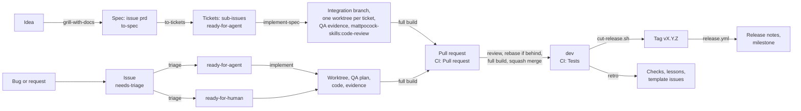

# How work flows

The path of a change in this project, from an idea to a released version, and who decides what along the way. Each step links to the document that owns its details; this page only puts them in order.



## Who decides what

| Step | Done by | The human decision |
|------|---------|--------------------|
| [1. Issue](#1-from-an-idea-to-an-issue) | A person, often with an agent's help | What to build: the acceptance criteria |
| [2. Triage](#2-triage) | Maintainer | Who builds it, and what kind of change it is |
| [3a. Spec](#3a-building-a-spec) | An agent orchestrating subagents | None; a ticket stops only on a gap in the spec |
| [3b. Single issue](#3b-working-a-single-issue) | An agent (or a developer) | None; an agent stops only on a gap in the issue |
| [4. Pull request](#4-pull-request-and-review) | Agent opens, maintainer reviews | Accept the change |
| [5. Release](#5-release) | Maintainer | When to release |
| [6. Retro](#6-lessons-and-retro) | The person who drove the build, with the agent | Which finding becomes a check, a lesson or a template issue |
| [7. Template update](#7-keeping-up-with-the-template) | Maintainer | Accept the template's changes |

## 1. From an idea to an issue

- Every change starts as a GitHub issue. A feature starts as a spec: `/grill-with-docs` sharpens the idea, `/to-spec` publishes it as an issue labelled `prd`, `/to-tickets` splits it into tickets (sub-issues with blocking edges, labelled `ready-for-agent`). A bug or a request from outside starts as a plain issue and goes through triage.
- The acceptance criteria are what QA checks later; an issue without them is not ready.
- Domain terms settled along the way go to `GLOSSARY.md`, decisions that are hard to reverse to `docs/adr/`.
- Details: [issue tracker](agents/issue-tracker.md), [domain docs](agents/domain.md).

## 2. Triage

- A new issue starts as `needs-triage`. Triage gives it one role label (`ready-for-agent`, `ready-for-human`, `needs-info`, `wontfix`) and one type label (`enhancement`, `bug`, `internal`); the type decides where the change appears in the release notes.
- `ready-for-agent` means fully specified: an agent takes it through to a pull request without asking. Tickets from `/to-tickets` are already agent-ready and are not triaged.
- Details: [triage labels](agents/triage-labels.md).

## 3a. Building a spec

- The user runs `/implement-spec #<spec>`. The agent creates the integration branch `spec-<n>-<slug>` in its own worktree, reads the tickets as a task graph, and works the unblocked ones in parallel with implementer subagents, each in its own worktree and branch (`issue-<n>-<slug>`) based on the integration branch.
- Each implementer plans QA from its ticket's acceptance criteria before any code, builds test-first, runs the app per worktree with `scripts/local-dev.sh`, verifies in a real browser and publishes its evidence to `qa-artifacts`; its commits name the ticket (`Closes #<ticket>`).
- Finished tickets are merged into the integration branch (fast-forward), which unblocks the next ones. A draft pull request to `dev` opens after the first merge; after the last one the agent runs `mattpocock-skills:code-review` over the whole branch, fixes what it raises, and marks the pull request ready.
- A gap in a ticket that changes what gets built: a question on the ticket, the label `needs-info`, that ticket stops; the others go on.
- Details: [issue tracker, *Working a spec*](agents/issue-tracker.md#working-a-spec), [implementer](agents/implementer.md), [testing](agents/testing.md), [QA evidence](agents/qa-evidence.md).

## 3b. Working a single issue

- The user runs `/implement #<n>`. The issue gets its own git worktree and branch (`issue-<n>-<slug>`), so several agents work in parallel.
- The QA plan comes from the acceptance criteria before any code; each test goes at the lowest level that proves the behaviour.
- The app runs per worktree with `scripts/local-dev.sh`, and changes are verified in a real browser. Evidence (screenshots, exported files, command output) goes to the `qa-artifacts` branch.
- The full build, `scripts/check.sh`, passes before the branch is pushed.
- A gap in the issue that changes what gets built: a question on the issue, the label `needs-info`, and the work stops there.
- Details: [issue tracker, *Working a single issue*](agents/issue-tracker.md#working-a-single-issue), [testing](agents/testing.md), [QA evidence](agents/qa-evidence.md).

## 4. Pull request and review

- The title states the intended outcome. The body follows the pull request template: `Closes #<n>` (a spec pull request lists the spec and every ticket), *Summary* with the smallest visual that makes the change clear, *Deviations from the issue*, *QA* with the evidence (one subsection per ticket in a spec pull request), *Merge Danger* (one-way or two-way door, blast radius), and *Przed wdrożeniem* / *Po wdrożeniu* when the change needs work outside the code to go live.
- Before the push, the agent runs the full build, `scripts/check.sh`: every check, the browser journeys included, the same script CI runs. Push only when it passes; `## QA` ends with its lines on the head commit.
- On the pull request CI runs only `Pull request` (the check of the description and the commits); a red one is not merged.
- Before the merge, a branch behind `dev` is rebased onto it, built again and pushed.
- CI runs `Tests` (the full build) after every merge to `dev`, one run per merge, unless the merge changed only documentation. A red `Tests` run on `dev` blocks further merges until its fix is merged; the run names the commit that broke the build. Details: [testing, *Merging*](agents/testing.md#merging).
- Review is the human's point of control: the evidence is in the pull request, so review reads it rather than repeating the checks. A spec pull request is read ticket by ticket through its QA subsections, then as a whole through Summary and Merge Danger.
- Merge is *Squash and merge* with the default commit message: that is what closes the issues ([`AGENTS.md`, *Issue tracker*](../AGENTS.md#issue-tracker)), and CI fails a pull request with a commit lacking the `Closes #<n>` line. The worktrees are then removed.
- Details: [issue tracker](agents/issue-tracker.md), [QA evidence](agents/qa-evidence.md).

## 5. Release

- `scripts/cut-release.sh X.Y.Z` on a clean, up-to-date `dev` writes `VERSION`, commits, tags `vX.Y.Z` and pushes.
- The tag starts `.github/workflows/release.yml`: release notes in Polish grouped by the issues' type labels, a *Wdrożenie* part gathered from the pull requests, the milestone `vX.Y.Z`, and a "Wydane w" comment on each issue.
- Deploying a version is the project's own procedure, in `docs/deployment.md` once the project has one.
- Details: [releasing](releasing.md).

## 6. Lessons and retro

- After a spec pull request (or any larger one) is merged, the person who drove the build runs `/retro` in the same session, before clearing its context (after clearing, the skill is pointed at that session's log). It looks at the agent's environment, not the code: navigation, automated checks, coding standards, steering files, tool cost, information access.
- Each finding becomes one thing: a deterministic check (a linter rule, a hook, a CI job) for a mechanical mistake; an entry in `docs/agents/lessons.md` for a judgement call; an issue in the team's project template when it applies to every project.
- Something non-obvious learned along the way, which should change how the next piece of work is done, goes to `docs/agents/lessons.md` the same way. Issue comments carry decisions, blockers and questions, not progress.
- Details: [lessons](agents/lessons.md).

## 7. Keeping up with the template

This page, the agent docs, the scripts and the workflows come from the team's project template; `.copier-answers.yml` records which version. A newer version of the template arrives as a pull request like any other change. With the department's plugin, asking an agent to "update the project to the newest template" does all of the following (skill `update-from-template`); by hand:

```bash
git switch dev && git pull
git switch -c template-update
uv tool run copier update --skip-answered      # the newest template version; needs a clean working tree
git add -A && git commit -m "Bring in the newest project template"
gh pr create --fill
```

- On the Python stack, refresh the lock file after the update (`uv lock && uv sync --locked`): `uv.lock` belongs to the project, so the update does not touch it.
- An update creates no GitHub labels: after it, run `scripts/setup-github.sh --labels-only`, which creates only the labels the repository lacks and touches nothing else.

- A conflict is left in the files; resolve it like any merge conflict before committing.
- The template repository is private: an update needs git access to GitHub where it runs. An agent in a sandbox gets that access from the host (for Docker Sandboxes, `sbx secret set github --sandbox <name>`); without it, the update stops at its first step.
- hq records the template's address as an alias each machine maps once: `docs/hq/agents.md`, *Updating from the template*.
- Files the project owns (`VERSION`, `README.md`, `GLOSSARY.md`, `CODING_STANDARDS.md`, `docs/agents/lessons.md`, `scripts/check.sh` on the other stack, `scripts/local-dev.project.sh`) are never touched by an update.
- A change to the process tooling itself (`scripts/`, `docs/agents/`, `.github/`) is proposed in the template, not made here, or the next update conflicts with it.
