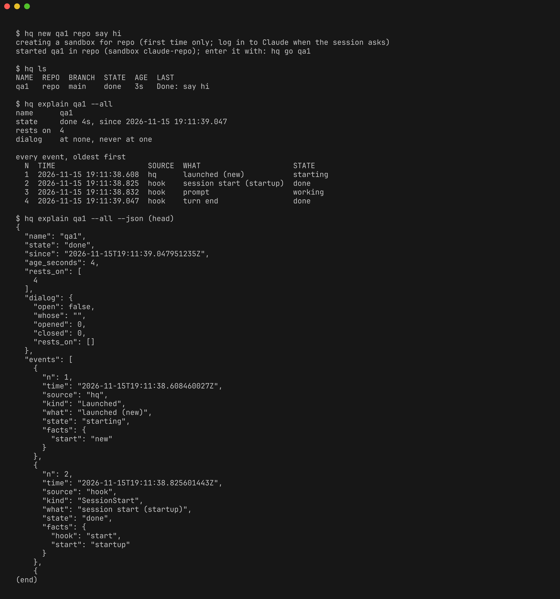
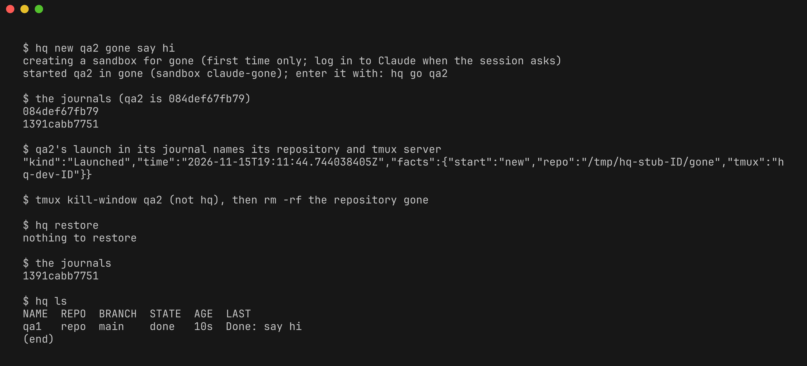
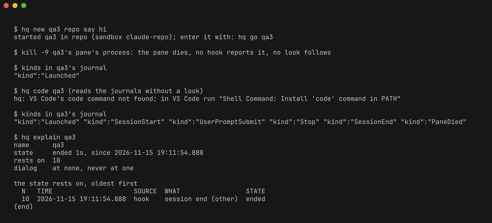

### #165 Review fixes

| # | Finding | Check | Expected | Result | Evidence |
|---|---------|-------|----------|--------|----------|
| 1 | S1 | spec §4.1 and the README no longer say what an agent of an older hq keeps | the generation rule only | ✅ pass: the `hq answer` and `hq mcp` sentences of the spec and the README's supervisor sentence are gone; `hq mcp` says an outdated agent is refused as the command refuses it | commit dae1685 |
| 2 | S2 | a journal left by an agent whose repository was removed without hq | removed once no window on its tmux server and no record stand for it | ✅ pass: qa2's window killed by tmux, its repository removed, `hq restore` says nothing to restore and its journal is gone; qa1's stays | [screenshot](#2-a-leftover-journal-goes), [txt](https://github.com/rkrysinski/hq/blob/3780a744840ddea7bdf9fe77bdbf65fa8acd2bc3/issue-165/2-leftover-journal.txt), `TestTheJournalsLeftOverGoOnceNothingStandsForTheirAgent`, `TestTheHomeIsWhereTheLatestLaunchThatStandsWas`, store contract `the ids are those of the agents with a journal` |
| 3 | S3 | a message put back after hq failed to type it | keeps its name less `.now`: delivered with the next prompt | ✅ pass | `TestAMessagePutBackLosesItsNowUnlessAskedAgain` (unit), `TestAMessageKeepsItsNameWhenHeldOrPutBack` (integration) |
| 4 | S4 | `hq restore`'s reasons name `its journal is gone` | in spec and design | ✅ pass: the design named it; spec §4.1 now does | commit dae1685 |
| 5 | S5 | an `ended` shown by `hq go`, `hq code`, the dock, the kill or `hq sandbox restart` | rests on an appended pane death, first append wins | ✅ pass: `hq code qa3` on a dead pane appended `PaneDied` with no look between (the fake's own `SessionEnd` came too, so its state rests on that) | [screenshot](#3-hq-code-appends-a-dead-panes-death), [txt](https://github.com/rkrysinski/hq/blob/3780a744840ddea7bdf9fe77bdbf65fa8acd2bc3/issue-165/3-pane-death-appended.txt), `TestFromJournalsAppendsOnlyAPanesDeathAndCapturesNoScreen` |
| 6 | S6 | `hq update` across generations with an agent recorded on another tmux server | refused, naming `x (on tmux server qa)` | ✅ pass | `TestUpdateAcrossGenerationsIsRefusedForAnAgentOfAnotherTmuxServer` |
| 7 | S7 | the generation's pin covers `state.ParseEvent` | a change of the facts taken fails the pin | ✅ pass: form `the events taken` (probes of every hook event); fingerprints renewed, generation stays 4 | `TestTheGenerationFollowsTheForms`, `TestTheProbesShowEveryFactTheHostTakes` |
| 8 | G1-G3, D1-D9 | names and smells fixed; `hq explain --json` shows the renamed facts | `hook` in place of `at`, no repository or tmux server shown | ✅ pass | [screenshot](#1-explain-after-the-renames), [txt](https://github.com/rkrysinski/hq/blob/3780a744840ddea7bdf9fe77bdbf65fa8acd2bc3/issue-165/1-explain-facts.txt) |
| 9 | - | full build and spec-wide mutation tests | pass, no mutant alive without a test or a reason | ✅ pass: one equivalent mutant, its reason below | below |

Pyramid before: `unit 764, integration 264, e2e 3 (unit share 74%, minimum 50%)`. After: `unit 772, integration 264, e2e 3 (unit share 75%, minimum 74%)` (74.5% exactly, under 0.75, so the minimum stays 0.74). Coverage after: 95.28% (minimum 94.7%, was 94.4%).
Tests added: unit `TestAMessagePutBackLosesItsNowUnlessAskedAgain`, `TestUpdateAcrossGenerationsIsRefusedForAnAgentOfAnotherTmuxServer`, `TestTheJournalsLeftOverGoOnceNothingStandsForTheirAgent`, `TestTheHomeIsWhereTheLatestLaunchThatStandsWas`, `TestSetAsideReadsTheEventsBeforeInTheSameAppend`, `TestTheProbesShowEveryFactTheHostTakes`, `TestAnEventFileIsNamedForTheHooksCount`, `TestTheLookAppendsAWakeUpBesideOtherEvidenceOfTheScreen`, the store contract's ids case (run on the fake as unit, on the files as integration); changed: `TestFromJournalsAppendsOnlyAPanesDeathAndCapturesNoScreen` (unit), `TestAMessageKeepsItsNameWhenHeldOrPutBack` (integration); the 30 fixture journals rebuilt for `hook`. End-to-end: none.

#### 1. explain after the renames


#### 2. A leftover journal goes


#### 3. hq code appends a dead pane's death


#### Outputs

QA runs on the fake Claude (`scripts/local-dev.sh --stub native`); paths of the stub environment replaced by `ID`.

```text

$ hq new qa1 repo say hi
creating a sandbox for repo (first time only; log in to Claude when the session asks)
started qa1 in repo (sandbox claude-repo); enter it with: hq go qa1

$ hq ls
NAME  REPO  BRANCH  STATE  AGE  LAST
qa1   repo  main    done   3s   Done: say hi

$ hq explain qa1 --all
name      qa1
state     done 4s, since 2026-11-15 19:11:39.047
rests on  4
dialog    at none, never at one

every event, oldest first
  N  TIME                     SOURCE  WHAT                     STATE
  1  2026-11-15 19:11:38.608  hq      launched (new)           starting
  2  2026-11-15 19:11:38.825  hook    session start (startup)  done
  3  2026-11-15 19:11:38.832  hook    prompt                   working
  4  2026-11-15 19:11:39.047  hook    turn end                 done

$ hq explain qa1 --all --json (head)
{
  "name": "qa1",
  "state": "done",
  "since": "2026-11-15T19:11:39.047951235Z",
  "age_seconds": 4,
  "rests_on": [
    4
  ],
  "dialog": {
    "open": false,
    "whose": "",
    "opened": 0,
    "closed": 0,
    "rests_on": []
  },
  "events": [
    {
      "n": 1,
      "time": "2026-11-15T19:11:38.608460027Z",
      "source": "hq",
      "kind": "Launched",
      "what": "launched (new)",
      "state": "starting",
      "facts": {
        "start": "new"
      }
    },
    {
      "n": 2,
      "time": "2026-11-15T19:11:38.825601443Z",
      "source": "hook",
      "kind": "SessionStart",
      "what": "session start (startup)",
      "state": "done",
      "facts": {
        "hook": "start",
        "start": "startup"
      }
    },
    {

$ hq new qa2 gone say hi
creating a sandbox for gone (first time only; log in to Claude when the session asks)
started qa2 in gone (sandbox claude-gone); enter it with: hq go qa2

$ the journals (qa2 is 084def67fb79)
084def67fb79
1391cabb7751

$ qa2's launch in its journal names its repository and tmux server
"kind":"Launched","time":"2026-11-15T19:11:44.744038405Z","facts":{"start":"new","repo":"/tmp/hq-stub-ID/gone","tmux":"hq-dev-ID"}}

$ tmux kill-window qa2 (not hq), then rm -rf the repository gone

$ hq restore
nothing to restore

$ the journals
1391cabb7751

$ hq ls
NAME  REPO  BRANCH  STATE  AGE  LAST
qa1   repo  main    done   10s  Done: say hi

$ hq new qa3 repo say hi
started qa3 in repo (sandbox claude-repo); enter it with: hq go qa3

$ kill -9 qa3's pane's process: the pane dies, no hook reports it, no look follows

$ kinds in qa3's journal
"kind":"Launched" 

$ hq code qa3 (reads the journals without a look)
hq: VS Code's code command not found; in VS Code run "Shell Command: Install 'code' command in PATH"

$ kinds in qa3's journal
"kind":"Launched" "kind":"SessionStart" "kind":"UserPromptSubmit" "kind":"Stop" "kind":"SessionEnd" "kind":"PaneDied" 

$ hq explain qa3
name      qa3
state     ended 1s, since 2026-11-15 19:11:54.888
rests on  10
dialog    at none, never at one

the state rests on, oldest first
  N   TIME                     SOURCE  WHAT                 STATE
  10  2026-11-15 19:11:54.888  hook    session end (other)  ended
```

Mutation tests, spec-wide: `go run ./tools/testgate mutation origin/release-v0.14.0`

```text
alive      internal/agent/agent.go:72:9 conditionals boundary
mutation: 529 killed, 1 alive, 0 timed out, 247 not covered against origin/release-v0.14.0 on 3e8066c7983ca6d0094b65f6242fa68c26a5ffda
```

- `agent.go:72:9`: equivalent: `StartedBy` is reached only for an agent of another generation than this hq's (`FromWindows`, `OutdatedErr` behind `Outdated`, `hq restore` and `hq explain` behind `Generation != version.Generation`), so `gen > version.Generation` and `>=` never differ.

The spec-wide run on 912453a also left `internal/agent/look.go:228:15 conditionals negation` alive (a wake-up dropped after any screen event but the prompt Claude took), killed by `TestTheLookAppendsAWakeUpBesideOtherEvidenceOfTheScreen`. The run against the integration branch before it left `internal/state/event.go:234:85 conditionals boundary`, killed by `TestAnEventFileIsNamedForTheHooksCount`.

Full build:

```text
check: ok   vet
check: ok   format
check: ok   pyramid
check: ok   platform
check: ok   unit
check: ok   integration
check: ok   coverage
check: ok   e2e
check: all 8 steps passed on 3e8066c7983ca6d0094b65f6242fa68c26a5ffda
```

#### Round 2: the last completed turn (integration review of #210)

| # | Finding | Check | Expected | Result | Evidence |
|---|---------|-------|----------|--------|----------|
| 10 | block: `TurnEnded` moves for a turn the user ended | a screen `TurnEnded` (`Interrupted`, then `User declined to answer questions`) and a `Rewound` after a turn the hook reported as done | `TurnEnded` stays at the hook's `Stop` | ✅ pass | `TestATurnTheUserEndedIsNoCompletedTurnButOneClaudeOwedThatDidNotComeIs` (was `TestATurnEndTheScreenShowedEndsTheLastCompletedTurn`), `TestADecisionThatTakesTimeIsAnEventAndTheTimePassedInDecidesNone` (`TurnEnded` 0 after the `Rewound`), commit cd8535f |
| 11 | - | a `TurnNotTaken` after a `Stop` the hook kept working for background work | stays a completed turn: `TurnEnded` is the `TurnNotTaken`'s number, as before (now pinned by a test) | ✅ pass | same test, second journal; the field's comment and `docs/design/hq.md` say it |
| 12 | - | nothing hq shows changes | states, ages and the 30 fixture journals as they were | ✅ pass | fixture journals untouched; `TestTheReducerGivesEveryFixtureJournalAsTheOldLookDid` and `TestTheFixtureJournalsAreWhatTheHookAndTheIngestMakeOfTheirPayloads` pass in the full build |
| 13 | - | full build and spec-wide mutation tests | pass, no mutant alive without a test or a reason | ✅ pass: the known equivalent at `agent.go:72:9` only | below |

No QA through hq: no output reads `TurnEnded`. Pyramid unchanged: `unit 772, integration 264, e2e 3 (unit share 75%, minimum 74%)` (one test renamed and widened, none added). Thresholds, generation and fingerprint untouched.

Mutation tests, spec-wide: `go run ./tools/testgate mutation origin/release-v0.14.0`

```text
alive      internal/agent/agent.go:72:9 conditionals boundary
mutation: 530 killed, 1 alive, 0 timed out, 247 not covered against origin/release-v0.14.0 on cd8535fd1c265ff4df85e3e53c7ee3fbed90e2a2
```

- `agent.go:72:9`: equivalent, reason as above.

Full build:

```text
check: ok   vet
check: ok   format
check: ok   pyramid
check: ok   platform
check: ok   unit
check: ok   integration
check: ok   coverage
check: ok   e2e
check: all 8 steps passed on cd8535fd1c265ff4df85e3e53c7ee3fbed90e2a2
```

#### Deviations

- **Thresholds raised** (hq's rule, `docs/hq/testing.md`): `MinUnitShare` 0.50 to 0.74 (measured 770 of 1034 at a590bc2, 74%), `MinCoverage` 94.4 to 94.7 (measured 95.28%, less 0.5 rounded down).
- **Generation fingerprint renewed, generation stays 4** (raised by #199 in this pull request, unreleased): the journal's form changed (`Facts.At` split into `hook`, `whose`, `withdrawn`; `repo` and `tmux` on a launch) and the form `the events taken` was added; no released hq has generation 4, so no agent reports in the old form.
- **S3**: the put-back message keeps its first name less `.now`, the only way to restore the delivery with the next prompt without a hook change (the hook delivers after a tool call whenever a `*.now` file waits); the withdrawn delivery event still names the whole first name.
- **S5**: the `ending` window option stays as tmux's word only where the journal cannot be read (`Agent.unread`): a `TakenDown` event is appended beside it and decides whenever the journal reads. A lost agent (no window) gets no pane death: it has no pane, its journal alone gives its state.
- **S2**: a journal is removed only by an hq on the tmux server its launch names, at `hq restore` and at every kill (`sweepJournals`); a journal of another server, or with no launch naming its repository, stays.
- **D6**: `Source`, `Kind` and `Aside` stay `string` with named constants: `Kind` holds the `hook_event_name` Claude sends, an open set kept as read (an unknown one is still the hook's latest report), and named types would add conversions at every parse and test boundary without a check the constants do not give.
- **D7**: the owe list stays the hook's lines with their marks, as `ID.owe` holds them, so the Go mirror of `hookAwk` reads line for line; the marks are now exported (`state.SubagentMark`, `state.MonitorMark`) and `hq explain` uses them.
- **D10**: the reducer keeps its own copy of the hook's awk state machine: ADR 0018 decides that the host reads none of the hook's working files and the hook keeps deciding its notifications in the sandbox; the fixture journals, rebuilt by running the real hook, are what keeps the two in step.
- **G1**: the older `collect`/`collectWith` of `hq ls` were renamed too (`lookNow`, `lookWith`), and `SettleDelay` became `OverruleDelay`; `agent.Collect` became `agent.FromJournals`.
- **Round 2**: `TurnNotTaken` stays a completed turn (the orchestrator's decision): the turn it closes ended as work and the hook reported its end; it keeps giving the `TurnNotTaken`'s own number.
- No issue created.
