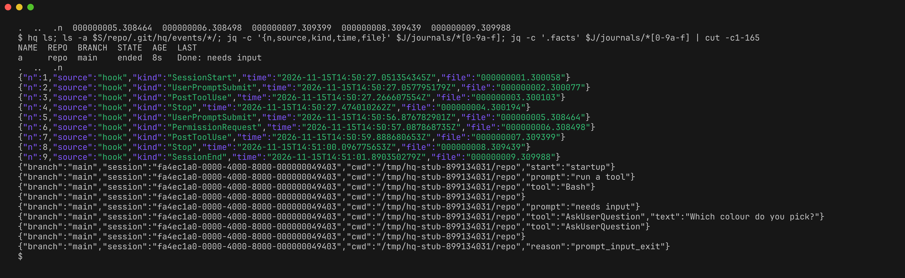
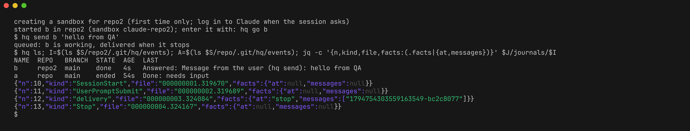
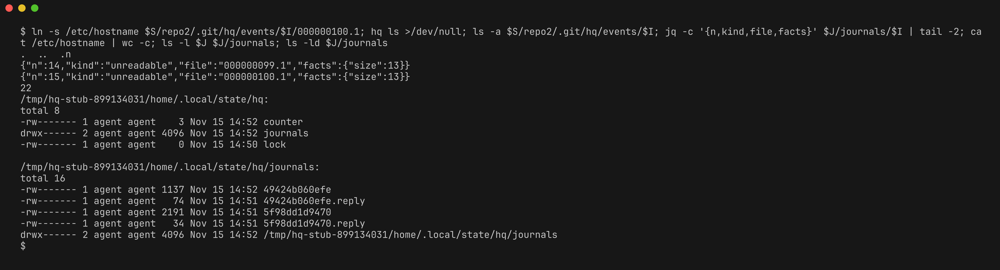
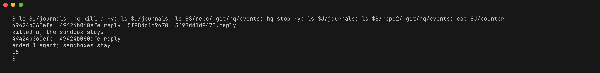

### #193 The hook reports events and hq collects them into numbered journals

| # | Check | Expected | Result | Evidence |
|---|-------|----------|--------|----------|
| 1 | Fake Claude through a session (prompt, tool, question dialog with Claude's late Notification, turn end, `/exit`), then `hq ls` | One event per report a rule reads, in the hook's order, each with number, source `hook`, kind, host time of its file, facts; no event files left; the Notification over an open dialog leaves none | ✅ pass | [1-session-journal.txt](https://github.com/rkrysinski/hq/blob/5a1364f14ce42795bcd2568627cb7deae497be06/issue-193/1-session-journal.txt), screenshot below; `TestTheJournalHoldsTheSessionInTheOrderTheHookReportedIt` |
| 2 | `hq ls`, the dashboard, every existing test and journey behave as before | The old files are still written and decide the state | ✅ pass | full build below (every existing test and journey unchanged in what it asserts); `hq ls` in 1 and 2 |
| 3 | Two agents in two repositories; another process; a lost server | One counter: no number twice, each journal rising, counter goes on | ✅ pass | [2-delivery-and-two-agents.txt](https://github.com/rkrysinski/hq/blob/5a1364f14ce42795bcd2568627cb7deae497be06/issue-193/2-delivery-and-two-agents.txt) (b numbered 10-15 after a's 1-9), [4-kill-and-stop.txt](https://github.com/rkrysinski/hq/blob/5a1364f14ce42795bcd2568627cb7deae497be06/issue-193/4-kill-and-stop.txt) (counter 15 after both are gone); `TestTwoAgentsInTwoRepositoriesNeverShareANumber`, `TestTheCounterGoesOnInAnotherProcess`, contract `one counter for every agent` |
| 4 | Eight hq processes ingesting at once; a process SIGKILLed between append and remove; a file visible after one with a later name; an append cut off; a file that cannot be removed | Each file appended exactly once; no second copy; the late file still appended | ✅ pass | `TestEightProcessesIngestEachFileOnce`, `TestAProcessKilledAfterItsAppendLeavesNoSecondCopy`, `TestAnAppendCutOffIsUndoneAndDoneAgain`, `TestAFileTheIngestCannotRemoveIsNeverAppendedTwice`, contract `a later file with an earlier name` |
| 5 | A reader under the lock while three appenders run | Every event numbered up to the N read is in the journal read | ✅ pass | `TestEveryEventUpToTheNumberReadIsInItsJournal` |
| 6 | Three turn ends, the last with a 5.8 MB reply | One reply kept, the latest, in full; no event holds a reply | ✅ pass | contract `the latest turn end keeps its reply` (store and fake); `ID.reply` in [3-unreadable-and-location.txt](https://github.com/rkrysinski/hq/blob/5a1364f14ce42795bcd2568627cb7deae497be06/issue-193/3-unreadable-and-location.txt) |
| 7 | A stop the hook blocks, a delivery with the next prompt, one after a tool's end | An event naming every message by its inbox name, before the event of what the agent does next | ✅ pass | `TestHookDeliveriesAreEventsNamingEachMessage` (a held message is named by none); [2-delivery-and-two-agents.txt](https://github.com/rkrysinski/hq/blob/5a1364f14ce42795bcd2568627cb7deae497be06/issue-193/2-delivery-and-two-agents.txt): `delivery` at `stop` naming `1794754303559163549-bc2c8077`, the name it had in b's inbox, then `Stop` |
| 8 | A turn of 200 tool calls | A handful of event files | ✅ pass | `TestHookLeavesAnEventFileForEveryReportARuleReads`: 200 tool ends leave one |
| 9 | A link, a pipe, a 16 MiB + 1 file, garbage, a directory and the hook's half-written dot file among the event files | Only regular files, no link followed, cap 16 MiB; one hq cannot read recorded with its size | ✅ pass | `TestEventFilesAreReadAsStateFilesAre`; [3-unreadable-and-location.txt](https://github.com/rkrysinski/hq/blob/5a1364f14ce42795bcd2568627cb7deae497be06/issue-193/3-unreadable-and-location.txt): a planted link to `/etc/hostname` is `unreadable` of 13 bytes (the link's, not the file's 22) |
| 10 | `hq kill a`, `hq stop` | Journal and event files gone with the agent | ✅ pass | [4-kill-and-stop.txt](https://github.com/rkrysinski/hq/blob/5a1364f14ce42795bcd2568627cb7deae497be06/issue-193/4-kill-and-stop.txt); `TestKillAndStopRemoveTheJournal`, `TestTheJournalHoldsTheSessionInTheOrderTheHookReportedIt` (its kill) |
| 11 | Where the journal lies; tests and `scripts/local-dev.sh` | `$XDG_STATE_HOME/hq`, directories 0700, files 0600; each test and local-dev run a state directory of its own | ✅ pass | [3-unreadable-and-location.txt](https://github.com/rkrysinski/hq/blob/5a1364f14ce42795bcd2568627cb7deae497be06/issue-193/3-unreadable-and-location.txt); `TestTheJournalIsTheUsersAlone`, `TestStubGivesHqJournalsOfItsOwn` |
| 12 | The journal's store is a seam | Interface with an in-memory fake; contract tests on both | ✅ pass | `journaltest.Contract` run by `TestFilesKeepTheContract` (integration) and `TestMemoryKeepsTheContract` (unit) |
| 13 | The hook's script within the budget its unit test holds | ≤ 10 KiB | ✅ pass | 10,229 of 10,240 bytes (`TestSettingsCarryIdentityAndOneHookPerEvent`) |
| 14 | ADR 0018; design | ADR written; design describes the two streams, the lock, the counter | ✅ pass | `docs/adr/0018-agent-state-is-a-pure-function-of-one-event-journal.md`; design 3.4 (*Events and journals*, diagram, *Location*, *Lifetime*), 3.12, 7.1, 7.2, 7.3, version changes |
| 15 | `GLOSSARY.md` *Event* and *Journal* | What is built matches | ✅ pass | No entry corrected: both describe what is built (setting aside comes with the later tickets) |
| 16 | `scripts/check.sh` | Passes | ✅ pass | full build below |

1 - the session's journal: 

2 - a delivery, numbers after another agent's: 

3 - an event file hq cannot read, the journal's place: 

4 - kill and stop take the journal: 

Nothing of the dashboard changes, so no before screenshots: the evidence is what hq writes. QA ran on the fake Claude through `scripts/local-dev.sh --stub native`, never the real Claude Code.

Pyramid, `go run ./tools/testgate pyramid`: before (the integration branch at `2b7a391`) `unit 723, integration 240, e2e 3`; after `unit 732, integration 257, e2e 3`. Coverage after: 94.77% (minimum 94.4%).

Tests added: unit 9 (`internal/state/event_test.go` 4, `internal/journal/journal_test.go` 1, `internal/journal/journaltest/journaltest_test.go` 2, `internal/cli/journal_test.go` 2); integration 17 (`internal/journal/files_integration_test.go` 10, `internal/state/event_integration_test.go` 4, `internal/cli/journal_integration_test.go` 2, `scripts/localdev_integration_test.go` 1); end-to-end none.

Mutation tests, `go run ./tools/testgate mutation spec-165-agent-state-journal`:

```text
alive      internal/journal/journaltest/contract.go:88:75 conditionals boundary
alive      internal/journal/journaltest/contract.go:111:43 conditionals boundary
alive      internal/journal/journaltest/contract.go:111:70 conditionals boundary
mutation: 75 killed, 3 alive, 0 timed out, 122 not covered against spec-165-agent-state-journal on 9127c180a672a33bc9add3392f4e9e0767a4ad13
```

- `contract.go:88:75`: equivalent for any store that keeps the contract elsewhere: the two numbers are never equal, so `>` and `>=` agree (the line checks the store, it is not code under test).
- `contract.go:111:43`: equivalent: no event is numbered 0, so `> 0` and `>= 0` agree.
- `contract.go:111:70`: equivalent: numbers in one journal are never equal, so `<=` and `<` agree.

#### Outputs

`1-session-journal.txt`

```text
.  ..  .n  000000005.308464  000000006.308498  000000007.309399	 000000008.309439  000000009.309988
$ hq ls; ls -a $S/repo/.git/hq/events/*/; jq -c '{n,source,kind,time,file}' $J/journals/*[0-9a-f]; jq -c '.facts' $J/journals/*[0-9a-f] | cut -c1-165
NAME  REPO  BRANCH  STATE  AGE  LAST
a     repo  main    ended  8s   Done: needs input
.  ..  .n
{"n":1,"source":"hook","kind":"SessionStart","time":"2026-11-15T14:50:27.051354345Z","file":"000000001.300058"}
{"n":2,"source":"hook","kind":"UserPromptSubmit","time":"2026-11-15T14:50:27.057795179Z","file":"000000002.300077"}
{"n":3,"source":"hook","kind":"PostToolUse","time":"2026-11-15T14:50:27.266607554Z","file":"000000003.300103"}
{"n":4,"source":"hook","kind":"Stop","time":"2026-11-15T14:50:27.474010262Z","file":"000000004.300194"}
{"n":5,"source":"hook","kind":"UserPromptSubmit","time":"2026-11-15T14:50:56.876782901Z","file":"000000005.308464"}
{"n":6,"source":"hook","kind":"PermissionRequest","time":"2026-11-15T14:50:57.087868735Z","file":"000000006.308498"}
{"n":7,"source":"hook","kind":"PostToolUse","time":"2026-11-15T14:50:59.888680653Z","file":"000000007.309399"}
{"n":8,"source":"hook","kind":"Stop","time":"2026-11-15T14:51:00.096775653Z","file":"000000008.309439"}
{"n":9,"source":"hook","kind":"SessionEnd","time":"2026-11-15T14:51:01.890350279Z","file":"000000009.309988"}
{"branch":"main","session":"fa4ec1a0-0000-4000-8000-000000049403","cwd":"/tmp/hq-stub-899134031/repo","start":"startup"}
{"branch":"main","session":"fa4ec1a0-0000-4000-8000-000000049403","cwd":"/tmp/hq-stub-899134031/repo","prompt":"run a tool"}
{"branch":"main","session":"fa4ec1a0-0000-4000-8000-000000049403","cwd":"/tmp/hq-stub-899134031/repo","tool":"Bash"}
{"branch":"main","session":"fa4ec1a0-0000-4000-8000-000000049403","cwd":"/tmp/hq-stub-899134031/repo"}
{"branch":"main","session":"fa4ec1a0-0000-4000-8000-000000049403","cwd":"/tmp/hq-stub-899134031/repo","prompt":"needs input"}
{"branch":"main","session":"fa4ec1a0-0000-4000-8000-000000049403","cwd":"/tmp/hq-stub-899134031/repo","tool":"AskUserQuestion","text":"Which colour do you pick?"}
{"branch":"main","session":"fa4ec1a0-0000-4000-8000-000000049403","cwd":"/tmp/hq-stub-899134031/repo","tool":"AskUserQuestion"}
{"branch":"main","session":"fa4ec1a0-0000-4000-8000-000000049403","cwd":"/tmp/hq-stub-899134031/repo"}
{"branch":"main","session":"fa4ec1a0-0000-4000-8000-000000049403","cwd":"/tmp/hq-stub-899134031/repo","reason":"prompt_input_exit"}
$


```

`2-delivery-and-two-agents.txt`

```text
creating a sandbox for repo2 (first time only; log in to Claude when the session asks)
started b in repo2 (sandbox claude-repo2); enter it with: hq go b
$ hq send b 'hello from QA'
queued: b is working, delivered when it stops
$ hq ls; I=$(ls $S/repo2/.git/hq/events); A=$(ls $S/repo/.git/hq/events); jq -c '{n,kind,file,facts:(.facts|{at,messages})}' $J/journals/$I
NAME  REPO   BRANCH  STATE  AGE  LAST
b     repo2  main    done   4s   Answered: Message from the user (hq send): hello from QA
a     repo   main    ended  54s  Done: needs input
{"n":10,"kind":"SessionStart","file":"000000001.319670","facts":{"at":null,"messages":null}}
{"n":11,"kind":"UserPromptSubmit","file":"000000002.319689","facts":{"at":null,"messages":null}}
{"n":12,"kind":"delivery","file":"000000003.324084","facts":{"at":"stop","messages":["1794754303559163549-bc2c8077"]}}
{"n":13,"kind":"Stop","file":"000000004.324167","facts":{"at":null,"messages":null}}
$
(the inbox of b held 1794754303559163549-bc2c8077 before the turn ended)
```

`3-unreadable-and-location.txt`

```text
$ ln -s /etc/hostname $S/repo2/.git/hq/events/$I/000000100.1; hq ls >/dev/null; ls -a $S/repo2/.git/hq/events/$I; jq -c '{n,kind,file,facts}' $J/journals/$I | tail -2; ca
t /etc/hostname | wc -c; ls -l $J $J/journals; ls -ld $J/journals
.  ..  .n
{"n":14,"kind":"unreadable","file":"000000099.1","facts":{"size":13}}
{"n":15,"kind":"unreadable","file":"000000100.1","facts":{"size":13}}
22
/tmp/hq-stub-899134031/home/.local/state/hq:
total 8
-rw------- 1 agent agent    3 Nov 15 14:52 counter
drwx------ 2 agent agent 4096 Nov 15 14:52 journals
-rw------- 1 agent agent    0 Nov 15 14:50 lock
/tmp/hq-stub-899134031/home/.local/state/hq/journals:
total 16
-rw------- 1 agent agent 1137 Nov 15 14:52 49424b060efe
-rw------- 1 agent agent   74 Nov 15 14:51 49424b060efe.reply
-rw------- 1 agent agent 2191 Nov 15 14:51 5f98dd1d9470
-rw------- 1 agent agent   34 Nov 15 14:51 5f98dd1d9470.reply
drwx------ 2 agent agent 4096 Nov 15 14:52 /tmp/hq-stub-899134031/home/.local/state/hq/journals
$
```

`4-kill-and-stop.txt`

```text
$ ls $J/journals; hq kill a -y; ls $J/journals; ls $S/repo/.git/hq/events; hq stop -y; ls $J/journals; ls $S/repo2/.git/hq/events; cat $J/counter
49424b060efe  49424b060efe.reply  5f98dd1d9470	5f98dd1d9470.reply
killed a; the sandbox stays
49424b060efe  49424b060efe.reply
ended 1 agent; sandboxes stay
15
$
```

`scripts/check.sh` on `9127c180a672a33bc9add3392f4e9e0767a4ad13`

```text
check: ok   vet
check: ok   format
check: ok   pyramid
check: ok   platform
check: ok   unit
check: ok   integration
check: ok   coverage
check: ok   e2e
check: all 8 steps passed on 9127c180a672a33bc9add3392f4e9e0767a4ad13
```

#### Deviations

- Seam: the journal's store (`journal.Store`: ingest, append, read, and remove for a kill) stands beside the state-file reader in the command's dependencies, which still decides every state; the event types and the parsing of an event file are in `internal/state` (the hook's side), the store in `internal/journal`, its fake and contract in `internal/journal/journaltest`. Looks ingest through `deps.readAgent`, also the lookups of `hq go`, `hq code` and the dialogs.
- Two existing tests turned red from timing alone, and are unchanged: `TestTheStopHookWritesStopBeforeItPublishesTheStateFile` (the state file must be the last rename of a stop) and `TestAnswerAfterTheTerminalAnsweredIsRefused` (the hook of kind hold missed a dialog answered within its 0.2 s look once the dialog's report came later). So a turn end's event is written with `.stop` before the state file, every other just after it, and the hold stops waiting once the state file is newer than its own copy and not the dialog's report (new test `TestTheHoldEndsWhenItsDialogWasAnsweredBeforeItSawIt`).
- Facts beyond the spec's list for a turn end: a prompt as sent (not a wake-up's) and what a dialog or Notification says, which the screen rules and the row read, never to be shown by `hq explain`; the reply kept beside the journal also keeps the texts of the turn end's tasks, for the own tasks.
- `hq mcp install` passes `XDG_STATE_HOME` on as it does `XDG_CONFIG_HOME`, so a supervisor's hq shares the journals and the counter; `TestMCPInstallRegistersHqWithSbx` gained that variable.
- An event file the ingest cannot remove keeps the record of its ingest, so that agent's ingest fails, silently, until it can be removed: never a second copy.
- The fingerprint test of the generation (#200) now covers the journal's form (`state.Event` and `state.Reply`), and the hook's script is pinned anew; the generation stays 3, as #199 raises it in this pull request.
- No step outside the code goes live with this ticket: none for `## Before deployment` or `## After deployment`.
