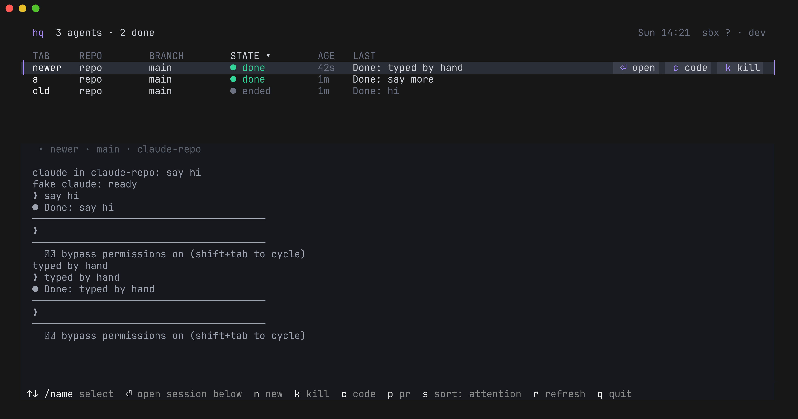
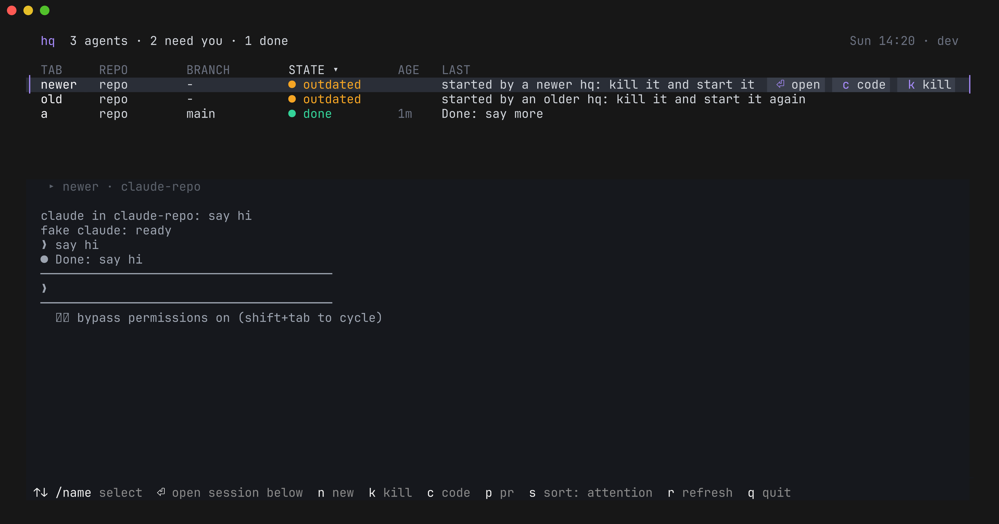
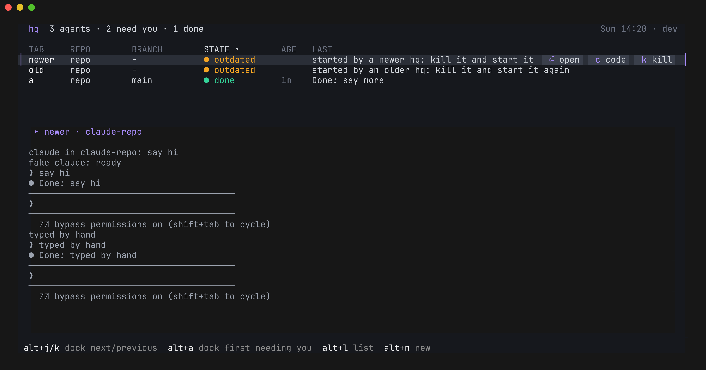
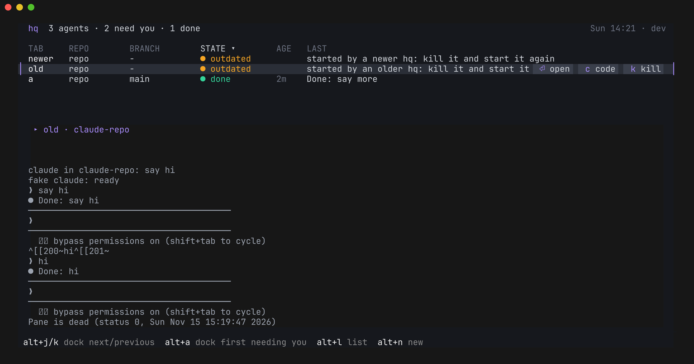
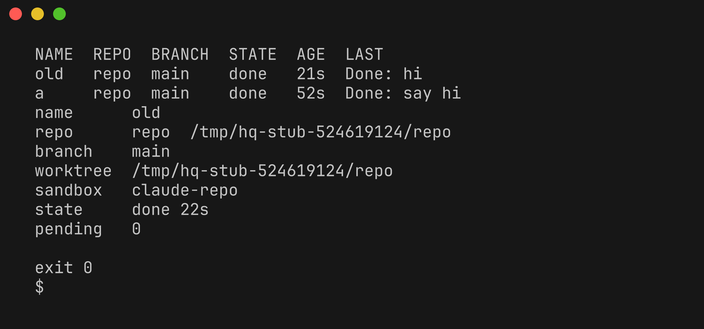
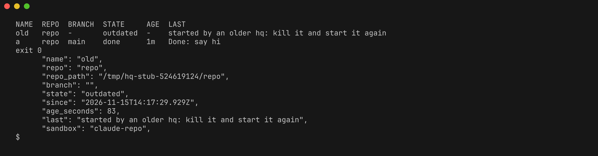
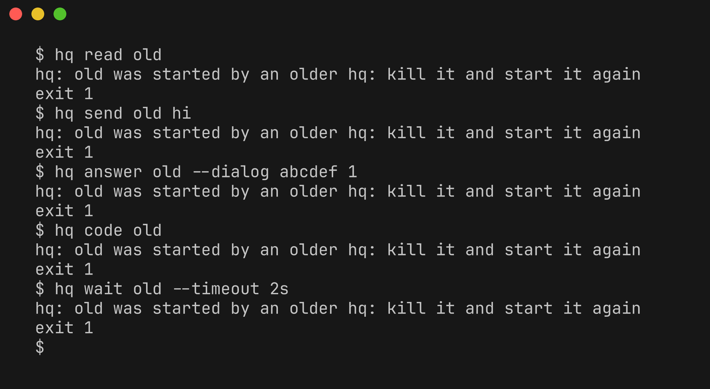
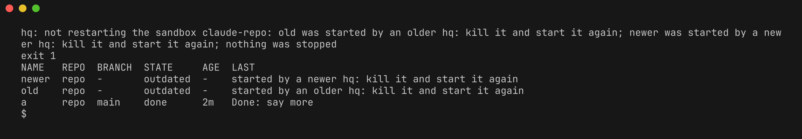
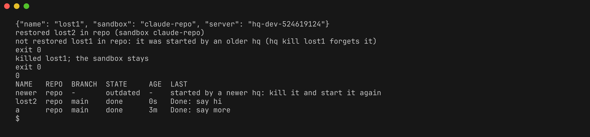
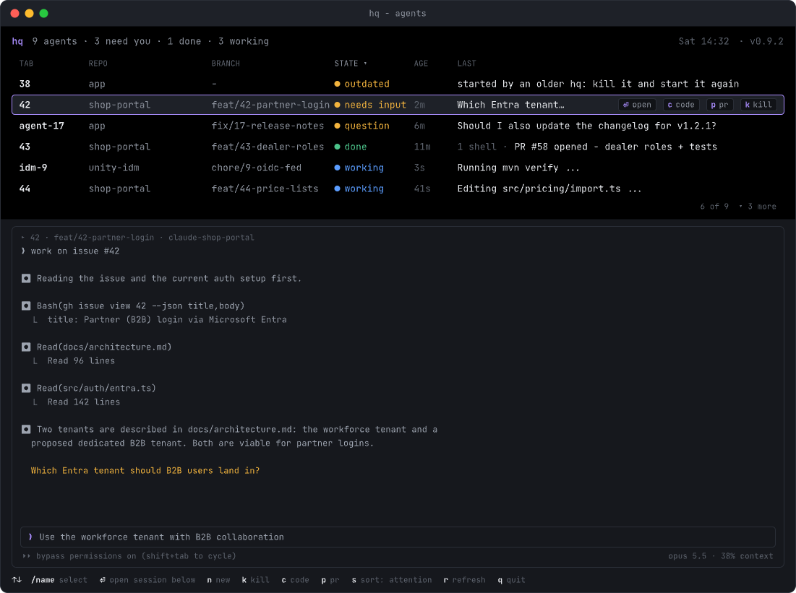

### #194 An agent of another generation shows as outdated

QA ran with `scripts/local-dev.sh --stub native` (the fake Claude, stub sbx) in its neutral repository; `hqbefore` is the same with `--before` (`origin/dev`). An agent is made outdated by setting its home window's `@hq_inbox` to `2` (older) or `4` (newer) on the checkout's private tmux server.

| # | Check | Expected | Result | Evidence |
|---|-------|----------|--------|----------|
| 1 | `hq ls`, `hq ls --json` with an agent of generation 2 and one of 4 | `outdated` on top, AGE `-`, branch `-`, `started by an older hq: ...` / `a newer hq`; JSON `"state": "outdated"` | pass | [1-ls-before.png](https://github.com/rkrysinski/hq/blob/ff23f80dfa3944643080c550f45c298fa060bc57/issue-194/1-ls-before.png), [1-ls-after.png](https://github.com/rkrysinski/hq/blob/ff23f80dfa3944643080c550f45c298fa060bc57/issue-194/1-ls-after.png), [1-ls-newer.png](https://github.com/rkrysinski/hq/blob/ff23f80dfa3944643080c550f45c298fa060bc57/issue-194/1-ls-newer.png); `TestLsShowsAnOutdatedAgentFirstWithTheRemedy`, `TestAnAgentOfAnotherGenerationIsOutdated` |
| 2 | The outdated agent's pane dies | still `outdated` | pass | [2-dead-pane.png](https://github.com/rkrysinski/hq/blob/ff23f80dfa3944643080c550f45c298fa060bc57/issue-194/2-dead-pane.png); `TestTheLookLeavesAnOutdatedAgentAlone` |
| 3 | Dashboard: attention sort, `need you`, row colour; docking and typing | outdated rows first, amber, counted under `need you`, no age; `hq go old` and docking show the session, typed keys reach it and the row stays `outdated` | pass | screenshots below; `TestAnOutdatedRowIsDrawnAsOneThatNeedsYou` (teatest, golden), `TestSorts`, `TestAnOutdatedAgentNeedsYou`, `TestGoOpensAnOutdatedAgent` |
| 4 | `hq read`, `hq send`, `hq answer`, `hq code`, `hq wait old` | refused with the line, exit 1, nothing left or typed | pass | [4-refusals.png](https://github.com/rkrysinski/hq/blob/ff23f80dfa3944643080c550f45c298fa060bc57/issue-194/4-refusals.png); `TestCommandsRefuseAnOutdatedAgent` |
| 5 | `hq wait` on every agent with an outdated one present | returns the other agent's `done`, never the outdated one, also when it is killed meanwhile | pass | [5-wait-all.png](https://github.com/rkrysinski/hq/blob/ff23f80dfa3944643080c550f45c298fa060bc57/issue-194/5-wait-all.png); `TestWaitOnEveryAgentLeavesAnOutdatedAgentOut` |
| 6 | `hq kill old`, `hq stop` | session ended, window and every file of the id gone (`ID`, `ID.stop`, `ID.hq`), trace of kills has it | pass | [6-kill.png](https://github.com/rkrysinski/hq/blob/ff23f80dfa3944643080c550f45c298fa060bc57/issue-194/6-kill.png), [6-stop.png](https://github.com/rkrysinski/hq/blob/ff23f80dfa3944643080c550f45c298fa060bc57/issue-194/6-stop.png); `TestKillAndStopEndAnOutdatedAgent` |
| 7 | `hq sandbox restart repo -y` with outdated agents in it | refused naming each and the remedy, exit 1, nothing stopped | pass | [7-sandbox-restart.png](https://github.com/rkrysinski/hq/blob/ff23f80dfa3944643080c550f45c298fa060bc57/issue-194/7-sandbox-restart.png); `TestSandboxRestartIsRefusedWithAnOutdatedAgentInIt` |
| 8 | `hq restore` with a lost agent whose record has no generation; `hq kill` of it | reported with the reason and not relaunched, the other restored; kill forgets it | pass | [8-restore.png](https://github.com/rkrysinski/hq/blob/ff23f80dfa3944643080c550f45c298fa060bc57/issue-194/8-restore.png); `TestRestoreReportsALostAgentOfAnotherGeneration` (no generation and a newer one) |
| 9 | No notification of hq's own for an outdated agent | hq on the host raises none | pass | by the code: hq sends no notification from the host at all (only the hook's `terminalSequence`, spec §5); no code path was added |
| 10 | Supervisor: `list`, `read`, `send`, `answer`, `wait` naming it, `go`, `kill`, instructions | `list` says `outdated`; the four fail with the line; `go` and `kill` work; instructions and `list`'s description say what it means | pass | `TestTheSupervisorsToolsTreatAnOutdatedAgentAsTheCommandsDo` (SDK client, in-memory transport) |
| 11 | The refusals for hooks too old for a message or an answer | gone, with their tests | pass | `agent.Supervisable`, `agent.Answerable`, `Agent.Inbox` removed; `TestAnAgentsHooksTellASupervisedTurnFromTheirSecondGeneration` replaced; the older-hooks cases of the send, answer, read and MCP tests now expect the outdated line |
| 12 | Spec, design, look-and-feel.pen | concepts, state, sorting, header, scenario S14, acceptance, supervisor section, older-hq sentences replaced; design 3.3 (new bullet), 3.4, 3.5, 3.6, 3.12, 6, version change; frame `S14 - outdated agent on top` | pass | the diff; the frame below |
| 13 | GLOSSARY entries generation and outdated agent | match what is built | pass | no entry changed |
| 14 | `scripts/check.sh` | passes | pass | full build below |

Dashboard, before (the agent of generation 2 shows `ended`, the one of 4 `done`) and after:




Docked with `Enter`, typed into, the row stays `outdated`; `hq go old`:




`hq ls` before and after, refusals, restart, restore:







The new frame of `look-and-feel.pen` (Pencil's render):



Pyramid before: `unit 702, integration 232, e2e 3 (unit share 75%, minimum 50%)`; after: `unit 714, integration 232, e2e 3 (unit share 75%, minimum 50%)`. Coverage after: 94.69% (minimum 94.4%). Tests added: unit 13 (`internal/agent`: 3 and a case in `TestSorts`; `internal/cli/outdated_test.go`: 8; `internal/dash/outdated_test.go`: 1 with its golden file), one unit test replaced; integration and end-to-end: none.

#### Outputs

`hq ls (after; generation 2)`

```text
NAME  REPO  BRANCH  STATE     AGE  LAST
old   repo  -       outdated  -    started by an older hq: kill it and start it again
a     repo  main    done      1m   Done: say hi
exit 0
      "name": "old",
      "repo": "repo",
      "repo_path": "/tmp/hq-stub-524619124/repo",
      "branch": "",
      "state": "outdated",
      "since": "2026-11-15T14:17:29.929Z",
      "age_seconds": 83,
      "last": "started by an older hq: kill it and start it again",
      "sandbox": "claude-repo",
$
```

`hqbefore ls; hqbefore read old (before)`

```text
NAME  REPO  BRANCH  STATE  AGE  LAST
old   repo  main    done   21s  Done: hi
a     repo  main    done   52s  Done: say hi
name      old
repo      repo  /tmp/hq-stub-524619124/repo
branch    main
worktree  /tmp/hq-stub-524619124/repo
sandbox   claude-repo
state     done 22s
pending   0

exit 0
$


```

`hq ls (generations 2 and 4)`

```text
NAME   REPO  BRANCH  STATE     AGE  LAST
newer  repo  -       outdated  -    started by a newer hq: kill it and start it again
old    repo  -       outdated  -    started by an older hq: kill it and start it again
a      repo  main    done      48s  Done: say more
$
```

`pane dead, hq ls`

```text
hq pane dead: 0
a pane dead: 0
old pane dead: 1
NAME  REPO  BRANCH  STATE     AGE  LAST
old   repo  -       outdated  -    started by an older hq: kill it and start it again
a     repo  main    done      23s  Done: say more
$
```

`refusals`

```text
$ hq read old
hq: old was started by an older hq: kill it and start it again
exit 1
$ hq send old hi
hq: old was started by an older hq: kill it and start it again
exit 1
$ hq answer old --dialog abcdef 1
hq: old was started by an older hq: kill it and start it again
exit 1
$ hq code old
hq: old was started by an older hq: kill it and start it again
exit 1
$ hq wait old --timeout 2s
hq: old was started by an older hq: kill it and start it again
exit 1
$
```

`hq send a ...; hq wait --since 3s`

```text
delivered: typed into a as its next prompt
NAME  REPO  BRANCH  STATE  AGE  LAST
a     repo  main    done   0s   Done: say more
next: hq wait --since 2026-11-15T14:19:26.61652357Z
exit 0
$
```

`hq kill old`

```text
a825cfdbe3ba
a825cfdbe3ba.hq
a825cfdbe3ba.stop
killed old; the sandbox stays
exit 0
0
2026-11-15 14:22:07  old in repo (sandbox claude-repo), by hq kill
NAME   REPO  BRANCH  STATE     AGE  LAST
newer  repo  -       outdated  -    started by a newer hq: kill it and start it again
a      repo  main    done      2m   Done: say more
$
```

`hq stop -y`

```text
ended 3 agents; sandboxes stay
exit 0
2026-11-15 14:22:38  lost1 in repo (sandbox claude-repo), by hq kill
2026-11-15 14:23:02  a in repo (sandbox claude-repo), by hq stop
2026-11-15 14:23:02  lost2 in repo (sandbox claude-repo), by hq stop
2026-11-15 14:23:02  newer in repo (sandbox claude-repo), by hq stop
$
```

`hq sandbox restart repo -y`

```text
hq: not restarting the sandbox claude-repo: old was started by an older hq: kill it and start it again; newer was started by a new
er hq: kill it and start it again; nothing was stopped
exit 1
NAME   REPO  BRANCH  STATE     AGE  LAST
newer  repo  -       outdated  -    started by a newer hq: kill it and start it again
old    repo  -       outdated  -    started by an older hq: kill it and start it again
a      repo  main    done      2m   Done: say more
$
```

`hq restore; hq kill lost1`

```text
{"name": "lost1", "sandbox": "claude-repo", "server": "hq-dev-524619124"}
restored lost2 in repo (sandbox claude-repo)
not restored lost1 in repo: it was started by an older hq (hq kill lost1 forgets it)
exit 0
killed lost1; the sandbox stays
exit 0
0
NAME   REPO  BRANCH  STATE     AGE  LAST
newer  repo  -       outdated  -    started by a newer hq: kill it and start it again
lost2  repo  main    done      0s   Done: say hi
a      repo  main    done      3m   Done: say more
$
```

### Mutation tests

`go run ./tools/testgate mutation spec-165-agent-state-journal`

```text
alive      internal/agent/agent.go:88:9 conditionals boundary
mutation: 15 killed, 1 alive, 0 timed out, 0 not covered against spec-165-agent-state-journal on 80bfaac6bdb401e12e877bd267bc5d18b0661430
```

- `agent.go:88:9`: equivalent: `StartedBy` is only called for a generation other than `version.Generation` (an outdated agent, or a lost one refused for it), so `gen > version.Generation` and `>=` never differ.

### Full build

```text
check: ok   vet
check: ok   format
check: ok   pyramid
check: ok   platform
check: ok   unit
check: ok   integration
check: ok   coverage
check: ok   e2e
check: all 8 steps passed on 80bfaac6bdb401e12e877bd267bc5d18b0661430
```

#### Deviations

- `teatest` is added to `go.mod` (test-only use, the operator's decision on #191); Go's module graph raises `charmbracelet/colorprofile` to v0.3.2, `golang.org/x/text` to v0.28.0 and `aymanbagabas/go-udiff` to v0.3.1 with it. The whole suite, the list's rendering tests included, passes unchanged on them.
- The window option keeps its name, `@hq_inbox`: renamed, every agent running under the hq before this change would turn outdated, which the ticket rules out while the generation stays `3`. A lost agent whose record that hq wrote has no generation, so `hq restore` reports it (as the ticket says of a record without one).
- `hq ls --json` keeps `since` (the start) and `age_seconds` for an outdated agent; only the table and the dashboard show no age, as the acceptance criterion names them.
- An outdated row keeps the dashboard's full action strip; `c code` on it is refused with the line, as `hq code` is.
- README: its sentence on agents an older hq started (supervisor section) now says what an outdated agent is. ADRs 0012, 0013 and 0014 still say how agents of an older hq were handled; they are left as recorded, for the ADRs of #165 to supersede.
- The full build failed once at the integration step on `TestAnswerAfterTheTerminalAnsweredIsRefused` (the hook ended later than its 5 s budget under load), which this change does not touch; the next run passed. Filed as #209. One later coverage run also exited non-zero without its output kept; the rerun passed.
- Deploy steps: none.
