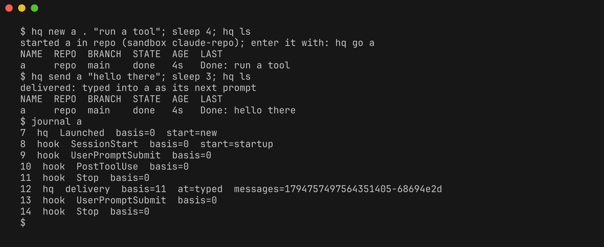
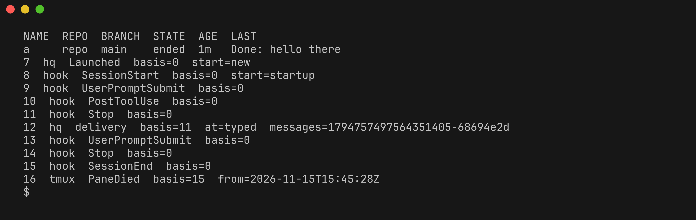
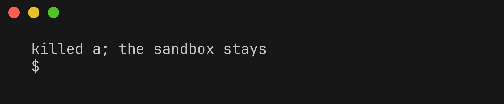

### #195 What hq sees and does becomes events in the journal

| # | Check | Expected | Result | Evidence |
|---|-------|----------|--------|----------|
| 1 | Each kind of evidence (screen: turn ended with its line, first seen at rest, rewound, tool cut short, owed turn not taken, own dialog seen and gone, at work after a hooks' dialog, queued prompt taken, wake-up; tmux: pane's death; sbx: not running; hq: launched, relaunched, taken down, typed delivery, answer) is appended once with its source, time and basis | one event per kind, source/time/basis right, none on the next look | ✅ pass | [tests.txt](https://github.com/rkrysinski/hq/blob/3be0b67ec7c88833f050845ccda92604a9ab6d78/issue-195/tests.txt) (`TestTheLookAppendsWhatTheScreenShowsOnce`, `TestTheLookAppendsAQueuedPromptTakenAndAWakeUp`, `TestTheLookAppendsThePanesDeathAndTheSandboxNotRunning`, `TestLaunchRestartAndRelaunchAreEvents`, `TestAnAnswerIsAnEventBeforeItIsGiven`) |
| 2 | A rewound turn leaves two events; an end known only from the pane's death is dated by it | `AtRest`, then `Rewound` 2 s later dated `From` the first; `PaneDied` with `From` = tmux's time | ✅ pass | [tests.txt](https://github.com/rkrysinski/hq/blob/3be0b67ec7c88833f050845ccda92604a9ab6d78/issue-195/tests.txt); hq on the fake Claude: [2-hundred-looks.txt](https://github.com/rkrysinski/hq/blob/3be0b67ec7c88833f050845ccda92604a9ab6d78/issue-195/2-hundred-looks.txt) |
| 3 | Eight looks racing for the same evidence | one stands, seven set aside as `duplicate` | ✅ pass | `TestOfEightLooksRacingOneEventStands` (unit), `TestOfEightProcessesAppendingTheSameEvidenceOneStands` (8 processes), contract on both stores: [tests.txt](https://github.com/rkrysinski/hq/blob/3be0b67ec7c88833f050845ccda92604a9ab6d78/issue-195/tests.txt) |
| 4 | Evidence whose basis a later report overtook | set aside as `overtaken`, kept in the journal | ✅ pass | `TestEvidenceALaterReportOvertookIsSetAside`, `TestEvidenceIsOvertakenOnlyByALaterReport`: [tests.txt](https://github.com/rkrysinski/hq/blob/3be0b67ec7c88833f050845ccda92604a9ab6d78/issue-195/tests.txt) |
| 5 | A hundred looks at the same screen | no event after the first, with or without the window record | ✅ pass | `TestAHundredLooksAtTheSameScreenAddOneEvent`; hq on the fake Claude, 101 `hq ls` on an ended agent leave one `PaneDied`: [2-hundred-looks.txt](https://github.com/rkrysinski/hq/blob/3be0b67ec7c88833f050845ccda92604a9ab6d78/issue-195/2-hundred-looks.txt) |
| 6 | hq types a message in | its delivery (`hq`, `typed`, named as first left in the inbox) is appended after the take and before the paste; the prompt Claude reports is later; a held message gets its event when a later look types it, under its first name; a failed typing puts the messages back under their names | ✅ pass | `TestHqTypingAMessageInAppendsItsDeliveryBeforeTheTyping`, `TestAFailedTypingWithdrawsItsDelivery`, `TestAMessageKeepsItsNameWhenHeldOrPutBack`, `TestTheJournalHoldsWhatHqDidAndSawBesideTheHooksReports`; hq on the fake Claude: [1-delivery.txt](https://github.com/rkrysinski/hq/blob/3be0b67ec7c88833f050845ccda92604a9ab6d78/issue-195/1-delivery.txt) |
| 7 | Messages and answers delivered as before | existing tests of `hq send`, `hq answer` and the inbox pass unchanged (`TestHeldMessagesWaitForHqAloneInTheOrderSent`, `TestSendTypesAWaitingCommandAsAPromptOfItsOwnInTheOrderSent` included) | ✅ pass | [tests.txt](https://github.com/rkrysinski/hq/blob/3be0b67ec7c88833f050845ccda92604a9ab6d78/issue-195/tests.txt), full build |
| 8 | An sbx too old | `hq ls`, `hq read`, `hq send`, `hq answer` exit 3 with nothing ingested, appended or typed; `hq wait` appends no `sbx` event | ✅ pass | `TestAnSbxTooOldEndsTheCommandBeforeAnythingIsIngested`, `TestOnlyAnAnswerOfSbxIsAnSbxEvent`: [tests.txt](https://github.com/rkrysinski/hq/blob/3be0b67ec7c88833f050845ccda92604a9ab6d78/issue-195/tests.txt) |
| 9 | Every existing test and journey; the window records still decide | full build green | ✅ pass | [full-build.txt](https://github.com/rkrysinski/hq/blob/3be0b67ec7c88833f050845ccda92604a9ab6d78/issue-195/full-build.txt) |
| 10 | The design lists the events of each source and the two reasons | design 3.4, *Events and journals*; glossary *Event*, *Look* | ✅ pass | diff of `docs/design/hq.md`, `GLOSSARY.md` |
| 11 | `hq kill` takes the journal with hq's events | no journal left | ✅ pass | [3-kill.txt](https://github.com/rkrysinski/hq/blob/3be0b67ec7c88833f050845ccda92604a9ab6d78/issue-195/3-kill.txt) |

Check 6 on hq with the fake Claude:



Check 5 on hq with the fake Claude (101 looks after `/exit`):





Pyramid before (integration branch): unit 748, integration 261, e2e 3 (unit share 74%). After: unit 767, integration 264, e2e 3 (unit share 74%). Coverage after: 94.97% (minimum 94.4%).

Tests added: unit: `internal/agent/events_test.go` (7), `internal/journal/aside_test.go` (4), `internal/cli/events_test.go` (7), `TestOnlyAMessagesNameIsKept`, and two subtests of the store contract (set aside, eight writers racing) run on the fake; integration: `TestOfEightProcessesAppendingTheSameEvidenceOneStands`, `TestAMessageKeepsItsNameWhenHeldOrPutBack`, `TestTheJournalHoldsWhatHqDidAndSawBesideTheHooksReports`, and the contract's subtests on the file store; e2e: none.

#### Outputs

`hq new`, `hq send` and the journal on the fake Claude (`scripts/local-dev.sh --stub native`; `journal` prints each event's number, source, kind, basis, reason set aside and hq's facts, no conversation text):

```text
$ hq new a . "run a tool"; sleep 4; hq ls
started a in repo (sandbox claude-repo); enter it with: hq go a
NAME  REPO  BRANCH  STATE  AGE  LAST
a     repo  main    done   4s   Done: run a tool
$ hq send a "hello there"; sleep 3; hq ls
delivered: typed into a as its next prompt
NAME  REPO  BRANCH  STATE  AGE  LAST
a     repo  main    done   4s   Done: hello there
$ journal a
7  hq  Launched  basis=0  start=new
8  hook  SessionStart  basis=0  start=startup
9  hook  UserPromptSubmit  basis=0
10  hook  PostToolUse  basis=0
11  hook  Stop  basis=0
12  hq  delivery  basis=11  at=typed  messages=1794757497564351405-68694e2d
13  hook  UserPromptSubmit  basis=0
14  hook  Stop  basis=0
$
```

```text
$ for i in $(seq 100); do hq ls >/dev/null; done; hq ls; journal a   # after /exit typed into the agent
NAME  REPO  BRANCH  STATE  AGE  LAST
a     repo  main    ended  1m   Done: hello there
7  hq  Launched  basis=0  start=new
8  hook  SessionStart  basis=0  start=startup
9  hook  UserPromptSubmit  basis=0
10  hook  PostToolUse  basis=0
11  hook  Stop  basis=0
12  hq  delivery  basis=11  at=typed  messages=1794757497564351405-68694e2d
13  hook  UserPromptSubmit  basis=0
14  hook  Stop  basis=0
15  hook  SessionEnd  basis=0
16  tmux  PaneDied  basis=15  from=2026-11-15T15:45:28Z
$
```

```text
$ hq kill a -y; hq ls; ls $XDG_STATE_HOME/hq/journals
killed a; the sandbox stays
$
```

### Mutation tests

`go run ./tools/testgate mutation spec-165-agent-state-journal`

```text
mutation: 65 killed, 0 alive, 0 timed out, 15 not covered against spec-165-agent-state-journal on b8a8abe068fd8f5e1db330e00d3c72c12a69687f
```

### Full build

```text
check: ok   coverage
check: ok   e2e
check: all 8 steps passed on b8a8abe068fd8f5e1db330e00d3c72c12a69687f
```

#### Deviations

- The journal's form changed (`Event.Basis`, `Event.Aside`, the facts `Screen`, `From`, `Asked`): the generation fingerprint of the journal is renewed and the generation kept at 3, since #199 raises it in this same pull request.
- Two integration tests of #193 in `internal/cli/journal_integration_test.go` pinned the journal to the hook's events alone; they now look at the hook's events (`ofSource`), as the journal holds hq's own beside them. No test of `hq send`, `hq answer` or the inbox changed.
- Seam: the spec names the journal's store; the look reaches it through `agent.Store` as an optional `agent.Journals` (`lookStore` joins tmux and `journal.Store`), so the look tests of the window records alone stay as they are. Every command's look passes it (`deps.store()`); `hq update`'s listing of agents now ingests as every look does.
- An event kind the ticket does not list: `Withdrawn` (hq), for a typed delivery whose typing failed (the messages back in the inbox), an answer not left or not taken by the hook, and a restore or relaunch whose session did not start, so the journal does not say a delivery reached the agent when it did not.
- A message put back after a failed typing keeps its name, `.now` included, so it goes back as sent with `--now`; before, the put-back dropped `--now`.
- `NotRunning` is appended only from an answer that ends the agent (it has reported, none since sbx was asked), as the old rule; the end-first-seen record (`endseen`) has no event of its own: its evidence is `PaneDied`, `NotRunning` or `TakenDown`, each dated by its own time.
- "The prompt Claude then reports" after hq typed a slash command as a word and a paste was shown on the fake Claude only (the operator's decision; the host step of Release QA carries it).
- No step outside the code.
