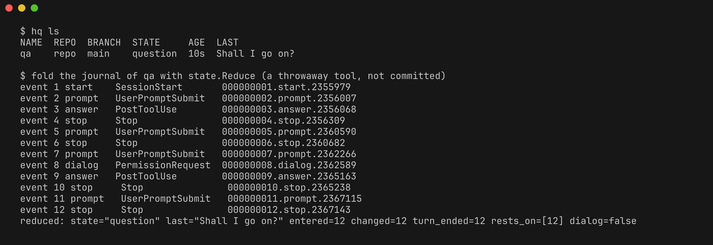
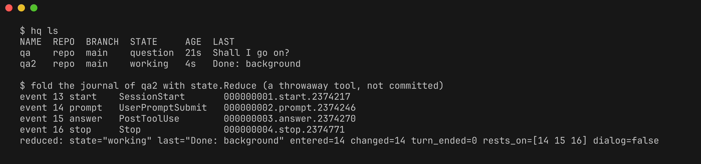

### #196 The reducer, part one: an agent's state from what its hook reports

| # | Check | Expected | Result | Evidence |
|---|-------|----------|--------|----------|
| 1 | The reducer gives the old reading's state, last message, own tasks and dialog verdict after every report of every fixture journal (17 journals, one per payload behaviour and per case of design 3.4 the hooks report), and also the old reading's since, latest, branch, worktree, session, prompt and the flags the screen rules read | equal at every step | ✅ pass | [1-unit.txt](https://github.com/rkrysinski/hq/blob/7911e7de9b1c8b38e18523576031f02deb282712/issue-196/1-unit.txt) |
| 2 | No I/O, no clock: one journal folded with two times passed in | same state, numbers and moments; only the age differs (an hour) | ✅ pass | [1-unit.txt](https://github.com/rkrysinski/hq/blob/7911e7de9b1c8b38e18523576031f02deb282712/issue-196/1-unit.txt) |
| 3 | Entered (number and time, today's rule) apart from Changed (state or open dialog); TurnEnded counts done and question turn ends, a closing turn Claude started included, and not a kept or handed-over turn end, a blocked stop, a session's start or a resume; RestsOn names prompt, task start and turn end for background work | as the acceptance criteria say | ✅ pass | [1-unit.txt](https://github.com/rkrysinski/hq/blob/7911e7de9b1c8b38e18523576031f02deb282712/issue-196/1-unit.txt) |
| 4 | Folding on from a kept position gives what folding from the start gives, at every event, and leaves the kept position untouched | equal at every event | ✅ pass | [1-unit.txt](https://github.com/rkrysinski/hq/blob/7911e7de9b1c8b38e18523576031f02deb282712/issue-196/1-unit.txt) |
| 5 | The integration test rebuilds every fixture journal from its payloads through the real hook (sh) and `journal.Files` ingest, and fails on a difference | all 17 rebuild byte for byte | ✅ pass | [2-integration.txt](https://github.com/rkrysinski/hq/blob/7911e7de9b1c8b38e18523576031f02deb282712/issue-196/2-integration.txt) |
| 6 | Live, hq from the worktree with the fake Claude (`scripts/local-dev.sh --stub native`): an agent through background work, a wake-up, a question dialog and a question; its real journal folded with `state.Reduce` (a throwaway tool, not committed) | event files named by the hook's case; the fold says what `hq ls` says | ✅ pass | screenshots below, [4-live-journal.txt](https://github.com/rkrysinski/hq/blob/7911e7de9b1c8b38e18523576031f02deb282712/issue-196/4-live-journal.txt) |
| 7 | Live: an agent working on a background subagent, its journal folded | `working`, rests on the prompt, the task's start and the turn end | ✅ pass | screenshot below, [5-live-background.txt](https://github.com/rkrysinski/hq/blob/7911e7de9b1c8b38e18523576031f02deb282712/issue-196/5-live-background.txt) |
| 8 | Full build, mutation tests against the integration branch, coverage | all pass, no mutant alive | ✅ pass | below |

Check 6: 

Check 7: 

Pyramid before: `unit 748, integration 261, e2e 3 (unit share 74%, minimum 50%)`; after: `unit 757, integration 262, e2e 3 (unit share 74%, minimum 50%)`. Coverage after: `coverage 94.96% (minimum 94.4%)`.

Tests added: unit 9 (`internal/state/reduce_test.go`: the fixture journals against the old reading, folding on from a kept position, the time passed in, entered and changed, the last completed turn's end, what the state rests on, reports hq cannot read, own tasks' texts; `event_test.go`: the hook's case from the file's name); integration 1 (`internal/state/journals_integration_test.go`, one subtest per fixture journal); 17 fixture journals in `internal/state/testdata/journals`.

#### Outputs

`go test -count=1 -v -run ... ./internal/state` (unit):

```text
$ go test -count=1 -v -run "TestTheReducer|TestFolding|TestTheTimePassed|TestTheResultNames|TestAReportHqCannotRead|TestOwnTasksTake|TestParseEventTakesTheHooksKind" ./internal/state
=== RUN   TestParseEventTakesTheHooksKindFromTheFilesName
--- PASS: TestParseEventTakesTheHooksKindFromTheFilesName (0.00s)
=== RUN   TestTheReducerReadsEveryFixtureJournalAsTheOldReadingDid
--- PASS: TestTheReducerReadsEveryFixtureJournalAsTheOldReadingDid (0.01s)
=== RUN   TestFoldingOnFromAKeptPositionIsFoldingFromTheStart
--- PASS: TestFoldingOnFromAKeptPositionIsFoldingFromTheStart (0.01s)
=== RUN   TestTheTimePassedInChangesOnlyTheAge
--- PASS: TestTheTimePassedInChangesOnlyTheAge (0.00s)
=== RUN   TestTheResultNamesWhereTheStateWasEnteredAndWhereItChanged
--- PASS: TestTheResultNamesWhereTheStateWasEnteredAndWhereItChanged (0.00s)
=== RUN   TestTheResultNamesTheTurnEndOfTheLastCompletedTurn
--- PASS: TestTheResultNamesTheTurnEndOfTheLastCompletedTurn (0.00s)
=== RUN   TestTheResultNamesTheEventsTheStateRestsOn
--- PASS: TestTheResultNamesTheEventsTheStateRestsOn (0.00s)
=== RUN   TestAReportHqCannotReadIsStartingUnlessItIsTooLarge
--- PASS: TestAReportHqCannotReadIsStartingUnlessItIsTooLarge (0.00s)
=== RUN   TestOwnTasksTakeTheirTextsFromTheReply
--- PASS: TestOwnTasksTakeTheirTextsFromTheReply (0.00s)
PASS
ok  	github.com/rkrysinski/hq/internal/state	0.026s
```

`go test -count=1 -tags integration -v -run "TestTheFixtureJournals|TestHookLeaves" ./internal/state`:

```text
$ go test -count=1 -tags integration -v -run "TestTheFixtureJournals|TestHookLeaves" ./internal/state
=== RUN   TestHookLeavesAnEventFileForEveryReportARuleReads
--- PASS: TestHookLeavesAnEventFileForEveryReportARuleReads (3.85s)
=== RUN   TestHookLeavesEventsForTurnsTheStateFileDoesNotShow
--- PASS: TestHookLeavesEventsForTurnsTheStateFileDoesNotShow (0.37s)
=== RUN   TestTheFixtureJournalsAreWhatTheHookAndTheIngestMakeOfTheirPayloads
=== RUN   TestTheFixtureJournalsAreWhatTheHookAndTheIngestMakeOfTheirPayloads/background.json
=== RUN   TestTheFixtureJournalsAreWhatTheHookAndTheIngestMakeOfTheirPayloads/dialogs.json
=== RUN   TestTheFixtureJournalsAreWhatTheHookAndTheIngestMakeOfTheirPayloads/elicitations.json
=== RUN   TestTheFixtureJournalsAreWhatTheHookAndTheIngestMakeOfTheirPayloads/finish-together.json
=== RUN   TestTheFixtureJournalsAreWhatTheHookAndTheIngestMakeOfTheirPayloads/interrupted.json
=== RUN   TestTheFixtureJournalsAreWhatTheHookAndTheIngestMakeOfTheirPayloads/messages.json
=== RUN   TestTheFixtureJournalsAreWhatTheHookAndTheIngestMakeOfTheirPayloads/notifications.json
=== RUN   TestTheFixtureJournalsAreWhatTheHookAndTheIngestMakeOfTheirPayloads/own-tasks.json
=== RUN   TestTheFixtureJournalsAreWhatTheHookAndTheIngestMakeOfTheirPayloads/queued-again.json
=== RUN   TestTheFixtureJournalsAreWhatTheHookAndTheIngestMakeOfTheirPayloads/queued-esc.json
=== RUN   TestTheFixtureJournalsAreWhatTheHookAndTheIngestMakeOfTheirPayloads/queued-tool.json
=== RUN   TestTheFixtureJournalsAreWhatTheHookAndTheIngestMakeOfTheirPayloads/queued.json
=== RUN   TestTheFixtureJournalsAreWhatTheHookAndTheIngestMakeOfTheirPayloads/sessions.json
=== RUN   TestTheFixtureJournalsAreWhatTheHookAndTheIngestMakeOfTheirPayloads/subagent-commands.json
=== RUN   TestTheFixtureJournalsAreWhatTheHookAndTheIngestMakeOfTheirPayloads/subagent-dialogs.json
=== RUN   TestTheFixtureJournalsAreWhatTheHookAndTheIngestMakeOfTheirPayloads/turns.json
=== RUN   TestTheFixtureJournalsAreWhatTheHookAndTheIngestMakeOfTheirPayloads/unreadable.json
--- PASS: TestTheFixtureJournalsAreWhatTheHookAndTheIngestMakeOfTheirPayloads (4.73s)
    --- PASS: TestTheFixtureJournalsAreWhatTheHookAndTheIngestMakeOfTheirPayloads/background.json (0.35s)
    --- PASS: TestTheFixtureJournalsAreWhatTheHookAndTheIngestMakeOfTheirPayloads/dialogs.json (0.26s)
    --- PASS: TestTheFixtureJournalsAreWhatTheHookAndTheIngestMakeOfTheirPayloads/elicitations.json (0.22s)
    --- PASS: TestTheFixtureJournalsAreWhatTheHookAndTheIngestMakeOfTheirPayloads/finish-together.json (1.31s)
    --- PASS: TestTheFixtureJournalsAreWhatTheHookAndTheIngestMakeOfTheirPayloads/interrupted.json (0.26s)
    --- PASS: TestTheFixtureJournalsAreWhatTheHookAndTheIngestMakeOfTheirPayloads/messages.json (0.15s)
    --- PASS: TestTheFixtureJournalsAreWhatTheHookAndTheIngestMakeOfTheirPayloads/notifications.json (0.24s)
    --- PASS: TestTheFixtureJournalsAreWhatTheHookAndTheIngestMakeOfTheirPayloads/own-tasks.json (0.35s)
    --- PASS: TestTheFixtureJournalsAreWhatTheHookAndTheIngestMakeOfTheirPayloads/queued-again.json (0.49s)
    --- PASS: TestTheFixtureJournalsAreWhatTheHookAndTheIngestMakeOfTheirPayloads/queued-esc.json (0.19s)
    --- PASS: TestTheFixtureJournalsAreWhatTheHookAndTheIngestMakeOfTheirPayloads/queued-tool.json (0.24s)
    --- PASS: TestTheFixtureJournalsAreWhatTheHookAndTheIngestMakeOfTheirPayloads/queued.json (0.24s)
    --- PASS: TestTheFixtureJournalsAreWhatTheHookAndTheIngestMakeOfTheirPayloads/sessions.json (0.09s)
    --- PASS: TestTheFixtureJournalsAreWhatTheHookAndTheIngestMakeOfTheirPayloads/subagent-commands.json (0.10s)
    --- PASS: TestTheFixtureJournalsAreWhatTheHookAndTheIngestMakeOfTheirPayloads/subagent-dialogs.json (0.09s)
    --- PASS: TestTheFixtureJournalsAreWhatTheHookAndTheIngestMakeOfTheirPayloads/turns.json (0.05s)
    --- PASS: TestTheFixtureJournalsAreWhatTheHookAndTheIngestMakeOfTheirPayloads/unreadable.json (0.10s)
PASS
ok  	github.com/rkrysinski/hq/internal/state	8.954s
```

Check 6:

```text
$ hq ls
NAME  REPO  BRANCH  STATE     AGE  LAST
qa    repo  main    question  10s  Shall I go on?

$ fold the journal of qa with state.Reduce (a throwaway tool, not committed)
event 1 start    SessionStart       000000001.start.2355979
event 2 prompt   UserPromptSubmit   000000002.prompt.2356007
event 3 answer   PostToolUse        000000003.answer.2356068
event 4 stop     Stop               000000004.stop.2356309
event 5 prompt   UserPromptSubmit   000000005.prompt.2360590
event 6 stop     Stop               000000006.stop.2360682
event 7 prompt   UserPromptSubmit   000000007.prompt.2362266
event 8 dialog   PermissionRequest  000000008.dialog.2362589
event 9 answer   PostToolUse        000000009.answer.2365163
event 10 stop     Stop               000000010.stop.2365238
event 11 prompt   UserPromptSubmit   000000011.prompt.2367115
event 12 stop     Stop               000000012.stop.2367143
reduced: state="question" last="Shall I go on?" entered=12 changed=12 turn_ended=12 rests_on=[12] dialog=false
```

Check 7:

```text
$ hq ls
NAME  REPO  BRANCH  STATE     AGE  LAST
qa    repo  main    question  21s  Shall I go on?
qa2   repo  main    working   4s   Done: background

$ fold the journal of qa2 with state.Reduce (a throwaway tool, not committed)
event 13 start    SessionStart       000000001.start.2374217
event 14 prompt   UserPromptSubmit   000000002.prompt.2374246
event 15 answer   PostToolUse        000000003.answer.2374270
event 16 stop     Stop               000000004.stop.2374771
reduced: state="working" last="Done: background" entered=14 changed=14 turn_ended=0 rests_on=[14 15 16] dialog=false
```

`go run ./tools/testgate mutation spec-165-agent-state-journal`:

```text
mutation: 94 killed, 0 alive, 0 timed out, 15 not covered against spec-165-agent-state-journal on 8175cfe8edd392fe57457fe40e927e573e0220fc
```

`scripts/check.sh`:

```text
check: ok   vet
check: ok   format
check: ok   pyramid
check: ok   platform
check: ok   unit
check: ok   integration
check: ok   coverage
check: ok   e2e
check: all 8 steps passed on 8175cfe8edd392fe57457fe40e927e573e0220fc
```

#### Deviations

- Facts added to the events (the ticket allows it): the hook names each event file by the case that wrote it, `%09d.KIND.PID` (`Facts.At` for every hook event; the `Event` type is unchanged), since a `/clear` queued before a prompt brings the queued prompt back as a `UserPromptSubmit` written by `start`, and a report hq cannot read tells nothing else; the hook now also leaves an event for an own tool's end that drops a queued prompt, which no event told before and which changes the next turn end; an unreadable event keeps the branch its file named. The hook's script went from 10,229 to 10,236 bytes, within its 10 KiB budget.
- The fingerprint of the hook's script is renewed (`b1b3705c1e2166d0` to `c4e6e672ee43eb48`) and the generation kept at 3: #199 raises it in this same pull request. The journal's form is unchanged.
- `notification-elicitation.json` is in no fixture journal: no hook of hq's runs on it (the Notification matcher leaves it out); `managed-settings-template.json` is no payload.
- The rebuild test runs the hook with `sh`, as the existing hook tests do, since rebuilding the journals from their payloads needs it; the unit tests start no process. It lives in package `state_test`, as `journal.Files` imports `state`; the fixture types are exported from `reduce_test.go` for it.
- The hook compares a dialog's tool by the raw `"tool_name"` text, so a pretty-printed and a compact payload differ there, which the reducer (comparing names) does not mirror; Claude writes compact payloads, and the fixtures' inline payloads are compacted. Likewise a payload cut off after its `hook_event_name` would still match the hook's greps; the unreadable fixture is cut off before it.
- The old reading gives a wake-up's prompt as Claude's notification text, which no rule reads and the journal does not keep (an event keeps no wake-up's prompt): the comparison leaves that one field out.
- No deploy steps.
