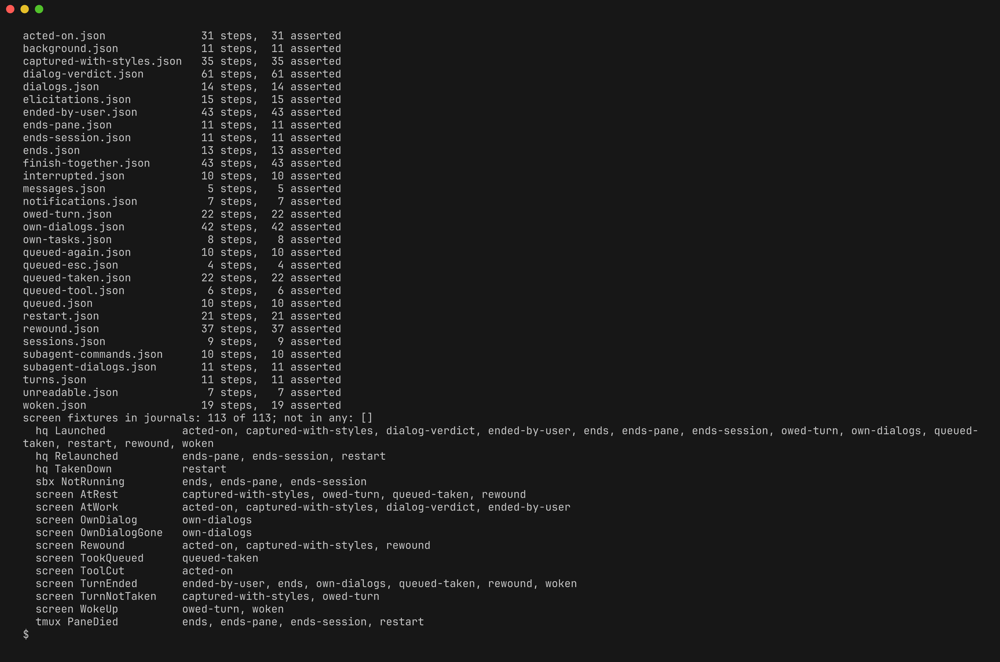
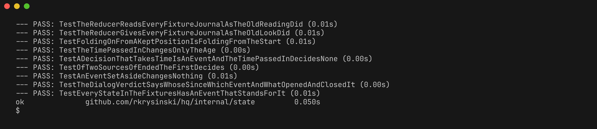
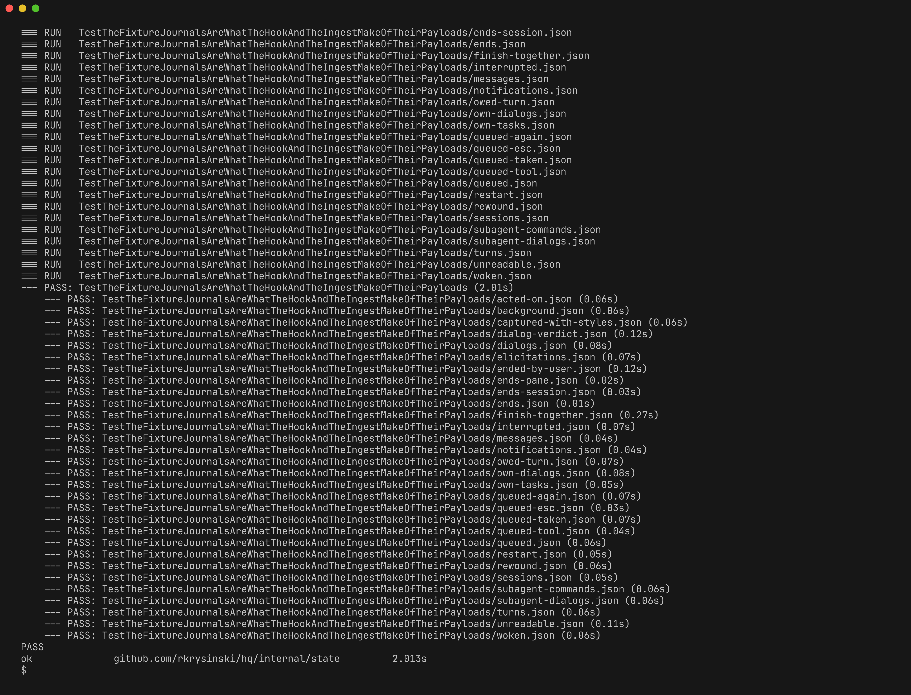
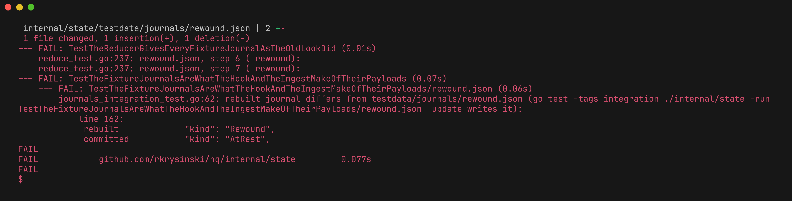
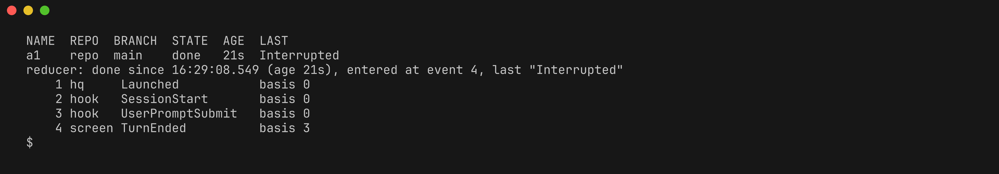
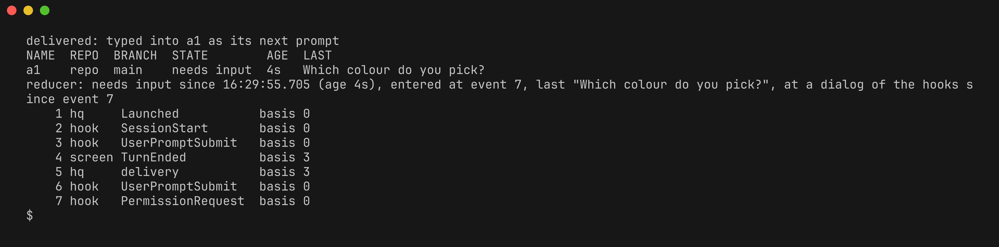
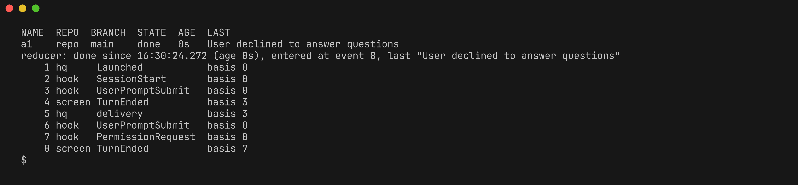
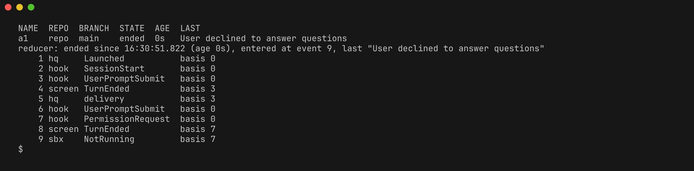

### #197 The reducer, part two: an agent's state from what hq sees

| # | Check | Expected | Result | Evidence |
|---|-------|----------|--------|----------|
| 1 | A fixture journal per case of design 3.4 that reads the screen, tmux or sbx, and per screen fixture, asserted after every step | 13 new journals (ended-by-user, rewound, acted-on, queued-taken, owed-turn, own-dialogs, dialog-verdict, woken, ends, ends-pane, ends-session, restart, captured-with-styles); all 113 screen fixtures in some journal; every step asserted | ✅ pass | [01-fixture-coverage.txt](https://github.com/rkrysinski/hq/blob/a39c0768f31bf1f4aea781ab8b862875effe3d40/issue-197/01-fixture-coverage.txt), screenshot below |
| 2 | On every fixture the reducer's state, since, last message, own tasks and dialog verdict equal the old look's (and its hook part the old reading's) | `TestTheReducerGivesEveryFixtureJournalAsTheOldLookDid`, `TestTheReducerReadsEveryFixtureJournalAsTheOldReadingDid` pass | ✅ pass | [02-unit-tests.txt](https://github.com/rkrysinski/hq/blob/a39c0768f31bf1f4aea781ab8b862875effe3d40/issue-197/02-unit-tests.txt) |
| 3 | A rewound turn is done with Interrupted at the decision's event, counted from the screen first seen at rest; an end known only from the pane's death counts from it; both give the deciding event | `TestADecisionThatTakesTimeIsAnEventAndTheTimePassedInDecidesNone` passes | ✅ pass | [02-unit-tests.txt](https://github.com/rkrysinski/hq/blob/a39c0768f31bf1f4aea781ab8b862875effe3d40/issue-197/02-unit-tests.txt) |
| 4 | No state changes by the time passed in alone | first-at-rest event, no decision: working at any time passed in; `TestTheTimePassedInChangesOnlyTheAge` on every fixture | ✅ pass | [02-unit-tests.txt](https://github.com/rkrysinski/hq/blob/a39c0768f31bf1f4aea781ab8b862875effe3d40/issue-197/02-unit-tests.txt) |
| 5 | Of two sources of ended the first decides; sbx not read for an agent whose latest report is newer than the question | `TestOfTwoSourcesOfEndedTheFirstDecides` passes | ✅ pass | [02-unit-tests.txt](https://github.com/rkrysinski/hq/blob/a39c0768f31bf1f4aea781ab8b862875effe3d40/issue-197/02-unit-tests.txt) |
| 6 | An event set aside (duplicate, overtaken) changes nothing | `TestAnEventSetAsideChangesNothing` (an aside copy of every event of hq's own in every fixture) passes | ✅ pass | [02-unit-tests.txt](https://github.com/rkrysinski/hq/blob/a39c0768f31bf1f4aea781ab8b862875effe3d40/issue-197/02-unit-tests.txt) |
| 7 | The dialog verdict says whose, since which event, which events opened and closed it | `TestTheDialogVerdictSaysWhoseSinceWhichEventAndWhatOpenedAndClosedIt` passes | ✅ pass | [02-unit-tests.txt](https://github.com/rkrysinski/hq/blob/a39c0768f31bf1f4aea781ab8b862875effe3d40/issue-197/02-unit-tests.txt) |
| 8 | Every state in the fixtures has an event that stands for it | `TestEveryStateInTheFixturesHasAnEventThatStandsForIt` passes | ✅ pass | [02-unit-tests.txt](https://github.com/rkrysinski/hq/blob/a39c0768f31bf1f4aea781ab8b862875effe3d40/issue-197/02-unit-tests.txt) |
| 9 | An integration test rebuilds every fixture journal and fails when one differs | passes as committed; fails naming the line when a committed event is altered | ✅ pass | [09-rebuild-passes.txt](https://github.com/rkrysinski/hq/blob/a39c0768f31bf1f4aea781ab8b862875effe3d40/issue-197/09-rebuild-passes.txt), [10-rebuild-fails-on-a-difference.txt](https://github.com/rkrysinski/hq/blob/a39c0768f31bf1f4aea781ab8b862875effe3d40/issue-197/10-rebuild-fails-on-a-difference.txt) |
| 10 | Live agent through hq (`scripts/local-dev.sh --stub native`, the fake Claude): the reducer folds its journal to what `hq ls` shows, for a turn interrupted on screen, a question dialog, the dialog cancelled on screen, the sandbox stopped | same state, since, last message and dialog as `hq ls` at each point, with a throwaway probe calling `state.Reduce` on the agent's journal (not committed) | ✅ pass | [11](https://github.com/rkrysinski/hq/blob/a39c0768f31bf1f4aea781ab8b862875effe3d40/issue-197/11-interrupted-turn.txt), [12](https://github.com/rkrysinski/hq/blob/a39c0768f31bf1f4aea781ab8b862875effe3d40/issue-197/12-hooks-dialog.txt), [13](https://github.com/rkrysinski/hq/blob/a39c0768f31bf1f4aea781ab8b862875effe3d40/issue-197/13-dialog-cancelled.txt), [14](https://github.com/rkrysinski/hq/blob/a39c0768f31bf1f4aea781ab8b862875effe3d40/issue-197/14-sandbox-stopped.txt), screenshots below |
| 11 | `scripts/check.sh` passes | all 8 steps | ✅ pass | [check.txt](https://github.com/rkrysinski/hq/blob/a39c0768f31bf1f4aea781ab8b862875effe3d40/issue-197/check.txt) |










No UI change: nothing calls the reducer yet but its tests, so hq looks as before (check 10 shows `hq ls` unchanged beside the reducer).

Pyramid before: `unit 776, integration 265, e2e 3 (unit share 75%, minimum 50%)`; after: `unit 785, integration 265, e2e 3 (unit share 75%, minimum 50%)`. Coverage after: 95.19% (minimum 94.4%).

Tests added: unit: `TestTheReducerGivesEveryFixtureJournalAsTheOldLookDid`, `TestADecisionThatTakesTimeIsAnEventAndTheTimePassedInDecidesNone`, `TestOfTwoSourcesOfEndedTheFirstDecides`, `TestAnEventSetAsideChangesNothing`, `TestTheDialogVerdictSaysWhoseSinceWhichEventAndWhatOpenedAndClosedIt`, `TestEveryStateInTheFixturesHasAnEventThatStandsForIt`, `TestARelaunchWithdrawnLeavesTheAgentTakenDown`, `TestClaudeTakingAQueuedPromptHandsTheStateOverToIt`, `TestATurnEndTheScreenShowedEndsTheLastCompletedTurn`; cases in `TestHoldsLooksPastWhatWasSetAsideAndNotPastALaunch` (journal) and `TestTheLookAppendsWhatTheScreenShowsOnce` (agent). Integration: `TestTheFixtureJournalsAreWhatTheHookAndTheIngestMakeOfTheirPayloads` now also runs hq's actions and the old look (`agent.Look`) on each step and records what it gave; 13 fixture journals added, the 17 of #196 gain the look's result per step. End-to-end: none.

#### Outputs

`python3 fixture-coverage.py` (from the checkout):

```text
acted-on.json               31 steps,  31 asserted
background.json             11 steps,  11 asserted
captured-with-styles.json   35 steps,  35 asserted
dialog-verdict.json         61 steps,  61 asserted
dialogs.json                14 steps,  14 asserted
elicitations.json           15 steps,  15 asserted
ended-by-user.json          43 steps,  43 asserted
ends-pane.json              11 steps,  11 asserted
ends-session.json           11 steps,  11 asserted
ends.json                   13 steps,  13 asserted
finish-together.json        43 steps,  43 asserted
interrupted.json            10 steps,  10 asserted
messages.json                5 steps,   5 asserted
notifications.json           7 steps,   7 asserted
owed-turn.json              22 steps,  22 asserted
own-dialogs.json            42 steps,  42 asserted
own-tasks.json               8 steps,   8 asserted
queued-again.json           10 steps,  10 asserted
queued-esc.json              4 steps,   4 asserted
queued-taken.json           22 steps,  22 asserted
queued-tool.json             6 steps,   6 asserted
queued.json                 10 steps,  10 asserted
restart.json                21 steps,  21 asserted
rewound.json                37 steps,  37 asserted
sessions.json                9 steps,   9 asserted
subagent-commands.json      10 steps,  10 asserted
subagent-dialogs.json       11 steps,  11 asserted
turns.json                  11 steps,  11 asserted
unreadable.json              7 steps,   7 asserted
woken.json                  19 steps,  19 asserted
screen fixtures in journals: 113 of 113; not in any: []
  hq Launched            acted-on, captured-with-styles, dialog-verdict, ended-by-user, ends, ends-pane, ends-session, owed-turn, own-dialogs, queued-
taken, restart, rewound, woken
  hq Relaunched          ends-pane, ends-session, restart
  hq TakenDown           restart
  sbx NotRunning         ends, ends-pane, ends-session
  screen AtRest          captured-with-styles, owed-turn, queued-taken, rewound
  screen AtWork          acted-on, captured-with-styles, dialog-verdict, ended-by-user
  screen OwnDialog       own-dialogs
  screen OwnDialogGone   own-dialogs
  screen Rewound         acted-on, captured-with-styles, rewound
  screen TookQueued      queued-taken
  screen ToolCut         acted-on
  screen TurnEnded       ended-by-user, ends, own-dialogs, queued-taken, rewound, woken
  screen TurnNotTaken    captured-with-styles, owed-turn
  screen WokeUp          owed-turn, woken
  tmux PaneDied          ends, ends-pane, ends-session, restart
$
```

`go test -count=1 ./internal/state -v -run '...' | grep -E '^(---|ok|FAIL)'`:

```text
--- PASS: TestTheReducerReadsEveryFixtureJournalAsTheOldReadingDid (0.01s)
--- PASS: TestTheReducerGivesEveryFixtureJournalAsTheOldLookDid (0.01s)
--- PASS: TestFoldingOnFromAKeptPositionIsFoldingFromTheStart (0.01s)
--- PASS: TestTheTimePassedInChangesOnlyTheAge (0.00s)
--- PASS: TestADecisionThatTakesTimeIsAnEventAndTheTimePassedInDecidesNone (0.00s)
--- PASS: TestOfTwoSourcesOfEndedTheFirstDecides (0.00s)
--- PASS: TestAnEventSetAsideChangesNothing (0.01s)
--- PASS: TestTheDialogVerdictSaysWhoseSinceWhichEventAndWhatOpenedAndClosedIt (0.00s)
--- PASS: TestEveryStateInTheFixturesHasAnEventThatStandsForIt (0.01s)
ok  	github.com/rkrysinski/hq/internal/state	0.050s
$
```

`go test -count=1 -tags integration ./internal/state -run TestTheFixtureJournalsAreWhatTheHookAndTheIngestMakeOfTheirPayloads -v | grep -E 'PASS|FAIL|ok'`:

```text
=== RUN   TestTheFixtureJournalsAreWhatTheHookAndTheIngestMakeOfTheirPayloads/ends-session.json
=== RUN   TestTheFixtureJournalsAreWhatTheHookAndTheIngestMakeOfTheirPayloads/ends.json
=== RUN   TestTheFixtureJournalsAreWhatTheHookAndTheIngestMakeOfTheirPayloads/finish-together.json
=== RUN   TestTheFixtureJournalsAreWhatTheHookAndTheIngestMakeOfTheirPayloads/interrupted.json
=== RUN   TestTheFixtureJournalsAreWhatTheHookAndTheIngestMakeOfTheirPayloads/messages.json
=== RUN   TestTheFixtureJournalsAreWhatTheHookAndTheIngestMakeOfTheirPayloads/notifications.json
=== RUN   TestTheFixtureJournalsAreWhatTheHookAndTheIngestMakeOfTheirPayloads/owed-turn.json
=== RUN   TestTheFixtureJournalsAreWhatTheHookAndTheIngestMakeOfTheirPayloads/own-dialogs.json
=== RUN   TestTheFixtureJournalsAreWhatTheHookAndTheIngestMakeOfTheirPayloads/own-tasks.json
=== RUN   TestTheFixtureJournalsAreWhatTheHookAndTheIngestMakeOfTheirPayloads/queued-again.json
=== RUN   TestTheFixtureJournalsAreWhatTheHookAndTheIngestMakeOfTheirPayloads/queued-esc.json
=== RUN   TestTheFixtureJournalsAreWhatTheHookAndTheIngestMakeOfTheirPayloads/queued-taken.json
=== RUN   TestTheFixtureJournalsAreWhatTheHookAndTheIngestMakeOfTheirPayloads/queued-tool.json
=== RUN   TestTheFixtureJournalsAreWhatTheHookAndTheIngestMakeOfTheirPayloads/queued.json
=== RUN   TestTheFixtureJournalsAreWhatTheHookAndTheIngestMakeOfTheirPayloads/restart.json
=== RUN   TestTheFixtureJournalsAreWhatTheHookAndTheIngestMakeOfTheirPayloads/rewound.json
=== RUN   TestTheFixtureJournalsAreWhatTheHookAndTheIngestMakeOfTheirPayloads/sessions.json
=== RUN   TestTheFixtureJournalsAreWhatTheHookAndTheIngestMakeOfTheirPayloads/subagent-commands.json
=== RUN   TestTheFixtureJournalsAreWhatTheHookAndTheIngestMakeOfTheirPayloads/subagent-dialogs.json
=== RUN   TestTheFixtureJournalsAreWhatTheHookAndTheIngestMakeOfTheirPayloads/turns.json
=== RUN   TestTheFixtureJournalsAreWhatTheHookAndTheIngestMakeOfTheirPayloads/unreadable.json
=== RUN   TestTheFixtureJournalsAreWhatTheHookAndTheIngestMakeOfTheirPayloads/woken.json
--- PASS: TestTheFixtureJournalsAreWhatTheHookAndTheIngestMakeOfTheirPayloads (2.01s)
    --- PASS: TestTheFixtureJournalsAreWhatTheHookAndTheIngestMakeOfTheirPayloads/acted-on.json (0.06s)
    --- PASS: TestTheFixtureJournalsAreWhatTheHookAndTheIngestMakeOfTheirPayloads/background.json (0.06s)
    --- PASS: TestTheFixtureJournalsAreWhatTheHookAndTheIngestMakeOfTheirPayloads/captured-with-styles.json (0.06s)
    --- PASS: TestTheFixtureJournalsAreWhatTheHookAndTheIngestMakeOfTheirPayloads/dialog-verdict.json (0.12s)
    --- PASS: TestTheFixtureJournalsAreWhatTheHookAndTheIngestMakeOfTheirPayloads/dialogs.json (0.08s)
    --- PASS: TestTheFixtureJournalsAreWhatTheHookAndTheIngestMakeOfTheirPayloads/elicitations.json (0.07s)
    --- PASS: TestTheFixtureJournalsAreWhatTheHookAndTheIngestMakeOfTheirPayloads/ended-by-user.json (0.12s)
    --- PASS: TestTheFixtureJournalsAreWhatTheHookAndTheIngestMakeOfTheirPayloads/ends-pane.json (0.02s)
    --- PASS: TestTheFixtureJournalsAreWhatTheHookAndTheIngestMakeOfTheirPayloads/ends-session.json (0.03s)
    --- PASS: TestTheFixtureJournalsAreWhatTheHookAndTheIngestMakeOfTheirPayloads/ends.json (0.01s)
    --- PASS: TestTheFixtureJournalsAreWhatTheHookAndTheIngestMakeOfTheirPayloads/finish-together.json (0.27s)
    --- PASS: TestTheFixtureJournalsAreWhatTheHookAndTheIngestMakeOfTheirPayloads/interrupted.json (0.07s)
    --- PASS: TestTheFixtureJournalsAreWhatTheHookAndTheIngestMakeOfTheirPayloads/messages.json (0.04s)
    --- PASS: TestTheFixtureJournalsAreWhatTheHookAndTheIngestMakeOfTheirPayloads/notifications.json (0.04s)
    --- PASS: TestTheFixtureJournalsAreWhatTheHookAndTheIngestMakeOfTheirPayloads/owed-turn.json (0.07s)
    --- PASS: TestTheFixtureJournalsAreWhatTheHookAndTheIngestMakeOfTheirPayloads/own-dialogs.json (0.08s)
    --- PASS: TestTheFixtureJournalsAreWhatTheHookAndTheIngestMakeOfTheirPayloads/own-tasks.json (0.05s)
    --- PASS: TestTheFixtureJournalsAreWhatTheHookAndTheIngestMakeOfTheirPayloads/queued-again.json (0.07s)
    --- PASS: TestTheFixtureJournalsAreWhatTheHookAndTheIngestMakeOfTheirPayloads/queued-esc.json (0.03s)
    --- PASS: TestTheFixtureJournalsAreWhatTheHookAndTheIngestMakeOfTheirPayloads/queued-taken.json (0.07s)
    --- PASS: TestTheFixtureJournalsAreWhatTheHookAndTheIngestMakeOfTheirPayloads/queued-tool.json (0.04s)
    --- PASS: TestTheFixtureJournalsAreWhatTheHookAndTheIngestMakeOfTheirPayloads/queued.json (0.06s)
    --- PASS: TestTheFixtureJournalsAreWhatTheHookAndTheIngestMakeOfTheirPayloads/restart.json (0.05s)
    --- PASS: TestTheFixtureJournalsAreWhatTheHookAndTheIngestMakeOfTheirPayloads/rewound.json (0.06s)
    --- PASS: TestTheFixtureJournalsAreWhatTheHookAndTheIngestMakeOfTheirPayloads/sessions.json (0.05s)
    --- PASS: TestTheFixtureJournalsAreWhatTheHookAndTheIngestMakeOfTheirPayloads/subagent-commands.json (0.06s)
    --- PASS: TestTheFixtureJournalsAreWhatTheHookAndTheIngestMakeOfTheirPayloads/subagent-dialogs.json (0.06s)
    --- PASS: TestTheFixtureJournalsAreWhatTheHookAndTheIngestMakeOfTheirPayloads/turns.json (0.06s)
    --- PASS: TestTheFixtureJournalsAreWhatTheHookAndTheIngestMakeOfTheirPayloads/unreadable.json (0.11s)
    --- PASS: TestTheFixtureJournalsAreWhatTheHookAndTheIngestMakeOfTheirPayloads/woken.json (0.06s)
PASS
ok  	github.com/rkrysinski/hq/internal/state	2.013s
$
```

After changing one event's kind in `rewound.json` (restored afterwards):

```text
 internal/state/testdata/journals/rewound.json | 2 +-
 1 file changed, 1 insertion(+), 1 deletion(-)
--- FAIL: TestTheReducerGivesEveryFixtureJournalAsTheOldLookDid (0.01s)
    reduce_test.go:237: rewound.json, step 6 ( rewound):
    reduce_test.go:237: rewound.json, step 7 ( rewound):
--- FAIL: TestTheFixtureJournalsAreWhatTheHookAndTheIngestMakeOfTheirPayloads (0.07s)
    --- FAIL: TestTheFixtureJournalsAreWhatTheHookAndTheIngestMakeOfTheirPayloads/rewound.json (0.06s)
        journals_integration_test.go:62: rebuilt journal differs from testdata/journals/rewound.json (go test -tags integration ./internal/state -run
TestTheFixtureJournalsAreWhatTheHookAndTheIngestMakeOfTheirPayloads/rewound.json -update writes it):
            line 162:
             rebuilt             "kind": "Rewound",
             committed           "kind": "AtRest",
FAIL
FAIL	github.com/rkrysinski/hq/internal/state	0.077s
FAIL
$
```

Live agent `a1` (`hq new a1 . "count slowly"`, then `esc` typed in its pane; `hq send a1 "pick an input"`; `esc` in its pane; the stub sandbox marked stopped), `hq ls` beside the probe at each point:

```text
NAME  REPO  BRANCH  STATE  AGE  LAST
a1    repo  main    done   21s  Interrupted
reducer: done since 16:29:08.549 (age 21s), entered at event 4, last "Interrupted"
    1 hq     Launched           basis 0
    2 hook   SessionStart       basis 0
    3 hook   UserPromptSubmit   basis 0
    4 screen TurnEnded          basis 3
$
```

```text
delivered: typed into a1 as its next prompt
NAME  REPO  BRANCH  STATE        AGE  LAST
a1    repo  main    needs input  4s   Which colour do you pick?
reducer: needs input since 16:29:55.705 (age 4s), entered at event 7, last "Which colour do you pick?", at a dialog of the hooks s
ince event 7
    1 hq     Launched           basis 0
    2 hook   SessionStart       basis 0
    3 hook   UserPromptSubmit   basis 0
    4 screen TurnEnded          basis 3
    5 hq     delivery           basis 3
    6 hook   UserPromptSubmit   basis 0
    7 hook   PermissionRequest  basis 0
$
```

```text
NAME  REPO  BRANCH  STATE  AGE  LAST
a1    repo  main    done   0s   User declined to answer questions
reducer: done since 16:30:24.272 (age 0s), entered at event 8, last "User declined to answer questions"
    1 hq     Launched           basis 0
    2 hook   SessionStart       basis 0
    3 hook   UserPromptSubmit   basis 0
    4 screen TurnEnded          basis 3
    5 hq     delivery           basis 3
    6 hook   UserPromptSubmit   basis 0
    7 hook   PermissionRequest  basis 0
    8 screen TurnEnded          basis 7
$
```

```text
NAME  REPO  BRANCH  STATE  AGE  LAST
a1    repo  main    ended  0s   User declined to answer questions
reducer: ended since 16:30:51.822 (age 0s), entered at event 9, last "User declined to answer questions"
    1 hq     Launched           basis 0
    2 hook   SessionStart       basis 0
    3 hook   UserPromptSubmit   basis 0
    4 screen TurnEnded          basis 3
    5 hq     delivery           basis 3
    6 hook   UserPromptSubmit   basis 0
    7 hook   PermissionRequest  basis 0
    8 screen TurnEnded          basis 7
    9 sbx    NotRunning         basis 7
$
```

`go run ./tools/testgate mutation spec-165-agent-state-journal`:

```text
alive      internal/state/seen.go:250:109 conditionals boundary
mutation: 38 killed, 1 alive, 0 timed out, 43 not covered against spec-165-agent-state-journal on d276885c51c0b7d5211c320d861757a1eb4282a4
```

- `seen.go:250:109`: equivalent: `te.key < key` and `<= key` agree, since `!te.at(key)` before it already rules out `te.key == key`.

`scripts/check.sh`:

```text
check: ok   vet
check: ok   format
check: ok   pyramid
check: ok   platform
check: ok   unit
check: ok   integration
check: ok   coverage
check: ok   e2e
check: all 8 steps passed on d276885c51c0b7d5211c320d861757a1eb4282a4
```

#### Deviations

- The fixture journals keep the agent's screen from one step to the next, as its pane keeps it, and read a `screen-styled-*` capture without its styles, as the look captures a pane; a look of the old code that captured no screen recalled nothing, which no real pane does.
- Two changes to the look of #195, needed for the reducer to equal it: the event of a dialog of Claude's own carries the dialog's title (`Facts.Text`, which the row shows as its last message), and `journal.Holds` starts every other kind of evidence over at Claude taking a queued prompt (the hand-over gives a new report with no event of the hook, so a turn the user ended right after it was held as already appended and never reached the journal). The journal's form and the hook are unchanged: no fingerprint renewed.
- An end that nothing dates (sbx's answer, a restart taking the agent down, a pane death tmux gives no time for) counts from its event, never before the latest report; the old look dated it by the first look that saw it, which in the fixtures is the same look, and in life the restart's event is a moment earlier than that look.
- The dialog verdict keeps naming the last dialog, with the event that closed it, once none is open (`Closed`); `DialogVerdict.Subagent` became `Whose` (`hooks`, `subagent`, `own`).
- A first full build failed `TestAStoppedSandboxLeavesTheSessionReadable` (cli integration) while the mutation run loaded every core; it passed three times alone and in the full build rerun above, and what it asserts (the stub sandbox stopped after `hq kill`) is nothing this change touches.
