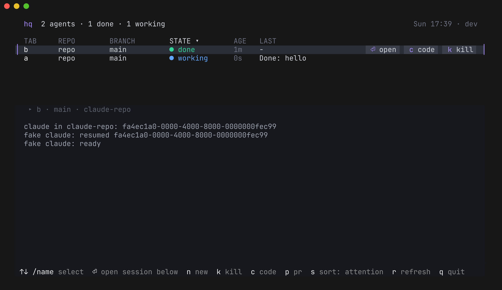
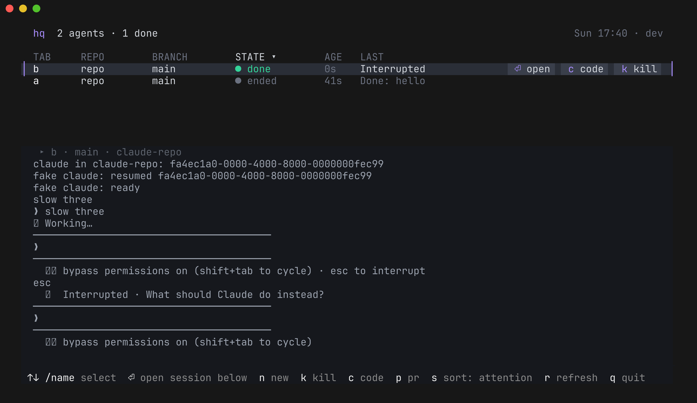
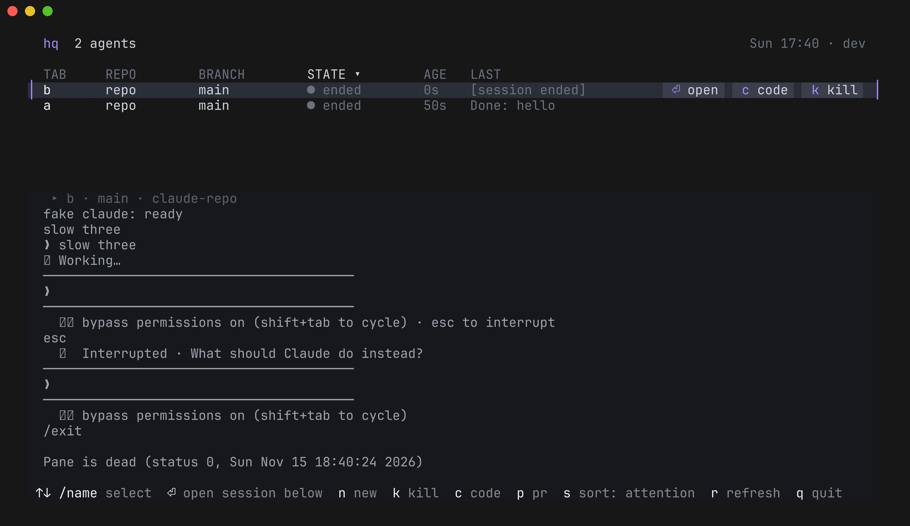

### #198 hq shows every agent's state from its journal

| # | Check | Expected | Result | Evidence |
|---|-------|----------|--------|----------|
| 1 | `hq ls` and `hq wait` on a turn the user ended (fake Claude, `slow` then Esc) | both show `done` with `Interrupted`, the same age; the wait returns it once | ✅ pass | [1-turn-ended-ls-wait.png](https://github.com/rkrysinski/hq/blob/d99a99c6bf667763693683bb63ea3acf7cbc0a4c/issue-198/1-turn-ended-ls-wait.png) |
| 2 | The journal after several looks at that screen | one `screen TurnEnded` event, based on the hook's prompt (basis 7) | ✅ pass | [2-journal-one-turn-end.txt](https://github.com/rkrysinski/hq/blob/d99a99c6bf667763693683bb63ea3acf7cbc0a4c/issue-198/2-journal-one-turn-end.txt) |
| 3 | Remove the hook's state files and spoil the window records by hand | `hq ls` identical before and after (`diff`: same), `hq read` gives the reply | ✅ pass | [3-old-files-removed.png](https://github.com/rkrysinski/hq/blob/d99a99c6bf667763693683bb63ea3acf7cbc0a4c/issue-198/3-old-files-removed.png) |
| 4 | `hq sandbox restart` | agents relaunched with their last message and branch; the journal goes on: TakenDown 9, Relaunched 11, SessionStart 14 after events 1-5 | ✅ pass | [4-sandbox-restart-numbered-on.png](https://github.com/rkrysinski/hq/blob/d99a99c6bf667763693683bb63ea3acf7cbc0a4c/issue-198/4-sandbox-restart-numbered-on.png) |
| 5 | tmux server killed, `hq restore` with c's journal removed (fake Claude starting in 4 s) | a and b restored, `starting` with their last message, then `done`, numbered on (18-24); c not restored: `its journal is gone` | ✅ pass | [5-restore-journal-gone.png](https://github.com/rkrysinski/hq/blob/d99a99c6bf667763693683bb63ea3acf7cbc0a4c/issue-198/5-restore-journal-gone.png) |
| 6 | A current agent's journal moved away, then back | `starting`, no reply, no failure; back: `done` again | ✅ pass | [6-missing-journal-starting.png](https://github.com/rkrysinski/hq/blob/d99a99c6bf667763693683bb63ea3acf7cbc0a4c/issue-198/6-missing-journal-starting.png) |
| 7 | Dashboard: a prompt, an Esc, `/exit` | working shown; `done` 0.27 s after the screen showed `Interrupted` (within 1 s); `ended` 0.06 s after `/exit` (within 2 s) | ✅ pass | [7-dashboard-timing.txt](https://github.com/rkrysinski/hq/blob/d99a99c6bf667763693683bb63ea3acf7cbc0a4c/issue-198/7-dashboard-timing.txt), screenshots below |
| 8 | Acceptance held by tests: 50,000 events x 15 agents (a look 0.5 s cold, then only the new events, under 50 ms), a long-running look folds only what is new, clock moved back and forward, looks at once agree, every fixture journal replayed through the look, eight racing looks, several-MB reply in pages, an sbx too old (exit 3, nothing ingested, no sbx event), an append to a 50,000-event journal reads only what is new, old files removed, restart and restore | all pass | ✅ pass | [8-acceptance-tests.txt](https://github.com/rkrysinski/hq/blob/d99a99c6bf667763693683bb63ea3acf7cbc0a4c/issue-198/8-acceptance-tests.txt) |
| 9 | Notifications and deliveries unchanged | the existing integration tests and journeys pass unchanged (full build) | ✅ pass | full build below |

Dashboard (check 7): working  turn ended  ended 

No look of the dashboard changed, so there is no before screenshot.

Pyramid before: `unit 785, integration 265, e2e 3 (unit share 75%, minimum 50%)`
Pyramid after (head ef2022c): `unit 770, integration 268, e2e 3 (unit share 74%, minimum 50%)`

Tests added or changed per level:
- Unit: `internal/agent` rewritten on the journals' fake (the fixture journals replayed through the look, one capture call, capture failure, outdated agent, unreadable journal, incremental folds, Collect, the queued prompt handed over, Detail, the clock, looks at once, 50,000 events x 15 agents, the dialog verdict, pane death and sbx answer, wake-up, a hundred looks, eight racing looks, overtaken evidence); `internal/state/sees_test.go`; `internal/cli` read of a several-MB reply and the command tests now filled through the hook's payloads (`hookedJournal`); `journaltest` contract (read on from a position, the latest dialog's ask), Put, ReportFiles. The old record tests of `internal/agent` are gone with the records.
- Integration: the look on the real journal with the hook's working files; an append reads on from the append before; an append to a 50,000-event journal; removing the old state files and window records changes nothing.
- End-to-end: none added; the journeys pass unchanged.

#### Outputs

`go run ./tools/testgate pyramid` after:

```text
unit 770, integration 268, e2e 3 (unit share 74%, minimum 50%)
```

Check 1 (`hq ls`, `hq wait`):

```text
NAME  REPO  BRANCH  STATE    AGE  LAST
a     repo  main    done     12s  Done: hello
b     repo  main    working  11s  -
$ hq wait b --since $S --timeout 10s; hq ls
NAME  REPO  BRANCH  STATE  AGE  LAST
b     repo  main    done   0s   Interrupted
next: hq wait b --since 2026-11-15T17:31:13.694101154Z
NAME  REPO  BRANCH  STATE  AGE  LAST
b     repo  main    done   1s   Interrupted
a     repo  main    done   22s  Done: hello
$
```

Check 2 (b's journal: number, source, kind, time, basis):

```text
2	hq	Launched	17:30:53.072
6	hook	SessionStart	17:30:53.390
7	hook	UserPromptSubmit	17:30:53.420
8	screen	TurnEnded	17:31:13.427	basis 7
$
```

Check 3:

```text
239183dd8e13  239183dd8e13.hq  e876638a688f  e876638a688f.hq  e876638a688f.stop
239183dd8e13.hq	 e876638a688f.hq
same
NAME  REPO  BRANCH  STATE  AGE  LAST
b     repo  main    done   5m   Interrupted
a     repo  main    done   5m   Done: hello
$ hq read a
name      a
repo      repo  /tmp/hq-stub-2744319230/repo
branch    main
worktree  /tmp/hq-stub-2744319230/repo
sandbox   claude-repo
state     done 5m
pending   0
reply
  Done: hello
$
```

Check 4:

```text
restarted the sandbox claude-repo; relaunched a, b
NAME  REPO  BRANCH  STATE  AGE  LAST
b     repo  main    done   0s   -
a     repo  main    done   0s   Done: hello
NAME  REPO  BRANCH  STATE  AGE  LAST
b     repo  main    done   3s   -
a     repo  main    done   3s   Done: hello
1	hq	Launched	17:30:51.863
3	hook	SessionStart	17:30:52.114
4	hook	UserPromptSubmit	17:30:52.138
5	hook	Stop	17:30:52.378
9	hq	TakenDown	17:36:35.205	basis 5
11	hq	Relaunched	17:36:35.320	basis 5
13	hook	SessionEnd	17:36:35.213
14	hook	SessionStart	17:36:35.531
$
```

Check 5:

```text
$ hq ls; hq restore; hq ls; sleep 6; hq ls; events a | tail -4
restored a in repo (sandbox claude-repo)
restored b in repo (sandbox claude-repo)
not restored c in repo: its journal is gone (hq kill c forgets it)
NAME  REPO  BRANCH  STATE     AGE  LAST
b     repo  main    starting  0s   -
a     repo  main    starting  0s   Done: hello
NAME  REPO  BRANCH  STATE  AGE  LAST
b     repo  main    done   2s   -
a     repo  main    done   2s   Done: hello
18	hq	Launched	17:37:48.192	basis 14
20	hook	SessionStart	17:37:52.205
22	hq	Launched	17:38:09.488	basis 20
24	hook	SessionStart	17:38:13.503
$
```

Check 6:

```text
NAME  REPO  BRANCH  STATE     AGE  LAST
a     repo  main    done      39s  Done: hello
b     repo  -       starting  43s  -
state     starting 43s
pending   0
reply     none
NAME  REPO  BRANCH  STATE  AGE  LAST
b     repo  main    done   39s  -
a     repo  main    done   39s  Done: hello
$
```

Check 7:

```text
screen shows Interrupted after .004393125s; dashboard done after .270270751s more
/exit typed into b: dashboard shows b ended after .056893958s
```

Check 8:

```text
--- PASS: TestOfEightLooksRacingOneEventStands (0.00s)
--- PASS: TestTheLookAppendsAndShowsWhatEveryFixtureJournalSays (0.02s)
--- PASS: TestALongRunningLookFoldsOnlyWhatIsNew (0.00s)
--- PASS: TestTheClockMovedBetweenLooksChangesNothingButTheAges (0.00s)
--- PASS: TestLooksAtOnceShowTheSameStateAndAge (0.00s)
--- PASS: TestALookAtFifteenLongJournalsFoldsOnlyWhatIsNew (0.50s)
PASS
ok  	github.com/rkrysinski/hq/internal/agent	0.533s
--- PASS: TestAnSbxTooOldEndsTheCommandBeforeAnythingIsIngested (0.00s)
--- PASS: TestOnlyAnAnswerOfSbxIsAnSbxEvent (0.00s)
--- PASS: TestReadGivesAReplyOfSeveralMegabytesInFullAndInPages (0.18s)
PASS
ok  	github.com/rkrysinski/hq/internal/cli	0.183s
--- PASS: TestAnAppendReadsOnFromTheAppendBefore (0.01s)
--- PASS: TestAnAppendToALongJournalIsQuick (1.22s)
PASS
ok  	github.com/rkrysinski/hq/internal/journal	1.226s
--- PASS: TestSandboxRestartRelaunchesAgentsAndRmRemovesTheSandbox (8.11s)
--- PASS: TestRestoreBringsBackTheAgentsOfAKilledTmuxServer (3.67s)
--- PASS: TestRemovingTheOldStateFilesAndWindowRecordsChangesNothing (1.05s)
PASS
ok  	github.com/rkrysinski/hq/internal/cli	12.845s
```

Mutation tests, `go run ./tools/testgate mutation spec-165-agent-state-journal`:

```text
mutation: done in 1m12s
alive      internal/journal/journaltest/journaltest.go:151:10 conditionals boundary
alive      internal/journal/journaltest/report.go:52:15 conditionals negation
alive      internal/journal/journaltest/report.go:64:17 conditionals boundary
alive      internal/journal/journaltest/report.go:102:53 arithmetic base
alive      internal/state/sees.go:216:66 conditionals boundary
mutation: 114 killed, 5 alive, 0 timed out, 72 not covered against spec-165-agent-state-journal on ef2022cb2ebe9a5b06144da86ba8de9a659f2d0b
exit status 1
```

- `journaltest.go:151:10`: equivalent: `from <= 0` resets a position of 0 to 0.
- `report.go:52:15`: equivalent: the fake's prompt id only ties a report's prompt and turn end together; an id on an empty prompt changes no state.
- `report.go:64:17`: equivalent: `background_tasks` null reads as none, as an absent one does.
- `report.go:102:53`: equivalent: the fake's task ids need only differ from each other.
- `sees.go:216:66`: equivalent: a turn end at the report itself (`te.key == key`) already returns at `te.at(key)`.

Full build on ef2022cb2ebe9a5b06144da86ba8de9a659f2d0b:

```text
check: ok   vet
check: ok   format
check: ok   pyramid
check: ok   platform
check: ok   unit
check: ok   integration
check: ok   coverage
check: ok   e2e
check: all 8 steps passed on ef2022cb2ebe9a5b06144da86ba8de9a659f2d0b
```

#### Deviations

- The journal's store gains two files beside each journal: `ID.ask` (what the latest dialog the hook reported asks, for `hq read` and `hq answer`) and `ID.held` (what the last append read, so an append to a long journal reads only what was appended since). The generation fingerprint test stayed green (it holds the hook's script and the event form, which did not change), so neither the fingerprint nor the generation was touched.
- No record is written on a home window any more. `tmux.KeepFirst` and the record keys in `tmux.OptionKeys` are left unused for #199 to remove with the old mechanism; `state.Read` and `state.ReadDetail` stay for the hook's tests until then.
- Integration tests changed where they read or set up the old mechanism: `h.d.readState` is now a test helper reading the journal; the lost agent of `TestRestoreBringsBackTheAgentsOfAKilledTmuxServer` whose worktree is gone is set up through an event file instead of an old state file; the fixture rebuild calls `agent.Look` with its new signature.
- `TestAgentsOfASandboxStoppedOutsideHqAreEnded`: with sbx failing after it said the sandbox stopped, `hq ls` now keeps b `ended` (the `NotRunning` event stands in the journal) where it showed `done` again; first append wins makes the end stick, as the spec's journal says.
- `hq restore` reports a lost agent with no journal as `its journal is gone` (a new reason, as the ticket asks).
- The moment a dialog of the hooks closed by Claude at work on the screen is entered is that `AtWork` event (was the dialog's report); it only touches `working`, which `hq wait` does not return.
- `hq go`, `hq code` and the dock (`agent.Collect`) append nothing, so an agent whose pane died but no look has appended it yet is shown `ended` from tmux's word, folded without being appended.
- `hq ls` is a new process each time, so it folds every journal from its start; the 250 ms tick with 50,000 events x 15 agents holds for the long-running list and `hq wait`, which keep their folds.
- The unit count fell from 785 to 770: the record tests of `internal/agent` went with the records; what they held is held by the fixture journals replayed through the look and by the reducer's tests.
