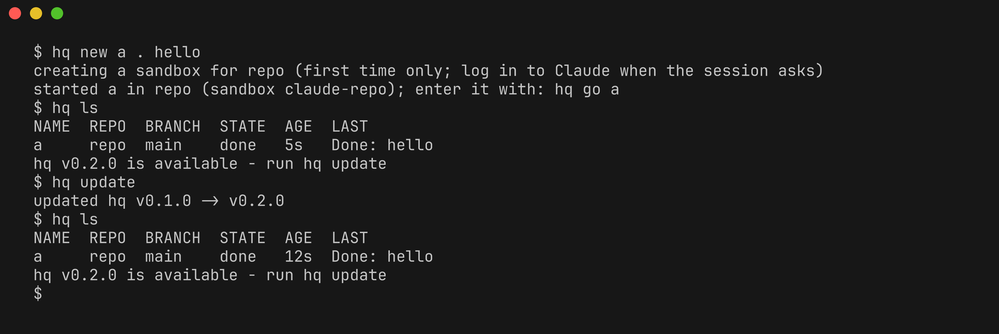
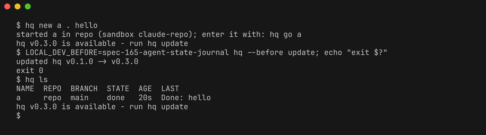
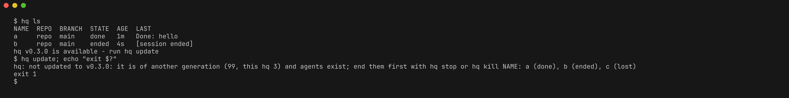
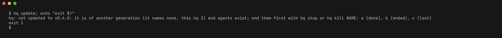
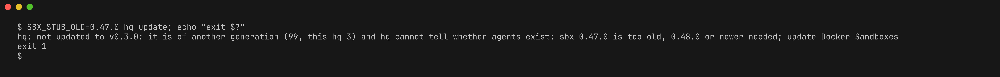
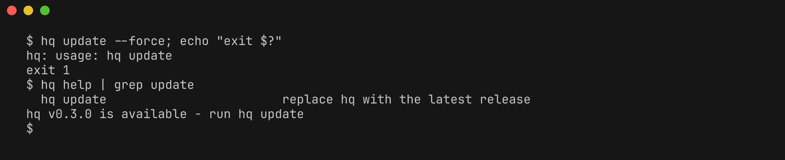
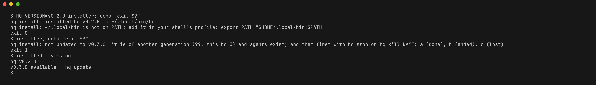
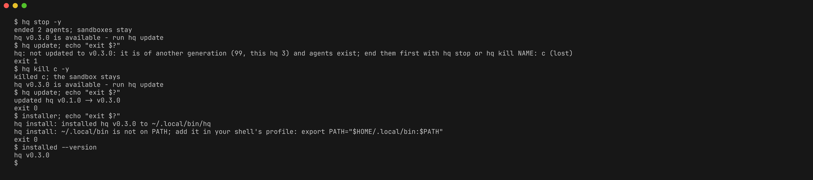
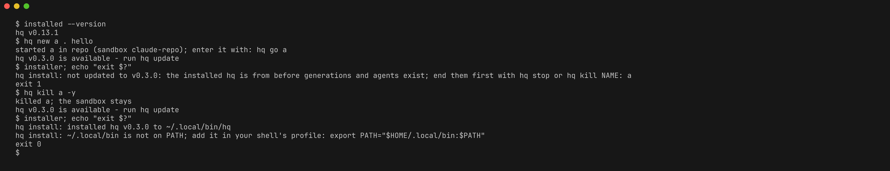

### #200 hq update and the install script refuse an update across generations

| # | Check | Expected | Result | Evidence |
|---|-------|----------|--------|----------|
| 1 | Update to a release of the same generation with an agent running (stub release server) | hq replaced, agent as it was | ✅ pass | [1-same-generation.txt](https://github.com/rkrysinski/hq/blob/059439d21bf44b7ab7f536c9e0654d87a1b072ee/issue-200/1-same-generation.txt), screenshot below |
| 2 | Update to another generation with a running (`done`), an `ended` and a lost agent | refused, exit 1, line names release, reason, remedy, each agent with its state; nothing replaced | ✅ pass | [2-refused-with-agents.txt](https://github.com/rkrysinski/hq/blob/059439d21bf44b7ab7f536c9e0654d87a1b072ee/issue-200/2-refused-with-agents.txt), before / after below |
| 3 | Release that publishes no generation | treated as another generation, refused | ✅ pass | [3-no-generation.txt](https://github.com/rkrysinski/hq/blob/059439d21bf44b7ab7f536c9e0654d87a1b072ee/issue-200/3-no-generation.txt) |
| 4 | Another generation, sbx cannot tell (too old) | refused with that reason, exit 1 | ✅ pass (sbx not answering: unit test, the stub has no hang) | [4-sbx-too-old.txt](https://github.com/rkrysinski/hq/blob/059439d21bf44b7ab7f536c9e0654d87a1b072ee/issue-200/4-sbx-too-old.txt) |
| 5 | `hq update` takes no option that updates anyway | `--force` is a usage error; help lists none | ✅ pass | [5-no-option.txt](https://github.com/rkrysinski/hq/blob/059439d21bf44b7ab7f536c9e0654d87a1b072ee/issue-200/5-no-option.txt) |
| 6 | Install script: first install, then over an installed hq with agents, another generation | first install asks nothing; then refused, exit 1, nothing replaced | ✅ pass | [6-install-refused.txt](https://github.com/rkrysinski/hq/blob/059439d21bf44b7ab7f536c9e0654d87a1b072ee/issue-200/6-install-refused.txt) |
| 7 | The remedy clears the way: `hq stop`, `hq kill c` | update and install go through with no agent | ✅ pass | [7-remedy.txt](https://github.com/rkrysinski/hq/blob/059439d21bf44b7ab7f536c9e0654d87a1b072ee/issue-200/7-remedy.txt) |
| 8 | Install script over a real hq v0.13.1 (before generations) with an agent, then none | refused naming the agent; then installs | ✅ pass | [8-install-over-old-hq.txt](https://github.com/rkrysinski/hq/blob/059439d21bf44b7ab7f536c9e0654d87a1b072ee/issue-200/8-install-over-old-hq.txt) |
| 9 | Release build publishes GENERATION, covered by SHA256SUMS | GENERATION = 3, listed in SHA256SUMS | ✅ pass | `TestReleaseBuildPublishesTheGeneration` |
| 10 | Fingerprint test fails on a hook change with the pin unchanged | fails naming the hook's script | ✅ pass | Outputs below |
| 11 | Update journey gains the refusal, no journey added | e2e count 3 before and after, journey passes | ✅ pass | full build |
| 12 | Docs: spec (`hq update`, install, S15, acceptance), design 3.6/3.9/7.2/7.3, README, ADR 0020 | say what is above | ✅ pass | diff |
| 13 | `scripts/check.sh` passes | all steps pass | ✅ pass | Outputs below |

**1. Update within the generation**


**2. Update across generations with agents**
Before (the integration branch's hq replaces itself): 
After: 

**3 to 8**







Pyramid before: `unit 714, integration 232, e2e 3 (unit share 75%, minimum 50%)`; after: `unit 723, integration 240, e2e 3 (unit share 75%, minimum 50%)`. Coverage after: 94.78% (minimum 94.4%).

Tests added: unit 9 (the update rule, refusals and hidden commands in `internal/cli/update_test.go`, `TestReadGeneration`, the fingerprint test and its own check in `internal/version/generation_test.go`); integration 8 (`Releases.Generation` against the stub release server, `hq update` across generations in real tmux with the stub sbx, four install-script tests with a stub installed hq, the release build); end-to-end: the install-and-update journey gains the refusal by `hq update` and by the install script with a real agent, none added.

#### Outputs

QA was run with `scripts/local-dev.sh --stub native` (`LOCAL_DEV_VERSION=v0.1.0`, `HQ_RELEASES_URL` at a local stub release server serving v0.2.0 of generation 3, v0.3.0 of generation 99 and v0.4.0 with none, built by `scripts/build-release.sh`); the fake Claude only. `installer` and `installed` are shell aliases running the release's `install.sh` and the installed `~/.local/bin/hq` in the stub home against the same tmux server.

Check 1:
```text
$ hq new a . hello
creating a sandbox for repo (first time only; log in to Claude when the session asks)
started a in repo (sandbox claude-repo); enter it with: hq go a
$ hq ls
NAME  REPO  BRANCH  STATE  AGE  LAST
a     repo  main    done   5s   Done: hello
hq v0.2.0 is available - run hq update
$ hq update
updated hq v0.1.0 -> v0.2.0
$ hq ls
NAME  REPO  BRANCH  STATE  AGE  LAST
a     repo  main    done   12s  Done: hello
hq v0.2.0 is available - run hq update
$
```
Check 2, before:
```text
$ hq new a . hello
started a in repo (sandbox claude-repo); enter it with: hq go a
hq v0.3.0 is available - run hq update
$ LOCAL_DEV_BEFORE=spec-165-agent-state-journal hq --before update; echo "exit $?"
updated hq v0.1.0 -> v0.3.0
exit 0
$ hq ls
NAME  REPO  BRANCH  STATE  AGE  LAST
a     repo  main    done   20s  Done: hello
hq v0.3.0 is available - run hq update
$
```
Check 2, after:
```text
$ hq ls
NAME  REPO  BRANCH  STATE  AGE  LAST
a     repo  main    done   1m   Done: hello
b     repo  main    ended  4s   [session ended]
hq v0.3.0 is available - run hq update
$ hq update; echo "exit $?"
hq: not updated to v0.3.0: it is of another generation (99, this hq 3) and agents exist; end them first with hq stop or hq kill NAME: a (done), b (ended), c (lost)
exit 1
$
```
Check 3:
```text
$ hq update; echo "exit $?"
hq: not updated to v0.4.0: it is of another generation (it names none, this hq 3) and agents exist; end them first with hq stop or hq kill NAME: a (done), b (ended), c (lost)
exit 1
$
```
Check 4:
```text
$ SBX_STUB_OLD=0.47.0 hq update; echo "exit $?"
hq: not updated to v0.3.0: it is of another generation (99, this hq 3) and hq cannot tell whether agents exist: sbx 0.47.0 is too old, 0.48.0 or newer needed; update Docker Sandboxes
exit 1
$
```
Check 5:
```text
$ hq update --force; echo "exit $?"
hq: usage: hq update
exit 1
$ hq help | grep update
  hq update                        replace hq with the latest release
hq v0.3.0 is available - run hq update
$
```
Check 6:
```text
$ HQ_VERSION=v0.2.0 installer; echo "exit $?"
hq install: installed hq v0.2.0 to ~/.local/bin/hq
hq install: ~/.local/bin is not on PATH; add it in your shell's profile: export PATH="$HOME/.local/bin:$PATH"
exit 0
$ installer; echo "exit $?"
hq install: not updated to v0.3.0: it is of another generation (99, this hq 3) and agents exist; end them first with hq stop or hq kill NAME: a (done), b (ended), c (lost)
exit 1
$ installed --version
hq v0.2.0
v0.3.0 available - hq update
$
```
Check 7:
```text
$ hq stop -y
ended 2 agents; sandboxes stay
hq v0.3.0 is available - run hq update
$ hq update; echo "exit $?"
hq: not updated to v0.3.0: it is of another generation (99, this hq 3) and agents exist; end them first with hq stop or hq kill NAME: c (lost)
exit 1
$ hq kill c -y
killed c; the sandbox stays
hq v0.3.0 is available - run hq update
$ hq update; echo "exit $?"
updated hq v0.1.0 -> v0.3.0
exit 0
$ installer; echo "exit $?"
hq install: installed hq v0.3.0 to ~/.local/bin/hq
hq install: ~/.local/bin is not on PATH; add it in your shell's profile: export PATH="$HOME/.local/bin:$PATH"
exit 0
$ installed --version
hq v0.3.0
$
```
Check 8:
```text
$ installed --version
hq v0.13.1
$ hq new a . hello
started a in repo (sandbox claude-repo); enter it with: hq go a
hq v0.3.0 is available - run hq update
$ installer; echo "exit $?"
hq install: not updated to v0.3.0: the installed hq is from before generations and agents exist; end them first with hq stop or hq kill NAME: a
exit 1
$ hq kill a -y
killed a; the sandbox stays
hq v0.3.0 is available - run hq update
$ installer; echo "exit $?"
hq install: installed hq v0.3.0 to ~/.local/bin/hq
hq install: ~/.local/bin is not on PATH; add it in your shell's profile: export PATH="$HOME/.local/bin:$PATH"
exit 0
$
```
Check 10 (one space added to the hook's first line, pin left as it was):
```text
generation_test.go:105: changed since generation 3 was pinned: the hook's script (now "0070df1b1b564470"); raise version.Generation and pin the forms again, or pin them again and say in the pull request why what agents report is unchanged
```

Mutation tests, `go run ./tools/testgate mutation spec-165-agent-state-journal`:
```text
mutation: 22 killed, 0 alive, 0 timed out, 12 not covered against spec-165-agent-state-journal on 2b7a391d86c23d57e25b92bdbbbbfa8e8350f78b
```
The two boundary mutants a first run left alive (`gen < 1` in `internal/cli/update.go` and `internal/update/update.go`) are killed by tests that accept generation 1. The 12 not covered are `Releases.Generation` and its reader, covered by the integration tests.

Full build:
```text
check: ok   vet
check: ok   format
check: ok   pyramid
check: ok   platform
check: ok   unit
check: ok   integration
check: ok   coverage
check: ok   e2e
check: all 8 steps passed on 2b7a391d86c23d57e25b92bdbbbbfa8e8350f78b
```

#### Deviations

- **The journal's form is not fingerprinted yet.** #193 was not on the integration branch when its tip was merged in (tip `80bfaac`), so the fingerprint test pins the hook set and script (`state.Settings`) and hq's record (`state.Record`); the journal's form (`state.Event` and the reply, by their fields, types and tags, with `form()`) is one more entry of `forms()` once #193 lands. The design and ADR 0020 say so.
- **The pin carries the generation it was pinned at.** The test fails when a form changes with the pin left as it was, and also when `version.Generation` moves without the pin being renewed, so a raise is always a renewal of the pin with the new number; a renewal that keeps the number is visible in the diff and is the one to explain in the pull request.
- **States in the refusal.** Agents of the tmux server are named with their state as `hq ls` shows it (`working`, `done`, `ended`, `outdated`...), lost ones as `lost`.
- **Exit codes.** As decided by the operator, a refusal is exit code 1, also when sbx is too old, missing or does not answer, and when tmux fails. A `GENERATION` the checksums do not vouch for, or that cannot be read, stops the update with exit code 3 ("could not read the generation ...; nothing was replaced"), like a failed download.
- **Seam.** The releases seam gains `Generation(tag)` (the spec's Testing Decisions name it); the install script's question goes through two hidden commands, `hq __generation` (an hq that does not know it is from before generations) and `hq __may-update TAG GENERATION`; #201 can use `__generation` to ask the hq on disk its generation.
- **QA of sbx not answering** is by unit test only: the stub sbx has no way to hang, and `scripts/local-dev.sh` puts it first on PATH.
- **Deploy steps.** None for this ticket's code. The release that brings #165 must say in its notes to end every agent before updating (story 28); that is the release's, not this branch's.
