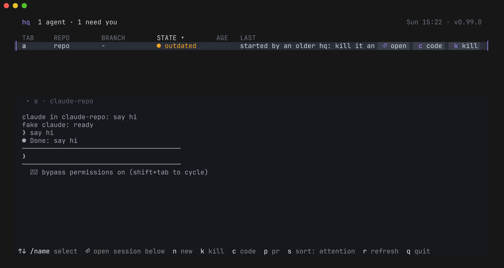
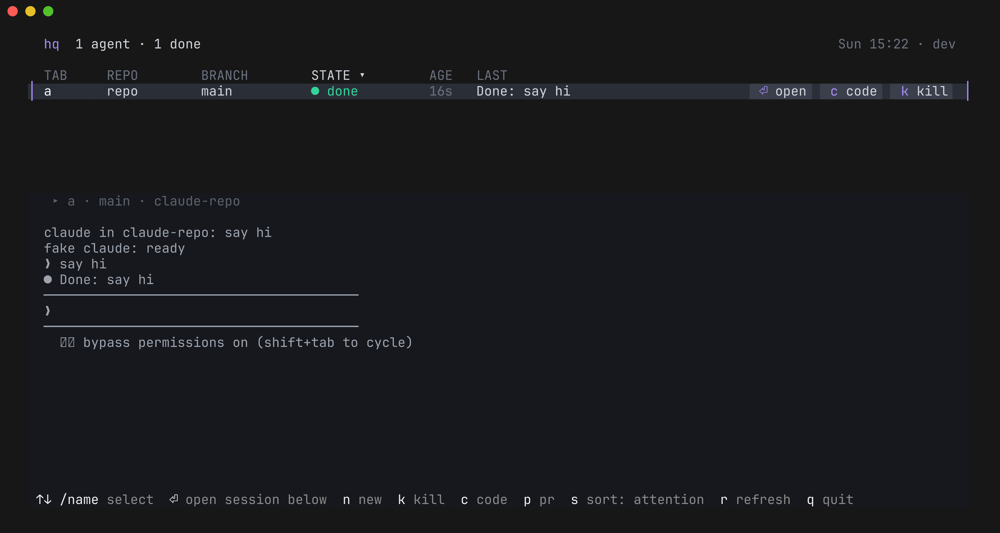
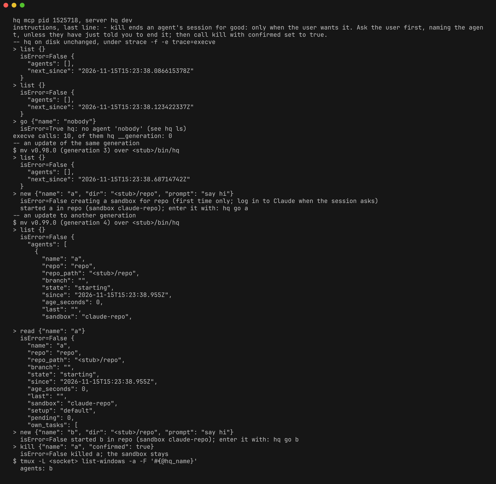
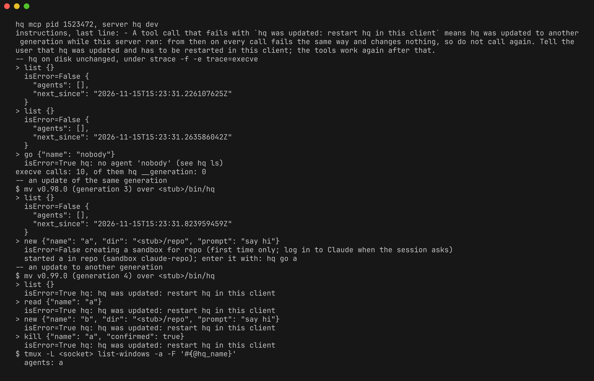
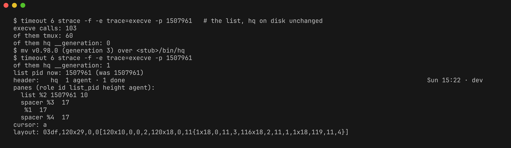

### #201 The dashboard and hq mcp step aside after an update to another generation

| # | Check | Expected | Result | Evidence |
|---|-------|----------|--------|----------|
| 1 | Dashboard open on `--stub native` (fake Claude), agent `a` docked; v0.99.0 of generation 4 renamed over the hq on disk | the list runs from the new hq within 5 s; docked session, cursor row and layout as before | ✅ pass: header showed v0.99.0 after 0.72 s, same list pid, panes, cursor and layout; `a` now `outdated` and still docked | [3-other-generation-after.txt](https://github.com/rkrysinski/hq/blob/84e1a0be157b889d07504e6d98d19fecafc604ab/issue-201/3-other-generation-after.txt), screenshots below |
| 2 | The same, with v0.98.0 of generation 3 renamed over it first | the list is not respawned | ✅ pass: header still `dev`, same pid and layout after 6 s | [2-same-generation-after.txt](https://github.com/rkrysinski/hq/blob/84e1a0be157b889d07504e6d98d19fecafc604ab/issue-201/2-same-generation-after.txt) |
| 3 | `hq mcp` driven over stdio; v0.99.0 of generation 4 renamed over the hq on disk | every tool call fails with `hq was updated: restart hq in this client`; `new` starts no agent | ✅ pass: `list`, `read`, `new`, `kill` all fail with the line; only `a` exists after | [4-mcp-after.txt](https://github.com/rkrysinski/hq/blob/84e1a0be157b889d07504e6d98d19fecafc604ab/issue-201/4-mcp-after.txt) |
| 4 | `hq mcp` after v0.98.0 of generation 3 is renamed over it | tools served as before | ✅ pass: `list` and `new a` work | [4-mcp-after.txt](https://github.com/rkrysinski/hq/blob/84e1a0be157b889d07504e6d98d19fecafc604ab/issue-201/4-mcp-after.txt) |
| 5 | Neither program starts a process while hq on disk is unchanged (`strace -f -e trace=execve` on the list and on `hq mcp`) | no `hq __generation` while unchanged; one after a change | ✅ pass: list 0 of 103 execs unchanged, 1 after the same-generation update; `hq mcp` 0 of 10 over three calls | [5-no-process-after.txt](https://github.com/rkrysinski/hq/blob/84e1a0be157b889d07504e6d98d19fecafc604ab/issue-201/5-no-process-after.txt), [4-mcp-after.txt](https://github.com/rkrysinski/hq/blob/84e1a0be157b889d07504e6d98d19fecafc604ab/issue-201/4-mcp-after.txt) |
| 6 | Spec (4.1, 6.1, S15, 10, Phase 2), design (3.11, 3.12, 7.2, 10), README and the server's instructions say the above | they do | ✅ pass | the diff; instructions' last line in [4-mcp-after.txt](https://github.com/rkrysinski/hq/blob/84e1a0be157b889d07504e6d98d19fecafc604ab/issue-201/4-mcp-after.txt) |
| 7 | `scripts/check.sh` | passes | ✅ pass | [full-build.txt](https://github.com/rkrysinski/hq/blob/84e1a0be157b889d07504e6d98d19fecafc604ab/issue-201/full-build.txt) |

Check 1, before (the integration branch's hq: the list keeps running as `dev` after an update to another generation) and after:




Docked before the updates (after):  Check 2 after: 

Check 3 and 4, before (the integration branch's `hq mcp` serves on and starts `b`) and after:




Check 5 after: 

Pyramid before: `unit 732, integration 257, e2e 3 (unit share 74%, minimum 50%)`; after: `unit 748, integration 261, e2e 3 (unit share 74%, minimum 50%)`. Coverage after: `coverage 94.81% (minimum 94.4%)`.

Tests added: unit: the watcher of the hq on disk (`internal/cli/ondisk_test.go`, 6), the list's look every 2 s, one at a time, making way or not (`internal/dash/dash_test.go`, 4), the list running the new hq in its pane or saying why it cannot (`internal/cli/dash_test.go`, 3), `hq mcp` failing every tool, serving after the same generation, asking nothing while unchanged, and the instructions (`internal/cli/mcp_test.go`, 3); integration: a file's stamp and asking an hq its generation (`internal/cli/ondisk_integration_test.go`, 2), the list in real tmux on a private socket and `hq mcp` over stdio across updates of the same and another generation, the other hq built with an overlay of `internal/version` (`cmd/hq/stepaside_integration_test.go`, 2); end-to-end: none.

#### Outputs

`go run ./tools/testgate mutation spec-165-agent-state-journal`

```text
mutation: 12 killed, 0 alive, 0 timed out, 11 not covered against spec-165-agent-state-journal on b0f7cf321d98f737e93a1fc8e7114a7dedac834b
```

`scripts/check.sh`

```text
check: ok   vet
check: ok   format
check: ok   pyramid
check: ok   platform
check: ok   unit
check: ok   integration
check: ok   coverage
check: ok   e2e
check: all 8 steps passed on b0f7cf321d98f737e93a1fc8e7114a7dedac834b
```

`cat 3-other-generation-after.txt`

```text
$ mv v0.99.0 (generation 4) over <stub>/bin/hq
the header showed v0.99.0 after: .723707626 s
list pid now: 1507961 (was 1507961)
header:   hq  1 agent · 1 need you                                                                         Sun 15:22 · v0.99.0
panes (role id list_pid height agent):
  list %2 1507961 10 
  spacer %3  17 
   %1  17 
  spacer %4  17 
cursor: a
layout: 03df,120x29,0,0[120x10,0,0,2,120x18,0,11{1x18,0,11,3,116x18,2,11,1,1x18,119,11,4}]
```

`cat 2-same-generation-after.txt`

```text
$ mv v0.98.0 (generation 3) over <stub>/bin/hq
$ timeout 6 strace -f -e trace=execve -p 1507961
of them hq __generation: 1
list pid now: 1507961 (was 1507961)
header:   hq  1 agent · 1 done                                                                                 Sun 15:22 · dev
panes (role id list_pid height agent):
  list %2 1507961 10 
  spacer %3  17 
   %1  17 
  spacer %4  17 
cursor: a
layout: 03df,120x29,0,0[120x10,0,0,2,120x18,0,11{1x18,0,11,3,116x18,2,11,1,1x18,119,11,4}]
```

`cat 5-no-process-after.txt`

```text
$ timeout 6 strace -f -e trace=execve -p 1507961   # the list, hq on disk unchanged
execve calls: 103
of them tmux: 60
of them hq __generation: 0
$ mv v0.98.0 (generation 3) over <stub>/bin/hq
$ timeout 6 strace -f -e trace=execve -p 1507961
of them hq __generation: 1
list pid now: 1507961 (was 1507961)
header:   hq  1 agent · 1 done                                                                                 Sun 15:22 · dev
panes (role id list_pid height agent):
  list %2 1507961 10 
  spacer %3  17 
   %1  17 
  spacer %4  17 
cursor: a
layout: 03df,120x29,0,0[120x10,0,0,2,120x18,0,11{1x18,0,11,3,116x18,2,11,1,1x18,119,11,4}]
```

`cat 4-mcp-after.txt`

```text
hq mcp pid 1523472, server hq dev
instructions, last line: - A tool call that fails with `hq was updated: restart hq in this client` means hq was updated to another generation while this server ran: from then on every call fails the same way and changes nothing, so do not call again. Tell the user that hq was updated and has to be restarted in this client; the tools work again after that.
-- hq on disk unchanged, under strace -f -e trace=execve
> list {}
  isError=False {
    "agents": [],
    "next_since": "2026-11-15T15:23:31.226107625Z"
  }
> list {}
  isError=False {
    "agents": [],
    "next_since": "2026-11-15T15:23:31.263586042Z"
  }
> go {"name": "nobody"}
  isError=True hq: no agent 'nobody' (see hq ls)
execve calls: 10, of them hq __generation: 0
-- an update of the same generation
$ mv v0.98.0 (generation 3) over <stub>/bin/hq
> list {}
  isError=False {
    "agents": [],
    "next_since": "2026-11-15T15:23:31.823959459Z"
  }
> new {"name": "a", "dir": "<stub>/repo", "prompt": "say hi"}
  isError=False creating a sandbox for repo (first time only; log in to Claude when the session asks)
  started a in repo (sandbox claude-repo); enter it with: hq go a
-- an update to another generation
$ mv v0.99.0 (generation 4) over <stub>/bin/hq
> list {}
  isError=True hq: hq was updated: restart hq in this client
> read {"name": "a"}
  isError=True hq: hq was updated: restart hq in this client
> new {"name": "b", "dir": "<stub>/repo", "prompt": "say hi"}
  isError=True hq: hq was updated: restart hq in this client
> kill {"name": "a", "confirmed": true}
  isError=True hq: hq was updated: restart hq in this client
$ tmux -L <socket> list-windows -a -F '#{@hq_name}'
  agents: a
```

#### Deviations

- The list is "respawned" by replacing its own process with `HQ __list` from the hq on disk (`exec`), not with tmux's `respawn-pane`: the pane, its process id (`@hq_list_pid`) and its shell stay, so nothing in tmux has to be put back (design 3.11).
- `hq mcp` fails every tool call once the generation differs, `go` and `kill` included, as the ticket says ("every tool call"); the handshake and the tool list still answer.
- Seams: the spec names none for this; the watcher stands behind three functions in the command's dependencies (`stampFile`, `askGeneration`, `replaceProcess`), as the per-user files do (design 7.2).
- A full build failed once in `TestHomeWindowKeepsOptionsArgumentsAndOutputAfterExit` (`internal/tmux`, untouched here) and passed on the rerun: #211.
