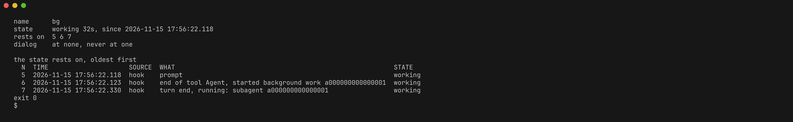
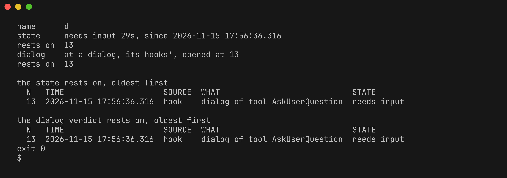
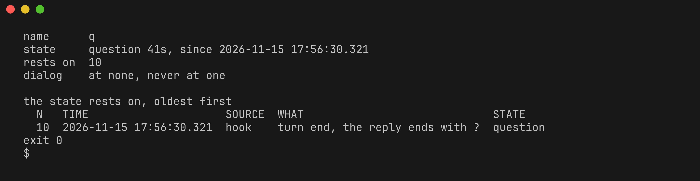
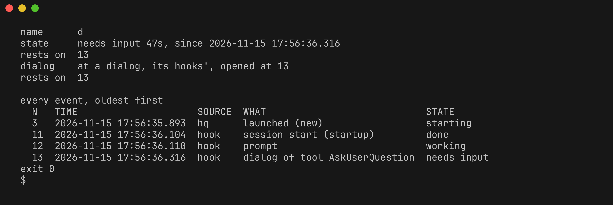
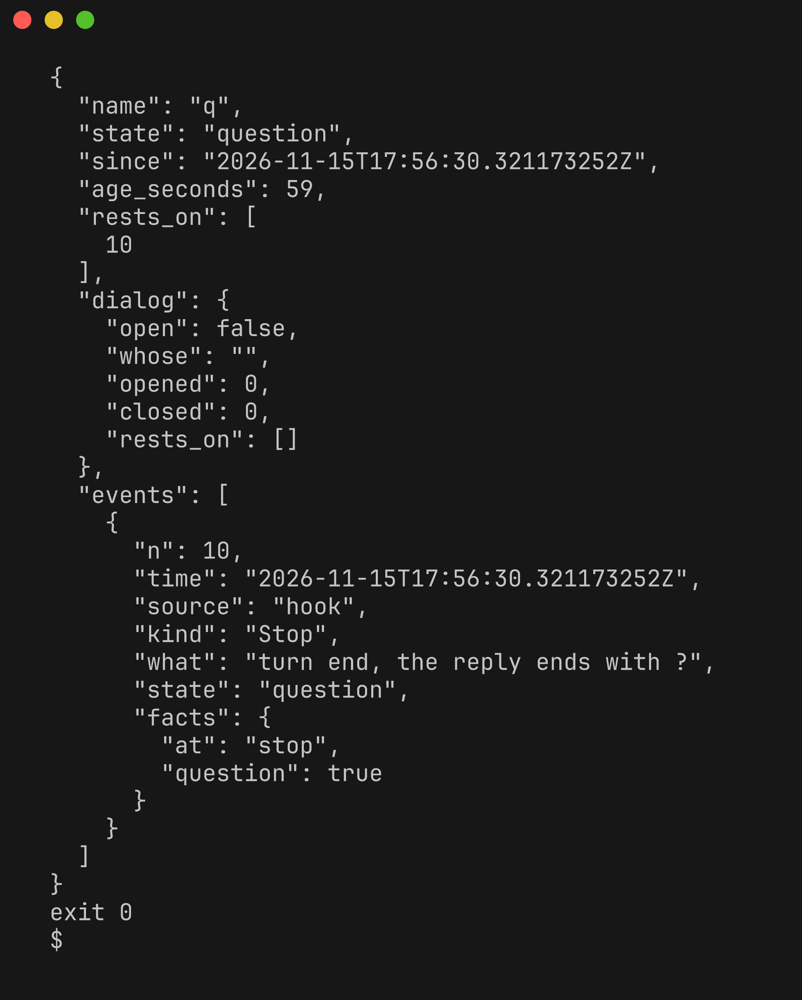
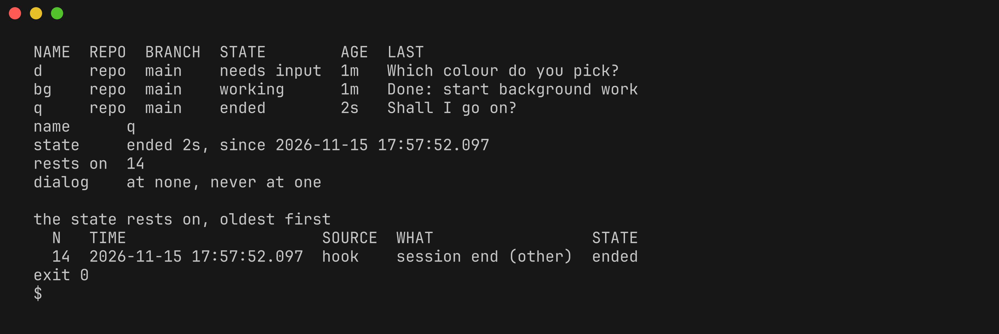
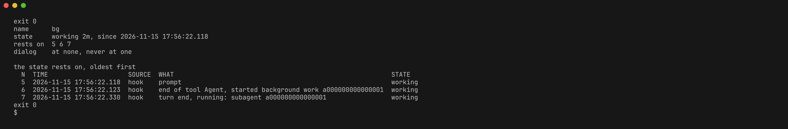
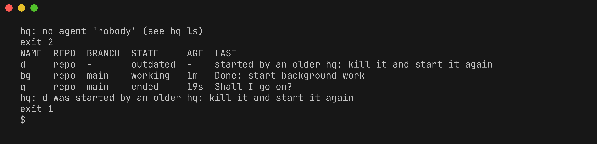
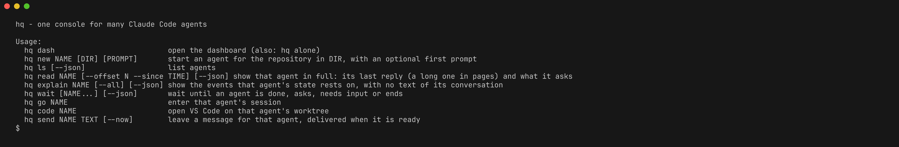

### #202 hq explain shows the events an agent's state rests on

Every check ran against hq built from `issue-202-hq-explain` with `scripts/local-dev.sh --stub native`, in the stub environment's neutral repository, on the fake Claude's sessions only (`tools/fakeclaude`): `bg` started with "start background work", `q` with "ask me a question", `d` with "need input".

| # | Check | Expected | Result | Evidence |
|---|-------|----------|--------|----------|
| 1 | `hq explain bg` on an agent working on background work | the prompt, the end of the tool that started the task and the turn end that left it working, oldest first, each with number, time, source, what and state after | ✅ pass | [1-explain-background.png](https://github.com/rkrysinski/hq/blob/e5c1d8c4812a8b584fa3b2ad96229fad9f04286d/issue-202/1-explain-background.png?raw=true) |
| 2 | `hq explain d` on an agent at a question dialog | says it is at a dialog, its hooks', and lists the event that opened it; no text of the dialog | ✅ pass | [2-explain-dialog.png](https://github.com/rkrysinski/hq/blob/e5c1d8c4812a8b584fa3b2ad96229fad9f04286d/issue-202/2-explain-dialog.png?raw=true) |
| 3 | `hq explain q` on an agent in `question` | the turn end shows `the reply ends with ?`, not the reply | ✅ pass | [3-explain-question.png](https://github.com/rkrysinski/hq/blob/e5c1d8c4812a8b584fa3b2ad96229fad9f04286d/issue-202/3-explain-question.png?raw=true) |
| 4 | `hq explain d --all` | every event since the launch, with the state after each | ✅ pass | [4-explain-all.png](https://github.com/rkrysinski/hq/blob/e5c1d8c4812a8b584fa3b2ad96229fad9f04286d/issue-202/4-explain-all.png?raw=true) |
| 5 | `hq explain q --json`, `hq explain bg --all --json` | the same events as data, with the state and the dialog verdict; no prompt or reply | ✅ pass | [5-explain-json.png](https://github.com/rkrysinski/hq/blob/e5c1d8c4812a8b584fa3b2ad96229fad9f04286d/issue-202/5-explain-json.png?raw=true), [10-explain-all-json.txt](https://github.com/rkrysinski/hq/blob/e5c1d8c4812a8b584fa3b2ad96229fad9f04286d/issue-202/10-explain-all-json.txt) |
| 6 | An event set aside, in `--all` | marked with its reason (another process appended it first; a later report overtook it) | ✅ pass (unit: `TestExplainAllShowsEveryEventAndWhyOneWasSetAside`, `TestAsideWhyTellsEveryReason`; a live race of two processes is not reproducible by hand) | unit tests |
| 7 | No conversation text, every fixture journal, plain and `--json`, with and without `--all` | output identical to that of the journal with every text blanked, and none of the fixture's texts in it | ✅ pass (unit: `TestExplainShowsNoTextOfTheConversationOfAnyFixtureJournal`, 30 journals) | unit test |
| 8 | `hq explain q` after its session ended, still listed | explains it: `ended`, from the session's end | ✅ pass | [6-explain-ended.png](https://github.com/rkrysinski/hq/blob/e5c1d8c4812a8b584fa3b2ad96229fad9f04286d/issue-202/6-explain-ended.png?raw=true) |
| 9 | `hq explain bg` after the tmux server was killed (a lost agent, before `hq restore`) | explained from its journal on the host | ✅ pass | [8-explain-lost.png](https://github.com/rkrysinski/hq/blob/e5c1d8c4812a8b584fa3b2ad96229fad9f04286d/issue-202/8-explain-lost.png?raw=true) |
| 10 | `hq explain nobody`; `hq explain d` with `d` made outdated (its window's generation set to 2) | `hq: no agent 'nobody' (see hq ls)`, exit 2; the outdated line, exit 1 | ✅ pass | [7-explain-refused.png](https://github.com/rkrysinski/hq/blob/e5c1d8c4812a8b584fa3b2ad96229fad9f04286d/issue-202/7-explain-refused.png?raw=true) |
| 11 | `hq mcp` offers no tool for it; the dashboard binds no key | tool list unchanged (`answer go kill list new read send wait`, pinned by `TestMCPOffersTheSupervisorsToolsAndTeachesTheProtocol`); `internal/dash` untouched by the change | ✅ pass | unit test, diff |
| 12 | Usage text, spec (§3, §4.1, §5, §10, Phase 2), design (3.4, 3.6, 3.12, 10), README, glossary's look | name `hq explain` as above | ✅ pass | [9-help.png](https://github.com/rkrysinski/hq/blob/e5c1d8c4812a8b584fa3b2ad96229fad9f04286d/issue-202/9-help.png?raw=true), diff |
| 13 | An sbx too old | `hq explain` takes it as one more failed `sbx ls`: explains, exit 0, appends no `sbx` event (design 3.6) | ✅ pass (unit: `TestExplainTakesAnSbxTooOldAsAFailedSbxLs`) | unit test |
| 14 | `scripts/check.sh` | passes | ✅ pass | full build below |

Pyramid before (`spec-165-agent-state-journal` at ef2022c): `unit 770, integration 268, e2e 3 (unit share 74%, minimum 50%)`. After: `unit 781, integration 268, e2e 3 (unit share 74%, minimum 50%)`. Coverage after: `coverage 95.24% (minimum 94.4%)`.

Tests added: unit 11 in `internal/cli/explain_test.go` (the rests-on output, `--all` with events set aside, `--json` with and without `--all`, a subagent's dialog, every kind told in words, every reason set aside, the question fact, no text over every fixture journal, an ended and a lost agent, the refusals, an sbx too old); integration none; end-to-end none.











**Mutation tests**

`go run ./tools/testgate mutation spec-165-agent-state-journal`

```text
mutation: 63 killed, 0 alive, 0 timed out, 4 not covered against spec-165-agent-state-journal on dc248facf9e85bd28ecebd411b7d0c0765a129bf
```

**Full build** (this ticket's head before the merge; the pull request's full build is the orchestrator's)

```text
check: ok   vet
check: ok   format
check: ok   pyramid
check: ok   platform
check: ok   unit
check: ok   integration
check: ok   coverage
check: ok   e2e
check: all 8 steps passed on dc248facf9e85bd28ecebd411b7d0c0765a129bf
```

#### Outputs

`1-explain-background`

```text
name      bg
state     working 32s, since 2026-11-15 17:56:22.118
rests on  5 6 7
dialog    at none, never at one

the state rests on, oldest first
  N  TIME                     SOURCE  WHAT                                                         STATE
  5  2026-11-15 17:56:22.118  hook    prompt                                                       working
  6  2026-11-15 17:56:22.123  hook    end of tool Agent, started background work a000000000000001  working
  7  2026-11-15 17:56:22.330  hook    turn end, running: subagent a000000000000001                 working
exit 0
$
```

`2-explain-dialog`

```text
name      d
state     needs input 29s, since 2026-11-15 17:56:36.316
rests on  13
dialog    at a dialog, its hooks', opened at 13
rests on  13

the state rests on, oldest first
  N   TIME                     SOURCE  WHAT                            STATE
  13  2026-11-15 17:56:36.316  hook    dialog of tool AskUserQuestion  needs input

the dialog verdict rests on, oldest first
  N   TIME                     SOURCE  WHAT                            STATE
  13  2026-11-15 17:56:36.316  hook    dialog of tool AskUserQuestion  needs input
exit 0
$
```

`3-explain-question`

```text
name      q
state     question 41s, since 2026-11-15 17:56:30.321
rests on  10
dialog    at none, never at one

the state rests on, oldest first
  N   TIME                     SOURCE  WHAT                             STATE
  10  2026-11-15 17:56:30.321  hook    turn end, the reply ends with ?  question
exit 0
$
```

`4-explain-all`

```text
name      d
state     needs input 47s, since 2026-11-15 17:56:36.316
rests on  13
dialog    at a dialog, its hooks', opened at 13
rests on  13

every event, oldest first
  N   TIME                     SOURCE  WHAT                            STATE
  3   2026-11-15 17:56:35.893  hq      launched (new)                  starting
  11  2026-11-15 17:56:36.104  hook    session start (startup)         done
  12  2026-11-15 17:56:36.110  hook    prompt                          working
  13  2026-11-15 17:56:36.316  hook    dialog of tool AskUserQuestion  needs input
exit 0
$
```

`5-explain-json`

```text
{
  "name": "q",
  "state": "question",
  "since": "2026-11-15T17:56:30.321173252Z",
  "age_seconds": 59,
  "rests_on": [
    10
  ],
  "dialog": {
    "open": false,
    "whose": "",
    "opened": 0,
    "closed": 0,
    "rests_on": []
  },
  "events": [
    {
      "n": 10,
      "time": "2026-11-15T17:56:30.321173252Z",
      "source": "hook",
      "kind": "Stop",
      "what": "turn end, the reply ends with ?",
      "state": "question",
      "facts": {
        "at": "stop",
        "question": true
      }
    }
  ]
}
exit 0
$
```

`6-explain-ended`

```text
NAME  REPO  BRANCH  STATE        AGE  LAST
d     repo  main    needs input  1m   Which colour do you pick?
bg    repo  main    working      1m   Done: start background work
q     repo  main    ended        2s   Shall I go on?
name      q
state     ended 2s, since 2026-11-15 17:57:52.097
rests on  14
dialog    at none, never at one

the state rests on, oldest first
  N   TIME                     SOURCE  WHAT                 STATE
  14  2026-11-15 17:57:52.097  hook    session end (other)  ended
exit 0
$
```

`8-explain-lost`

```text
exit 0
name      bg
state     working 2m, since 2026-11-15 17:56:22.118
rests on  5 6 7
dialog    at none, never at one

the state rests on, oldest first
  N  TIME                     SOURCE  WHAT                                                         STATE
  5  2026-11-15 17:56:22.118  hook    prompt                                                       working
  6  2026-11-15 17:56:22.123  hook    end of tool Agent, started background work a000000000000001  working
  7  2026-11-15 17:56:22.330  hook    turn end, running: subagent a000000000000001                 working
exit 0
$
```

`7-explain-refused`

```text
hq: no agent 'nobody' (see hq ls)
exit 2
NAME  REPO  BRANCH  STATE     AGE  LAST
d     repo  -       outdated  -    started by an older hq: kill it and start it again
bg    repo  main    working   1m   Done: start background work
q     repo  main    ended     19s  Shall I go on?
hq: d was started by an older hq: kill it and start it again
exit 1
$
```

`9-help`

```text
hq - one console for many Claude Code agents

Usage:
  hq dash                          open the dashboard (also: hq alone)
  hq new NAME [DIR] [PROMPT]       start an agent for the repository in DIR, with an optional first prompt
  hq ls [--json]                   list agents
  hq read NAME [--offset N --since TIME] [--json] show that agent in full: its last reply (a long one in pages) and what it asks
  hq explain NAME [--all] [--json] show the events that agent's state rests on, with no text of its conversation
  hq wait [NAME...] [--json]       wait until an agent is done, asks, needs input or ends
  hq go NAME                       enter that agent's session
  hq code NAME                     open VS Code on that agent's worktree
  hq send NAME TEXT [--now]        leave a message for that agent, delivered when it is ready
$
```

#### Deviations

- `hq explain` takes an sbx too old as one more failed `sbx ls` (exit 0, no `sbx` event), the side of design 3.6's *The oldest sbx* the integration review of #206 asked to choose: it explains the journal, which is on the host, and has to work for a lost agent whatever sbx says. Written into design 3.6 and held by `TestExplainTakesAnSbxTooOldAsAFailedSbxLs`.
- Unlike `hq read`, it types in no waiting message (spec 5.1 does not name it among the looks that do); its look is otherwise `hq ls`'s, the second look RestDelay later included (`lookSettled`, factored out of `gatherAgents`).
- Besides the conversation's text, `--json` leaves out the session id, the branch, the worktree and the screen's fingerprint, so its output can go into a public issue (the session id is a private detail by `docs/hq/testing.md`); the turn id, tool names, MCP server names and task ids stay, being what the rules read. Written into the spec's entry.
- The spec's §3 gains *Event* and *journal* (from `GLOSSARY.md`), which the entry of `hq explain` refers to.
- Story 5's test is stronger than a search for the fixtures' texts: the output of each fixture journal must equal, character for character, that of the same journal with every text blanked; the search stays beside it.
- Check 6 (an event set aside) and check 13 (an sbx too old) are proven by unit tests only: a race of two hq processes for one first append, and an sbx older than 0.48, are not reproducible with the stub by hand.
- No deploy steps.
