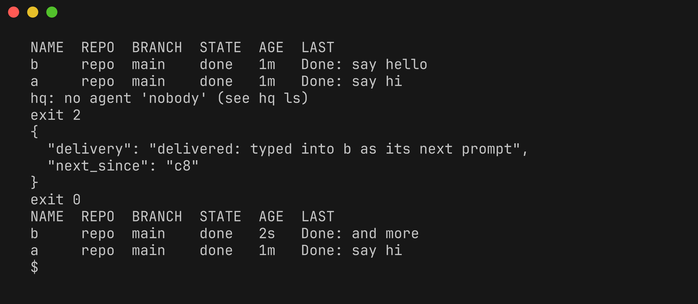
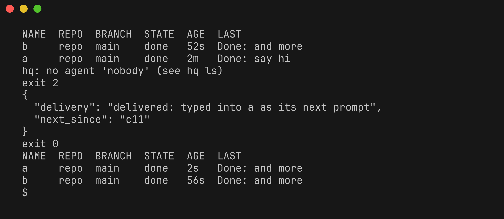
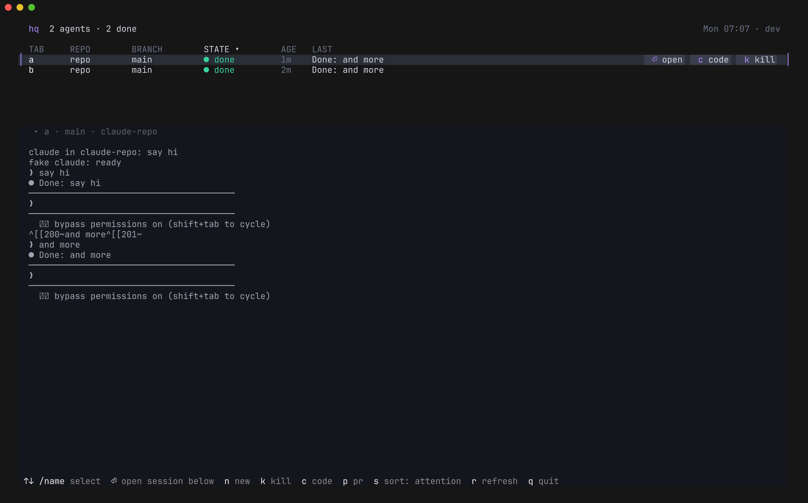
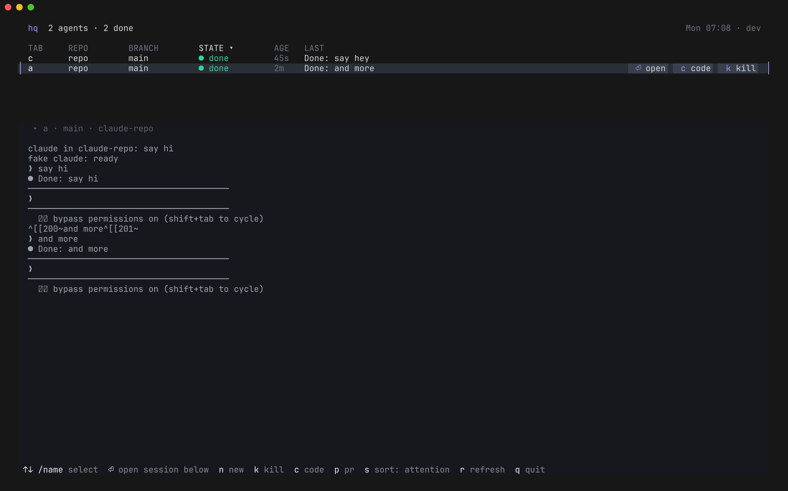
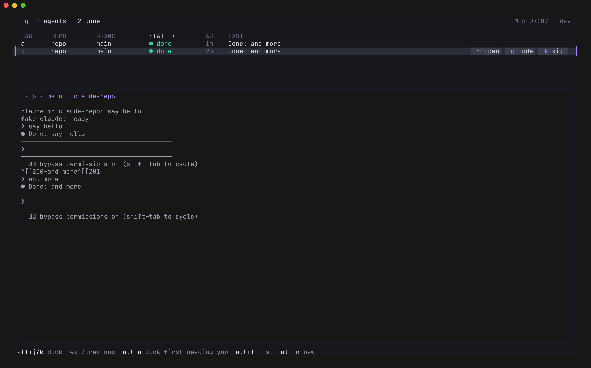
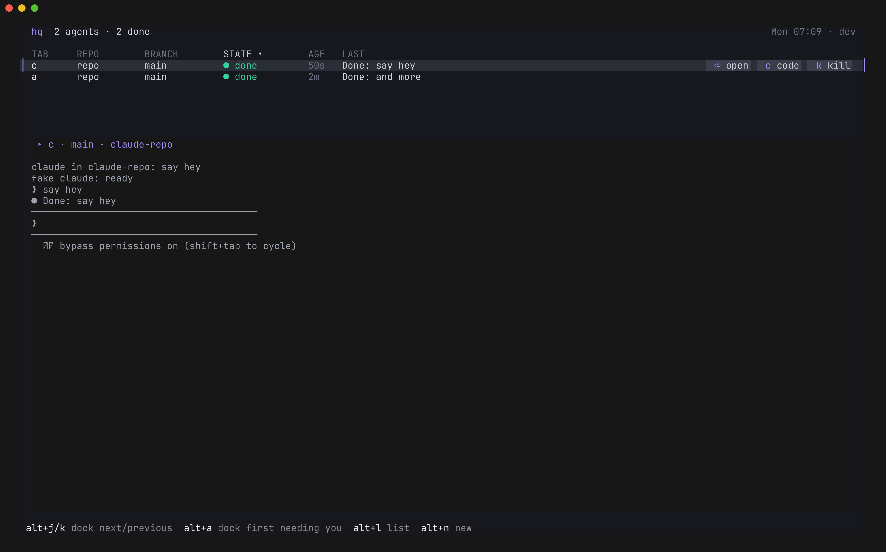

### #337 The one-shot commands take the look from one module: the agents, the cursor, and the agent named or its refusal

Base commit: `476a6ce` (`origin/release-v0.17.0` and `spec-336-one-look-module` when the branch was cut), with none of #291, #318 or #330; none of #291, #318, #330 or #279 was edited. Commits: `847c55f` (only the three missing checks), `601b6de` (the module, the glossary, the design), `a5cf222` (new tests for what the mutation gate found untested). The terminal checks ran with `scripts/local-dev.sh --stub native` in the stub environment's neutral repository, on fake Claude sessions; "before" is the same script with `--before` and `LOCAL_DEV_BEFORE=476a6ce`, on the same agents.

| # | Check | Expected | Result | Evidence |
|---|-------|----------|--------|----------|
| 1 | The first commit adds only the three missing checks, which pass on the code before the module: `hq explain` types in no waiting message; the chords and docking on entry ask sbx nothing; `hq send` looks every 250 ms and `hq answer` every 100 ms, each look asking sbx | `847c55f` adds `internal/cli/look_variants_test.go` alone; its 4 tests pass on `476a6ce` (and each failed when the behaviour was broken on purpose: explain delivering, a chord or the dock asking sbx, 200 ms and 120 ms) | ✅ pass | [5-files.txt](https://github.com/rkrysinski/hq/blob/46f2472ad5f6142320f5db7ecd2536bb6ff22ede/issue-337/5-files.txt), [8-new-tests-on-base.txt](https://github.com/rkrysinski/hq/blob/46f2472ad5f6142320f5db7ecd2536bb6ff22ede/issue-337/8-new-tests-on-base.txt) |
| 2 | After the first commit no test file changes, and no ADR | no test file or ADR modified, removed or renamed; one test file added (check 5) | ✅ pass | [5-files.txt](https://github.com/rkrysinski/hq/blob/46f2472ad5f6142320f5db7ecd2536bb6ff22ede/issue-337/5-files.txt) |
| 3 | The tests of the spec's table "Krok 1" pass, with the 4 new checks | 38 tests pass, unit and integration | ✅ pass | [7-step-1-tests.txt](https://github.com/rkrysinski/hq/blob/46f2472ad5f6142320f5db7ecd2536bb6ff22ede/issue-337/7-step-1-tests.txt) |
| 4 | The private names the tests use stay in the commands' package as thin forwarders | `agentAppeared` -> `agent.Appeared`, `coverLooks` = `agent.CoverLooks`, `lookNow` -> `Looker.Look(agent.Acting)`; no test needed a change | ✅ pass | diff of `cursor.go`, `ls.go` |
| 5 | A mutant or a line no test killed or ran becomes a new test passing on the code before the module | the gate's first run left 1 alive and 9 not run; `look_rules_test.go` (4 tests) kills and runs them all, and passes on `476a6ce`; the second run: 38 killed, 0 alive, 0 not run | ✅ pass | [8-new-tests-on-base.txt](https://github.com/rkrysinski/hq/blob/46f2472ad5f6142320f5db7ecd2536bb6ff22ede/issue-337/8-new-tests-on-base.txt), mutation block |
| 6 | Same output, exit codes and `next_since` for `hq ls`, `hq ls --json`, `hq read` (plain, `--json`), `hq explain`, and the refusals of `hq read`, `hq explain`, `hq send`, `hq answer` | before and after differ only in ages; the cursors are the same (`c8`) | ✅ pass | [4-commands-before.txt](https://github.com/rkrysinski/hq/blob/46f2472ad5f6142320f5db7ecd2536bb6ff22ede/issue-337/4-commands-before.txt), [4-commands-after.txt](https://github.com/rkrysinski/hq/blob/46f2472ad5f6142320f5db7ecd2536bb6ff22ede/issue-337/4-commands-after.txt) |
| 7 | `hq send` to an agent at its prompt and the refusal of a missing name, in a terminal | typed in as its next prompt, `next_since` given; `no agent 'nobody' (see hq ls)`, exit 2; the same before and after | ✅ pass | [1-commands-before.png](https://github.com/rkrysinski/hq/blob/46f2472ad5f6142320f5db7ecd2536bb6ff22ede/issue-337/1-commands-before.png?raw=true), [1-commands-after.png](https://github.com/rkrysinski/hq/blob/46f2472ad5f6142320f5db7ecd2536bb6ff22ede/issue-337/1-commands-after.png?raw=true) |
| 8 | Docking on entry and the chords (Alt+j before, Alt+k after) | the cursor row docked as the dashboard is entered (after a kill left the placeholder, in the after run); the chord docks the next or previous row | ✅ pass | [2-dock-on-entry-before.png](https://github.com/rkrysinski/hq/blob/46f2472ad5f6142320f5db7ecd2536bb6ff22ede/issue-337/2-dock-on-entry-before.png?raw=true), [2-dock-on-entry-after.png](https://github.com/rkrysinski/hq/blob/46f2472ad5f6142320f5db7ecd2536bb6ff22ede/issue-337/2-dock-on-entry-after.png?raw=true), [3-chord-next-before.png](https://github.com/rkrysinski/hq/blob/46f2472ad5f6142320f5db7ecd2536bb6ff22ede/issue-337/3-chord-next-before.png?raw=true), [3-chord-previous-after.png](https://github.com/rkrysinski/hq/blob/46f2472ad5f6142320f5db7ecd2536bb6ff22ede/issue-337/3-chord-previous-after.png?raw=true) |
| 9 | No command asks sbx or tmux more often | the rhythm and sbx checks of check 1, `TestAQuietLookListsTheWindowsOnce`, `TestTheListsCursorStandsForEveryRowItShows` (the table looks once); the plain `hq ls` lists the windows at most once less (Deviations) | ✅ pass | [7-step-1-tests.txt](https://github.com/rkrysinski/hq/blob/46f2472ad5f6142320f5db7ecd2536bb6ff22ede/issue-337/7-step-1-tests.txt) |
| 10 | Code searches: no command of the ticket calls a bare look, notes the moment of asking sbx, reads the counter for a cursor or builds the refusal; the module calls no delivery and writes in no pane | the only hits in the ticket's command files are the list's `listSource` and `dockAgent` in `dash.go` and, in `ls.go`, `lookWith`, `runningSandboxes`, `askSandboxes`, whose only callers are `hq wait`, `hq send --wait` and `hq kill` (searched too); none in `looker.go` | ✅ pass | [6-searches.txt](https://github.com/rkrysinski/hq/blob/46f2472ad5f6142320f5db7ecd2536bb6ff22ede/issue-337/6-searches.txt) |
| 11 | `Stands` keeps its name and gets no second one | `git grep -n -w Stands -- '*.go'` shows the same lines as on the base | ✅ pass | [6-searches.txt](https://github.com/rkrysinski/hq/blob/46f2472ad5f6142320f5db7ecd2536bb6ff22ede/issue-337/6-searches.txt) |
| 12 | The interface designed twice, the refusals apart, compared, the choice argued | below | ✅ pass | this section |
| 13 | `GLOSSARY.md` gets **Look loop** after **Look**, in the agreed words; the design (3.8 components, 7.2 testability, 10) describes the module | both in `601b6de` | ✅ pass | diff |
| 14 | Full build and mutation gate on the head | both pass on `a5cf222` | ✅ pass | blocks below |

Pyramid before (`476a6ce`): `unit 991, integration 324, e2e 3 (unit share 75%, minimum 75%)`. After: `unit 999, integration 324, e2e 3 (unit share 76%, minimum 75%)`. The minimum stays 0.75: the share is 75.5%, so a minimum of 76% would fail it. Coverage after: `coverage 95.46% (minimum 94.7%)` (the base measured the same way: 95.40%, already more than 0.5 points above the minimum, so this change moves no threshold).

Tests added: unit 8, all in `internal/cli`: 4 in `look_variants_test.go` (`TestExplainTypesInNoMessageLeftWaiting`, `TestTheChordsAndDockingOnEntryAskSbxNothing`, `TestSendLooksEvery250msWhileItsAgentStartsEachLookAskingSbx`, `TestAnswerLooksEvery100msUntilItsAgentLeavesTheDialogEachLookAskingSbx`) and 4 in `look_rules_test.go` (`TestTheLooksCursorIsItsLowestReadUnlessAnAgentMayHaveAppeared`, `TestLsJSONFailsWhenALookAgainFails`, `TestAChordAndExplainFailWhenTmuxCannotListTheWindows`, `TestSendsCursorWithoutTheCounterIsItsReadOfTheAgent`); integration none; end-to-end none.








**The interface, designed twice**

Both cover the two entries, the look and the look loop, and give the refusal of a name no agent has apart from the refusal of an outdated agent, since `hq ls NAME...` (#291) takes only the first.

**Design A: one entry, a closed set of named variants** (chosen, built in `internal/agent/looker.go`)

```go
type Looker struct { Windows; Sources; Sandboxes; Now; Sleep; Folds }   // tmux, the journals' store, sbx's answer, the clock
type Variant struct { /* private: sbx mode, second look */ }
var Shown, Explained, Acting, Updating, Docking Variant                // one per command, each what it did before
func (k Looker) Look(v Variant) (Seen, error)                          // *SbxError, *TmuxError
type Seen struct { Agents []Agent; Windows []tmux.Window; Listed []sbx.Sandbox }
func (s Seen) Cursor() int64                                           // the look's cursor, worked out when asked
func (s Seen) Covered() (Seen, int64, error)                           // hq ls --json: looks again, up to CoverLooks
func (s Seen) CursorOf(a Agent) int64                                  // hq read's own cursor
func (s Seen) Counter() (int64, bool)                                  // for --since's ahead check
func (s Seen) Named(name string) (Agent, error)                        // *NotFoundError only
func (s Seen) Usable(name string) (Agent, error)                       // Named, then *OutdatedError
func (a Agent) Refusal() error                                         // *OutdatedError, for hq explain's lost agent
func (k Looker) CounterBefore(a Agent) int64                           // hq send, hq answer
// the look loop, built by the next ticket:
var Waiting Variant                                                    // hq wait, hq send --wait: sbx asked in the background
const LoopEvery, SbxEvery = 250 * time.Millisecond, time.Second        // the list reads them too
func (k Looker) Loop(v Variant, step func(s Seen, first bool) (done bool, err error)) error
func (k Looker) AskSbx() (Sandboxes, error)                            // the moment noted before the question; the list's own background asking calls it
```

**Design B: one entry per question, with options the command composes**

```go
type Deps struct { Windows; Sources; Sandboxes; Now; Sleep; Folds }
type Option func(*options)
func SbxRequired() Option; func SbxTolerated() Option; func NoSbx() Option
func SecondLook() Option; func CoverRows() Option
type Cursors struct { Look, Counter int64; Counted bool }              // worked out with every look
func All(d Deps, opts ...Option) ([]Agent, Cursors, error)             // hq ls, explain, update, chords, dock
func One(d Deps, name string, opts ...Option) (Agent, Cursors, error)  // ErrNoAgent; ErrOutdated unless AllowOutdated()
func AllowOutdated() Option                                            // hq ls NAME...: no agent refused, outdated shown
func Before(d Deps, a Agent) int64                                     // hq send, hq answer
func Loop(d Deps, until func([]Agent, Cursors, bool) (bool, error), opts ...Option) error
const LoopEvery, SbxEvery
```

**Compared**

| | A: closed variants | B: composed options |
|---|---|---|
| Depth | 5 names hide the sbx rule, the second look and the counter behind one call; a command says which command it is, not how to look | 6 options are the protocol's steps again, chosen at each call site: the module hides less |
| Locality | which command looks how stands in one table of 5 values in the module, beside the rules; a rule changes in one place | each command's mix is spelled at its call, over 8 files: the knowledge the spec wants in one place spreads again |
| A switchboard? | no: the fields are private, so no command can make a mix the module does not name; a new one is a new named value, with its reason, in the module | yes: any of 2^6 mixes compiles, most never meant (`NoSbx` with `SbxRequired`) |
| Today's behaviour | the cursor is worked out only when asked, so `hq read`, `hq send` and `hq answer` list the windows no more often; `Covered` comes after the command typed in what waits, as today | the eager `Cursors` lists the windows again in `hq read`, `hq send` and `hq answer` (more tmux calls); `CoverRows` inside `All` covers before the delivery, or needs the module to call it; `One` refuses before `hq read`'s `--since` check |

**Choice: A.** It is the deeper module with its rules in one place, its variants cannot be mixed into new ones by a caller, and it keeps every command's order and tmux and sbx calls as they were, which B breaks in three places. The refusals stay apart in A as in B (`Named` gives only the refusal of a missing name, which `hq ls NAME...` takes; `Usable` and `Refusal` add the outdated one).

#### Outputs

**Mutation tests**

`go run ./tools/testgate mutation spec-336-one-look-module`

```text
mutation: 38 killed, 0 alive, 0 timed out, 0 not covered, 0 not run against spec-336-one-look-module on a5cf222a7b94f80149b16caecf2ad03b4ced1296
```

The run on `601b6de` before `a5cf222`'s tests, for the record:

```text
not run    internal/agent/looker.go:81
not run    internal/agent/looker.go:83
not run    internal/agent/looker.go:89
alive      internal/agent/looker.go:211:9 conditionals negation
not run    internal/agent/looker.go:212
not run    internal/agent/looker.go:234
not run    internal/agent/looker.go:309
not run    internal/cli/chord.go:35
not run    internal/cli/explain.go:138
not run    internal/cli/ls.go:62
mutation: 37 killed, 1 alive, 0 timed out, 0 not covered, 9 not run against spec-336-one-look-module on 601b6de56e9e496e4c10df273fdd94853e125516
```

**Full build**

`scripts/check.sh`

```text
check: ok   vet
check: ok   format
check: ok   pyramid
check: ok   platform
check: ok   timebound
check: ok   sees
check: ok   unit
check: ok   integration
check: ok   coverage
check: ok   e2e
check: all 10 steps passed on a5cf222a7b94f80149b16caecf2ad03b4ced1296
```

**Files the ticket changes**

```text
$ git diff --name-status 476a6ce a5cf222
M	GLOSSARY.md
M	docs/design/hq.md
A	internal/agent/looker.go
M	internal/cli/answer.go
M	internal/cli/chord.go
M	internal/cli/cursor.go
M	internal/cli/dash.go
M	internal/cli/deps.go
M	internal/cli/explain.go
A	internal/cli/look_rules_test.go
A	internal/cli/look_variants_test.go
M	internal/cli/ls.go
M	internal/cli/read.go
M	internal/cli/send.go
M	internal/cli/update.go

$ git diff --name-status 476a6ce 847c55f   # the first commit
A	internal/cli/look_variants_test.go

$ git diff --name-status --diff-filter=MDR 847c55f a5cf222 -- '*_test.go' docs/adr   # test files or ADRs changed after it
(none)

$ git diff --name-status 847c55f a5cf222 -- '*_test.go'   # test files added after it
A	internal/cli/look_rules_test.go
```

**The new tests on the base**

```text
$ git log --oneline -1   # the base, with look_variants_test.go and look_rules_test.go copied in
476a6ce Merge pull request #317 from rkrysinski/release-v0.16.0
$ go test -count=1 -v -run '^(TestExplainTypesInNoMessageLeftWaiting|TestTheChordsAndDockingOnEntryAskSbxNothing|TestSendLooksEvery250msWhileItsAgentStartsEachLookAskingSbx|TestAnswerLooksEvery100msUntilItsAgentLeavesTheDialogEachLookAskingSbx|TestTheLooksCursorIsItsLowestReadUnlessAnAgentMayHaveAppeared|TestLsJSONFailsWhenALookAgainFails|TestAChordAndExplainFailWhenTmuxCannotListTheWindows|TestSendsCursorWithoutTheCounterIsItsReadOfTheAgent)$' ./internal/cli | grep -E '^(--- |ok|FAIL)'
--- PASS: TestTheLooksCursorIsItsLowestReadUnlessAnAgentMayHaveAppeared (0.00s)
--- PASS: TestLsJSONFailsWhenALookAgainFails (0.00s)
--- PASS: TestAChordAndExplainFailWhenTmuxCannotListTheWindows (0.00s)
--- PASS: TestSendsCursorWithoutTheCounterIsItsReadOfTheAgent (0.00s)
--- PASS: TestExplainTypesInNoMessageLeftWaiting (0.00s)
--- PASS: TestTheChordsAndDockingOnEntryAskSbxNothing (0.00s)
--- PASS: TestSendLooksEvery250msWhileItsAgentStartsEachLookAskingSbx (0.00s)
--- PASS: TestAnswerLooksEvery100msUntilItsAgentLeavesTheDialogEachLookAskingSbx (0.00s)
ok  	github.com/rkrysinski/hq/internal/cli	0.003s
```

**The tests of the spec's table "Krok 1" and the new checks**

```text
$ go test -count=1 -tags integration -v -run '^(TestAnswerGivesEveryQuestionItsAnswer|TestAnswerTakenButNotClosedNamesTheLikelyCause|TestAnswerToAnAgentKilledMeanwhile|TestAnswerPicksAnOptionOfADialogOfClaudesOwnWithKeys|TestAltJAndKDockTheNextAndPreviousRow|TestAltADocksTheFirstAgentNeedingYou|TestCursorsOfLoopsLookingAtOnceMissNoChangeAndRepeatNone|TestAnAgentAppearedWhenItsWindowDid|TestALooksCursorLeavesWhatAnotherProcessNumberedMeanwhileToTheNextWait|TestSendsCursorIsTheCounterAsItLeavesTheMessage|TestAQuietLookListsTheWindowsOnce|TestTheListsCursorStandsForEveryRowItShows|TestTheListLooksAgainOnlyAFewTimes|TestEnteringWithNothingDockedDocksTheCursorRowKeysOnTheList|TestEnteringLeavesWhatIsDockedAndTheEmptySlot|TestExplainExplainsAnEndedAndALostAgent|TestExplainTakesAnSbxTooOldAsAFailedSbxLs|TestExplainTypesInNoMessageLeftWaiting|TestTheChordsAndDockingOnEntryAskSbxNothing|TestSendLooksEvery250msWhileItsAgentStartsEachLookAskingSbx|TestAnswerLooksEvery100msUntilItsAgentLeavesTheDialogEachLookAskingSbx|TestLsDoesNotEndAnAgentThatReportedAfterSbxWasAsked|TestLsShowsARewoundTurnDoneOnceItsScreenStaysAtRest|TestLsBetweenTheStepsOfAKillLeavesTheAgentOut|TestLsBetweenTheStepsOfAKillWritesNoJournalBack|TestReadJSONHasWhatLsHasAndTheAgentInFull|TestSendToAStartingAgentWaitsForItsFirstReport|TestSendUsage|TestAMessageLeftWaitingForAnAgentAtItsPromptIsTypedInWhenHqLooks|TestAMessageLeftWaitingIsTypedInOnlyAtAnEmptyBoxAtRest|TestUpdateAcrossGenerationsIsRefusedWhileAgentsExist|TestUpdateAcrossGenerationsIsRefusedWhenHqCannotTell|TestWaitSinceTheLastCursorReportsWhatChangedBetweenCalls|TestWaitOnNamedAgentsIgnoresTheOthers|TestWaitReturnsAnAgentKilledBetweenTheStepsOfItsLookWithItsLastMessage|TestWaitReturnsAgentsThatFinishWithinALookOfEachOtherTogether|TestTheLookSawEveryChangeUpToTheLowestCounterOfItsReads|TestEachLookDeliversTheMessagesLeftWaitingOneRoundAtATime)$' ./internal/cli ./internal/agent ./internal/dash | grep -E '^(--- |ok|FAIL)'
--- PASS: TestAnswerGivesEveryQuestionItsAnswer (0.00s)
--- PASS: TestAnswerTakenButNotClosedNamesTheLikelyCause (0.00s)
--- PASS: TestAnswerToAnAgentKilledMeanwhile (0.00s)
--- PASS: TestAnswerPicksAnOptionOfADialogOfClaudesOwnWithKeys (0.00s)
--- PASS: TestAltJAndKDockTheNextAndPreviousRow (0.00s)
--- PASS: TestAltADocksTheFirstAgentNeedingYou (0.00s)
--- PASS: TestCursorsOfLoopsLookingAtOnceMissNoChangeAndRepeatNone (7.26s)
--- PASS: TestAnAgentAppearedWhenItsWindowDid (0.00s)
--- PASS: TestALooksCursorLeavesWhatAnotherProcessNumberedMeanwhileToTheNextWait (0.00s)
--- PASS: TestSendsCursorIsTheCounterAsItLeavesTheMessage (0.00s)
--- PASS: TestAQuietLookListsTheWindowsOnce (0.00s)
--- PASS: TestTheListsCursorStandsForEveryRowItShows (0.00s)
--- PASS: TestTheListLooksAgainOnlyAFewTimes (0.00s)
--- PASS: TestEnteringWithNothingDockedDocksTheCursorRowKeysOnTheList (0.00s)
--- PASS: TestEnteringLeavesWhatIsDockedAndTheEmptySlot (0.00s)
--- PASS: TestExplainExplainsAnEndedAndALostAgent (0.00s)
--- PASS: TestExplainTakesAnSbxTooOldAsAFailedSbxLs (0.00s)
--- PASS: TestExplainTypesInNoMessageLeftWaiting (0.00s)
--- PASS: TestTheChordsAndDockingOnEntryAskSbxNothing (0.00s)
--- PASS: TestSendLooksEvery250msWhileItsAgentStartsEachLookAskingSbx (0.00s)
--- PASS: TestAnswerLooksEvery100msUntilItsAgentLeavesTheDialogEachLookAskingSbx (0.00s)
--- PASS: TestLsDoesNotEndAnAgentThatReportedAfterSbxWasAsked (0.00s)
--- PASS: TestLsShowsARewoundTurnDoneOnceItsScreenStaysAtRest (0.00s)
--- PASS: TestLsBetweenTheStepsOfAKillLeavesTheAgentOut (0.00s)
--- PASS: TestLsBetweenTheStepsOfAKillWritesNoJournalBack (0.00s)
--- PASS: TestReadJSONHasWhatLsHasAndTheAgentInFull (0.00s)
--- PASS: TestSendToAStartingAgentWaitsForItsFirstReport (0.00s)
--- PASS: TestSendUsage (0.00s)
--- PASS: TestAMessageLeftWaitingForAnAgentAtItsPromptIsTypedInWhenHqLooks (0.00s)
--- PASS: TestAMessageLeftWaitingIsTypedInOnlyAtAnEmptyBoxAtRest (0.00s)
--- PASS: TestUpdateAcrossGenerationsIsRefusedWhileAgentsExist (0.00s)
--- PASS: TestUpdateAcrossGenerationsIsRefusedWhenHqCannotTell (0.00s)
--- PASS: TestWaitSinceTheLastCursorReportsWhatChangedBetweenCalls (0.00s)
--- PASS: TestWaitOnNamedAgentsIgnoresTheOthers (0.00s)
--- PASS: TestWaitReturnsAnAgentKilledBetweenTheStepsOfItsLookWithItsLastMessage (0.00s)
--- PASS: TestWaitReturnsAgentsThatFinishWithinALookOfEachOtherTogether (0.00s)
ok  	github.com/rkrysinski/hq/internal/cli	7.288s
--- PASS: TestTheLookSawEveryChangeUpToTheLowestCounterOfItsReads (0.00s)
ok  	github.com/rkrysinski/hq/internal/agent	0.002s
--- PASS: TestEachLookDeliversTheMessagesLeftWaitingOneRoundAtATime (0.06s)
ok  	github.com/rkrysinski/hq/internal/dash	0.063s
```

**Code searches**

```text
$ git grep -n -E 'd\.look\(|agent\.Look\(|lookWith\(|runningSandboxes\(|askSandboxes\(|pollSandboxes|asked := d\.now\(\)|journal\.Through\(\)|\.cursor\(d\)|no agent '\''' -- internal/cli/ls.go internal/cli/read.go internal/cli/explain.go internal/cli/send.go internal/cli/answer.go internal/cli/update.go internal/cli/chord.go internal/cli/dash.go
internal/cli/dash.go:176:		return fmt.Errorf("no agent '%s'", name)
internal/cli/dash.go:286:			as := d.look(ws, running)
internal/cli/dash.go:302:			asked := d.now() // before the question, as runningSandboxes
internal/cli/dash.go:303:			sbs, err := d.pollSandboxes()
internal/cli/ls.go:178:func lookWith(d deps, running agent.Sandboxes) (looked, error) {
internal/cli/ls.go:179:	counter, err := d.journal.Through()
internal/cli/ls.go:185:	return looked{agents: d.look(ws, running), windows: ws, counter: counter, counted: counted}, nil
internal/cli/ls.go:190:func runningSandboxes(d deps) agent.Sandboxes {
internal/cli/ls.go:191:	running, _ := askSandboxes(d)
internal/cli/ls.go:197:func askSandboxes(d deps) (agent.Sandboxes, error) {
internal/cli/ls.go:200:	asked := d.now()
internal/cli/ls.go:201:	sbs, err := d.pollSandboxes()

$ git grep -n -E 'deliverWaiting|Paste|Type\(|Submit|Press|postMessage|takeMessages' -- internal/agent/looker.go
(no output)

$ git grep -n -w Stands -- '*.go'
internal/agent/look.go:19:	// Stands says whether home window w still stands, tmux asked now; one
internal/agent/look.go:21:	Stands(w string) bool
internal/agent/look.go:134:	_, _ = store.AppendEvidence(a.ID, func() bool { return store.Stands(a.Window) }, e)
internal/agent/look_integration_test.go:25:// Stands says every home window stands.
internal/agent/look_integration_test.go:26:func (s filesStore) Stands(string) bool { return true }
internal/agent/look_integration_test.go:123:func (s killingFiles) Stands(string) bool { return !*s.killed }
internal/agent/look_test.go:53:func (s *memStore) Stands(w string) bool { return !s.gone[w] }
internal/agent/look_test.go:151:// Stands says every home window stands.
internal/agent/look_test.go:152:func (s *replayStore) Stands(string) bool { return true }
internal/cli/deps.go:398:// Stands says whether home window w is among the windows tmux lists now.
internal/cli/deps.go:402:func (s lookSources) Stands(w string) bool {
internal/state/journals_integration_test.go:162:// Stands says the agent's home window stands: the fixture's look is at it.
internal/state/journals_integration_test.go:163:func (s *lookStore) Stands(string) bool { return true }

$ git grep -n -w Stands 476a6ce -- '*.go'
476a6ce:internal/agent/look.go:19:	// Stands says whether home window w still stands, tmux asked now; one
476a6ce:internal/agent/look.go:21:	Stands(w string) bool
476a6ce:internal/agent/look.go:134:	_, _ = store.AppendEvidence(a.ID, func() bool { return store.Stands(a.Window) }, e)
476a6ce:internal/agent/look_integration_test.go:25:// Stands says every home window stands.
476a6ce:internal/agent/look_integration_test.go:26:func (s filesStore) Stands(string) bool { return true }
476a6ce:internal/agent/look_integration_test.go:123:func (s killingFiles) Stands(string) bool { return !*s.killed }
476a6ce:internal/agent/look_test.go:53:func (s *memStore) Stands(w string) bool { return !s.gone[w] }
476a6ce:internal/agent/look_test.go:151:// Stands says every home window stands.
476a6ce:internal/agent/look_test.go:152:func (s *replayStore) Stands(string) bool { return true }
476a6ce:internal/cli/deps.go:398:// Stands says whether home window w is among the windows tmux lists now.
476a6ce:internal/cli/deps.go:402:func (s lookSources) Stands(w string) bool {
476a6ce:internal/state/journals_integration_test.go:162:// Stands says the agent's home window stands: the fixture's look is at it.
476a6ce:internal/state/journals_integration_test.go:163:func (s *lookStore) Stands(string) bool { return true }

$ git grep -n -E '\blookWith\(|\brunningSandboxes\(|\baskSandboxes\(' -- 'internal/*.go' ':!*_test.go'
internal/cli/kill.go:157:	sandboxes := runningSandboxes(d)
internal/cli/ls.go:178:func lookWith(d deps, running agent.Sandboxes) (looked, error) {
internal/cli/ls.go:190:func runningSandboxes(d deps) agent.Sandboxes {
internal/cli/ls.go:191:	running, _ := askSandboxes(d)
internal/cli/ls.go:197:func askSandboxes(d deps) (agent.Sandboxes, error) {
internal/cli/wait.go:187:	sbxs := &sbxPoll{ask: func() agent.Sandboxes { return runningSandboxes(d) }}
internal/cli/wait.go:189:		l, err := lookWith(d, sbxs.running(d.now(), first))
```

**The same commands before and after** (`diff` of the two runs: only ages differ)

```text
$ diff 4-commands-before.txt 4-commands-after.txt
3,4c3,4
< b     repo  main    done   46s  Done: say hello
< a     repo  main    done   46s  Done: say hi
---
> b     repo  main    done   52s  Done: say hello
> a     repo  main    done   53s  Done: say hi
18c18
<       "age_seconds": 47,
---
>       "age_seconds": 53,
35c35
<       "age_seconds": 47,
---
>       "age_seconds": 53,
53c53
< state     done 48s
---
> state     done 53s
69c69
<   "age_seconds": 48,
---
>   "age_seconds": 54,
85c85
< state     done 49s, since 2026-11-23 07:04:19.918
---
> state     done 54s, since 2026-11-23 07:04:19.918
```

#### Deviations

- **Four sbx modes, not three.** The ticket names "sbx required, tolerated or not asked"; the commands had four behaviours, kept exactly: `hq ls`, `hq read`, `hq send`, `hq answer` fail on an sbx too old and take a failing or slow one as no answer (`Shown`, `Acting`); `hq explain` takes all three as no answer (`Explained`); `hq update` fails on any of them (`Updating`); the chords and docking ask nothing (`Docking`).
- **Covering the rows is a method, not a field of the variant** (`Seen.Covered`): `hq ls --json` types in what waits before it covers, so its looks again show what the delivery changed, as before; inside `Look` it would come before the delivery, or the module would have to call it.
- **Two reads differ, neither a call to sbx or tmux more:** `hq update`, the chords and docking on entry now read the journals' counter (one read of the state directory's counter under its lock) before the windows, as every look of the module does; and the plain `hq ls`, which prints no cursor, no longer works one out, so it lists the windows at most once less. Both are in the design's section 10.
- **Seams:** none new; the module takes tmux's windows, the journals' store with tmux's screens (`agent.Sources`), sbx's answer and the clock, all faked by the command tests already, which test it.
- **Interim, for the next ticket:** `hq wait`, `hq send --wait` and the list keep their code, so `lookWith`, `looked.cursor`, `deps.look` and `withoutKilled` stay in the commands' package beside the module's own; `runningSandboxes` stays for them and `hq kill`.
- **Not in a terminal:** `hq answer` acting on a dialog and `hq update` across generations, which the fake Claude and a dev build cannot reach; the spec's table covers them (`TestAnswerGivesEveryQuestionItsAnswer`, `TestAnswerPicksAnOptionOfADialogOfClaudesOwnWithKeys`, `TestUpdateAcrossGenerationsIsRefused...`), with `TestAnswerLooksEvery100ms...`.
- **Deploy steps:** none.
