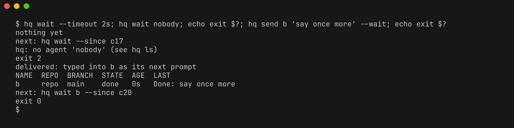
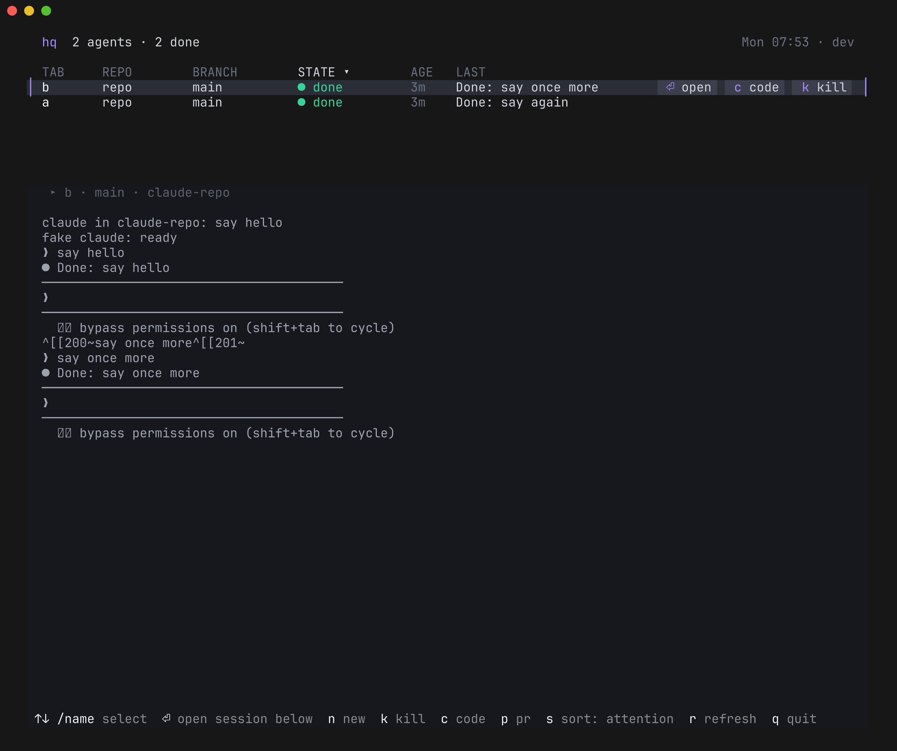
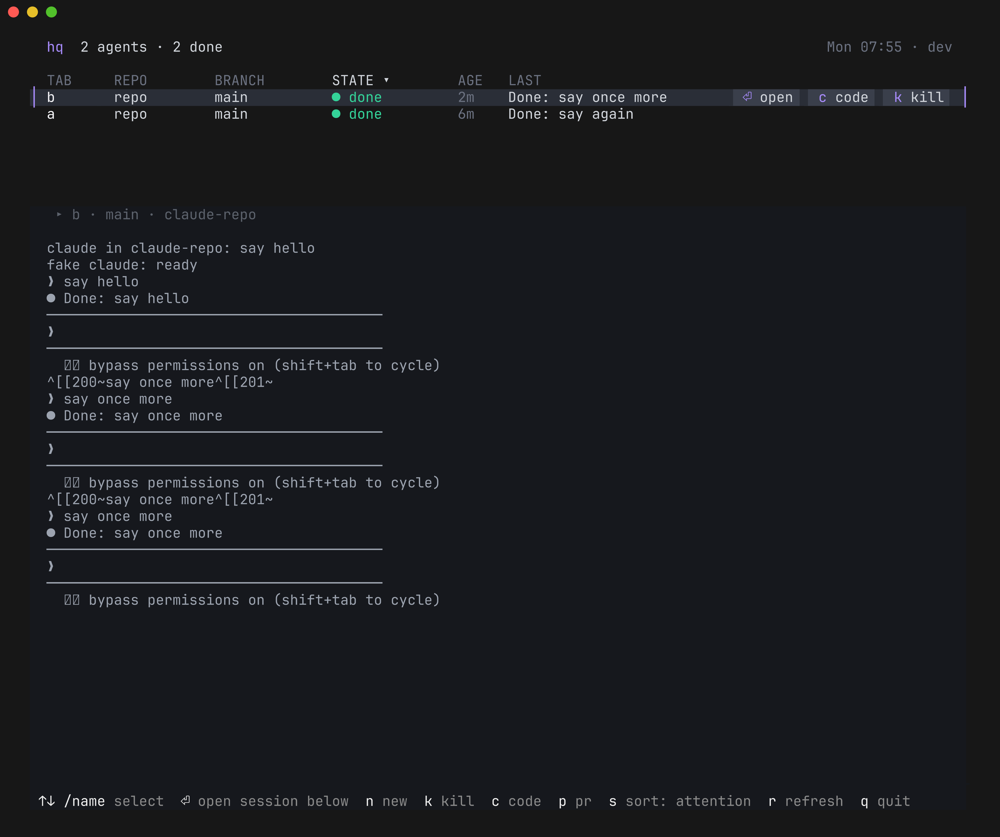

### #338 `hq wait`, `hq send --wait` and the list take the look loop and the rhythm's figures from the look module

Base commit: `a5cf222` (`spec-336-one-look-module` with #337, when the branch was cut and when it was merged in before the report: the integration branch had not moved). Commits: `8435a56` (the look loop, the figures, the list, the design), `6dd1bd9` (two new tests for what the mutation gate found untested). The terminal checks ran with `scripts/local-dev.sh --stub native` in the stub environment's neutral repository, on two fake Claude sessions; "before" is the same script with `--before` and `LOCAL_DEV_BEFORE=a5cf222`, on the same agents, with the stub sbx logging each call (`SBX_STUB_LOG`).

| # | Check | Expected | Result | Evidence |
|---|-------|----------|--------|----------|
| 1 | No test file changes, and no ADR | no test file or ADR modified, removed or renamed; one test file added (check 4) | ✅ pass | [5-files.txt](https://github.com/rkrysinski/hq/blob/5e499464cef5423daad600d43b7800ec74d7af85/issue-338/5-files.txt) |
| 2 | The tests of the spec's table "Krok 1" pass, with #337's checks (`look_variants_test.go`, `look_rules_test.go`) and this ticket's two | 44 tests pass, unit and integration | ✅ pass | [7-step-1-tests.txt](https://github.com/rkrysinski/hq/blob/5e499464cef5423daad600d43b7800ec74d7af85/issue-338/7-step-1-tests.txt) |
| 3 | The private names the tests use stay as thin forwarders | `waitEvery` = `agent.LoopEvery`; `looked` keeps only `agents`, for `lookNow`; `agentAppeared`, `coverLooks` unchanged; no test needed a change | ✅ pass | diff of `wait.go`, `cursor.go` |
| 4 | A mutant or a line no test killed or ran becomes a new test passing on the code before this ticket | the gate's first run left 3 alive and 2 not run, all in the moved asking of sbx in the background and the loop's failing look; `look_loop_test.go` (2 tests) kills and runs them, and passes on `a5cf222`; each of the 3 mutants, applied by hand, fails it | ✅ pass | [8-new-tests-on-base.txt](https://github.com/rkrysinski/hq/blob/5e499464cef5423daad600d43b7800ec74d7af85/issue-338/8-new-tests-on-base.txt), mutation block |
| 5 | `hq wait`, `hq send --wait` and the list ask sbx no more often | `hq wait --timeout 4s` asks at 0, 1, 2, 3 and 4 s before and after; the 8 commands of check 6 ask 14 times before and after; the list asks once a second before and after; tmux: `TestAQuietLookListsTheWindowsOnce`, `TestWaitReturnsAgentsThatFinishWithinALookOfEachOtherTogether` | ✅ pass | [3-sbx-calls.txt](https://github.com/rkrysinski/hq/blob/5e499464cef5423daad600d43b7800ec74d7af85/issue-338/3-sbx-calls.txt), [7-step-1-tests.txt](https://github.com/rkrysinski/hq/blob/5e499464cef5423daad600d43b7800ec74d7af85/issue-338/7-step-1-tests.txt) |
| 6 | Same output, exit codes and `next_since` for `hq wait` (timeout, `--json`, a missing name alone and among others, a cursor ahead) and `hq send --wait --json`, and calls from each cursor lose and repeat no change | before and after differ only in the counter (3 higher after one more send), times and ages: the wait from the cursor before the send returns `a` done with the send's cursor, the wait from that cursor returns nothing | ✅ pass | [4-commands-before.txt](https://github.com/rkrysinski/hq/blob/5e499464cef5423daad600d43b7800ec74d7af85/issue-338/4-commands-before.txt), [4-commands-after.txt](https://github.com/rkrysinski/hq/blob/5e499464cef5423daad600d43b7800ec74d7af85/issue-338/4-commands-after.txt) |
| 7 | In a terminal: `hq wait` timing out, its refusal of a missing name, `hq send --wait` | `nothing yet` with its `next:`; `no agent 'nobody' (see hq ls)`, exit 2; the turn's end with `next: hq wait b --since`; the same before and after | ✅ pass | [1-wait-send-before.png](https://github.com/rkrysinski/hq/blob/5e499464cef5423daad600d43b7800ec74d7af85/issue-338/1-wait-send-before.png?raw=true), [1-wait-send-after.png](https://github.com/rkrysinski/hq/blob/5e499464cef5423daad600d43b7800ec74d7af85/issue-338/1-wait-send-after.png?raw=true) |
| 8 | The list, which now asks sbx and looks through the module and reads its figures | the same rows, header and docked session before and after; sbx asked once a second | ✅ pass | [2-list-before.png](https://github.com/rkrysinski/hq/blob/5e499464cef5423daad600d43b7800ec74d7af85/issue-338/2-list-before.png?raw=true), [2-list-after.png](https://github.com/rkrysinski/hq/blob/5e499464cef5423daad600d43b7800ec74d7af85/issue-338/2-list-after.png?raw=true), [3-sbx-calls.txt](https://github.com/rkrysinski/hq/blob/5e499464cef5423daad600d43b7800ec74d7af85/issue-338/3-sbx-calls.txt) |
| 9 | The look loop is the module's, in today's rhythm: a look every 250 ms, sbx in the background every second, the first look waiting for sbx's answer | `agent.Looker.Loop`; `TestWaitAsksSbxBeforeItsFirstLookThenInTheBackgroundOnceASecond` (sbx at 0 s, then at 1 s in the background, whose answer ends the agents of a stopped sandbox), `TestWaitReturnsAgentsThatFinishWithinALookOfEachOtherTogether` | ✅ pass | [7-step-1-tests.txt](https://github.com/rkrysinski/hq/blob/5e499464cef5423daad600d43b7800ec74d7af85/issue-338/7-step-1-tests.txt) |
| 10 | `hq wait`'s refusal of a name comes from the module, worded as today; several names and the rule without `--since` stay in the command | `Seen.Usable` with `refusalErr`; `TestWaitOnNamedAgentsIgnoresTheOthers`; check 6 and 7 | ✅ pass | diff of `wait.go` |
| 11 | Code searches: no command of the spec's scope calls a bare look, notes the moment of asking sbx or builds the refusal; the counter is read in the commands' package only by `hq wait`'s rule without `--since`; 250 ms and 1 s are defined once and the list reads them; the module calls no delivery and writes in no pane | the only hits in the command files are `dockAs`'s refusal in `dash.go:176` (docking a pointed row, O1) and the list's look through the module (`dash.go:286`); `.Through()` only at `wait.go:141`; the figures only in `looker.go`, read by `wait.go` and `dash/dash.go` (`send.go`'s `pollEvery` is `hq send`'s own wait, which stays, O10); none in `looker.go` | ✅ pass | [6-searches.txt](https://github.com/rkrysinski/hq/blob/5e499464cef5423daad600d43b7800ec74d7af85/issue-338/6-searches.txt) |
| 12 | The series of looks is called the look loop; no `watch`, `poll`, `refresh` or `tick` for it | `watchLooks` and `sbxPoll` are gone (`Looker.Loop`, `inBackground`); the added lines that match are the test's override of the dependency `pollSandboxes` and the list's own ticker constants, whose names stay with its mechanism | ✅ pass | [6-searches.txt](https://github.com/rkrysinski/hq/blob/5e499464cef5423daad600d43b7800ec74d7af85/issue-338/6-searches.txt) |
| 13 | `Stands` keeps its name and gets no second one; no new seam | `git grep -n -w Stands` shows the same lines as the base; the module's dependencies are those #337 named | ✅ pass | [6-searches.txt](https://github.com/rkrysinski/hq/blob/5e499464cef5423daad600d43b7800ec74d7af85/issue-338/6-searches.txt) |
| 14 | The interface is #337's design A | `Loop`, `LoopEvery`, `SbxEvery`, `AskSbx` as designed; two departures below (Deviations) | ✅ pass | this section |
| 15 | The design describes the new split (3.4, 3.8, 5.1, 7.2, 10) | in `8435a56` | ✅ pass | diff |
| 16 | Full build and mutation gate on the head | both pass on `6dd1bd9`, the gate with the Go version `go.mod` names (Deviations) | ✅ pass | blocks below |

Pyramid before (`a5cf222`, #337's figure): `unit 999, integration 324, e2e 3 (unit share 76%, minimum 75%)`. After: `unit 1001, integration 324, e2e 3 (unit share 76%, minimum 75%)`. The minimum stays 0.75: the share is 75.5%, so a minimum of 76% would fail it. Coverage after: `coverage 95.49% (minimum 94.7%)` (95.46% on the base, already more than 0.5 points above the minimum, as #337 noted, so this change moves no threshold).

Tests added: unit 2, both in `internal/cli/look_loop_test.go` (`TestWaitAsksSbxBeforeItsFirstLookThenInTheBackgroundOnceASecond`, `TestWaitFailsWhenTmuxCannotListTheWindows`); integration none; end-to-end none.






#### Outputs

**Mutation tests**

`GOTOOLCHAIN=go1.26.0 go run ./tools/testgate mutation spec-336-one-look-module`

```text
not covered internal/agent/looker.go:128:18 arithmetic base
not covered internal/dash/dash.go:186:35 arithmetic base
mutation: 8 killed, 0 alive, 0 timed out, 2 not covered, 0 not run against spec-336-one-look-module on 6dd1bd97a37028e62f980f2731b2a17cefc0cc69
```

The same commit with the sandbox's own Go (go1.27.3), `go run ./tools/testgate mutation spec-336-one-look-module`:

```text
not covered internal/agent/looker.go:128:18 arithmetic base
not run    internal/agent/looker.go:265
not covered internal/dash/dash.go:186:35 arithmetic base
mutation: 8 killed, 0 alive, 0 timed out, 2 not covered, 1 not run against spec-336-one-look-module on 6dd1bd97a37028e62f980f2731b2a17cefc0cc69
```

- `looker.go:265` (`case b.latest = <-b.answers:`): run by `TestWaitAsksSbxBeforeItsFirstLookThenInTheBackgroundOnceASecond`; Go 1.27's coverage profile starts the block of a case's body at its first statement, not after the colon where the gate looks (#344), so only a run with Go 1.26 judges it, above.

The first run, on `8435a56` before `6dd1bd9`'s tests, for the record:

```text
not covered internal/agent/looker.go:128:18 arithmetic base
not run    internal/agent/looker.go:237
not run    internal/agent/looker.go:265
alive      internal/agent/looker.go:270:33 conditionals boundary
alive      internal/agent/looker.go:270:33 conditionals negation
alive      internal/agent/looker.go:271:16 conditionals negation
not covered internal/dash/dash.go:186:35 arithmetic base
mutation: 5 killed, 3 alive, 0 timed out, 2 not covered, 2 not run against spec-336-one-look-module on 8435a56bb9a8bf2da924294622a89269483303a2
```

The three mutants applied by hand, each failing the new test:

```text
>= into >       look_loop_test.go:79: sbx not asked by the look at [1s] within 5 s; asked at [0s 1.25s]
>= into <       look_loop_test.go:82: asked sbx at [0s 250ms 500ms 750ms 1s], want at 0s and 1s
== nil into != nil   look_loop_test.go:79: sbx not asked by the look at [2s] within 5 s; asked at [0s 1s]
```

**Full build**

`scripts/check.sh`

```text
check: ok   vet
check: ok   format
check: ok   pyramid
check: ok   platform
check: ok   timebound
check: ok   sees
check: ok   unit
check: ok   integration
check: ok   coverage
check: ok   e2e
check: all 10 steps passed on 6dd1bd97a37028e62f980f2731b2a17cefc0cc69
```

**Files the ticket changes**

```text
$ git diff --name-status spec-336-one-look-module HEAD
M	docs/design/hq.md
M	internal/agent/looker.go
M	internal/cli/cursor.go
M	internal/cli/dash.go
M	internal/cli/deps.go
A	internal/cli/look_loop_test.go
M	internal/cli/ls.go
M	internal/cli/sendwait.go
M	internal/cli/wait.go
M	internal/dash/dash.go

$ git diff --name-status --diff-filter=MDR spec-336-one-look-module HEAD -- '*_test.go' docs/adr   # test files or ADRs changed
(none)
```

**The new tests on the base**

```text
$ git log --oneline -1   # the base, with look_loop_test.go copied in
a5cf222 Check the look's cursor, its failures and the counter before a message
$ go test -count=1 -v -run '^(TestWaitAsksSbxBeforeItsFirstLookThenInTheBackgroundOnceASecond|TestWaitFailsWhenTmuxCannotListTheWindows)$' ./internal/cli | grep -E '^(--- |ok|FAIL)'
--- PASS: TestWaitAsksSbxBeforeItsFirstLookThenInTheBackgroundOnceASecond (0.01s)
--- PASS: TestWaitFailsWhenTmuxCannotListTheWindows (0.00s)
ok  	github.com/rkrysinski/hq/internal/cli	0.011s
```

**sbx asked by hq wait and the list, before and after** (`SBX_STUB_LOG`)

```text
## hq wait --timeout 4s, before (a5cf222): ran 08:48:42.20 .. 08:48:47.04
08:48:42.960592 ls --json
08:48:43.985860 ls --json
08:48:45.007595 ls --json
08:48:46.024661 ls --json
08:48:47.043574 ls --json

## hq wait --timeout 4s, after (this branch): ran 08:48:55.11 .. 08:48:59.57
08:48:55.483702 ls --json
08:48:56.508799 ls --json
08:48:57.529289 ls --json
08:48:58.551491 ls --json
08:48:59.570995 ls --json

## the commands of 4-commands-*.txt (8 calls: 7 of hq wait, 3 of them refused, and a send --wait), sbx calls in all
before: 14, after: 14

## the list, 5 s after its screenshot, before: 08:53:04 .. 08:53:09
08:53:04.534148 ls --json
08:53:05.536744 ls --json
08:53:06.540678 ls --json
08:53:07.543662 ls --json
08:53:08.548052 ls --json

## the list, 5 s after its screenshot, after: 08:55:40 .. 08:55:45
08:55:40.114188 ls --json
08:55:41.119538 ls --json
08:55:42.120786 ls --json
08:55:43.125334 ls --json
08:55:44.128009 ls --json
```

**The same commands before and after** (`diff` of the two runs: the counter, 3 higher after one more send, times and ages)

```text
$ diff 4-commands-before.txt 4-commands-after.txt
3c3
< next: hq wait --since c8
---
> next: hq wait --since c11
17c17
<   "next_since": "c8"
---
>   "next_since": "c11"
31,33c31,33
<       "state_seq": 11,
<       "completion_seq": 11,
<       "since": "2026-11-23T07:49:20.688500606Z",
---
>       "state_seq": 14,
>       "completion_seq": 14,
>       "since": "2026-11-23T07:49:36.39170853Z",
43c43
<   "next_since": "c11"
---
>   "next_since": "c14"
46c46
< $ hq wait --since c8 --timeout 5s
---
> $ hq wait --since c11 --timeout 5s
48,49c48,49
< a     repo  main    done   1s   Done: say again
< next: hq wait --since c11
---
> a     repo  main    done   0s   Done: say again
> next: hq wait --since c14
51c51
< $ hq wait --since c11 --timeout 2s
---
> $ hq wait --since c14 --timeout 2s
53c53
< next: hq wait --since c11
---
> next: hq wait --since c14
```

**Code searches**: [6-searches.txt](https://github.com/rkrysinski/hq/blob/5e499464cef5423daad600d43b7800ec74d7af85/issue-338/6-searches.txt) holds every command and its output; the hits:

```text
$ git grep -n -E 'agent\.Look\(|\.Agents\(ws|d\.look\(|lookWith\(|withoutKilled\(|asked := |SandboxesOf\(|pollSandboxes\(\)|no agent ' -- $F   # the command files of the spec's scope
internal/cli/dash.go:176:		return fmt.Errorf("no agent '%s'", name)
internal/cli/dash.go:286:			as := d.looker().Agents(ws, running)

$ git grep -n -E '\.Through\(\)' -- internal/cli ':!*_test.go'
internal/cli/wait.go:141:				if n, err := d.journal.Through(); err == nil {

$ git grep -n -E 'deliverWaiting|Paste|Type\(|Submit|Press|postMessage|takeMessages|SetTitle' -- internal/agent/looker.go
(no output)

$ diff <(git grep -n -w Stands spec-336-one-look-module -- '*.go' | cut -d: -f2-) <(git grep -n -w Stands -- '*.go') && echo same
same

$ git diff --name-status spec-336-one-look-module HEAD -- docs/adr
(no output)
```

#### Deviations

- **`Loop` takes no variant.** Design A has `Loop(v Variant, step)` with a variant `Waiting`; the module has `Loop(step)`. One look loop exists, so `Waiting` would be a variant only `Loop` takes and `Loop` one that takes only it, and `Look(Waiting)` would compile with no meaning. The loop's looks are `Acting`'s but for how sbx is asked; the step takes the look's cursor (`Seen.Cursor`) first, before it types in what waits, as `hq wait` and `hq send --wait` did.
- **One method beyond design A: `Looker.Agents(ws, running)`**, the list's look at the windows it listed with its own sbx answer, an agent killed meanwhile left out. Without it the list kept `deps.look` and `deps.withoutKilled`, a second copy of the #239 rule in the commands' package; with it the rule is in the module alone and the list makes the same calls as before (no counter read: it prints no cursor).
- **`hq kill` asks sbx through the module too.** `runningSandboxes`, which only `hq kill` still calls (`kill.go` is O1 and unchanged), forwards to `Looker.AskSbx`, so the moment of asking sbx is noted in the module alone; what it asks and when is unchanged.
- **Names that stay:** `send.go`'s `pollEvery` (`hq send`'s own wait for a starting agent, which stays in the command, O10) and the list's `tick`, `tickEvery`, `sbxEvery` (its own look loop's ticker, which stays with its mechanism; its figures now come from `agent.LoopEvery` and `agent.SbxEvery`). `pollSandboxes` is the dependency that runs `sbx ls` within a time limit, not a series of looks.
- **The mutation gate under Go 1.27 (#344, created):** the sandbox's Go is 1.27.3, whose coverage profile starts a case's body block at its first statement, so the gate judges the moved `case b.latest = <-b.answers:` as not run although the new test runs it. The gate's block above is its run with `GOTOOLCHAIN=go1.26.0`, the version `go.mod` names and CI sets up; the run with Go 1.27 is beside it with the reason.
- **Seams:** none new.
- **Deploy steps:** none.
