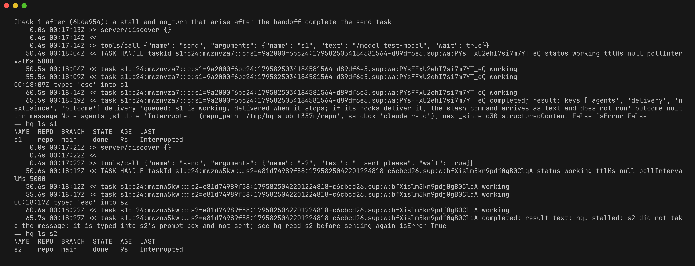
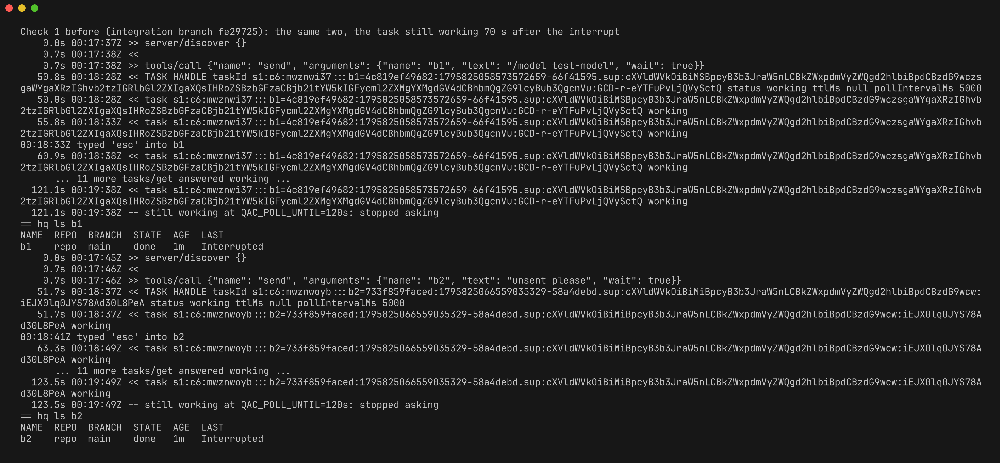
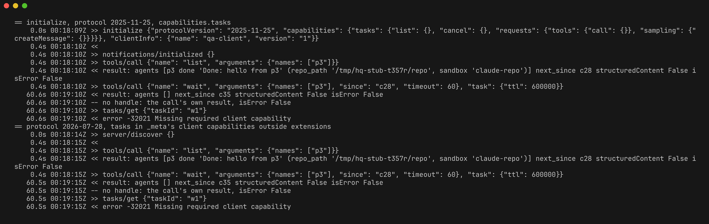
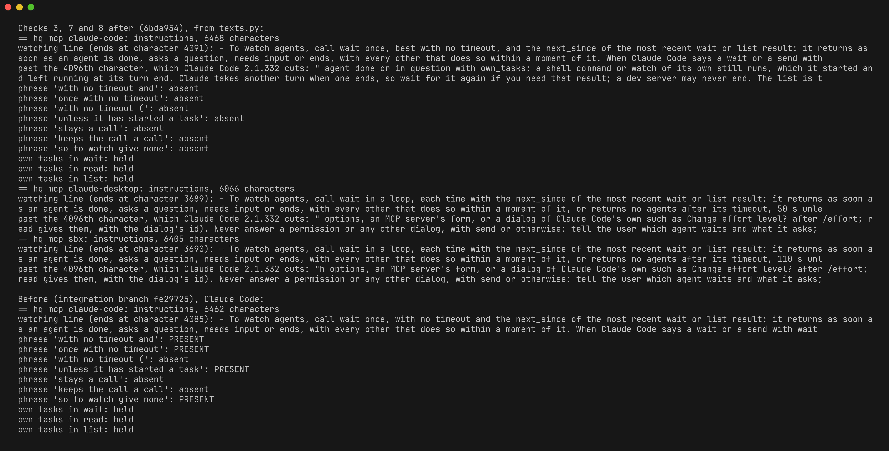
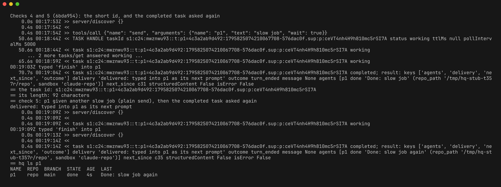
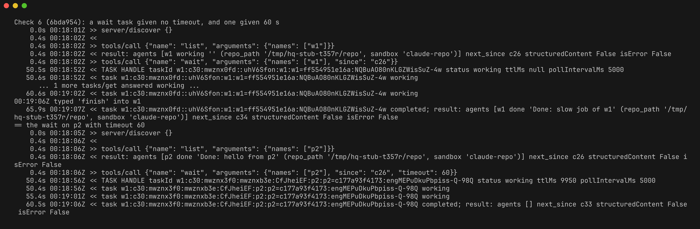

### #357 Review fixes

Checks 1-8 ran against hq built from `issue-357-review-fixes` at 6bda954 with `scripts/local-dev.sh --stub native`: the stub `sbx` and the fake claude, in stub environment t357r, with agents at their prompt (p1-p3) or working on a "slow job" (s1-s3, w1) until a line typed into their pane lets them finish, or `esc` interrupts the turn with no hook. The client was #361's raw MCP client (`qac.py`, copied, its polling bounded by `QAC_POLL_UNTIL`), over standard input and output, speaking protocol 2026-07-28 as Claude Code 2.1.332 does, with the Tasks extension declared in each request's `_meta`. Check 2 used a raw client of its own (`experimental.py`). The before of checks 1 and 3 is the integration branch `spec-357-wait-task` at fe29725, built with `--before` in a stub environment of its own (t357b). No nested Claude Code ran: the raw client shows the send-task fix against the running hq, which is what the client sees of it.

| # | Check | Expected | Result | Evidence |
|---|---|---|---|---|
| 1 | A stall or `no_turn` that arises after the handoff completes a `send`'s task with the call's error or outcome (finding (a)1; stories 18, 19) | (a) `/model test-model` sent with `wait` to s1, which is working. The handle comes at 50 s. At 56 s s1's turn is interrupted (`esc`, so no hook delivers), and a look types the slash command in, which starts no turn. Expected: `completed` 5 s later with `no_turn` and s1's row. (b) "unsent please" to s2, same steps; Claude leaves it in the box. Expected: `completed` with the stalled tool error "it is typed into s2's prompt box and not sent". Before: both tasks stay `working` | ✅ pass. (a): the handle at 50.4 s, id `s1:c24:mwznvza7::c:s1=9a2000f6bc24:1795825034184581564-d89df6e5.sup:wa:PYsFFxU2ehI7si7m7YT_eQ` (`c`: a slash command). `esc` at 00:18:09. `working` at 60.5 s. At 65.5 s `completed`: `no_turn`, `s1 done "Interrupted"`, delivery `queued: s1 is working, delivered when it stops; if its hooks deliver it, the slash command arrives as text and does not run`. (b): the handle at 50.6 s, `esc` at 00:18:17. At 65.7 s `completed`, `isError`: `hq: stalled: s2 did not take the message: it is typed into s2's prompt box and not sent; see hq read s2 before sending again`. Before: b1 and b2 were still `working` at 121.1 s and 123.5 s, 65 s and 68 s after their interrupts, asked every 5 s. The third case, a message left in the inbox behind the user's typing, is the unit test's alone (Deviations) | [c1a-no-turn-summary.txt](https://github.com/rkrysinski/hq/blob/08cde68adc95c8fd5818be30527b912de783bbd2/issue-357/c1a-no-turn-summary.txt), [raw](https://github.com/rkrysinski/hq/blob/08cde68adc95c8fd5818be30527b912de783bbd2/issue-357/c1a-no-turn.txt), [c1b-left-in-box-summary.txt](https://github.com/rkrysinski/hq/blob/08cde68adc95c8fd5818be30527b912de783bbd2/issue-357/c1b-left-in-box-summary.txt), [raw](https://github.com/rkrysinski/hq/blob/08cde68adc95c8fd5818be30527b912de783bbd2/issue-357/c1b-left-in-box.txt), [before (a)](https://github.com/rkrysinski/hq/blob/08cde68adc95c8fd5818be30527b912de783bbd2/issue-357/c1a-before-summary.txt), [raw](https://github.com/rkrysinski/hq/blob/08cde68adc95c8fd5818be30527b912de783bbd2/issue-357/c1a-before.txt), [before (b)](https://github.com/rkrysinski/hq/blob/08cde68adc95c8fd5818be30527b912de783bbd2/issue-357/c1b-before-summary.txt), [raw](https://github.com/rkrysinski/hq/blob/08cde68adc95c8fd5818be30527b912de783bbd2/issue-357/c1b-before.txt), screenshots 1 after, 1 before |
| 2 | The experimental tasks of revision 2025-11-25 are not the declaration (finding (a)3) | A `wait` on p3, which nothing changes, with `timeout` 60 and `params.task` (ttl 600000). (a) From a session opened with `initialize`, protocol 2025-11-25, that declares `capabilities.tasks`. (b) From 2026-07-28 requests whose `_meta` client capabilities hold `tasks` outside `extensions`. Expected: no handle at 50 s; the call returns `agents: []` at 60 s; `tasks/get` refused as undeclared (-32021) | ✅ pass. (a): the call's own result at 60.6 s, `agents: []`, `next_since` c35, no handle; `tasks/get`: `-32021 Missing required client capability`. (b): the same at 60.5 s | [c2-experimental-summary.txt](https://github.com/rkrysinski/hq/blob/08cde68adc95c8fd5818be30527b912de783bbd2/issue-357/c2-experimental-summary.txt), [raw](https://github.com/rkrysinski/hq/blob/08cde68adc95c8fd5818be30527b912de783bbd2/issue-357/c2-experimental.txt), screenshot 2 |
| 3 | Claude Code's texts advise no timeout to watch without forbidding one, and none says a timeout keeps a call a call (finding (b)1; story 9) | The instructions and `tools/list` of `hq mcp claude-code`. Expected: none of "with no timeout and", "once with no timeout", "with no timeout (", "unless it has started a task", "stays a call", "keeps the call a call" and "so to watch give none". The watching line says "best with no timeout". The `wait` text says a call that starts a task waits as long as its timeout. A `wait` given a timeout goes on as a task (check 6). Before: the phrases that forbade a timeout | ✅ pass. After: all seven absent. The watching line: "- To watch agents, call wait once, best with no timeout, and the next_since of the most recent wait or list result: …". `wait`: "After timeout seconds it returns no agents, which is not an error. A call that starts a task (below) waits that long, and given none until an agent changes; one that does not, at most 3600 seconds, and that long given none. To watch, give none: a timeout only brings a result with no agents, to call it again." `send`: "the delivery included: a call that starts a task waits that long, and given none until the answer; one that does not, at most 3600, and that long given none". Before: "with no timeout and", "once with no timeout", "unless it has started a task" and "so to watch give none" were present | [c3-texts.txt](https://github.com/rkrysinski/hq/blob/08cde68adc95c8fd5818be30527b912de783bbd2/issue-357/c3-texts.txt), [before](https://github.com/rkrysinski/hq/blob/08cde68adc95c8fd5818be30527b912de783bbd2/issue-357/c3-texts-before.txt), screenshot 3-7-8 |
| 4 | A `send` task's id is shorter, and its result unchanged (finding (b)3) | A `send` with `wait` of "slow job" to p1, at its prompt, let finish 70 s in, and check 1's ids. Expected: each id carries its delivery as a code of a character or two, and the result's `delivery` is the call's line. Before: the delivery line whole, in base64url | ✅ pass. p1's id: `s1:c24:mwznwu93::t:p1=4c3a2ab9d492:1795825074210067708-576dac0f.sup:p:ceVT4nh4H9h810mc5rSI7A`, 92 characters. At 70.7 s `completed`: `turn_ended`, `p1 done "Done: slow job"`, delivery `delivered: typed into p1 as its next prompt`. Check 1's ids are 93 (`wa`) and 91 (`w`) characters. Before: b1's id was 253 characters and b2's 151; #364's check 1 id was 149 | [c4-short-id-summary.txt](https://github.com/rkrysinski/hq/blob/08cde68adc95c8fd5818be30527b912de783bbd2/issue-357/c4-short-id-summary.txt), [raw](https://github.com/rkrysinski/hq/blob/08cde68adc95c8fd5818be30527b912de783bbd2/issue-357/c4-short-id.txt), [before](https://github.com/rkrysinski/hq/blob/08cde68adc95c8fd5818be30527b912de783bbd2/issue-357/c1a-before-summary.txt), screenshot 4-5 |
| 5 | A completed task asked again answers what a look then finds (finding (c)1: described, not changed) | After check 4's task completed, p1 gets another slow job by a plain `send`, and another `hq mcp` asks for the completed task, then again once p1 has finished. Expected: `working`, then `completed` with the new turn's row, as design 3.12 now says | ✅ pass. At 00:19:09 `working`. After `finish`, `completed` with `turn_ended`, `p1 done "Done: slow job again"`, `next_since` c35. Design 3.12 states it as a known limitation, with the reason (ADR 0019) | [c4-short-id-summary.txt](https://github.com/rkrysinski/hq/blob/08cde68adc95c8fd5818be30527b912de783bbd2/issue-357/c4-short-id-summary.txt), screenshot 4-5 |
| 6 | Nearby: a `wait`'s task is unchanged after the refactor (`waitToolTask`, `taskHeader`, `lookFor`, `waitingCall`) | A declaring `wait` on w1 (working), given no timeout, w1 let finish 65 s in; and, beside it, a declaring `wait` on p2 (done) given `timeout` 60. Expected: w1's handle at 50 s, then `completed` with `w1 done`; p2's handle at 50 s with `ttlMs` about 10000, then `completed` at 60 s with `agents: []` | ✅ pass. w1: the handle at 50.5 s (`w1:c30:…`, `ttlMs` null), `completed` at 65.9 s with `w1 done "Done: slow job of w1"`. p2: the handle at 50.4 s with `ttlMs` 9950, `completed` at 60.5 s, `agents: []`, `next_since` c33 | [c6-wait-task-summary.txt](https://github.com/rkrysinski/hq/blob/08cde68adc95c8fd5818be30527b912de783bbd2/issue-357/c6-wait-task-summary.txt), [raw](https://github.com/rkrysinski/hq/blob/08cde68adc95c8fd5818be30527b912de783bbd2/issue-357/c6-wait-task.txt), screenshot 6 |
| 7 | Nothing this spec moved past Claude Code's cut at the 4096th character is lost to a Claude Code supervisor (finding (c)2) | Claude Code's instructions. Expected: the watching line ends before character 4096, and each fact of the bullet on own tasks, which starts past the cut, is in the `wait`, `read` and `list` descriptions | ✅ pass. The watching line ends at character 4091 of 6468. Past 4096: " agent done or in question with own_tasks: a shell command or watch of its own still runs, …". The facts are held in `wait`, `read` and `list`. Before: the line ended at 4085, and the same bullet was past the cut. #365 stays open | [c3-texts.txt](https://github.com/rkrysinski/hq/blob/08cde68adc95c8fd5818be30527b912de783bbd2/issue-357/c3-texts.txt), screenshot 3-7-8 |
| 8 | Claude Desktop's and the gateway's numbers (finding (b)2: confirmed, no change) | The watching lines of `hq mcp claude-desktop` and `hq mcp sbx`. Expected: each names its client's own number, as #360 left them | ✅ pass, unchanged: "…or returns no agents after its timeout, 50 s unless you give a shorter one; then call it again." The gateway's says 110 s | [c3-texts.txt](https://github.com/rkrysinski/hq/blob/08cde68adc95c8fd5818be30527b912de783bbd2/issue-357/c3-texts.txt), screenshot 3-7-8 |
| 9 | The code review's Standards findings and smells (findings 1-4) | The unit tests that the fixes changed or added, run on 6bda954 | ✅ pass: 12 tests, `ok` | [c8-unit.txt](https://github.com/rkrysinski/hq/blob/08cde68adc95c8fd5818be30527b912de783bbd2/issue-357/c8-unit.txt) |

Screenshots:

1 after. Check 1 on 6bda954, `no_turn` and the stalled error after the handoff: 
1 before. Check 1 on the integration branch, both tasks still working: 
2. Check 2, the experimental tasks: 
3-7-8. Checks 3, 7 and 8, the texts: 
4-5. Checks 4 and 5, the short id and the completed task asked again: 
6. Check 6, the wait tasks: 

The scripts of the checks are in [scripts/](https://github.com/rkrysinski/hq/tree/08cde68adc95c8fd5818be30527b912de783bbd2/issue-357/scripts). `hq.sh` and `hqmcp.sh` run `LOCAL_DEV_ID=<env> scripts/local-dev.sh --stub native` from the worktree, written `<worktree>`. `run-all.sh` ran checks 1, 2, 4, 5 and 6 together, each started 8 s after the one before; `texts.py` ran checks 3, 7 and 8. `summarize.py` and `show.py` print the logs short.

Pyramid before (integration branch at fe29725): `unit 1065, integration 330, e2e 3 (unit share 76%, minimum 75%)`. After (6bda954): `unit 1071, integration 330, e2e 3 (unit share 76%, minimum 75%)`.

Coverage after: `coverage 95.79% (minimum 94.7%)`.

Tests added:
- Unit, 6 tests:
  - `internal/cli/sendtask_test.go`:
    - `TestASendsWaitTaskTellsAStallOrNoTurnThatAriseAfterTheHandoff`, 5 cases: a slash command typed in that starts no turn; a message typed in and left in the box; one typed in that left the box with no turn; one still in the inbox behind the user's typing; a slash command behind the user's typing. Each is `working` 1 ms before the 5 s and `completed` at them.
    - `TestASendsWaitTaskCountsAStallOnBackgroundWorkFromItsTurnEnd`
    - `TestASendsWaitTaskIdCarriesItsDeliveryInACharacterOrTwo`: every code with and without the slash command's words, the base64url fallback, and the codes no id carries.
  - `internal/cli/waittask_test.go`: `TestTheExperimentalTasksOf20251125AreNotTheDeclaration`.
  - `internal/cli/mcp_test.go`: `TestWhatClaudeCodeCutsOfTheBulletOnOwnTasksIsInTheTools`.
  - `internal/cli/sendwait_test.go`: `TestAWaitedSendReadsOnTheEventsAboveItsCursor`.
- Changed:
  - Each case now builds its own session, through `sessionOn` and `keyed`: `TestAWaitThatFailsWithinItsHoldFailsInTheCall`, `TestAnUnknownWaitTaskIsRefusedAsInvalidParams`, `TestTheTaskMethodsRefuseARequestThatDoesNotDeclareTasks` and `TestAWaitTaskIdChangedInAnyWayIsAnUnknownTask`.
  - `TestEachClientIsTaughtToWatchItsOwnWay` has no map shared between cases, and follows the new texts, as `TestMCPWaitSaysHowLongItMayWait` does.
  - `journalEvents` reads the fakes' journal by its key (Deviations).
  - The raw client bounds its writes and its server's end (`writeBounded`).
- Integration: none added. In `cmd/hq/mcp_integration_test.go`, the raw supervisor bounds its writes, and the check of the `wait` text follows the new text.
- End-to-end: none.

Docs:
- `GLOSSARY.md`: **Hold**.
- Design 3.4: what the call and the task share.
- Design 3.12: the stall after the handoff, the id's terms and why each is needed, a completed task asked again, the bullet past the cut, the texts on the timeout. Also a section 10 line.
- Spec §4.1 and Phase 2: the stall after the handoff, and the timeout advice.
- README: Claude Code.

#### Outputs

Checks 1, 2, 4, 5 and 6, run together by `./run-all.sh`, each log printed short by `show.py` (polls answered `working` between the first and the last folded into one line); the whole logs are in the evidence.

`python3 show.py 'Check 1 after' c1a-no-turn.txt c1b-left-in-box.txt`

```text
Check 1 after
    0.0s 00:17:13Z >> server/discover {}
    0.4s 00:17:14Z << 
    0.4s 00:17:14Z >> tools/call {"name": "send", "arguments": {"name": "s1", "text": "/model test-model", "wait": true}}
   50.4s 00:18:04Z << TASK HANDLE taskId s1:c24:mwznvza7::c:s1=9a2000f6bc24:1795825034184581564-d89df6e5.sup:wa:PYsFFxU2ehI7si7m7YT_eQ status working ttlMs null pollIntervalMs 5000
   50.5s 00:18:04Z << task s1:c24:mwznvza7::c:s1=9a2000f6bc24:1795825034184581564-d89df6e5.sup:wa:PYsFFxU2ehI7si7m7YT_eQ working
   55.5s 00:18:09Z << task s1:c24:mwznvza7::c:s1=9a2000f6bc24:1795825034184581564-d89df6e5.sup:wa:PYsFFxU2ehI7si7m7YT_eQ working
00:18:09Z typed 'esc' into s1
   60.5s 00:18:14Z << task s1:c24:mwznvza7::c:s1=9a2000f6bc24:1795825034184581564-d89df6e5.sup:wa:PYsFFxU2ehI7si7m7YT_eQ working
   65.5s 00:18:19Z << task s1:c24:mwznvza7::c:s1=9a2000f6bc24:1795825034184581564-d89df6e5.sup:wa:PYsFFxU2ehI7si7m7YT_eQ completed; result: keys ['agents', 'delivery', 'next_since', 'outcome'] delivery 'queued: s1 is working, delivered when it stops; if its hooks deliver it, the slash command arrives as text and does not run' outcome no_turn message None agents [s1 done 'Interrupted' (repo_path '/tmp/hq-stub-t357r/repo', sandbox 'claude-repo')] next_since c30 structuredContent False isError False
== hq ls s1
NAME  REPO  BRANCH  STATE  AGE  LAST
s1    repo  main    done   9s   Interrupted
    0.0s 00:17:21Z >> server/discover {}
    0.4s 00:17:22Z << 
    0.4s 00:17:22Z >> tools/call {"name": "send", "arguments": {"name": "s2", "text": "unsent please", "wait": true}}
   50.6s 00:18:12Z << TASK HANDLE taskId s1:c24:mwznw5kw:::s2=e81d74989f58:1795825042201224818-c6cbcd26.sup:w:bfXislm5kn9pdj0gB0ClqA status working ttlMs null pollIntervalMs 5000
   50.6s 00:18:12Z << task s1:c24:mwznw5kw:::s2=e81d74989f58:1795825042201224818-c6cbcd26.sup:w:bfXislm5kn9pdj0gB0ClqA working
   55.6s 00:18:17Z << task s1:c24:mwznw5kw:::s2=e81d74989f58:1795825042201224818-c6cbcd26.sup:w:bfXislm5kn9pdj0gB0ClqA working
00:18:17Z typed 'esc' into s2
   60.6s 00:18:22Z << task s1:c24:mwznw5kw:::s2=e81d74989f58:1795825042201224818-c6cbcd26.sup:w:bfXislm5kn9pdj0gB0ClqA working
   65.7s 00:18:27Z << task s1:c24:mwznw5kw:::s2=e81d74989f58:1795825042201224818-c6cbcd26.sup:w:bfXislm5kn9pdj0gB0ClqA completed; result text: hq: stalled: s2 did not take the message: it is typed into s2's prompt box and not sent; see hq read s2 before sending again isError True
== hq ls s2
NAME  REPO  BRANCH  STATE  AGE  LAST
s2    repo  main    done   9s   Interrupted
```

`python3 show.py 'Check 1 before' c1a-before.txt c1b-before.txt`

```text
Check 1 before
    0.0s 00:17:37Z >> server/discover {}
    0.7s 00:17:38Z << 
    0.7s 00:17:38Z >> tools/call {"name": "send", "arguments": {"name": "b1", "text": "/model test-model", "wait": true}}
   50.8s 00:18:28Z << TASK HANDLE taskId s1:c6:mwznwi37:::b1=4c819ef49682:1795825058573572659-66f41595.sup:cXVldWVkOiBiMSBpcyB3b3JraW5nLCBkZWxpdmVyZWQgd2hlbiBpdCBzdG9wczsgaWYgaXRzIGhvb2tzIGRlbGl2ZXIgaXQsIHRoZSBzbGFzaCBjb21tYW5kIGFycml2ZXMgYXMgdGV4dCBhbmQgZG9lcyBub3QgcnVu:GCD-r-eYTFuPvLjQVySctQ status working ttlMs null pollIntervalMs 5000
   50.8s 00:18:28Z << task s1:c6:mwznwi37:::b1=4c819ef49682:1795825058573572659-66f41595.sup:cXVldWVkOiBiMSBpcyB3b3JraW5nLCBkZWxpdmVyZWQgd2hlbiBpdCBzdG9wczsgaWYgaXRzIGhvb2tzIGRlbGl2ZXIgaXQsIHRoZSBzbGFzaCBjb21tYW5kIGFycml2ZXMgYXMgdGV4dCBhbmQgZG9lcyBub3QgcnVu:GCD-r-eYTFuPvLjQVySctQ working
   55.8s 00:18:33Z << task s1:c6:mwznwi37:::b1=4c819ef49682:1795825058573572659-66f41595.sup:cXVldWVkOiBiMSBpcyB3b3JraW5nLCBkZWxpdmVyZWQgd2hlbiBpdCBzdG9wczsgaWYgaXRzIGhvb2tzIGRlbGl2ZXIgaXQsIHRoZSBzbGFzaCBjb21tYW5kIGFycml2ZXMgYXMgdGV4dCBhbmQgZG9lcyBub3QgcnVu:GCD-r-eYTFuPvLjQVySctQ working
00:18:33Z typed 'esc' into b1
   60.9s 00:18:38Z << task s1:c6:mwznwi37:::b1=4c819ef49682:1795825058573572659-66f41595.sup:cXVldWVkOiBiMSBpcyB3b3JraW5nLCBkZWxpdmVyZWQgd2hlbiBpdCBzdG9wczsgaWYgaXRzIGhvb2tzIGRlbGl2ZXIgaXQsIHRoZSBzbGFzaCBjb21tYW5kIGFycml2ZXMgYXMgdGV4dCBhbmQgZG9lcyBub3QgcnVu:GCD-r-eYTFuPvLjQVySctQ working
      ... 11 more tasks/get answered working ...
  121.1s 00:19:38Z << task s1:c6:mwznwi37:::b1=4c819ef49682:1795825058573572659-66f41595.sup:cXVldWVkOiBiMSBpcyB3b3JraW5nLCBkZWxpdmVyZWQgd2hlbiBpdCBzdG9wczsgaWYgaXRzIGhvb2tzIGRlbGl2ZXIgaXQsIHRoZSBzbGFzaCBjb21tYW5kIGFycml2ZXMgYXMgdGV4dCBhbmQgZG9lcyBub3QgcnVu:GCD-r-eYTFuPvLjQVySctQ working
  121.1s 00:19:38Z -- still working at QAC_POLL_UNTIL=120s: stopped asking
== hq ls b1
NAME  REPO  BRANCH  STATE  AGE  LAST
b1    repo  main    done   1m   Interrupted
    0.0s 00:17:45Z >> server/discover {}
    0.7s 00:17:46Z << 
    0.7s 00:17:46Z >> tools/call {"name": "send", "arguments": {"name": "b2", "text": "unsent please", "wait": true}}
   51.7s 00:18:37Z << TASK HANDLE taskId s1:c6:mwznwoyb:::b2=733f859faced:1795825066559035329-58a4debd.sup:cXVldWVkOiBiMiBpcyB3b3JraW5nLCBkZWxpdmVyZWQgd2hlbiBpdCBzdG9wcw:iEJX0lq0JYS78Ad30L8PeA status working ttlMs null pollIntervalMs 5000
   51.7s 00:18:37Z << task s1:c6:mwznwoyb:::b2=733f859faced:1795825066559035329-58a4debd.sup:cXVldWVkOiBiMiBpcyB3b3JraW5nLCBkZWxpdmVyZWQgd2hlbiBpdCBzdG9wcw:iEJX0lq0JYS78Ad30L8PeA working
00:18:41Z typed 'esc' into b2
   63.3s 00:18:49Z << task s1:c6:mwznwoyb:::b2=733f859faced:1795825066559035329-58a4debd.sup:cXVldWVkOiBiMiBpcyB3b3JraW5nLCBkZWxpdmVyZWQgd2hlbiBpdCBzdG9wcw:iEJX0lq0JYS78Ad30L8PeA working
      ... 11 more tasks/get answered working ...
  123.5s 00:19:49Z << task s1:c6:mwznwoyb:::b2=733f859faced:1795825066559035329-58a4debd.sup:cXVldWVkOiBiMiBpcyB3b3JraW5nLCBkZWxpdmVyZWQgd2hlbiBpdCBzdG9wcw:iEJX0lq0JYS78Ad30L8PeA working
  123.5s 00:19:49Z -- still working at QAC_POLL_UNTIL=120s: stopped asking
== hq ls b2
NAME  REPO  BRANCH  STATE  AGE  LAST
b2    repo  main    done   1m   Interrupted
```

`python3 show.py 'Check 1, case c (Deviations)' c1c-user-draft.txt`

```text
Check 1, case c (Deviations)
    0.0s 00:17:29Z >> server/discover {}
    0.4s 00:17:30Z << 
    0.4s 00:17:30Z >> tools/call {"name": "send", "arguments": {"name": "s3", "text": "hi", "wait": true}}
   50.6s 00:18:20Z << TASK HANDLE taskId s1:c24:mwznwbqb:::s3=ec8425a9014d:1795825050195379072-90e79933.sup:w:uVQNNPciCe50S50i82USFQ status working ttlMs null pollIntervalMs 5000
   50.6s 00:18:20Z << task s1:c24:mwznwbqb:::s3=ec8425a9014d:1795825050195379072-90e79933.sup:w:uVQNNPciCe50S50i82USFQ working
   55.6s 00:18:25Z << task s1:c24:mwznwbqb:::s3=ec8425a9014d:1795825050195379072-90e79933.sup:w:uVQNNPciCe50S50i82USFQ working
00:18:25Z typed 'esc' and 'draft' into s3
   60.6s 00:18:30Z << task s1:c24:mwznwbqb:::s3=ec8425a9014d:1795825050195379072-90e79933.sup:w:uVQNNPciCe50S50i82USFQ working
      ... 11 more tasks/get answered working ...
  120.9s 00:19:30Z << task s1:c24:mwznwbqb:::s3=ec8425a9014d:1795825050195379072-90e79933.sup:w:uVQNNPciCe50S50i82USFQ working
  120.9s 00:19:30Z -- still working at QAC_POLL_UNTIL=120s: stopped asking
== hq ls s3
NAME  REPO  BRANCH  STATE    AGE  LAST
s3    repo  main    working  2m   -
```

`python3 show.py 'Checks 4 and 5' c4-short-id.txt`

```text
Checks 4 and 5
    0.0s 00:17:53Z >> server/discover {}
    0.4s 00:17:54Z << 
    0.4s 00:17:54Z >> tools/call {"name": "send", "arguments": {"name": "p1", "text": "slow job", "wait": true}}
   50.6s 00:18:44Z << TASK HANDLE taskId s1:c24:mwznwu93::t:p1=4c3a2ab9d492:1795825074210067708-576dac0f.sup:p:ceVT4nh4H9h810mc5rSI7A status working ttlMs null pollIntervalMs 5000
   50.6s 00:18:44Z << task s1:c24:mwznwu93::t:p1=4c3a2ab9d492:1795825074210067708-576dac0f.sup:p:ceVT4nh4H9h810mc5rSI7A working
      ... 2 more tasks/get answered working ...
   65.6s 00:18:59Z << task s1:c24:mwznwu93::t:p1=4c3a2ab9d492:1795825074210067708-576dac0f.sup:p:ceVT4nh4H9h810mc5rSI7A working
00:19:03Z typed 'finish' into p1
   70.7s 00:19:04Z << task s1:c24:mwznwu93::t:p1=4c3a2ab9d492:1795825074210067708-576dac0f.sup:p:ceVT4nh4H9h810mc5rSI7A completed; result: keys ['agents', 'delivery', 'next_since', 'outcome'] delivery 'delivered: typed into p1 as its next prompt' outcome turn_ended message None agents [p1 done 'Done: slow job' (repo_path '/tmp/hq-stub-t357r/repo', sandbox 'claude-repo')] next_since c31 structuredContent False isError False
== the task id: s1:c24:mwznwu93::t:p1=4c3a2ab9d492:1795825074210067708-576dac0f.sup:p:ceVT4nh4H9h810mc5rSI7A
== its length: 92 characters
== check 5: p1 given another slow job (plain send), then the completed task asked again
delivered: typed into p1 as its next prompt
    0.0s 00:19:09Z >> server/discover {}
    0.4s 00:19:09Z << 
    0.4s 00:19:09Z << task s1:c24:mwznwu93::t:p1=4c3a2ab9d492:1795825074210067708-576dac0f.sup:p:ceVT4nh4H9h810mc5rSI7A working
00:19:09Z typed 'finish' into p1
    0.0s 00:19:13Z >> server/discover {}
    0.4s 00:19:14Z << 
    0.4s 00:19:14Z << task s1:c24:mwznwu93::t:p1=4c3a2ab9d492:1795825074210067708-576dac0f.sup:p:ceVT4nh4H9h810mc5rSI7A completed; result: keys ['agents', 'delivery', 'next_since', 'outcome'] delivery 'delivered: typed into p1 as its next prompt' outcome turn_ended message None agents [p1 done 'Done: slow job again' (repo_path '/tmp/hq-stub-t357r/repo', sandbox 'claude-repo')] next_since c35 structuredContent False isError False
== hq ls p1
NAME  REPO  BRANCH  STATE  AGE  LAST
p1    repo  main    done   4s   Done: slow job again
```

`python3 show.py 'Check 6' c6-wait-task.txt`

```text
Check 6
    0.0s 00:18:01Z >> server/discover {}
    0.4s 00:18:02Z << 
    0.4s 00:18:02Z >> tools/call {"name": "list", "arguments": {"names": ["w1"]}}
    0.4s 00:18:02Z << result: agents [w1 working '' (repo_path '/tmp/hq-stub-t357r/repo', sandbox 'claude-repo')] next_since c26 structuredContent False isError False
    0.4s 00:18:02Z >> tools/call {"name": "wait", "arguments": {"names": ["w1"], "since": "c26"}}
   50.5s 00:18:52Z << TASK HANDLE taskId w1:c30:mwznx0fd::uhV6Sfon:w1:w1=ff554951e16a:NQBuAO80nKLGZWisSuZ-4w status working ttlMs null pollIntervalMs 5000
   50.6s 00:18:52Z << task w1:c30:mwznx0fd::uhV6Sfon:w1:w1=ff554951e16a:NQBuAO80nKLGZWisSuZ-4w working
      ... 1 more tasks/get answered working ...
   60.6s 00:19:02Z << task w1:c30:mwznx0fd::uhV6Sfon:w1:w1=ff554951e16a:NQBuAO80nKLGZWisSuZ-4w working
00:19:06Z typed 'finish' into w1
   65.9s 00:19:07Z << task w1:c30:mwznx0fd::uhV6Sfon:w1:w1=ff554951e16a:NQBuAO80nKLGZWisSuZ-4w completed; result: agents [w1 done 'Done: slow job of w1' (repo_path '/tmp/hq-stub-t357r/repo', sandbox 'claude-repo')] next_since c34 structuredContent False isError False
== the wait on p2 with timeout 60
    0.0s 00:18:05Z >> server/discover {}
    0.4s 00:18:06Z << 
    0.4s 00:18:06Z >> tools/call {"name": "list", "arguments": {"names": ["p2"]}}
    0.4s 00:18:06Z << result: agents [p2 done 'Done: hello from p2' (repo_path '/tmp/hq-stub-t357r/repo', sandbox 'claude-repo')] next_since c26 structuredContent False isError False
    0.4s 00:18:06Z >> tools/call {"name": "wait", "arguments": {"names": ["p2"], "since": "c26", "timeout": 60}}
   50.4s 00:18:56Z << TASK HANDLE taskId w1:c30:mwznx3f0:mwznxb3e:CfJheiEF:p2:p2=c177a93f4173:engMEPuDkuPbpiss-Q-98Q status working ttlMs 9950 pollIntervalMs 5000
   50.4s 00:18:56Z << task w1:c30:mwznx3f0:mwznxb3e:CfJheiEF:p2:p2=c177a93f4173:engMEPuDkuPbpiss-Q-98Q working
   55.4s 00:19:01Z << task w1:c30:mwznx3f0:mwznxb3e:CfJheiEF:p2:p2=c177a93f4173:engMEPuDkuPbpiss-Q-98Q working
   60.5s 00:19:06Z << task w1:c30:mwznx3f0:mwznxb3e:CfJheiEF:p2:p2=c177a93f4173:engMEPuDkuPbpiss-Q-98Q completed; result: agents [] next_since c33 structuredContent False isError False
```

`python3 summarize.py c2-experimental.txt`

```text
== initialize, protocol 2025-11-25, capabilities.tasks
    0.0s 00:18:09Z >> initialize {"protocolVersion": "2025-11-25", "capabilities": {"tasks": {"list": {}, "cancel": {}, "requests": {"tools": {"call": {}}, "sampling": {"createMessage": {}}}}}, "clientInfo": {"name": "qa-client", "version": "1"}}
    0.4s 00:18:10Z << 
    0.4s 00:18:10Z >> notifications/initialized {}
    0.4s 00:18:10Z >> tools/call {"name": "list", "arguments": {"names": ["p3"]}}
    0.4s 00:18:10Z << result: agents [p3 done 'Done: hello from p3' (repo_path '/tmp/hq-stub-t357r/repo', sandbox 'claude-repo')] next_since c28 structuredContent False isError False
    0.4s 00:18:10Z >> tools/call {"name": "wait", "arguments": {"names": ["p3"], "since": "c28", "timeout": 60}, "task": {"ttl": 600000}}
   60.6s 00:19:10Z << result: agents [] next_since c35 structuredContent False isError False
   60.6s 00:19:10Z -- no handle: the call's own result, isError False
   60.6s 00:19:10Z >> tasks/get {"taskId": "w1"}
   60.6s 00:19:10Z << error -32021 Missing required client capability
== protocol 2026-07-28, tasks in _meta's client capabilities outside extensions
    0.0s 00:18:14Z >> server/discover {}
    0.4s 00:18:15Z << 
    0.4s 00:18:15Z >> tools/call {"name": "list", "arguments": {"names": ["p3"]}}
    0.4s 00:18:15Z << result: agents [p3 done 'Done: hello from p3' (repo_path '/tmp/hq-stub-t357r/repo', sandbox 'claude-repo')] next_since c28 structuredContent False isError False
    0.4s 00:18:15Z >> tools/call {"name": "wait", "arguments": {"names": ["p3"], "since": "c28", "timeout": 60}, "task": {"ttl": 600000}}
   60.5s 00:19:15Z << result: agents [] next_since c35 structuredContent False isError False
   60.5s 00:19:15Z -- no handle: the call's own result, isError False
   60.5s 00:19:15Z >> tasks/get {"taskId": "w1"}
   60.5s 00:19:15Z << error -32021 Missing required client capability
```

`./texts-short.sh`

```text
Checks 3, 7 and 8 after (6bda954), from texts.py:
== hq mcp claude-code: instructions, 6468 characters
watching line (ends at character 4091): - To watch agents, call wait once, best with no timeout, and the next_since of the most recent wait or list result: it returns as soon as an agent is done, asks a question, needs input or ends, with every other that does so within a moment of it. When Claude Code says a wait or a send with
past the 4096th character, which Claude Code 2.1.332 cuts: " agent done or in question with own_tasks: a shell command or watch of its own still runs, which it started and left running at its turn end. Claude takes another turn when one ends, so wait for it again if you need that result; a dev server may never end. The list is t
phrase 'with no timeout and': absent
phrase 'once with no timeout': absent
phrase 'with no timeout (': absent
phrase 'unless it has started a task': absent
phrase 'stays a call': absent
phrase 'keeps the call a call': absent
phrase 'so to watch give none': absent
own tasks in wait: held
own tasks in read: held
own tasks in list: held
== hq mcp claude-desktop: instructions, 6066 characters
watching line (ends at character 3689): - To watch agents, call wait in a loop, each time with the next_since of the most recent wait or list result: it returns as soon as an agent is done, asks a question, needs input or ends, with every other that does so within a moment of it, or returns no agents after its timeout, 50 s unle
past the 4096th character, which Claude Code 2.1.332 cuts: " options, an MCP server's form, or a dialog of Claude Code's own such as Change effort level? after /effort; read gives them, with the dialog's id). Never answer a permission or any other dialog, with send or otherwise: tell the user which agent waits and what it asks; 
== hq mcp sbx: instructions, 6405 characters
watching line (ends at character 3690): - To watch agents, call wait in a loop, each time with the next_since of the most recent wait or list result: it returns as soon as an agent is done, asks a question, needs input or ends, with every other that does so within a moment of it, or returns no agents after its timeout, 110 s unl
past the 4096th character, which Claude Code 2.1.332 cuts: "h options, an MCP server's form, or a dialog of Claude Code's own such as Change effort level? after /effort; read gives them, with the dialog's id). Never answer a permission or any other dialog, with send or otherwise: tell the user which agent waits and what it asks;

Before (integration branch fe29725), Claude Code:
== hq mcp claude-code: instructions, 6462 characters
watching line (ends at character 4085): - To watch agents, call wait once, with no timeout and the next_since of the most recent wait or list result: it returns as soon as an agent is done, asks a question, needs input or ends, with every other that does so within a moment of it. When Claude Code says a wait or a send with wait 
phrase 'with no timeout and': PRESENT
phrase 'once with no timeout': PRESENT
phrase 'with no timeout (': absent
phrase 'unless it has started a task': PRESENT
phrase 'stays a call': absent
phrase 'keeps the call a call': absent
phrase 'so to watch give none': PRESENT
own tasks in wait: held
own tasks in read: held
own tasks in list: held
```

`go test -count=1 -v -run 'TestAWaitThatFailsWithinItsHoldFailsInTheCall|TestAnUnknownWaitTaskIsRefusedAsInvalidParams|TestTheTaskMethodsRefuseARequestThatDoesNotDeclareTasks|TestAWaitTaskIdChangedInAnyWayIsAnUnknownTask|TestEachClientIsTaughtToWatchItsOwnWay|TestTheExperimentalTasksOf20251125AreNotTheDeclaration|TestASendsWaitTaskTellsAStallOrNoTurnThatAriseAfterTheHandoff|TestASendsWaitTaskCountsAStallOnBackgroundWorkFromItsTurnEnd|TestASendsWaitTaskIdCarriesItsDeliveryInACharacterOrTwo|TestWhatClaudeCodeCutsOfTheBulletOnOwnTasksIsInTheTools|TestAWaitedSendReadsOnTheEventsAboveItsCursor|TestAStallAndNoTurnStayInTheCall' ./internal/cli/ > c8-unit.txt; grep -E '^(--- |ok|FAIL)' c8-unit.txt`

```text
--- PASS: TestEachClientIsTaughtToWatchItsOwnWay (0.00s)
--- PASS: TestWhatClaudeCodeCutsOfTheBulletOnOwnTasksIsInTheTools (0.00s)
--- PASS: TestAStallAndNoTurnStayInTheCall (0.01s)
--- PASS: TestASendsWaitTaskTellsAStallOrNoTurnThatAriseAfterTheHandoff (0.02s)
--- PASS: TestASendsWaitTaskCountsAStallOnBackgroundWorkFromItsTurnEnd (0.00s)
--- PASS: TestASendsWaitTaskIdCarriesItsDeliveryInACharacterOrTwo (0.00s)
--- PASS: TestAWaitedSendReadsOnTheEventsAboveItsCursor (0.00s)
--- PASS: TestAWaitThatFailsWithinItsHoldFailsInTheCall (0.00s)
--- PASS: TestAnUnknownWaitTaskIsRefusedAsInvalidParams (0.00s)
--- PASS: TestAWaitTaskIdChangedInAnyWayIsAnUnknownTask (0.06s)
--- PASS: TestTheTaskMethodsRefuseARequestThatDoesNotDeclareTasks (0.00s)
--- PASS: TestTheExperimentalTasksOf20251125AreNotTheDeclaration (0.01s)
ok  	github.com/rkrysinski/hq/internal/cli	0.135s
```

Mutation tests on the head:

```text
$ GOTOOLCHAIN=go1.26.0 go run ./tools/testgate mutation spec-357-wait-task   # on 6bda954
not covered internal/cli/send.go:356:15 conditionals negation
not covered internal/cli/sendtooltask.go:84:32 conditionals negation
not covered internal/cli/sendwait.go:289:26 conditionals negation
not covered internal/cli/sendwait.go:306:47 conditionals boundary
not covered internal/cli/sendwait.go:306:47 conditionals negation
not covered internal/cli/sendwait.go:312:11 conditionals negation
mutation: 63 killed, 0 alive, 0 timed out, 6 not covered, 0 not run against spec-357-wait-task on 6bda954592f28bc89d9c690ac18ad6bf0856f6be
mutation: staging the tree in /tmp/hq-mutation-2817259687
mutation: installing go-gremlins v0.6.0
mutation: running the unit tests once, then once per mutant
mutation: done in 54s
```

Pyramid and coverage:

```text
$ go run ./tools/testgate pyramid   # before, on the integration branch at fe29725
unit 1065, integration 330, e2e 3 (unit share 76%, minimum 75%)
$ go run ./tools/testgate pyramid   # after, on 6bda954
unit 1071, integration 330, e2e 3 (unit share 76%, minimum 75%)
$ GOTOOLCHAIN=go1.26.0 go test -count=1 -tags integration -coverpkg=./internal/... -coverprofile=cover.out ./... && go run ./tools/testgate coverage cover.out   # on 6bda954
coverage 95.79% (minimum 94.7%)
```

Full build (`GOTOOLCHAIN=go1.26.0 scripts/check.sh`):

```text
check: ok   vet
check: ok   format
check: ok   pyramid
check: ok   platform
check: ok   timebound
check: ok   sees
check: ok   unit
check: ok   integration
check: ok   coverage
check: ok   e2e
check: all 10 steps passed on 6bda954592f28bc89d9c690ac18ad6bf0856f6be
```

#### Deviations

Findings with no change, as ruled or checked:
- (a)2, `hq send --wait` keeps its own question (`settled`): no change, by the operator's ruling (#358's record).
- (b)2, Claude Desktop's "50 s unless you give a shorter one": confirmed (check 8). It gives that client its own number, and the behaviour is unchanged.
- (b)4, -32021 for a task method without the declaration: no change, since the extension requires it.
- (c)2, the cut at 4096 characters: checked (check 7). The bullet on own tasks is past the cut, and each of its facts is in the `wait`, `read` and `list` descriptions, which `TestWhatClaudeCodeCutsOfTheBulletOnOwnTasksIsInTheTools` now holds. #365 stays open.

(a)1, the mechanism: the task tells a stall and `no_turn` from the journal. The other path the finding offered, going on as a task only once the message is taken or a hook will deliver it, was not taken. Whether a hook will deliver cannot be known at the handoff: a message queued for a working agent is delivered by a hook when the agent stops, unless the user interrupts the turn, which fires none and leaves the message to a look. So that path would keep every `send` to a working agent in its call until the message is taken, which is the case the task is for. The call still tells in itself a stall whose 5 s began within the hold (story 19).

The third case of the finding, a message that stays in the inbox behind the user's typing after the interrupt, is shown by the unit test alone (`TestASendsWaitTaskTellsAStallOrNoTurnThatAriseAfterTheHandoff`, its cases "waiting, the user typing in its box" and "a slash command, the user typing there"). Against the fake Claude it cannot be staged:
- Typing into the box together with the `esc` (check 1, case c: [c1c-user-draft-summary.txt](https://github.com/rkrysinski/hq/blob/08cde68adc95c8fd5818be30527b912de783bbd2/issue-357/c1c-user-draft-summary.txt), [raw](https://github.com/rkrysinski/hq/blob/08cde68adc95c8fd5818be30527b912de783bbd2/issue-357/c1c-user-draft.txt)) left hq showing s3 `working`, since no screen rule reads an interrupted screen with typing in its box as at its prompt. So no look types the message in, and nothing stalls.
- Typing 0.3 s after the `esc` (a first run) lost the race to a look, which had typed the message in first.

That is how hq reads the screen today, against the fake's captures, and not this change's.

(b)3, the id: `s1` keeps its name with the new form. `s1` has not been released, so no id of the old form outlives the merge. Each term that stays is needed, as design 3.12 says.

Glossary drift (finding 2):
- `waitTask` is now the umbrella, the glossary's *Wait task*, with `waitToolTask` and `sendToolTask` as its kinds.
- `poll` became `look` and `lookFor`. `pollIntervalMs` and the client's polling keep the protocol's word.
- "hold" was added to the glossary as **Hold** rather than renamed: `waitHold` and `waitedSend.hold` now name a glossary term, and `d.held` stays the *Held message*.

The smells (finding 4) that were fixed:
- Duplicated Code: one `waitingCall` for both handlers; `inALoop` and `inOneCall` in place of `waitTimeoutText` and `sendLimit`; `parseTaskHeader` for both parsers; `lookFor` for both looks.
- Data Clumps and Middle Men: `taskHeader`, with `task(id)` promoted.
- Mysterious Names: `wg` became `ongoing`, `waiting` became `ongoingWait`, `waited` became `waitEnd`. `send`'s parameter and `sendEnd`'s field became `toTask`.
- Feature Envy: `waitedSend.readOn`, `stallKey` and `waitedSend.stalled`, shared by the call and the task.
- Divergent Change: `waittask.go` holds what both kinds share, and `waittooltask.go` and `sendtooltask.go` (renamed from `sendtask.go`) hold one kind each.
- Repeated Switches: `mcptasks.Offered` is read once, in `waitingCall`, and `c.tasks` once, where the server is set up.

The smells left, each with its reason:
- The raw clients in two packages (`rawClient` in `internal/cli`, `rawSupervisor` in `cmd/hq`): they sit in different packages and build tags, and sharing them would take a test-helper package exported for one integration test, more code than the lines they repeat.
- Terms read by position, with the flags as letters: the id is a signed string, and the positions are its grammar. Each kind parses them once (`parseTaskHeader`, `parseWaitToolTask`, `parseSendToolTask`) into typed fields and booleans, so no other code reads a position.

A check of #361 that counted nothing: `journalEvents` in `internal/cli/waittask_test.go` read the fakes' journal by the agent's raw id, where the fakes key it by `journalID`. So it always counted 0 events, and the check that a wait task changes nothing in the journal compared 0 with 0. It now reads by the key and fails when it finds no event.

The mutation run's `not covered` lines are all `case` lines whose body blocks the unit tests run (go-gremlins counts no block for a case's expression):
- `send.go:356`: `TestSendNowToAWorkingAgentGoesAfterItsNextToolCall`.
- `sendtooltask.go:84`: `TestASendsWaitTaskIdCarriesItsDeliveryInACharacterOrTwo`.
- `sendwait.go:289, 306, 312`: `TestASendsWaitTaskTellsAStallOrNoTurnThatAriseAfterTheHandoff` and `TestSendWaitFailsAsStalledWhenTheBoxHoldsTheUsersTyping`.

The coverage, 95.79%, is more than 0.5 points above its minimum, as it was on the integration branch (95.73% at fe29725). The threshold is left for the spec's pull request, since an implementer changes none (`docs/agents/implementer.md`).

No issue was created.
