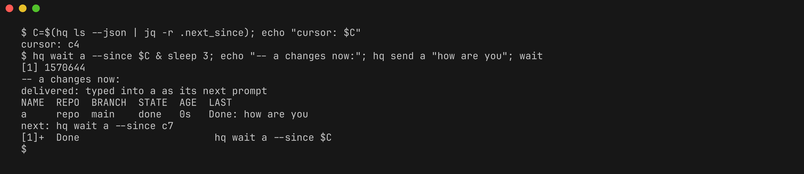
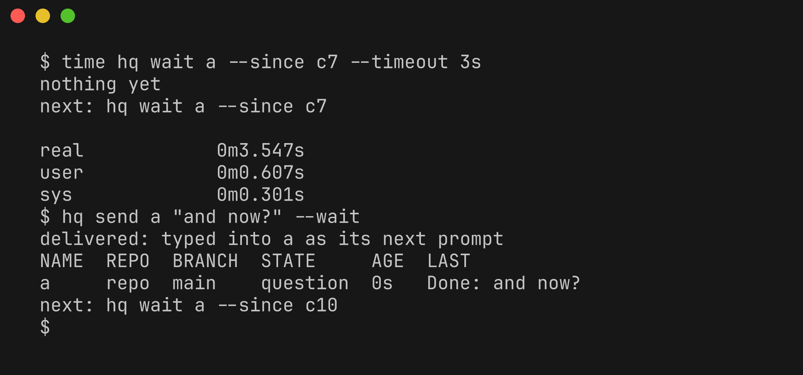
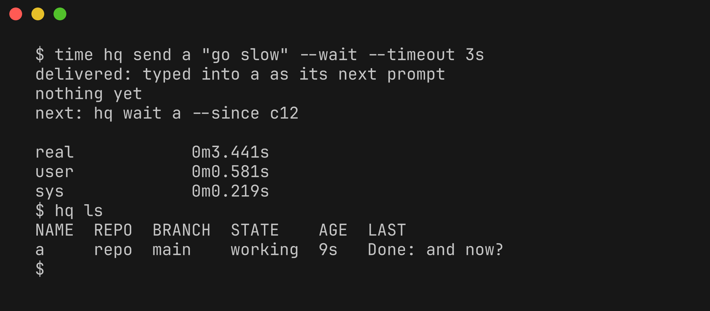

### #358 Wynik `wait` dla zapisanych warunków: to samo pytanie w wywołaniu i poza nim

Base commit: `36d00aa` (`spec-357-wait-task` when the branch was cut and when it was merged in before the report: the integration branch had not moved). Commit: `00e169d`. The change asks each look of `hq wait` for the wait's result from its terms (`waitTerms.resultAt` in `internal/cli/wait.go`) and brings in ADR 0022 with its glossary term; hq prints and does as before.

| # | Check | Expected | Result | Evidence |
|---|-------|----------|--------|----------|
| 1 | ADR 0022 and *Wait task* on the branch as the two picked commits, each with `Closes #358`, the pick of `551d6ce` also naming #357; both carry cleanly onto `dev` without the rest of `issue-342-standing-wait` | `51e78c1` (from `551d6ce`, `Refs #342, #356, #357`) and `b705950` (from `b9dae36`), each with a `Closes #358` line; the same patch as each original (equal `git patch-id`); the ADR the same file as on `b9dae36`; nothing of ADR 0021 | ✅ pass | [1-cherry-picks.txt](https://github.com/rkrysinski/hq/blob/9b879f8f85cf53e11291ae85554170c61bee34a6/issue-358/1-cherry-picks.txt) |
| 2 | The wait result for stored terms gives at one look what the running `wait` call gives (unit), for: an agent changed after the cursor; a change before it; an agent killed since the previous look (`ended`); an agent whose journal can no longer be read; a deadline passed; an outdated agent in a wait on every agent | six tests in `internal/cli/waitresult_test.go`, each checking the result against literal values and against `hq wait` from the same cursor on the same fakes | ✅ pass | [2-wait-result-tests.txt](https://github.com/rkrysinski/hq/blob/9b879f8f85cf53e11291ae85554170c61bee34a6/issue-358/2-wait-result-tests.txt) |
| 3 | `hq wait` and `hq send --wait` as before, their existing tests unchanged (story 32) | no existing test file changed: the only test file in the diff is the new one; the tests of `hq wait`, `hq send` and the MCP `wait` and `send` pass (88, the six new ones among them) | ✅ pass | [3-existing-tests-unchanged.txt](https://github.com/rkrysinski/hq/blob/9b879f8f85cf53e11291ae85554170c61bee34a6/issue-358/3-existing-tests-unchanged.txt) |
| 4 | The MCP tools `wait` and `send` return the same for each client profile as before | `hq mcp claude-desktop`, `claude-code` and `sbx` over stdio, this branch and the base (`--before`, built from `origin/dev` = `36d00aa`): `wait` with nothing, `send` with `wait` (`turn_ended` with the row), `wait` with no `since` and `send` with `timeout` but no `wait` (both refused) answer the same but for the cursor, the numbers and the time | ✅ pass | [4-mcp-profiles-after-and-before.txt](https://github.com/rkrysinski/hq/blob/9b879f8f85cf53e11291ae85554170c61bee34a6/issue-358/4-mcp-profiles-after-and-before.txt) |
| 5 | QA: `hq wait` and `hq send --wait` from a terminal through `scripts/local-dev.sh` return the agent after its change, and nothing after the limit | `hq wait a --since c4` returns `a` done once `hq send` changes it; `hq wait a --since c7 --timeout 3s` returns `nothing yet` after 3.5 s; `hq send a "and now?" --wait` returns the row; `hq send a "go slow" --wait --timeout 3s` returns `nothing yet` after 3.4 s | ✅ pass | screenshots below |
| 6 | Mutation gate of the changed lines against `spec-357-wait-task` and the full build | no mutant alive; 4 timed out, each failing the tests of this change within milliseconds when applied by hand (reasons in the mutation block); full build passes | ✅ pass | blocks below, [6-timed-out-mutants-by-hand.txt](https://github.com/rkrysinski/hq/blob/9b879f8f85cf53e11291ae85554170c61bee34a6/issue-358/6-timed-out-mutants-by-hand.txt) |

**5. `hq wait` returns the agent after its change** (`scripts/local-dev.sh --stub native`, an agent of the fake Claude, from the stub environment's repository)



**5. `hq wait` returns nothing after its limit; `hq send --wait` returns the turn that took the message**



**5. `hq send --wait` returns nothing after its limit** (the fake Claude works on a prompt with `slow` until a line comes)



Pyramid before (`36d00aa`): `unit 1017, integration 326, e2e 3 (unit share 76%, minimum 75%)`. After: `unit 1023, integration 326, e2e 3 (unit share 76%, minimum 75%)`; the share is 75.8% (1,023 of 1,349), so the minimum stays 75%. Coverage after (the full build's coverage step on `00e169d`): `coverage 95.58% (minimum 94.7%)`; before (`36d00aa`, the same coverage command on the same machine): `coverage 95.60%`. The change lifts neither figure, so neither threshold moves.

Tests added: unit 6, in `internal/cli/waitresult_test.go` (`TestWaitResultReturnsAnAgentChangedAfterTheCursor`, `TestWaitResultDoesNotReturnAChangeBeforeTheCursor`, `TestWaitResultReturnsAnAgentKilledSinceThePreviousLookAsEnded`, `TestWaitResultReturnsAnAgentWhoseJournalCannotBeReadAsToday`, `TestWaitResultIsLateWithNoAgentsOnceTheDeadlineHasPassed`, `TestWaitResultOnEveryAgentLeavesAnOutdatedAgentOut`); integration none; end-to-end none.

#### Outputs

**Mutation tests**

`go run ./tools/testgate mutation spec-357-wait-task`

```text
timed out  internal/cli/wait.go:120:15 conditionals negation
timed out  internal/cli/wait.go:163:20 conditionals boundary
timed out  internal/cli/wait.go:163:20 conditionals negation
timed out  internal/cli/wait.go:217:20 conditionals negation
mutation: 2 killed, 0 alive, 4 timed out, 0 not covered, 0 not run against spec-357-wait-task on 00e169d0f8c59c72fcbc1d06ff67472a88eb1499
```

- `wait.go:120:15` (`w.timeout > 0` into `<= 0`): timed out: a call with a timeout gets no deadline and never returns with nothing, so the first unit test of `internal/cli` whose wait should time out, the unchanged `TestWaitWithACursorMissesNothingWhenTheClockMovesBackAndForth` (`cursor_test.go`, before the tests of this change), waits for ever with no bound of its own (#366). Applied by hand, the tests of this change fail under it at once: `TestWaitResultDoesNotReturnAChangeBeforeTheCursor` and `TestWaitResultIsLateWithNoAgentsOnceTheDeadlineHasPassed`, `hq wait --since c3 --timeout 1s still waits after 1m40.25s`.
- `wait.go:163:20` boundary (`len(r.agents) > 0` into `>= 0`): timed out: a look with nothing to return takes the branch of a hit and never reaches the deadline's, so a wait that should time out never returns; the same unchanged test hangs first (#366). By hand, the same two tests of this change fail at once.
- `wait.go:163:20` negation (into `<= 0`): timed out: a hit is never kept, and a look with one is not late, so a wait that should return an agent never returns; the unchanged `TestRowsCarryTheTwoNumbersAndAnOutdatedOneNone` (`cursor_test.go`) hangs first (#366). By hand, all six tests of this change fail at once (`... still waits after 1m40.25s`).
- `wait.go:217:20` (`len(hits) == 0` into `!= 0`): timed out: a look with nothing is never late, so a wait that should time out never returns; `TestWaitWithACursorMissesNothingWhenTheClockMovesBackAndForth` hangs first (#366). By hand, `TestWaitResultIsLateWithNoAgentsOnceTheDeadlineHasPassed` fails on the result itself (`at it: late false, want late true`), and its call as above.
- The by-hand runs, on `00e169d`: [6-timed-out-mutants-by-hand.txt](https://github.com/rkrysinski/hq/blob/9b879f8f85cf53e11291ae85554170c61bee34a6/issue-358/6-timed-out-mutants-by-hand.txt), also under *The timed-out mutants applied by hand* below.

**Full build**

`GITHUB_STEP_SUMMARY=<file> scripts/check.sh` (the file only collects the pyramid and coverage figures)

```text
check: ok   vet
check: ok   format
check: ok   pyramid
check: ok   platform
check: ok   timebound
check: ok   sees
check: ok   unit
check: ok   integration
check: ok   coverage
check: ok   e2e
check: all 10 steps passed on 00e169d0f8c59c72fcbc1d06ff67472a88eb1499
```

**The six tests of the wait result**

```text
$ go test -count=1 -v -run TestWaitResult ./internal/cli | grep -E "^(--- |ok|FAIL)"
--- PASS: TestWaitResultReturnsAnAgentChangedAfterTheCursor (0.00s)
--- PASS: TestWaitResultDoesNotReturnAChangeBeforeTheCursor (0.00s)
--- PASS: TestWaitResultReturnsAnAgentKilledSinceThePreviousLookAsEnded (0.00s)
--- PASS: TestWaitResultReturnsAnAgentWhoseJournalCannotBeReadAsToday (0.00s)
--- PASS: TestWaitResultIsLateWithNoAgentsOnceTheDeadlineHasPassed (0.00s)
--- PASS: TestWaitResultOnEveryAgentLeavesAnOutdatedAgentOut (0.00s)
ok  	github.com/rkrysinski/hq/internal/cli	0.004s
```

**The timed-out mutants applied by hand**

```text
# on 00e169d0f8c59c72fcbc1d06ff67472a88eb1499, each mutant applied to internal/cli/wait.go by hand, then the file restored (git checkout)

== wait.go:120 now: if w.timeout <= 0 {
$ go test -count=1 -run TestWaitResult ./internal/cli
--- FAIL: TestWaitResultDoesNotReturnAChangeBeforeTheCursor (0.00s)
    waitresult_test.go:53: hq wait --since c3 --timeout 1s still waits after 1m40.25s
--- FAIL: TestWaitResultIsLateWithNoAgentsOnceTheDeadlineHasPassed (0.00s)
    waitresult_test.go:53: hq wait --since c4 --timeout 2s still waits after 1m40.25s
FAIL
FAIL	github.com/rkrysinski/hq/internal/cli	0.008s
FAIL
$ go test -count=1 -timeout 30s ./internal/cli   # the whole package
panic: test timed out after 30s
    running tests:
        TestWaitWithACursorMissesNothingWhenTheClockMovesBackAndForth (30s)

== wait.go:163 now: if len(r.agents) >= 0 {
$ go test -count=1 -run TestWaitResult ./internal/cli
--- FAIL: TestWaitResultDoesNotReturnAChangeBeforeTheCursor (0.00s)
    waitresult_test.go:53: hq wait --since c3 --timeout 1s still waits after 1m40.25s
--- FAIL: TestWaitResultIsLateWithNoAgentsOnceTheDeadlineHasPassed (0.00s)
    waitresult_test.go:53: hq wait --since c4 --timeout 2s still waits after 1m40.25s
FAIL
FAIL	github.com/rkrysinski/hq/internal/cli	0.008s
FAIL
$ go test -count=1 -timeout 30s ./internal/cli   # the whole package
panic: test timed out after 30s
    running tests:
        TestWaitWithACursorMissesNothingWhenTheClockMovesBackAndForth (30s)

== wait.go:163 now: if len(r.agents) <= 0 {
$ go test -count=1 -run TestWaitResult ./internal/cli
--- FAIL: TestWaitResultReturnsAnAgentChangedAfterTheCursor (0.00s)
    waitresult_test.go:53: hq wait --since c4 --timeout 1s still waits after 1m40.25s
--- FAIL: TestWaitResultDoesNotReturnAChangeBeforeTheCursor (0.00s)
    waitresult_test.go:53: hq wait --since c3 --timeout 1s still waits after 1m40.25s
--- FAIL: TestWaitResultReturnsAnAgentKilledSinceThePreviousLookAsEnded (0.00s)
    waitresult_test.go:53: hq wait b --since c4 still waits after 1m40.25s
--- FAIL: TestWaitResultReturnsAnAgentWhoseJournalCannotBeReadAsToday (0.00s)
    waitresult_test.go:53: hq wait --since c4 still waits after 1m40.25s
--- FAIL: TestWaitResultIsLateWithNoAgentsOnceTheDeadlineHasPassed (0.00s)
    waitresult_test.go:53: hq wait --since c4 --timeout 2s still waits after 1m40.25s
--- FAIL: TestWaitResultOnEveryAgentLeavesAnOutdatedAgentOut (0.00s)
    waitresult_test.go:53: hq wait --since c2 still waits after 1m40.25s
FAIL
FAIL	github.com/rkrysinski/hq/internal/cli	0.016s
FAIL
$ go test -count=1 -timeout 30s ./internal/cli   # the whole package
panic: test timed out after 30s
    running tests:
        TestRowsCarryTheTwoNumbersAndAnOutdatedOneNone (30s)

== wait.go:217 now: late := len(hits) != 0 && !t.deadline.IsZero() && !now.Before(t.deadline)
$ go test -count=1 -run TestWaitResult ./internal/cli
--- FAIL: TestWaitResultDoesNotReturnAChangeBeforeTheCursor (0.00s)
    waitresult_test.go:53: hq wait --since c3 --timeout 1s still waits after 1m40.25s
--- FAIL: TestWaitResultIsLateWithNoAgentsOnceTheDeadlineHasPassed (0.00s)
    waitresult_test.go:204: at it:  late false, want late true
    waitresult_test.go:204: after it:  late false, want late true
    waitresult_test.go:53: hq wait --since c4 --timeout 2s still waits after 1m40.25s
FAIL
FAIL	github.com/rkrysinski/hq/internal/cli	0.009s
FAIL
$ go test -count=1 -timeout 30s ./internal/cli   # the whole package
panic: test timed out after 30s
    running tests:
        TestWaitWithACursorMissesNothingWhenTheClockMovesBackAndForth (30s)
```

#### Deviations

- **`hq send --wait` keeps its own question.** The ticket says `hq wait`, `hq send --wait` and the MCP `wait` take the same question. What `hq send --wait` waits for is the answer to its one message (`settled`: the message taken, then a change above its delivery), not any change after a cursor, so it does not ask `waitTerms.resultAt`; it decides by the same rule of the cursor as before (`returnable`, beside the wait result in `wait.go`), and its terms become callable from a task in #364, whose id carries the agent, the message, the cursor and the deadline. The MCP `wait` asks the question through `hq wait`, as it calls it.
- **The picks keep their authors.** `51e78c1` and `b705950` keep the author and the `Co-Authored-By` line of `551d6ce` and `b9dae36`; only `Refs #357` (on `551d6ce`, which named #342 and #356) and the `Closes #358` line were added to the messages.
- **Names.** The terms are `waitTerms` and the question `waitTerms.resultAt`; what it gives is `waitFound`, since `waitResult` is already a helper of `internal/cli/wait_integration_test.go`, which stays unchanged. No glossary term: the words are those of ADR 0022 (the terms of a wait, the agents it covered).
- **The design.** 3.4 (*Changes after a cursor*) says that what a look finds for a wait is one question of its terms, and section 10 has the line of this change.
- **Timed-out mutants and #366.** The four mutants the gate reports `timed out` make a wait endless. The tests of this change bound their calls of `hq wait` (`callBound`, twice the default timeout on the fake clock) and fail under each of them within milliseconds, but unchanged tests of `internal/cli/cursor_test.go` that run before them wait with no bound of their own and hang the package: filed as #366 (`internal`, `needs-triage`), since the ticket keeps the existing tests unchanged.
- **Seams:** the spec's (*Wynik czekania dla zapisanych warunków*, unit), on the fakes of the commands' tests; none new.
- **Deploy steps:** none.
