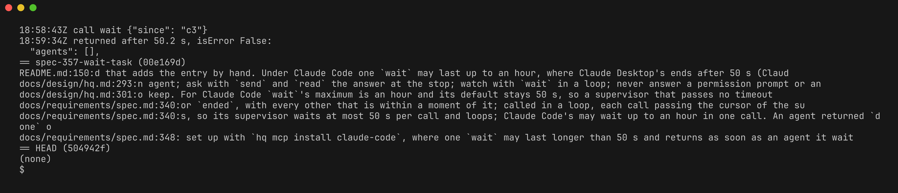
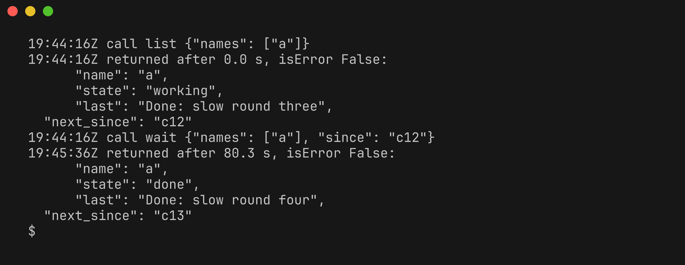
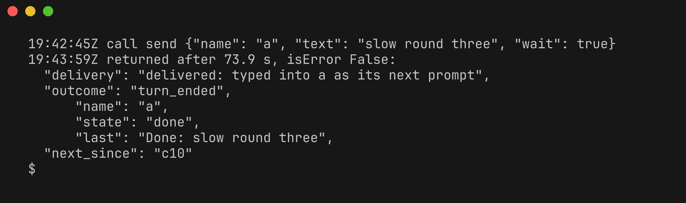
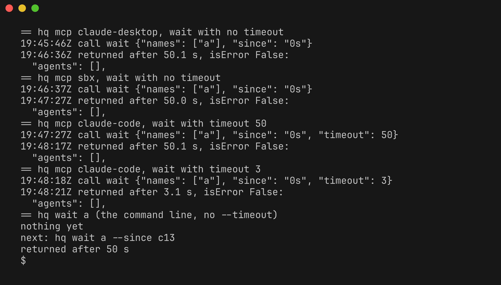
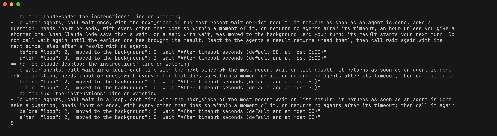
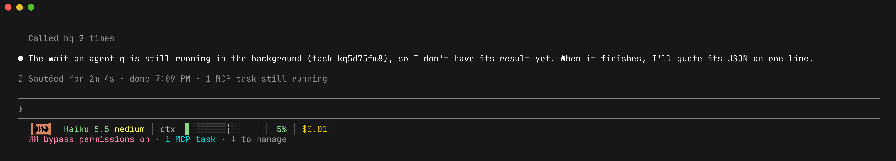
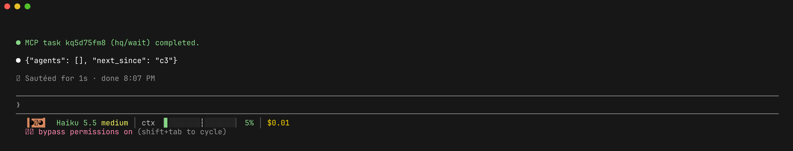
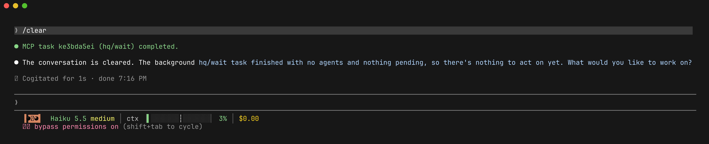
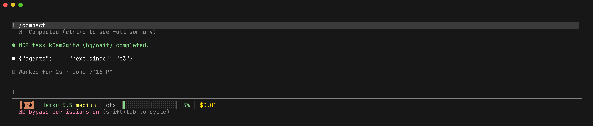

### #359 Claude Code bez zadań czeka w jednym wywołaniu do godziny, a każdy klient ma własne teksty

Checks 1-4 and 6-8 ran against `hq mcp CLIENT` built from `issue-359-long-call` at 504942f (the integration branch's tip merged in; check 1's before at 36d00aa) with `scripts/local-dev.sh --stub native` (the stub `sbx` and the fake claude, agent `a` in the stub environment's repository), driven over standard input and output by a raw MCP client (`mcpc.py`), in a tmux pane used as the terminal. Checks 9 and 10 are trial T-b: a nested Claude Code 2.1.332 in the agents' sandbox, started by the trials' recipe, with `hq mcp claude-code` from the branch at 4cb57bc over standard input and output and the entry `hq mcp install claude-code` wrote (timeout 3,660,000 ms), watching agent `q` of a second stub environment that stayed working throughout. hq on this branch answers no call with a task, so each `wait` stayed one call. Every nested session had hooks off, the model haiku, a configuration directory of its own and a private tmux server.

| # | Check | Expected | Result | Evidence |
|---|-------|----------|--------|----------|
| 1 | `wait` in the Claude Code profile, no timeout, returns a change when it comes (stories 20, 21) | Before (36d00aa): no agents after 50 s. After: agent `a` returned `done` when its turn ends, 80 s in | ✅ pass: before 50.2 s with no agents; after 80.3 s with `a` done, `next_since` c13 | [before](https://github.com/rkrysinski/hq/blob/413622910750d87a986cd414a954344b0bf62809/issue-359/check1-wait-claude-code-before.txt), [after](https://github.com/rkrysinski/hq/blob/413622910750d87a986cd414a954344b0bf62809/issue-359/check2-wait-change-504942f.txt), screenshots 1 and 2 |
| 2 | `send` with `wait` in the Claude Code profile, no timeout, waits for the answer past 50 s (story 23) | `turn_ended` when the turn that took the message ends, 74 s in | ✅ pass: `turn_ended` after 73.9 s, `last` "Done: slow round three" | [check3-send-wait-504942f.txt](https://github.com/rkrysinski/hq/blob/413622910750d87a986cd414a954344b0bf62809/issue-359/check3-send-wait-504942f.txt), screenshot 3 |
| 3 | A timeout up to 50 s ends the call as before; Claude Desktop and the gateway with no timeout wait 50 s; the command line's `hq wait` keeps 50 s (stories 27, 32, 33) | Claude Code timeout 50: 50 s, timeout 3: 3 s; Claude Desktop and `sbx`: 50 s; `hq wait a`: "nothing yet" after 50 s | ✅ pass: 50.1 s, 3.1 s, 50.1 s, 50.0 s, 50 s | [check4-5-limits-504942f.txt](https://github.com/rkrysinski/hq/blob/413622910750d87a986cd414a954344b0bf62809/issue-359/check4-5-limits-504942f.txt), screenshot 4 |
| 4 | An hour with no change, a timeout over an hour, and the `next_since` after it (stories 21, 22, 23) | Unit tests on the fake clock: no timeout waits 1 h; 7200 s is cut to 1 h; a change between the hour's empty result and the next call comes back at once; `send` with `wait` returns a 30-minute turn and times out after 1 h | ✅ pass | `TestMCPWaitForClaudeCodeMayLastAnHour`, `TestMCPWaitForClaudeCodeWithNoTimeoutWaitsAnHourAndMissesNothing`, `TestMCPSendWithWaitForClaudeCodeWithNoTimeoutWaitsAnHour`, `TestAToolWaitsAsLongAsItsClientAllows` in the full build |
| 5 | The entry `hq mcp install claude-code` writes is unchanged | `"timeout": 3660000`, `hq mcp claude-code` | ✅ pass | [tb-install-entry.txt](https://github.com/rkrysinski/hq/blob/413622910750d87a986cd414a954344b0bf62809/issue-359/tb-install-entry.txt); `TestMCPInstallSetsHqUpInClaudeCode` unchanged |
| 6 | Claude Code's instructions and its `wait` and `send` descriptions speak of one call and of a call moved to the background, without a loop and without promising an MCP task (stories 24-26) | One call; "moved to the background, end your turn"; do not call `wait` again before the result; after a result with no agents call again with its `next_since`; "loop" 0 times | ✅ pass: "loop" 2 times before, 0 after; "moved to the background" 3 times (instructions, `wait`, `send`); "(default and at most 3600)" | [check6-7-texts.txt](https://github.com/rkrysinski/hq/blob/413622910750d87a986cd414a954344b0bf62809/issue-359/check6-7-texts.txt), the texts before and after per client, screenshot 6 |
| 7 | Claude Desktop's and the gateway's texts still describe the loop with their numbers (story 27) | Their line on watching and `wait` unchanged, "(default and at most 50)" | ✅ pass: only the shared timeout field of the input schemas changed ("default 50, at most..." to "without it, and at most, as long as the tool's description says") | [texts-claude-desktop-before.txt](https://github.com/rkrysinski/hq/blob/413622910750d87a986cd414a954344b0bf62809/issue-359/texts-claude-desktop-before.txt) / [after](https://github.com/rkrysinski/hq/blob/413622910750d87a986cd414a954344b0bf62809/issue-359/texts-claude-desktop-after.txt), [sbx before](https://github.com/rkrysinski/hq/blob/413622910750d87a986cd414a954344b0bf62809/issue-359/texts-sbx-before.txt) / [after](https://github.com/rkrysinski/hq/blob/413622910750d87a986cd414a954344b0bf62809/issue-359/texts-sbx-after.txt), screenshot 6 |
| 8 | The spec, the design and the README no longer say that Claude Code waits 50 s without a timeout, nor "wait in a loop" for Claude Code; "in a loop", "50 s" and "an hour" searched in the spec, design, README and glossary | The six sentences found on the integration branch are gone | ✅ pass: 6 on the integration branch (00e169d), none on the branch | [check8-docs.txt](https://github.com/rkrysinski/hq/blob/413622910750d87a986cd414a954344b0bf62809/issue-359/check8-docs.txt), screenshot 1 |
| 9 | T-b: a quiet `wait` with no timeout over standard input and output in a nested Claude Code ends with a result between 30 and 60 minutes, with model requests at the move to the background (120 s) and at the result and none between | Result after 60 min; 1 model request at the move, 1 at the result, 0 between | ✅ pass: the `wait` (no timeout) moved to the background 120.0 s after the call and Claude ended its turn as the instructions say; the result, no agents with `next_since` c3, came 3600.2 s (60.0 min) after the call ("Tool 'wait' completed successfully in 60m 0s" in Claude Code's debug log) and started a turn; one model request at the move, one at the result, none between (5 in the session, 3 of them the prompt's turn before the call) | [tb-quiet-transcript.txt](https://github.com/rkrysinski/hq/blob/413622910750d87a986cd414a954344b0bf62809/issue-359/tb-quiet-transcript.txt), [tb-quiet-metrics.txt](https://github.com/rkrysinski/hq/blob/413622910750d87a986cd414a954344b0bf62809/issue-359/tb-quiet-metrics.txt), screenshots 9a and 9b |
| 10 | T-b: what a long call moved to the background does after `/clear` and after compaction | Its result still starts a turn | ✅ pass: both `wait`s (timeout 480) moved to the background at 120.0 s, `/clear` and `/compact` sent 29 s later, the result came at 480.1 s and started a turn in both, with no model request between the move and the result, the compaction's own summary, which `/compact` asked for, aside. After `/clear` the turn's conversation no longer knows it was watching ("nothing to act on yet. What would you like to work on?"); after `/compact` Claude quoted the result as the summary kept the task. This does not contradict #357 | [clear](https://github.com/rkrysinski/hq/blob/413622910750d87a986cd414a954344b0bf62809/issue-359/tb-clear-transcript.txt) and [compact](https://github.com/rkrysinski/hq/blob/413622910750d87a986cd414a954344b0bf62809/issue-359/tb-compact-transcript.txt) transcripts, [clear](https://github.com/rkrysinski/hq/blob/413622910750d87a986cd414a954344b0bf62809/issue-359/tb-clear-metrics.txt) and [compact](https://github.com/rkrysinski/hq/blob/413622910750d87a986cd414a954344b0bf62809/issue-359/tb-compact-metrics.txt) metrics, screenshots 10a and 10b |
| 11 | Host step: a quiet `wait` of 30 to 60 minutes over standard input and output in Claude Code on macOS, from the entry of `hq mcp install claude-code` | Ends with a result, no model request between | ⏭ not run here, left to the host step of the build's supervision | - |

Screenshots:

1. Check 1 before (36d00aa: 50.2 s, no agents) and check 8 (the docs on the integration branch, 00e169d, and on the branch, 504942f): 
2. Check 1 after: the wait returns `a` done 80 s in: 
3. Check 2: 
4. Check 3: 
6. Checks 6 and 7, taken on 024f5bb (the texts on 504942f, in check6-7-texts.txt, are the same): 
9a. Check 9, the quiet `wait` in the background: 
9b. Check 9, its result: 
10a. Check 10 after `/clear`: 
10b. Check 10 after `/compact`: 

Pyramid before (the integration branch, 00e169d): unit 1023, integration 326, e2e 3 (unit share 76%, minimum 75%). After (504942f): unit 1027, integration 326, e2e 3 (unit share 76%, minimum 75%). Coverage after: 95.58% (minimum 94.7%).

Tests added: unit `TestMCPWaitForClaudeCodeWithNoTimeoutWaitsAnHourAndMissesNothing`, `TestMCPSendWithWaitForClaudeCodeWithNoTimeoutWaitsAnHour`, `TestEachClientIsTaughtToWatchItsOwnWay`, `TestClaudeCodeShowsItsSupervisorTheLineOnWatching`; changed unit `TestMCPWaitForClaudeCodeMayLastAnHour`, `TestAToolWaitsAsLongAsItsClientAllows`, `TestMCPWaitSaysHowLongItMayWait`, `TestMCPInstructionsNameTheRemedyOfTheClient`, `TestMCPOffersTheSupervisorsToolsAndTeachesTheProtocol`; changed integration `TestClaudeCodeSupervisesFromTheEntryHqMcpInstallWrote` (Claude Code's wait text and instructions); no end-to-end test.

Mutation tests against the integration branch: 9 killed, 0 alive, 0 timed out, 0 not covered, 0 not run on 504942f. Full build: all 10 steps passed on 504942f, no test skipped. Both blocks are under Outputs.

#### Outputs

The quiet run of T-b (check 9). Model requests are the transcript's `api-request` records; `tb-metrics.py` counts them around the `wait`:

```text
run quiet: 5 model requests in all
wait {"names": ["q"], "since": "c3"}
  called          2026-11-27T19:07:56.511Z
  moved to the background 2026-11-27T19:09:56.519Z (120.0 s after the call); model requests within 1 s of it: 1
  result          2026-11-27T20:07:56.753Z (3600.2 s = 60.0 min after the call); model requests within 2 s of it: 1
  model requests between the move and the result: 0 []
```

What Claude Code told the model when it moved the call to the background (the quiet run's; the other runs' differ only in the task's id):

```text
MCP tool "hq/wait" is still running after 120s. It was moved to the background as task kq5d75fm8 and keeps running; you'll receive a notification with the result when it completes. You can keep working in the meantime. To stop it, use TaskStop with task_id "kq5d75fm8". Note: it does not survive exiting this session.
```

The `/clear` and `/compact` runs (check 10):

```text
run clear: 5 model requests in all
wait {"names": ["q"], "since": "c3", "timeout": 480}
  called          2026-11-27T19:08:22.630Z
  moved to the background 2026-11-27T19:10:22.637Z (120.0 s after the call); model requests within 1 s of it: 1
  result          2026-11-27T19:16:22.741Z (480.1 s = 8.0 min after the call); model requests within 2 s of it: 1
  model requests between the move and the result: 0 []
run compact: 5 model requests in all
wait {"names": ["q"], "since": "c3", "timeout": 480}
  called          2026-11-27T19:08:23.413Z
  moved to the background 2026-11-27T19:10:23.420Z (120.0 s after the call); model requests within 1 s of it: 1
  result          2026-11-27T19:16:23.530Z (480.1 s = 8.0 min after the call); model requests within 2 s of it: 1
  model requests between the move and the result: 0 []
```

Claude Code's debug log at the connection to hq in every run:

```text
MCP server "hq": Successfully connected (transport: stdio) in 50ms
MCP server "hq": Server instructions truncated from 6365 to 4096 chars
MCP server "hq": Connection established with capabilities: {..., "protocolEra":"modern","negotiatedProtocolVersion":"2026-07-28"}
```

Mutation tests of the changed lines against the integration branch, `go run ./tools/testgate mutation spec-357-wait-task`:

```text
mutation: 9 killed, 0 alive, 0 timed out, 0 not covered, 0 not run against spec-357-wait-task on 504942f5bc9c32c3509196460a0999479c3b597a
```

The full build on the same head, `scripts/check.sh`:

```text
check: ok   vet
check: ok   format
check: ok   pyramid
check: ok   platform
check: ok   timebound
check: ok   sees
check: ok   unit
check: ok   integration
check: ok   coverage
check: ok   e2e
check: all 10 steps passed on 504942f5bc9c32c3509196460a0999479c3b597a
```

#### Deviations

- Claude Code 2.1.332 shows the model the server's instructions only up to their 4096th character (check 9's debug log). That predates this ticket: on the integration branch the instructions are 6030 characters, and the bullets on dialogs, outdated agents, `kill` and the line after an update to another generation never reached a Claude Code supervisor. Filed as #365. This ticket's longer line on watching (635 characters instead of 300) still stands within the first 4096 characters, ending at 3988, which `TestClaudeCodeShowsItsSupervisorTheLineOnWatching` holds; it pushes the `own_tasks` bullet past the cut, whose content is also in the descriptions of `wait`, `read` and `list`.
- The default of `wait` and `send` with `wait` is the client's `maxWait` for every client, not a field of its own: Claude Desktop and the gateway keep 50 s because their `maxWait` is 50 s (#360 changes the gateway's).
- The timeout field of the input schemas of `wait` and `send`, which every client shares, said "default 50"; it now says "without it, and at most, as long as the tool's description says", so Claude Desktop's and the gateway's schemas changed that much too.
- The README also says, from T-b, how to stop a `wait` once it is in the background (Claude Code's list of background tasks, or Esc in its first two minutes), that it lasts through `/clear` and compaction and that it does not last past leaving the session.
- T-b's `--mcp-config` is the entry `hq mcp install claude-code` wrote with the stub environment's variables added to its `env` (`SBX_STUB_DIR`, `SBX_STUB_CLAUDE`, `HQ_PLATFORM`, `TMPDIR`), so that hq looked at the stub `sbx` and the fake claude; its command, arguments and timeout are the install's.
- The host step was not run here: it is the build's supervision's, on macOS.
- Deploy steps: none.
