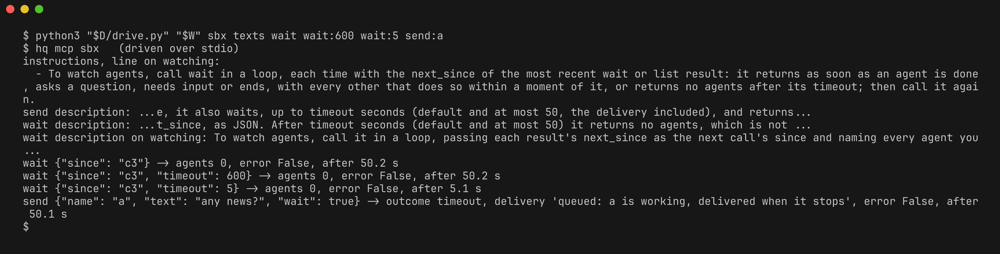
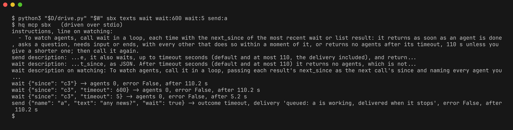
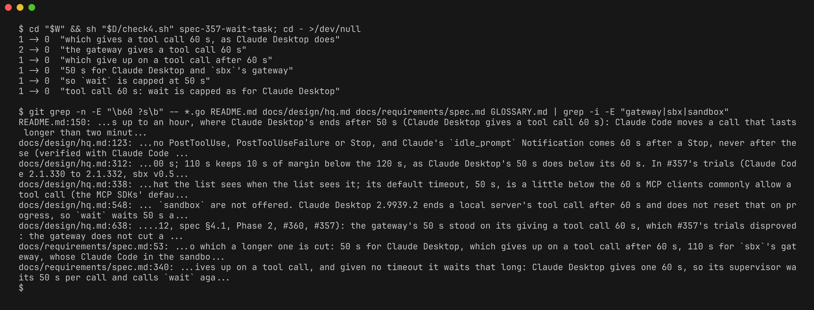
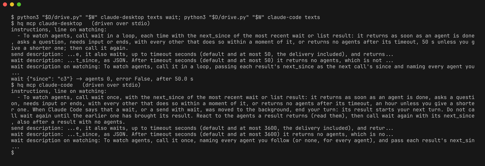

### #360 Agent za bramą czeka 110 s, a dokumenty nie mówią już, że brama daje 60 s

Checks 1-3 and 5 ran against `hq mcp CLIENT` built with `scripts/local-dev.sh --stub native` (the stub `sbx` and the fake claude, agent `a` started with the prompt "slow", so it stayed working throughout), driven over standard input and output by a raw MCP client ([drive.py](https://github.com/rkrysinski/hq/blob/23d39bd07d0941d1692f233aef10add0ba25ac1a/issue-360/drive.py)), in a tmux pane used as the terminal: before on the integration branch's tip (504942f), after on `issue-360-gateway-110s` at 174d68c. Check 4 ran [check4.sh](https://github.com/rkrysinski/hq/blob/23d39bd07d0941d1692f233aef10add0ba25ac1a/issue-360/check4.sh) in the same pane on 174d68c against the integration branch. The integration branch did not move while this ticket was built, so there was nothing to merge in before the full build.

| # | Check | Expected | Result | Evidence |
|---|-------|----------|--------|----------|
| 1 | `wait` in the gateway's profile (`hq mcp sbx`) with no timeout, with a timeout above 110 s and with a short one (stories 28, 30) | Before: 50 s, 50 s, 5 s. After: no agents after 110 s with no timeout and with timeout 600; 5 s with timeout 5 | ✅ pass: before 50.2 s, 50.2 s, 5.1 s; after 110.2 s, 110.2 s, 5.2 s | [before](https://github.com/rkrysinski/hq/blob/23d39bd07d0941d1692f233aef10add0ba25ac1a/issue-360/1-3-sbx-before.txt), [after](https://github.com/rkrysinski/hq/blob/23d39bd07d0941d1692f233aef10add0ba25ac1a/issue-360/1-3-sbx-after.txt), screenshots 1 and 2 |
| 2 | `send` with `wait` in the gateway's profile, no timeout, to an agent at work (story 30) | Before: `timeout` after 50 s. After: `timeout` after 110 s, the message queued | ✅ pass: before 50.1 s; after 110.2 s, delivery "queued: a is working, delivered when it stops" | as check 1, screenshots 1 and 2 |
| 3 | The gateway profile's instructions and `wait` and `send` descriptions give 110 s and still describe the loop | Instructions: "call wait in a loop ... returns no agents after its timeout, 110 s unless you give a shorter one; then call it again."; `wait`: "(default and at most 110)" and "call it in a loop"; `send`: "(default and at most 110, the delivery included)" | ✅ pass: before, no number in the instructions and 50 in the descriptions; after, as expected | as check 1, screenshots 1 and 2 |
| 4 | No text in the code or the docs says the gateway gives a tool call 60 s; "60 s", "50 s", "gateway", "in a loop" and "an hour" searched in the code's comments, the spec, the design, the README and the glossary (story 38) | Each sentence found on the integration branch gone; every line left with "60 s" near "gateway", "sbx" or "sandbox" is Claude Desktop's own limit, another 60 s, or the correction | ✅ pass: 6 sentences on the integration branch (the code's comment on `sbxGateway` and a test's, the README, the design, the spec twice; 7 matches of the phrases), none after; the 8 lines left are Claude Desktop's 60 s (README 150, design 548, spec 53 and 340), Claude Code's `idle_prompt` (design 123), the MCP clients' common 60 s behind `hq wait`'s 50 s (design 338) and this ticket's correction (design 312, 638) | [4-no-gateway-60s.txt](https://github.com/rkrysinski/hq/blob/23d39bd07d0941d1692f233aef10add0ba25ac1a/issue-360/4-no-gateway-60s.txt), screenshot 4 |
| 5 | Nearby: Claude Desktop keeps 50 s with its own reason, Claude Code keeps its one call of an hour, the command line keeps 50 s (stories 32, 33, 38) | `hq mcp claude-desktop`: `wait` with no timeout after 50 s, "(default and at most 50)", the loop; `hq mcp claude-code`: one call, "an hour", "(default and at most 3600)"; the comment on Claude Desktop's 60 s unchanged; `hq wait`'s unit tests unchanged | ✅ pass: Claude Desktop 50.0 s, its instructions now name its 50 s too ("50 s unless you give a shorter one"); Claude Code's texts as on the integration branch | [5-desktop-code-after.txt](https://github.com/rkrysinski/hq/blob/23d39bd07d0941d1692f233aef10add0ba25ac1a/issue-360/5-desktop-code-after.txt), screenshot 5 |
| 6 | Unit tests on the fake clock: the gateway's `wait` and `send` with `wait` for each timeout, its texts, and its line on watching within the 4096 characters Claude Code shows (#365) | `wait` 0 → 110 s, 5 → 5 s, 51 → 51 s, 110 → 110 s, 111 → 110 s, 600 → 110 s; `send` 0 → 110 s, 30 → 30 s, 600 → 110 s; each client's own number in its texts | ✅ pass; the new and changed tests fail on the integration branch's `mcp.go` (5 failing) and pass on the branch | `TestMCPWaitThroughTheGatewayLasts110Seconds`, `TestAToolWaitsAsLongAsItsClientAllows`, `TestEachClientIsTaughtToWatchItsOwnWay`, `TestMCPWaitSaysHowLongItMayWait`, `TestClaudeCodeShowsItsSupervisorTheLineOnWatching`, `TestMCPForSbxServesTheGatewaysWait` in the full build |
| 7 | Host step: hq from the worktree registered and loaded into a sandbox (`hq mcp install sbx`, `hq mcp load`); an agent there calls `wait` through the gateway: the call lasts 110 s and its result comes back in the same turn (story 29) | 110 s, same turn | ⏭ not run here, left to the host step of the build's supervision (the gateway was not touched) | - |

Screenshots:

1. Checks 1-3 before (504942f): 
2. Checks 1-3 after (174d68c): 
4. Check 4: 
5. Check 5: 

Pyramid before (504942f): unit 1027, integration 326, e2e 3 (unit share 76%, minimum 75%). After (174d68c): unit 1028, integration 326, e2e 3 (unit share 76%, minimum 75%). Coverage after: 95.60% (minimum 94.7%).

Tests added: unit `TestMCPWaitThroughTheGatewayLasts110Seconds`; changed unit `TestAToolWaitsAsLongAsItsClientAllows` (the gateway's rows), `TestEachClientIsTaughtToWatchItsOwnWay` (each loop client's number), `TestMCPWaitSaysHowLongItMayWait` (110), `TestClaudeCodeShowsItsSupervisorTheLineOnWatching` (the gateway's line too), `TestMCPForSbxServesClaudeDesktopsWait` renamed `TestMCPForSbxServesTheGatewaysWait` (110 s); changed integration `TestASandboxsClaudeCodeSupervisesFromTheRegistrationHqMcpInstallSbxMade` ("(default and at most 110)"); no end-to-end test.

Mutation tests against the integration branch: no mutant alive, 1 not covered (the constant `gatewayWait`), 0 not run on 174d68c. Full build: all 10 steps passed on 174d68c. Both blocks are under Outputs.

#### Outputs

Checks 1-3 before, `python3 drive.py WORKTREE sbx texts wait wait:600 wait:5 send:a` on 504942f:

```text
$ python3 "$D/drive.py" "$W" sbx texts wait wait:600 wait:5 send:a
$ hq mcp sbx   (driven over stdio)
instructions, line on watching:
  - To watch agents, call wait in a loop, each time with the next_since of the most recent wait or list result: it returns as soon as an agent is done
, asks a question, needs input or ends, with every other that does so within a moment of it, or returns no agents after its timeout; then call it agai
n.
send description: ...e, it also waits, up to timeout seconds (default and at most 50, the delivery included), and returns...
wait description: ...t_since, as JSON. After timeout seconds (default and at most 50) it returns no agents, which is not ...
wait description on watching: To watch agents, call it in a loop, passing each result's next_since as the next call's since and naming every agent you
...
wait {"since": "c3"} -> agents 0, error False, after 50.2 s
wait {"since": "c3", "timeout": 600} -> agents 0, error False, after 50.2 s
wait {"since": "c3", "timeout": 5} -> agents 0, error False, after 5.1 s
send {"name": "a", "text": "any news?", "wait": true} -> outcome timeout, delivery 'queued: a is working, delivered when it stops', error False, after
 50.1 s
$
```

Checks 1-3 after, the same on 174d68c:

```text
$ python3 "$D/drive.py" "$W" sbx texts wait wait:600 wait:5 send:a
$ hq mcp sbx   (driven over stdio)
instructions, line on watching:
  - To watch agents, call wait in a loop, each time with the next_since of the most recent wait or list result: it returns as soon as an agent is done
, asks a question, needs input or ends, with every other that does so within a moment of it, or returns no agents after its timeout, 110 s unless you
give a shorter one; then call it again.
send description: ...e, it also waits, up to timeout seconds (default and at most 110, the delivery included), and return...
wait description: ...t_since, as JSON. After timeout seconds (default and at most 110) it returns no agents, which is not...
wait description on watching: To watch agents, call it in a loop, passing each result's next_since as the next call's since and naming every agent you
...
wait {"since": "c3"} -> agents 0, error False, after 110.2 s
wait {"since": "c3", "timeout": 600} -> agents 0, error False, after 110.2 s
wait {"since": "c3", "timeout": 5} -> agents 0, error False, after 5.2 s
send {"name": "a", "text": "any news?", "wait": true} -> outcome timeout, delivery 'queued: a is working, delivered when it stops', error False, after
 110.2 s
$
```

Check 5, `python3 drive.py WORKTREE claude-desktop texts wait; python3 drive.py WORKTREE claude-code texts` on 174d68c:

```text
$ python3 "$D/drive.py" "$W" claude-desktop texts wait; python3 "$D/drive.py" "$W" claude-code texts
$ hq mcp claude-desktop   (driven over stdio)
instructions, line on watching:
  - To watch agents, call wait in a loop, each time with the next_since of the most recent wait or list result: it returns as soon as an agent is done
, asks a question, needs input or ends, with every other that does so within a moment of it, or returns no agents after its timeout, 50 s unless you g
ive a shorter one; then call it again.
send description: ...e, it also waits, up to timeout seconds (default and at most 50, the delivery included), and returns...
wait description: ...t_since, as JSON. After timeout seconds (default and at most 50) it returns no agents, which is not ...
wait description on watching: To watch agents, call it in a loop, passing each result's next_since as the next call's since and naming every agent you
...
wait {"since": "c3"} -> agents 0, error False, after 50.0 s
$ hq mcp claude-code   (driven over stdio)
instructions, line on watching:
  - To watch agents, call wait once, with the next_since of the most recent wait or list result: it returns as soon as an agent is done, asks a questi
on, needs input or ends, with every other that does so within a moment of it, or returns no agents after its timeout, an hour unless you give a shorte
r one. When Claude Code says that a wait, or a send with wait, was moved to the background, end your turn: its result starts your next turn. Do not ca
ll wait again until the earlier one has brought its result. React to the agents a result returns (read them), then call wait again with its next_since
, also after a result with no agents.
send description: ...e, it also waits, up to timeout seconds (default and at most 3600, the delivery included), and retur...
wait description: ...t_since, as JSON. After timeout seconds (default and at most 3600) it returns no agents, which is no...
wait description on watching: To watch agents, call it once, naming every agent you follow (or none, for every agent), and pass each result's next_sin
...
$
```

Check 4, `sh check4.sh spec-357-wait-task` on 174d68c (each sentence's count on the integration branch, then on the branch; then every line with "60 s" near "gateway", "sbx" or "sandbox"):

```text
$ cd "$W" && sh "$D/check4.sh" spec-357-wait-task; cd - >/dev/null
1 -> 0  "which gives a tool call 60 s, as Claude Desktop does"
2 -> 0  "the gateway gives a tool call 60 s"
1 -> 0  "which give up on a tool call after 60 s"
1 -> 0  "50 s for Claude Desktop and `sbx`'s gateway"
1 -> 0  "so `wait` is capped at 50 s"
1 -> 0  "tool call 60 s: wait is capped as for Claude Desktop"

$ git grep -n -E "\b60 ?s\b" -- *.go README.md docs/design/hq.md docs/requirements/spec.md GLOSSARY.md | grep -i -E "gateway|sbx|sandbox"
README.md:150: ...s up to an hour, where Claude Desktop's ends after 50 s (Claude Desktop gives a tool call 60 s): Claude Code moves a call that lasts
 longer than two minut...
docs/design/hq.md:123: ...no PostToolUse, PostToolUseFailure or Stop, and Claude's `idle_prompt` Notification comes 60 s after a Stop, never after the
se (verified with Claude Code ...
docs/design/hq.md:312: ...00 s; 110 s keeps 10 s of margin below the 120 s, as Claude Desktop's 50 s does below its 60 s. In #357's trials (Claude Cod
e 2.1.330 to 2.1.332, sbx v0.5...
docs/design/hq.md:338: ...hat the list sees when the list sees it; its default timeout, 50 s, is a little below the 60 s MCP clients commonly allow a
tool call (the MCP SDKs' defau...
docs/design/hq.md:548: ... `sandbox` are not offered. Claude Desktop 2.9939.2 ends a local server's tool call after 60 s and does not reset that on pr
ogress, so `wait` waits 50 s a...
docs/design/hq.md:638: ....12, spec §4.1, Phase 2, #360, #357): the gateway's 50 s stood on its giving a tool call 60 s, which #357's trials disproved
: the gateway does not cut a ...
docs/requirements/spec.md:53: ...o which a longer one is cut: 50 s for Claude Desktop, which gives up on a tool call after 60 s, 110 s for `sbx`'s gat
eway, whose Claude Code in the sandbo...
docs/requirements/spec.md:340: ...ives up on a tool call, and given no timeout it waits that long: Claude Desktop gives one 60 s, so its supervisor wa
its 50 s per call and calls `wait` aga...
$
```

The new and changed unit tests on the integration branch's `internal/cli/mcp.go` (504942f), before the change:

```text
--- FAIL: TestMCPWaitThroughTheGatewayLasts110Seconds (0.02s)
--- FAIL: TestEachClientIsTaughtToWatchItsOwnWay (0.00s)
--- FAIL: TestMCPWaitSaysHowLongItMayWait (0.00s)
--- FAIL: TestAToolWaitsAsLongAsItsClientAllows (0.00s)
--- FAIL: TestMCPForSbxServesTheGatewaysWait (0.00s)
FAIL
FAIL	github.com/rkrysinski/hq/internal/cli	0.899s
```

Mutation tests of the changed lines against the integration branch, `go run ./tools/testgate mutation spec-357-wait-task`:

```text
not covered internal/cli/mcp.go:69:25 arithmetic base
mutation: 0 killed, 0 alive, 0 timed out, 1 not covered, 0 not run against spec-357-wait-task on 174d68c55ba6cc81df7385697b21872d33921ddb
```

The full build on the same head, `scripts/check.sh`:

```text
check: ok   vet
check: ok   format
check: ok   pyramid
check: ok   platform
check: ok   timebound
check: ok   sees
check: ok   unit
check: ok   integration
check: ok   coverage
check: ok   e2e
check: all 10 steps passed on 174d68c55ba6cc81df7385697b21872d33921ddb
```

#### Deviations

- Claude Desktop's instructions changed too: the loop's line on watching names the client's limit, so Claude Desktop's now says "50 s unless you give a shorter one" where it named no number. Its behaviour (50 s), its descriptions and the comment that gives its reason (its own 60 s) are unchanged. This makes "each with its own numbers" (#357, *Teksty*) true of the instructions as well as of the descriptions.
- `TestClaudeCodeShowsItsSupervisorTheLineOnWatching` now also holds the gateway's line on watching within the 4096 characters Claude Code shows (#365), since the gateway's client is a Claude Code too: otherwise the 110 s of the instructions could fall past the cut unseen. The gateway's line ends at byte 3690 of its 6405 (Claude Desktop's at 3689, Claude Code's at 3988).
- The design's paragraph on the gateway says what #357's trials measured (a call of 90 s through the gateway came back in its turn, the gateway did not cut short one of 65 minutes) and that a wait of 110 s through the gateway is not verified here, left to the host step.
- The host step was not run here: it is the build's supervision's, on the host.
- Deploy steps: none.
