### #361 Claude Code z zadaniami: `wait` po 50 s czeka dalej jako wait task, a wynik zaczyna turę

Checks 1-13 and 16 ran against `hq mcp CLIENT` built from `issue-361-wait-task` at af752e5 with `scripts/local-dev.sh --stub native` (the stub `sbx` and the fake claude, one agent per check in the stub environment's repository, each working on a "slow job" until a line typed into its pane let it finish), driven over standard input and output by a raw MCP client (`qac.py`) that speaks protocol 2026-07-28 as Claude Code 2.1.332 does (`server/discover`, no `initialize`, the extension declared in each request's `_meta` unless `--no-tasks`), in windows of a tmux server used as the terminal. The before of check 1 is the integration branch at 504942f. Check 14 is trial T-c: nested Claude Code 2.1.332 sessions in the agents' sandbox, started by the trials' recipe (hooks off, model haiku, a configuration directory of its own, a private tmux server), with `hq mcp claude-code` of the same build over standard input and output and the entry `hq mcp install claude-code` wrote, each supervisor told only "Watch the hq agent X with hq's tools until it is done, then tell me in one line what its last message says, and stop watching."

| # | Check | Expected | Result | Evidence |
|---|---|---|---|---|
| 1 | `server/discover` declares the Tasks extension, and how the library allows it (#357, *Do sprawdzenia*) | `capabilities.extensions["io.modelcontextprotocol/tasks"]` for `hq mcp claude-code`; none before, none for Claude Desktop and the gateway | ✅ pass: before `{"logging": {}, "tools": {"listChanged": true}}`; after, for `claude-code`, `{"extensions": {"io.modelcontextprotocol/tasks": {}}, "logging": {}, "tools": {"listChanged": true}}`; `claude-desktop` and `sbx` unchanged. **The library**: go-sdk v1.8.0 has no option for an extension in the `server/discover` answer alone (`ServerOptions.Capabilities` would also put it into the `initialize` result and drop the default `logging`); a receiving middleware on `server/discover` adds it to the `*mcp.DiscoverResult` with `Capabilities.AddExtension`, public API only | [s1-discover.txt](https://github.com/rkrysinski/hq/blob/bf5e5ec97fd9a842e37ffa5ede840aa0e265a435/issue-361/s1-discover.txt), [1-discover-before.txt](https://github.com/rkrysinski/hq/blob/bf5e5ec97fd9a842e37ffa5ede840aa0e265a435/issue-361/1-discover-before.txt), screenshot 1 |
| 2 | A change within 50 s comes back in the same call as a plain result, also when the request declares tasks (story 2) | `e2` finishes 21 s in: the call returns it, no handle | ✅ pass: `e2` let finish at 21 s, the call returned `e2 done "Done: slow job of e2"` at 21.4 s, a plain `CallToolResult` with no `resultType` | [s2-within-hold-summary.txt](https://github.com/rkrysinski/hq/blob/bf5e5ec97fd9a842e37ffa5ede840aa0e265a435/issue-361/s2-within-hold-summary.txt), [raw](https://github.com/rkrysinski/hq/blob/bf5e5ec97fd9a842e37ffa5ede840aa0e265a435/issue-361/s2-within-hold.txt), screenshot 2 |
| 3 | After 50 s a declaring request gets a task handle, a request without the declaration a long call (stories 1, 3) | Handle at 50 s; without the declaration no answer at 50 s and the change returned when it comes | ✅ pass: handle at 50.5 s, `resultType` `task`, `status` `working`, `ttlMs` null, `pollIntervalMs` 5000; with `--no-tasks` the call went on past 50 s and returned `e4 done` at 82.4 s, 1 s after `e4` was let finish | [s3-task-summary.txt](https://github.com/rkrysinski/hq/blob/bf5e5ec97fd9a842e37ffa5ede840aa0e265a435/issue-361/s3-task-summary.txt), [s3b-no-tasks-summary.txt](https://github.com/rkrysinski/hq/blob/bf5e5ec97fd9a842e37ffa5ede840aa0e265a435/issue-361/s3b-no-tasks-summary.txt), screenshots 3 and 3b |
| 4 | `tasks/get` gives `working`, then after the change `completed` with the `wait` result, whose `next_since` works as in a call: nothing lost, nothing twice (stories 4, 5, 6) | `working` until `e3` finishes, then `completed` with `e3` and `next_since`; a `wait` from that `next_since` does not return `e3` again | ✅ pass: `working` at 50.5-70.6 s, `e3` let finish at 72 s, `completed` at 75.6 s with `e3 done "Done: slow job of e3"`, `next_since` c41, no `structuredContent`, not an error; the `wait` from c41 returned nothing and went on as a new task after 50 s | [s3-task-summary.txt](https://github.com/rkrysinski/hq/blob/bf5e5ec97fd9a842e37ffa5ede840aa0e265a435/issue-361/s3-task-summary.txt), screenshot 3 |
| 5 | Without a limit the task waits until the first change, with no time to live (story 8) | `ttlMs` null; `working` as long as nothing changes | ✅ pass: `ttlMs` null in every handle and every task answered; in T-c's quiet run the task stayed `working` for 285 s, 57 polls, until the change; the unit test holds one 5 hours on the fake clock | [tc-metrics.txt](https://github.com/rkrysinski/hq/blob/bf5e5ec97fd9a842e37ffa5ede840aa0e265a435/issue-361/tc-metrics.txt), screenshot 3 |
| 6 | Another `hq mcp` than the one that took the call answers `tasks/get` (story 36) | A second process, started afresh, answers `working`, then `completed` | ✅ pass: the first process handed `e5`'s wait off at 50.6 s and ended; a second answered `working` four times and `completed` with `e5 done` 3 s after `e5` was let finish. The same in the integration journey and in T-c's resumed session (check 14c) | [s6-other-process-summary.txt](https://github.com/rkrysinski/hq/blob/bf5e5ec97fd9a842e37ffa5ede840aa0e265a435/issue-361/s6-other-process-summary.txt), screenshot 6 |
| 7 | Cancelling, also twice, is acknowledged and changes nothing at the agents (story 14) | Two acknowledgements; `hq ls` the same before and after; the task still answers | ✅ pass: two `tasks/cancel` sent at once, two `{"resultType": "complete"}`; `hq ls e3` the same line before and after; `tasks/get` afterwards still `working`. The unit test checks that a cancel types in no waiting message | [s3-task-summary.txt](https://github.com/rkrysinski/hq/blob/bf5e5ec97fd9a842e37ffa5ede840aa0e265a435/issue-361/s3-task-summary.txt), screenshot 3 |
| 8 | Two `wait`s are two tasks, each completes once, and the instruction says not to call `wait` again (story 15) | Two ids; each `completed` once `e6` finishes | ✅ pass: two `wait`s from the same `next_since`, 3 s apart: `w1:c38:mwzh16so:44UO-EGz:e6` and `w1:c38:mwzh18ze:BnHNL8rI:e6`, each `completed` with `e6 done` once; Claude Code's instruction says "Do not call wait again until the earlier one has brought its result" (check 11) | [s8-two-waits-summary.txt](https://github.com/rkrysinski/hq/blob/bf5e5ec97fd9a842e37ffa5ede840aa0e265a435/issue-361/s8-two-waits-summary.txt), screenshot 8 |
| 9 | An unknown task is refused with -32602 | -32602 | ✅ pass: `nope` and `w1` refused with -32602 "Failed to retrieve task: Task not found"; a task method whose request does not declare the extension with -32021 naming it | [s9-refusals-summary.txt](https://github.com/rkrysinski/hq/blob/bf5e5ec97fd9a842e37ffa5ede840aa0e265a435/issue-361/s9-refusals-summary.txt), screenshot 9 |
| 10 | The tasks contract is in one module (story 37) | The extension, the handle, `tasks/get` and `tasks/cancel` only in `internal/mcptasks` | ✅ pass: outside tests every mention of the extension's methods and fields is in `internal/mcptasks/mcptasks.go` (and one comment in `waittask.go`); `internal/cli` uses it only through `Serve`, `Offered`, `HandOff`, `Task` and `Tasks` | [s10-contract.txt](https://github.com/rkrysinski/hq/blob/bf5e5ec97fd9a842e37ffa5ede840aa0e265a435/issue-361/s10-contract.txt) |
| 11 | Claude Code's texts say what to do when a call became a task, and after "outcome unknown" and "cannot follow" (story 26, the part on tasks) | End the turn on a task; no `wait` until the earlier one's result; after "outcome unknown"/"cannot follow" a `wait` from the last `next_since`; within the 4096 characters Claude Code shows (#365) | ✅ pass: the instructions' line and the `wait` description say all three, and to call `wait` with no timeout (Deviations); the line runs from character 3353 to 4085; `wait` keeps `readOnlyHint: true` | [s11-texts.txt](https://github.com/rkrysinski/hq/blob/bf5e5ec97fd9a842e37ffa5ede840aa0e265a435/issue-361/s11-texts.txt) |
| 12 | The spec and the design say what ADR 0022 says, with no "wait in a loop" for Claude Code (story 39) | Phase 2 "Watching is waiting" and "No push into the client" (the client asks for the task), §4.1, Acceptance; design 3.4, 3.12, 5.1, 7.2 and a version line | ✅ pass: "in a loop" is left only for Claude Desktop and the gateway; "an hour" and "two model requests" only for a request without the extension or a `wait` given a timeout; README's Claude Code paragraph says the same | [s12-docs.txt](https://github.com/rkrysinski/hq/blob/bf5e5ec97fd9a842e37ffa5ede840aa0e265a435/issue-361/s12-docs.txt) |
| 13 | Hook and generation unchanged, so agents started before work without a restart (story 34); the install entry unchanged (story 31) | No change outside `internal/cli`, `internal/mcptasks`, tests and docs; entry `["mcp", "claude-code"]`, timeout 3660000 | ✅ pass: the diff against the integration branch touches only those; `hq mcp install claude-code` wrote `{"type": "stdio", "args": ["mcp", "claude-code"], "timeout": 3660000}`; T-c's sessions watched agents started before the build | [s13-unchanged.txt](https://github.com/rkrysinski/hq/blob/bf5e5ec97fd9a842e37ffa5ede840aa0e265a435/issue-361/s13-unchanged.txt) |
| 14a | T-c: the supervisor ends its turn after more than 50 s, and the task's completion starts a turn with the result | Handle after 50 s, turn ended; completion starts a turn that reports the agent | ✅ pass: quiet run: `wait` (no timeout) answered with a handle after 50.2 s; Claude ended its turn 0.8 s later on its own ("1 MCP task still running"); `a` let finish 281 s after the handle, the task `completed` 4.47 s after that, and the turn it started began 67 ms later: "Agent a is done. Its last message says: "Done: slow job of a". I've stopped watching." | [tc-metrics.txt](https://github.com/rkrysinski/hq/blob/bf5e5ec97fd9a842e37ffa5ede840aa0e265a435/issue-361/tc-metrics.txt), [tc-quiet-wire.txt](https://github.com/rkrysinski/hq/blob/bf5e5ec97fd9a842e37ffa5ede840aa0e265a435/issue-361/tc-quiet-wire.txt), screenshots 14a |
| 14b | T-c: no model request while waiting | 0 between the end of the turn that took the handle and the completion | ✅ pass: 0 in 285.0 s (quiet run), 0 in 74.2 s, 74.0 s and 75.1 s (the other three); each handle's own turn made one request, its closing reply. The compaction made its own call, which `/compact` asked for (`compact_boundary` 8 s after it), and which the transcript records as no `api-request` | [tc-metrics.txt](https://github.com/rkrysinski/hq/blob/bf5e5ec97fd9a842e37ffa5ede840aa0e265a435/issue-361/tc-metrics.txt) |
| 14c | T-c: the result also comes after `/clear`, after compaction, and after "Exit and stop tasks" and `claude --resume` (stories 10, 11) | Each completion starts a turn | ✅ pass: `/clear`, `/compact` and `/exit` sent 15 s after the handles. After `/clear` the turn started, in a conversation that no longer knew it was watching ("You didn't ask me to do anything with it"); after `/compact` Claude reported `c`'s last message; at `/exit` Claude Code's dialog offered "Exit and stop tasks", which sent no `tasks/cancel` and ended hq with SIGINT; 26 s later `claude --resume` started a new hq process, which the session asked for the same task 0.28 s after its start, and its completion started a turn that reported `d` | [tc-metrics.txt](https://github.com/rkrysinski/hq/blob/bf5e5ec97fd9a842e37ffa5ede840aa0e265a435/issue-361/tc-metrics.txt), [tc-exit-dialog.txt](https://github.com/rkrysinski/hq/blob/bf5e5ec97fd9a842e37ffa5ede840aa0e265a435/issue-361/tc-exit-dialog.txt), screenshots 14c |
| 14d | T-c: the poll interval measured and the value chosen justified | A value within 250 ms-30 s, with its reasons | ✅ pass: 5 s. Claude Code asked every 5.01 s (min 5.01, max 5.03, 96 gaps over four runs), never with a model request; hq answered a poll in a median of 6-13 ms per run and at most 22 ms, one look and one `sbx ls`, about 14 ms of CPU each (12 polls took 170 ms) against the stub `sbx`; a task completed 0.22-4.47 s after its change. So a result comes at most 5 s after its change, little beside an agent's turn, for about 720 looks an hour, and a poll whose `sbx ls` takes all of its 5 s (`sbxPollTimeout`) ends before the next one comes | [tc-metrics.txt](https://github.com/rkrysinski/hq/blob/bf5e5ec97fd9a842e37ffa5ede840aa0e265a435/issue-361/tc-metrics.txt) |
| 14e | T-c: a supervisor follows the texts into a task | It calls `wait` with no timeout | ✅ pass, after a change of the texts: with the texts the ticket lists (63978a9) all four supervisors of round 1 gave `wait` a timeout of 600 s, which keeps the call from going on as a task (Deviations); told to call `wait` with no timeout (af752e5), none of the four of round 2 gave one, and each call went on as a task | [tc-round1-calls.txt](https://github.com/rkrysinski/hq/blob/bf5e5ec97fd9a842e37ffa5ede840aa0e265a435/issue-361/tc-round1-calls.txt), [tc-metrics.txt](https://github.com/rkrysinski/hq/blob/bf5e5ec97fd9a842e37ffa5ede840aa0e265a435/issue-361/tc-metrics.txt) |
| 15 | Host step: the same in Claude Code on macOS with the entry of `hq mcp install claude-code`, a task through leaving and resuming the session, waiting for hours | | ⏭️ not run here, left to the host step | |
| 16 | Nearby, unchanged: Claude Desktop's and the gateway's waits, a Claude Code `wait` given a timeout, `hq wait` at the command line | Desktop 50 s and gateway 110 s with no agents and no handle though the request declares tasks; timeout 70 a call of 70 s; `hq wait` "nothing yet" after 50 s | ✅ pass: Desktop 50.6 s, gateway 110.5 s, no agents, no handle; `claude-code` with timeout 70: no agents at 70.5 s, no handle; `hq wait e7` "nothing yet" after 51 s, its build included | [s16-nearby-summary.txt](https://github.com/rkrysinski/hq/blob/bf5e5ec97fd9a842e37ffa5ede840aa0e265a435/issue-361/s16-nearby-summary.txt), screenshot 16 |

Screenshots:

1. Check 1, `server/discover` per client: 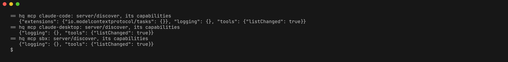
2. Check 2, a change within the hold: 
3. Checks 3, 4, 7, the handle, the polls, the completion, a wait from its `next_since`, two cancels: 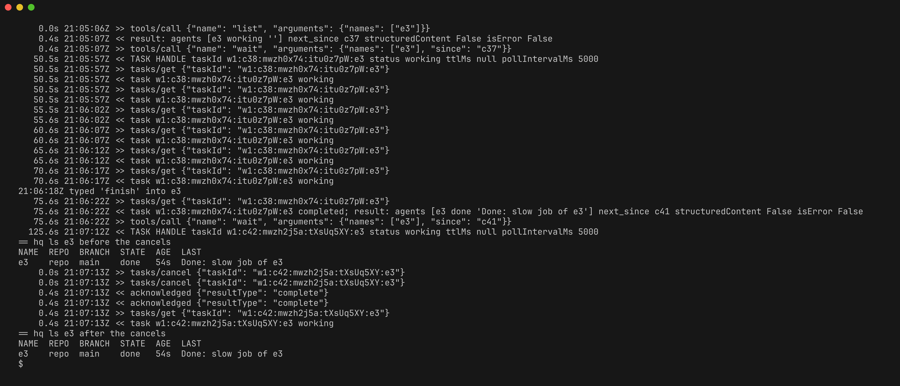
3b. Check 3, no declaration, a long call: 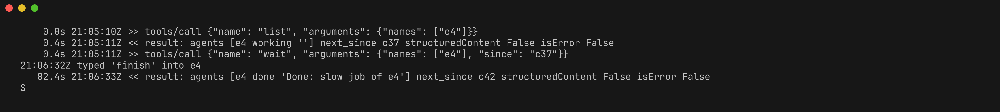
6. Check 6, another `hq mcp` answers: 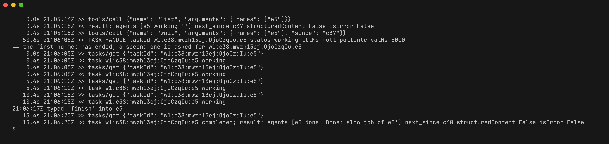
8. Check 8, two waits, two tasks: 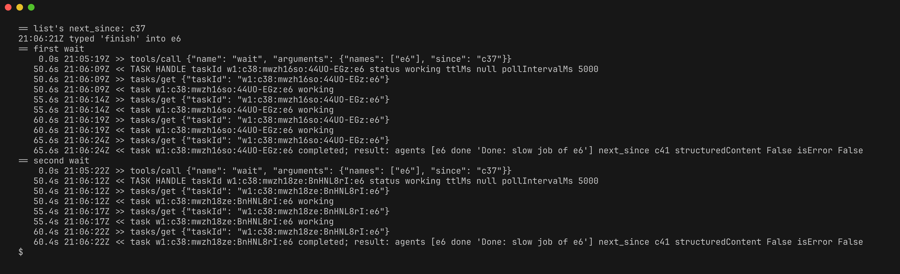
9. Check 9, refusals: 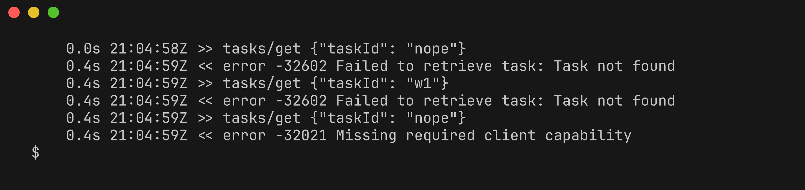
14a. Check 14a, T-c's quiet run, the task pending and its result (the trial folder's path written `<trial>`): 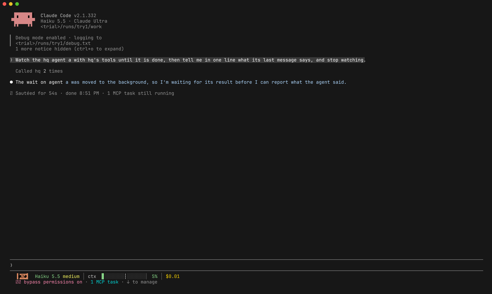 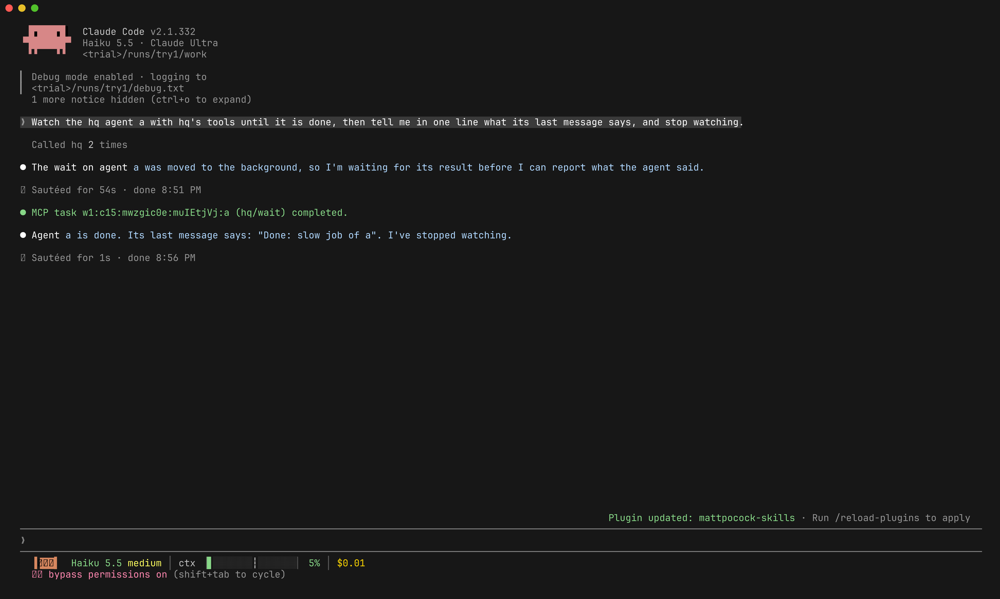
14c. Check 14c, after `/clear`, after `/compact`, after "Exit and stop tasks" and `claude --resume`: 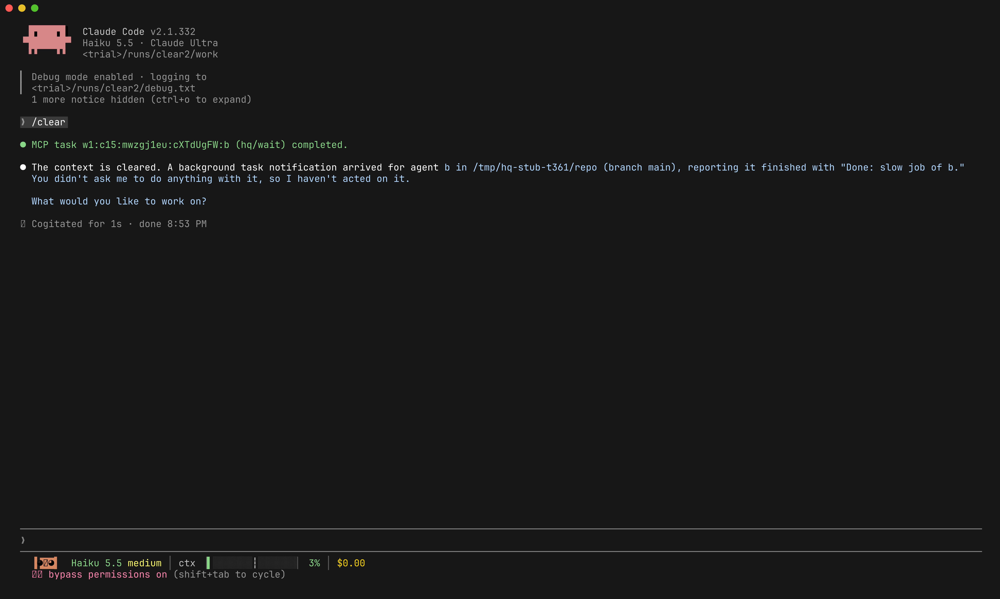 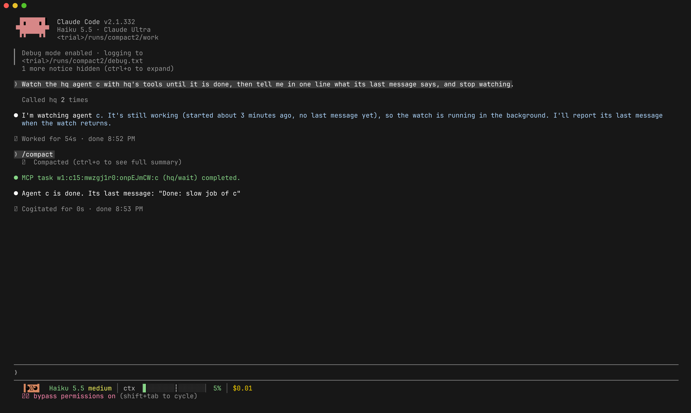 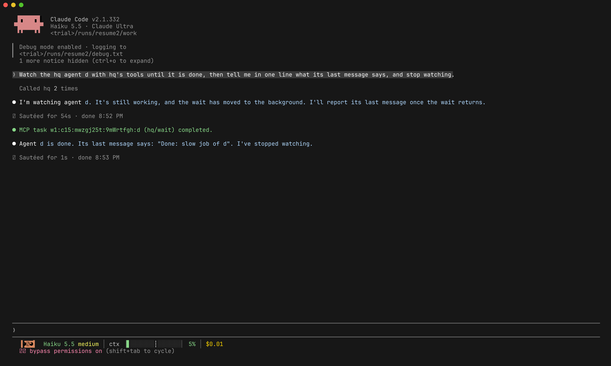
16. Check 16, nearby: 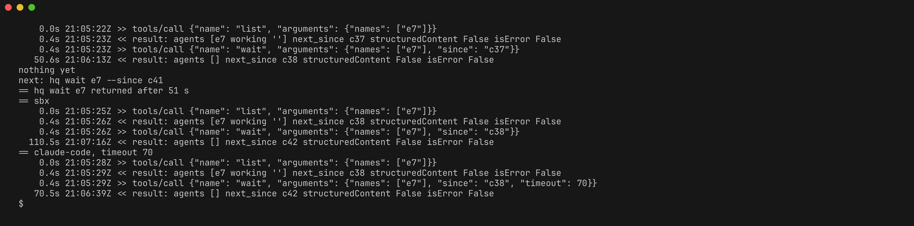

The scripts of the checks and of T-c are in [scripts/](https://github.com/rkrysinski/hq/tree/bf5e5ec97fd9a842e37ffa5ede840aa0e265a435/issue-361/scripts) (`hq.sh` and `hqmcp.sh` run `LOCAL_DEV_ID=t361 scripts/local-dev.sh --stub native` from the worktree); T-c's MCP configuration is [tc-entry.json](https://github.com/rkrysinski/hq/blob/bf5e5ec97fd9a842e37ffa5ede840aa0e265a435/issue-361/tc-entry.json).

Pyramid before (integration branch at 174d68c): `unit 1028, integration 326, e2e 3 (unit share 76%, minimum 75%)`. After (af752e5): `unit 1040, integration 327, e2e 3 (unit share 76%, minimum 75%)`.

Coverage after: `coverage 95.65% (minimum 94.7%)`.

Tests added:
- Unit (`internal/cli/waittask_test.go`, a raw JSON-RPC client over pipes to the server on the fakes, 12): `TestClaudeCodesHqDeclaresTheTasksExtensionInItsAnswerToDiscover`, `TestAWaitThatSeesAChangeWithinItsHoldReturnsItInTheCall`, `TestAWaitGoesOnAsAWaitTaskAfterItsHoldOnlyWhenItsRequestDeclaresTasks`, `TestAWaitThatFailsWithinItsHoldFailsInTheCall`, `TestAWaitTaskWorksUntilALookSeesAChangeThenCompletesWithTheWaitsResult`, `TestAnotherHqMcpAnswersForAWaitTask`, `TestCancellingAWaitTaskTwiceIsAcknowledgedAndChangesNothing`, `TestTwoWaitsAreTwoWaitTasksThatEachComplete`, `TestAnUnknownWaitTaskIsRefusedAsInvalidParams`, `TestTheTaskMethodsRefuseARequestThatDoesNotDeclareTasks`, `TestClaudeDesktopsAndTheGatewaysWaitsNeverBecomeTasks`, `TestAPollThatCannotLookCompletesTheWaitTaskWithTheError`. Changed: `TestEachClientIsTaughtToWatchItsOwnWay`, `TestMCPWaitSaysHowLongItMayWait` (`internal/cli/mcp_test.go`) for Claude Code's new texts.
- Integration (`cmd/hq/mcp_integration_test.go`, 1): `TestAWaitTaskOneHqMcpHandedOffIsAnsweredByAnother`, the built `hq mcp claude-code` over stdio: one process hands a wait off after 50 s, the agent ends its turn, another process answers for the task with the result. Changed: `TestClaudeCodeSupervisesFromTheEntryHqMcpInstallWrote` for the new `wait` description.
- End-to-end: none.

#### Outputs

T-c, round 1, with the texts of 63978a9 (`tc-round1-calls.txt`):

```text
== quiet
  tools/call list {"names": ["a"]}
  tools/call wait {"names": ["a"], "since": "c15", "timeout": 600}
== clear
  tools/call list {"names": ["b"]}
  tools/call wait {"names": ["b"], "since": "c15", "timeout": 600}
== compact
  tools/call list {"names": ["c"]}
  tools/call wait {"names": ["c"], "since": "c15", "timeout": 600}
== resume
  tools/call list {"names": ["d"]}
  tools/call wait {"names": ["d"], "since": "c15", "timeout": 600}
```

T-c, round 2, the quiet run and the resumed one (`python3 metrics.py try1`, `python3 metrics.py resume2`; all four in `tc-metrics.txt`):

```text
run try1: 1 hq processes started, 5 model requests in the run's transcripts
  20:50:32.410Z  hq process 496902: start
  20:50:36.791Z  said: Watch the hq agent a with hq's tools until it is done, then tell me in one line what its last message says, and stop watching.
  20:56:11.635Z  finished a
wait {"names": ["a"], "since": "c15"}, called 20:50:40.025Z by process 496902
  answered with a task handle after 50.2 s: taskId w1:c15:mwzgic0e:muIEtjVj:a, status working, ttlMs None, pollIntervalMs 5000
  tasks/get: 58, the first 0.014 s after the handle, by processes [496902]
  gaps between tasks/get of one process: min 5.01 s, median 5.01 s, max 5.03 s (57 gaps)
  hq's time to answer a tasks/get: median 11.9 ms, max 21.6 ms
  the turn that took the handle ended 20:51:31.066Z, 0.8 s after it, with 1 model request(s) after the handle ['20:51:30.280Z']
  completed at 20:56:16.101Z (336.1 s = 5.6 min after the call), structuredContent False, isError False: {   "agents": [     {       "name": "a",       "repo": "repo",       "repo_path": "/tmp/hq-stub-t361/repo",       "branch": "main",       "state": "done",       "state_seq": 19,       "completion_seq"
  model requests between the end of that turn and the completion (285.0 s): 0 []
  first model request after the completion: 20:56:16.169Z, 67 ms after it
  completed 4.47 s after the agent was let finish (20:56:11.635Z)

run resume2: 2 hq processes started, 5 model requests in the run's transcripts
  20:51:06.237Z  hq process 504020: start
  20:52:28.183Z  hq process 504020: signal 2
  20:52:28.184Z  hq process 504020: exit -2
  20:52:54.862Z  hq process 542542: start
  20:51:11.634Z  said: Watch the hq agent d with hq's tools until it is done, then tell me in one line what its last message says, and stop watching.
  20:52:19.182Z  said: /exit
  20:52:28.178Z  chose: Exit and stop tasks
  20:52:54.386Z  resumed: claude --resume (session of the run)
  20:53:18.275Z  finished d
wait {"names": ["d"], "since": "c15"}, called 20:51:14.060Z by process 504020
  answered with a task handle after 50.1 s: taskId w1:c15:mwzgj25t:9mWrtfgh:d, status working, ttlMs None, pollIntervalMs 5000
  tasks/get: 11, the first 0.029 s after the handle, by processes [504020, 542542]
  gaps between tasks/get of one process: min 5.01 s, median 5.01 s, max 5.03 s (9 gaps)
  hq's time to answer a tasks/get: median 8.1 ms, max 15.7 ms
  process 504020's last tasks/get 20:52:24.240Z, process 542542's first 20:52:55.140Z (30.9 s later)
  the turn that took the handle ended 20:52:05.138Z, 1.0 s after it, with 1 model request(s) after the handle ['20:52:04.192Z']
  completed at 20:53:20.197Z (126.1 s = 2.1 min after the call), structuredContent False, isError False: {   "agents": [     {       "name": "d",       "repo": "repo",       "repo_path": "/tmp/hq-stub-t361/repo",       "branch": "main",       "state": "done",       "state_seq": 18,       "completion_seq"
  model requests between the end of that turn and the completion (75.1 s): 0 []
  first model request after the completion: 20:53:20.261Z, 63 ms after it
  completed 1.92 s after the agent was let finish (20:53:18.275Z)
```

The cost of polls, the quiet run's `hq mcp` process over one minute (CPU from `/proc/PID/stat`, its children included; `grep -c tasks/get` counts the requests only, so 12 polls):

```text
polls 6 in 60 s; hq process CPU incl. reaped children: 170 ms
```

Claude Code's line on watching as `hq mcp claude-code` serves it (`./s11-texts.py`, first lines):

```text
instructions: 6462 characters; the line on watching runs from 3353 to 4085 (within the 4096 Claude Code shows: True):
- To watch agents, call wait once, with no timeout and the next_since of the most recent wait or list result: it returns as soon as an agent is done, asks a question, needs input or ends, with every other that does so within a moment of it. When Claude Code says a wait or a send with wait started a task or was moved to the background, end your turn: its result starts your next turn. Do not call wait again until the earlier one has brought its result. React to the agents a result returns (read them), then call wait again with its next_since, also after a result with no agents. After a task result of "outcome unknown" or "cannot follow", call wait again with the last next_since you know, without asking: wait changes nothing.
```

Mutation tests: `GOTOOLCHAIN=go1.26.0 go run ./tools/testgate mutation spec-357-wait-task` (Go 1.26.0, `go.mod`'s version, as #349 says; the run with the installed Go 1.27.3 is under Deviations)

```text
not covered internal/cli/waittask.go:33:24 arithmetic base
not run    internal/mcptasks/mcptasks.go:84
not covered internal/mcptasks/mcptasks.go:163:75 arithmetic base
not covered internal/mcptasks/mcptasks.go:163:87 arithmetic base
mutation: 25 killed, 0 alive, 0 timed out, 3 not covered, 1 not run against spec-357-wait-task on af752e515fa5e913a84f001a58dc948ae6c146c2
```

- `mcptasks.go:84`: the `panic` runs only when go-sdk has `tasks/get` or `tasks/cancel` as methods of its own (`AddReceivingCustomMethod` refuses only the name of a standard method, from a table the SDK keeps unexported); v1.8.0 has neither, so no test can reach it, and an SDK that adds them fails every test that starts the server.

Full build: `scripts/check.sh`

```text
check: ok   vet
check: ok   format
check: ok   pyramid
check: ok   platform
check: ok   timebound
check: ok   sees
check: ok   unit
check: ok   integration
check: ok   coverage
check: ok   e2e
check: all 10 steps passed on af752e515fa5e913a84f001a58dc948ae6c146c2
```

#### Deviations

- **Claude Code's texts say to call `wait` with no timeout**, beyond the ticket's list: in T-c's round 1, with the texts the ticket lists, every supervisor gave `wait` a timeout of 600 s, which keeps the call from going on as a task (next point). The instructions' line ("call wait once, with no timeout and the next_since…"), the `wait` description ("call it once with no timeout"; "given none, it waits until an agent changes once it has started a task, and 3600 seconds if it has not, so to watch give none") and the spec and design say so; with them no supervisor of round 2 gave one.
- **A `wait` given a timeout stays a call** of up to an hour, as #359 left it, until #363 brings the limit into the task (spec, *Implementation Decisions*: "z limitem zadanie kończy się o tej porze wynikiem bez agentów"); a timeout of 0 or below counts as none.
- **Only the `claude-code` profile serves tasks.** Claude Desktop declares none, and through sbx's gateway hq hands off none (its `wait` lasts 110 s, #360); their `server/discover` declares no extension (check 1).
- **A task method whose request does not declare the extension is refused with -32021**, with the capability it lacks in its data, as the extension requires; the ticket names only -32602 for an unknown task.
- **A poll whose look fails completes the task with that error as a tool error** (`isError`), the shape #363 sets for errors; a poll has to answer something.
- **The id's form**: `w1:<cursor>:<the moment of the handoff, ms in base 36>:<nonce>:<names>`, unsigned until #362; it carries no deadline and no covered agents yet (#363), and a poll takes no look more after a hit (#363, agents that change together).
- **The instructions' line drops "or returns no agents after its timeout, an hour unless you give a shorter one"** to stay within the 4096 characters Claude Code shows (#365); the `wait` description keeps the timeout.
- **README**: its Claude Code paragraph, which said a `wait` lasts up to an hour and does not last past leaving the session, now says what the wait task does; the ticket names the spec and the design only.
- **T-c ran hq through a tap** (`tap.py`), which passes every line between Claude Code and `hq mcp claude-code` through unchanged and writes it with its time, since Claude Code's debug log does not record polls; the configuration is otherwise the entry `hq mcp install claude-code` wrote, with the stub environment's variables added to its `env`, as T-b's. The credentials copy T-c used, under the scratchpad, is deleted, with the trial's other copies of Claude Code's configuration.
- **The mutation run with the installed Go 1.27.3** also reported `internal/mcptasks/mcptasks.go:95` and `:101`, the two `case` lines of the middleware, as not run though their bodies ran: #349 (found, open). The block above is the run with Go 1.26.0, which reports neither.
- **Not run here: the host step** (check 15), left to the host step.
- Deploy steps: none.
