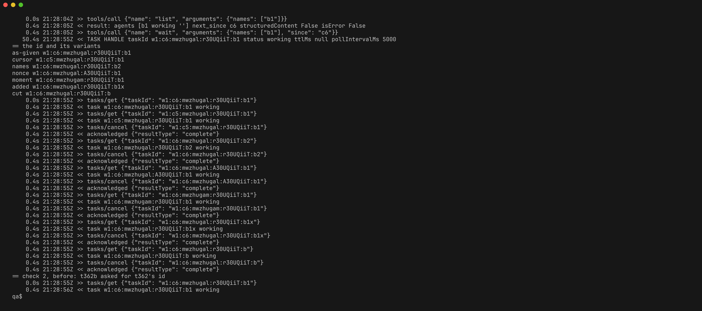
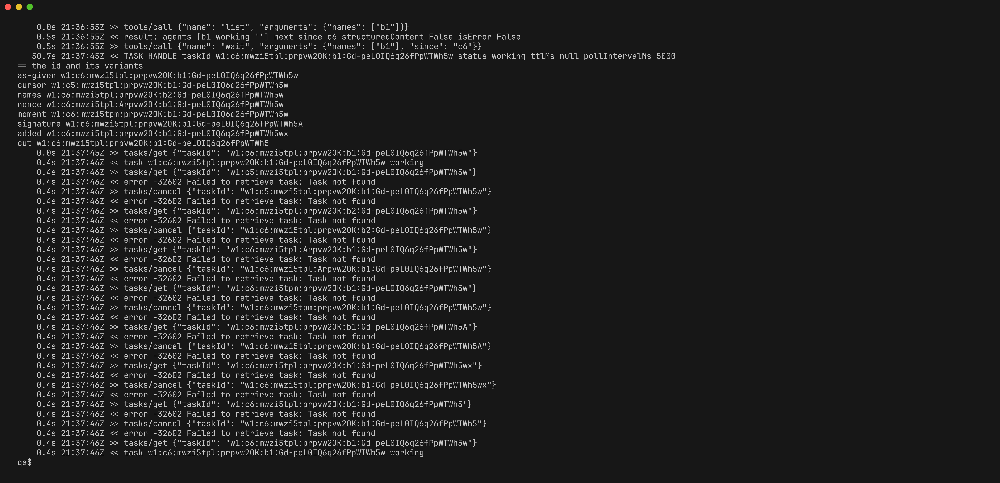
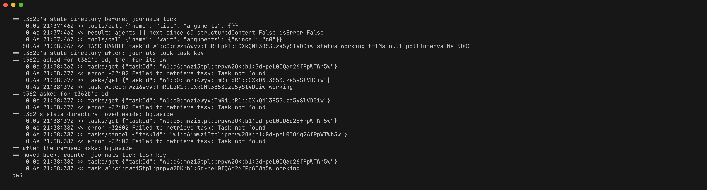
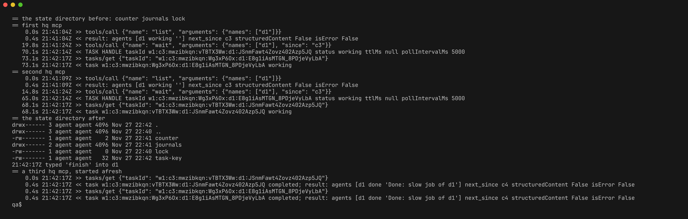
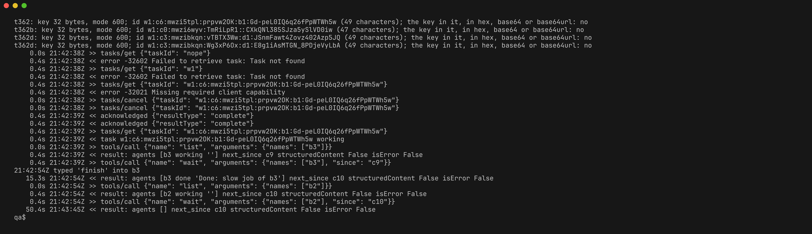

### #362 Identyfikator wait task jest podpisany

Checks 1-6 ran against `hq mcp claude-code` built from `issue-362-signed-id` at c7c9d13 with `scripts/local-dev.sh --stub native` (the stub `sbx` and the fake claude, agents working on a "slow job" in a stub environment's repository until a line typed into their pane let them finish), driven over standard input and output by #361's raw MCP client (`qac.py`, copied with three steps added: `at:` to send at a set moment, `cancel:ID` and `getfile:`), which speaks protocol 2026-07-28 as Claude Code 2.1.332 does (`server/discover`, no `initialize`, the Tasks extension declared in each request's `_meta`), in a window of a tmux server used as the terminal. Each stub environment (`LOCAL_DEV_ID` t362, t362b, t362d) has a state directory of its own. The before of checks 1 and 2 is the integration branch at af752e5, run the same way.

| # | Check | Expected | Result | Evidence |
|---|---|---|---|---|
| 1 | An id with a changed signature or changed terms is an unknown task (story 35) | The handle's id works; the same id with the cursor, a name, the nonce, the moment or the signature changed, a character added or cut: -32602 for `tasks/get` and `tasks/cancel`; before, each was answered `working` | ✅ pass: before, the id `w1:c6:mwzhugal:r30UQiiT:b1` with `c5`, `b2`, another nonce, the next millisecond, `b1x` or `b` was answered `working` and its cancel acknowledged. After, the handle (50.7 s) carries a signature, `w1:c6:mwzi5tpl:prpvw2OK:b1:Gd-peL0IQ6q26fPpWTWh5w`; as given it is `working` before and after the 14 asks; each of the 7 variants is refused by both methods with -32602 "Failed to retrieve task: Task not found" | [s1-s2-before-summary.txt](https://github.com/rkrysinski/hq/blob/72d8b287209d140198a82172d2fcebef90bf891d/issue-362/s1-s2-before-summary.txt), [s1-after-summary.txt](https://github.com/rkrysinski/hq/blob/72d8b287209d140198a82172d2fcebef90bf891d/issue-362/s1-after-summary.txt), [raw before](https://github.com/rkrysinski/hq/blob/72d8b287209d140198a82172d2fcebef90bf891d/issue-362/s1-before.txt), [raw after](https://github.com/rkrysinski/hq/blob/72d8b287209d140198a82172d2fcebef90bf891d/issue-362/s1-after.txt), screenshots 1-2 before and 1 |
| 2 | An id signed in one state directory is an unknown task in another; so is one hq cannot check because the key went with the state directory | -32602 both ways between two state directories; with t362's state directory moved aside, -32602 and nothing made; moved back, the id works; before, the other environment answered `working` | ✅ pass: before, t362b answered t362's id `working`. After, t362b's first task (50.4 s) made its key (`journals lock` before, `journals lock task-key` after); t362b refused t362's id and answered its own `working`; t362 refused t362b's id; t362's state directory moved aside: `tasks/get` and `tasks/cancel` refused with -32602 and the directory held only `hq.aside` afterwards (no key, no `hq` made); moved back: `working` | [s2-after-summary.txt](https://github.com/rkrysinski/hq/blob/72d8b287209d140198a82172d2fcebef90bf891d/issue-362/s2-after-summary.txt), [raw](https://github.com/rkrysinski/hq/blob/72d8b287209d140198a82172d2fcebef90bf891d/issue-362/s2-after.txt), screenshots 1-2 before and 2 |
| 3 | Two `hq mcp` started at once use one key: a task of one is known to the other | On a state directory with no key, two processes take a `wait` at the same moment and hand off after 50 s; each answers `working` for the other's task; one key file in the directory, nothing else left | ✅ pass: before `counter journals lock`; both `wait`s sent at 21:41:24, both handed off at 21:42:14 in the same millisecond (`mwzibkqn`), two ids; each process answered the other's id `working` 3 s later; after, one `task-key` of 32 bytes, `-rw-------`, in a `drwx------` directory, and no file left beside it. The second process started 5 s after the first (Deviations, #368) | [s3-after-summary.txt](https://github.com/rkrysinski/hq/blob/72d8b287209d140198a82172d2fcebef90bf891d/issue-362/s3-after-summary.txt), [s3-first.txt](https://github.com/rkrysinski/hq/blob/72d8b287209d140198a82172d2fcebef90bf891d/issue-362/s3-first.txt), [s3-second.txt](https://github.com/rkrysinski/hq/blob/72d8b287209d140198a82172d2fcebef90bf891d/issue-362/s3-second.txt), screenshot 3-4 |
| 4 | A valid id works as before, also in another process | A third process, started afresh after the agent finished, answers both tasks `completed` with the `wait` result | ✅ pass: `d1` let finish at 21:42:17; the third `hq mcp` answered both ids `completed` at once, each with `d1 done "Done: slow job of d1"`, `next_since` c4, no `structuredContent`, not an error. Checks 1, 2 and 6 show t362's id `working` in three processes other than the one that took the call | [s3-third.txt](https://github.com/rkrysinski/hq/blob/72d8b287209d140198a82172d2fcebef90bf891d/issue-362/s3-third.txt), screenshot 3-4 |
| 5 | No process remembers the wait, and the id holds no key | The key of each state directory, in hex, base64 and base64url, in none of its ids | ✅ pass: four ids of three state directories, 47-49 characters, none holds its directory's key in any of the three forms; each key 32 bytes, mode 600. No process holds a wait: checks 2 and 4 answer ids in processes started after the call ended | [s5-after.txt](https://github.com/rkrysinski/hq/blob/72d8b287209d140198a82172d2fcebef90bf891d/issue-362/s5-after.txt), screenshot 5-6 |
| 6 | Nearby, unchanged: refusals, cancelling twice, a change within the hold, Claude Desktop | `nope` and `w1` -32602; no declaration -32021; two cancels of a valid id both acknowledged, the task still `working`; a change at 15 s returned in the call; Claude Desktop's `wait` 50 s, no handle | ✅ pass: as expected; `b3` let finish at 15 s returned `b3 done` at 15.3 s in the call; Claude Desktop returned no agents at 50.4 s, no handle | [s6-after-summary.txt](https://github.com/rkrysinski/hq/blob/72d8b287209d140198a82172d2fcebef90bf891d/issue-362/s6-after-summary.txt), [raw](https://github.com/rkrysinski/hq/blob/72d8b287209d140198a82172d2fcebef90bf891d/issue-362/s6-after.txt), screenshot 5-6 |
| 7 | The design says what the code does; the contract stays in one module (story 37) | Design 3.4, 3.12, 7.2, 7.3, the data table, the diagram and a version line; ADR 0022 unchanged and in agreement; the extension's methods and fields only in `internal/mcptasks` | ✅ pass: the design's id example carries a signature, and every mention of the task key agrees with ADR 0022's "signed with a key in hq's state directory"; signing is in `internal/taskid`, the contract untouched in `internal/mcptasks` | [s7-docs.txt](https://github.com/rkrysinski/hq/blob/72d8b287209d140198a82172d2fcebef90bf891d/issue-362/s7-docs.txt) |

Screenshots:

1-2 before. Checks 1 and 2 on the integration branch, every changed id answered `working`, and the other state directory's answer: 
1. Check 1 after, the signed id and its seven variants: 
2. Check 2 after, another state directory, and the state directory moved aside: 
3-4. Checks 3 and 4, two `hq mcp` handing off at once, the key file, a third answering both: 
5-6. Checks 5 and 6, no key in the ids, nearby behaviour: 

The scripts of the checks are in [scripts/](https://github.com/rkrysinski/hq/tree/72d8b287209d140198a82172d2fcebef90bf891d/issue-362/scripts) (`hq.sh` and `hqmcp.sh` run `LOCAL_DEV_ID=<env> scripts/local-dev.sh --stub native` from the worktree, written `<worktree>`); the first run of check 3, whose second process died in `scripts/local-dev.sh` (#368), is [s3-failed-run.txt](https://github.com/rkrysinski/hq/blob/72d8b287209d140198a82172d2fcebef90bf891d/issue-362/s3-failed-run.txt).

Pyramid before (integration branch at af752e5): `unit 1040, integration 327, e2e 3 (unit share 76%, minimum 75%)`. After (c7c9d13): `unit 1043, integration 330, e2e 3 (unit share 76%, minimum 75%)`.

Coverage after: `coverage 95.65% (minimum 94.7%)`.

Tests added:
- Unit (`internal/cli/waittask_test.go`, the raw JSON-RPC client over pipes to the server on the fakes, 3): `TestAWaitTaskIdChangedInAnyWayIsAnUnknownTask` (every one-character change of the id, one added, one cut, at either end, for `tasks/get` and `tasks/cancel`; the id holds no key), `TestAWaitTaskIdSignedWithAnotherKeyIsAnUnknownTask` (the key made at the first task and kept; another state directory's id both ways; the key gone, asking makes none, a new key after), `TestAWaitThatCannotSignItsTaskFailsInTheCall`.
- Integration (`internal/taskid/taskid_integration_test.go`, on temporary directories, 3): `TestTheKeyIsMadeOnceForTheUserAlone`, `TestAKeyAnotherProcessPutInPlaceFirstIsKept`, `TestNoKeyFromAFileHqDidNotMakeOrADirectoryItCannotMake`. Changed (`cmd/hq/mcp_integration_test.go`): #361's journey `TestAWaitTaskOneHqMcpHandedOffIsAnsweredByAnother` is now `TestWaitTasksOfHqMcpsStartedAtOnceAreAnsweredByAnother`: two built `hq mcp claude-code` started at once on a state directory with no key each hand a `wait` off at the same moment, each knows the other's task, and a third, started afresh, answers both with the result.
- End-to-end: none.

#### Outputs

Check 1 and 2, before, on the integration branch at af752e5 (`./s1-changed.sh`, `./s2-before.sh`, summarized by `./summarize.py`):

```text
    0.0s 21:28:04Z >> tools/call {"name": "list", "arguments": {"names": ["b1"]}}
    0.4s 21:28:05Z << result: agents [b1 working ''] next_since c6 structuredContent False isError False
    0.4s 21:28:05Z >> tools/call {"name": "wait", "arguments": {"names": ["b1"], "since": "c6"}}
   50.4s 21:28:55Z << TASK HANDLE taskId w1:c6:mwzhugal:r30UQiiT:b1 status working ttlMs null pollIntervalMs 5000
== the id and its variants
as-given w1:c6:mwzhugal:r30UQiiT:b1
cursor w1:c5:mwzhugal:r30UQiiT:b1
names w1:c6:mwzhugal:r30UQiiT:b2
nonce w1:c6:mwzhugal:A30UQiiT:b1
moment w1:c6:mwzhugam:r30UQiiT:b1
added w1:c6:mwzhugal:r30UQiiT:b1x
cut w1:c6:mwzhugal:r30UQiiT:b
    0.0s 21:28:55Z >> tasks/get {"taskId": "w1:c6:mwzhugal:r30UQiiT:b1"}
    0.4s 21:28:55Z << task w1:c6:mwzhugal:r30UQiiT:b1 working
    0.4s 21:28:55Z >> tasks/get {"taskId": "w1:c5:mwzhugal:r30UQiiT:b1"}
    0.4s 21:28:55Z << task w1:c5:mwzhugal:r30UQiiT:b1 working
    0.4s 21:28:55Z >> tasks/cancel {"taskId": "w1:c5:mwzhugal:r30UQiiT:b1"}
    0.4s 21:28:55Z << acknowledged {"resultType": "complete"}
    0.4s 21:28:55Z >> tasks/get {"taskId": "w1:c6:mwzhugal:r30UQiiT:b2"}
    0.4s 21:28:55Z << task w1:c6:mwzhugal:r30UQiiT:b2 working
    0.4s 21:28:55Z >> tasks/cancel {"taskId": "w1:c6:mwzhugal:r30UQiiT:b2"}
    0.4s 21:28:55Z << acknowledged {"resultType": "complete"}
    0.4s 21:28:55Z >> tasks/get {"taskId": "w1:c6:mwzhugal:A30UQiiT:b1"}
    0.4s 21:28:55Z << task w1:c6:mwzhugal:A30UQiiT:b1 working
    0.4s 21:28:55Z >> tasks/cancel {"taskId": "w1:c6:mwzhugal:A30UQiiT:b1"}
    0.4s 21:28:55Z << acknowledged {"resultType": "complete"}
    0.4s 21:28:55Z >> tasks/get {"taskId": "w1:c6:mwzhugam:r30UQiiT:b1"}
    0.4s 21:28:55Z << task w1:c6:mwzhugam:r30UQiiT:b1 working
    0.4s 21:28:55Z >> tasks/cancel {"taskId": "w1:c6:mwzhugam:r30UQiiT:b1"}
    0.4s 21:28:55Z << acknowledged {"resultType": "complete"}
    0.4s 21:28:55Z >> tasks/get {"taskId": "w1:c6:mwzhugal:r30UQiiT:b1x"}
    0.4s 21:28:55Z << task w1:c6:mwzhugal:r30UQiiT:b1x working
    0.4s 21:28:55Z >> tasks/cancel {"taskId": "w1:c6:mwzhugal:r30UQiiT:b1x"}
    0.4s 21:28:55Z << acknowledged {"resultType": "complete"}
    0.4s 21:28:55Z >> tasks/get {"taskId": "w1:c6:mwzhugal:r30UQiiT:b"}
    0.4s 21:28:55Z << task w1:c6:mwzhugal:r30UQiiT:b working
    0.4s 21:28:55Z >> tasks/cancel {"taskId": "w1:c6:mwzhugal:r30UQiiT:b"}
    0.4s 21:28:55Z << acknowledged {"resultType": "complete"}
== check 2, before: t362b asked for t362's id
    0.0s 21:28:55Z >> tasks/get {"taskId": "w1:c6:mwzhugal:r30UQiiT:b1"}
    0.4s 21:28:56Z << task w1:c6:mwzhugal:r30UQiiT:b1 working
```

Check 1, after (`./s1-changed.sh`):

```text
    0.0s 21:36:55Z >> tools/call {"name": "list", "arguments": {"names": ["b1"]}}
    0.5s 21:36:55Z << result: agents [b1 working ''] next_since c6 structuredContent False isError False
    0.5s 21:36:55Z >> tools/call {"name": "wait", "arguments": {"names": ["b1"], "since": "c6"}}
   50.7s 21:37:45Z << TASK HANDLE taskId w1:c6:mwzi5tpl:prpvw2OK:b1:Gd-peL0IQ6q26fPpWTWh5w status working ttlMs null pollIntervalMs 5000
== the id and its variants
as-given w1:c6:mwzi5tpl:prpvw2OK:b1:Gd-peL0IQ6q26fPpWTWh5w
cursor w1:c5:mwzi5tpl:prpvw2OK:b1:Gd-peL0IQ6q26fPpWTWh5w
names w1:c6:mwzi5tpl:prpvw2OK:b2:Gd-peL0IQ6q26fPpWTWh5w
nonce w1:c6:mwzi5tpl:Arpvw2OK:b1:Gd-peL0IQ6q26fPpWTWh5w
moment w1:c6:mwzi5tpm:prpvw2OK:b1:Gd-peL0IQ6q26fPpWTWh5w
signature w1:c6:mwzi5tpl:prpvw2OK:b1:Gd-peL0IQ6q26fPpWTWh5A
added w1:c6:mwzi5tpl:prpvw2OK:b1:Gd-peL0IQ6q26fPpWTWh5wx
cut w1:c6:mwzi5tpl:prpvw2OK:b1:Gd-peL0IQ6q26fPpWTWh5
    0.0s 21:37:45Z >> tasks/get {"taskId": "w1:c6:mwzi5tpl:prpvw2OK:b1:Gd-peL0IQ6q26fPpWTWh5w"}
    0.4s 21:37:46Z << task w1:c6:mwzi5tpl:prpvw2OK:b1:Gd-peL0IQ6q26fPpWTWh5w working
    0.4s 21:37:46Z >> tasks/get {"taskId": "w1:c5:mwzi5tpl:prpvw2OK:b1:Gd-peL0IQ6q26fPpWTWh5w"}
    0.4s 21:37:46Z << error -32602 Failed to retrieve task: Task not found
    0.4s 21:37:46Z >> tasks/cancel {"taskId": "w1:c5:mwzi5tpl:prpvw2OK:b1:Gd-peL0IQ6q26fPpWTWh5w"}
    0.4s 21:37:46Z << error -32602 Failed to retrieve task: Task not found
    0.4s 21:37:46Z >> tasks/get {"taskId": "w1:c6:mwzi5tpl:prpvw2OK:b2:Gd-peL0IQ6q26fPpWTWh5w"}
    0.4s 21:37:46Z << error -32602 Failed to retrieve task: Task not found
    0.4s 21:37:46Z >> tasks/cancel {"taskId": "w1:c6:mwzi5tpl:prpvw2OK:b2:Gd-peL0IQ6q26fPpWTWh5w"}
    0.4s 21:37:46Z << error -32602 Failed to retrieve task: Task not found
    0.4s 21:37:46Z >> tasks/get {"taskId": "w1:c6:mwzi5tpl:Arpvw2OK:b1:Gd-peL0IQ6q26fPpWTWh5w"}
    0.4s 21:37:46Z << error -32602 Failed to retrieve task: Task not found
    0.4s 21:37:46Z >> tasks/cancel {"taskId": "w1:c6:mwzi5tpl:Arpvw2OK:b1:Gd-peL0IQ6q26fPpWTWh5w"}
    0.4s 21:37:46Z << error -32602 Failed to retrieve task: Task not found
    0.4s 21:37:46Z >> tasks/get {"taskId": "w1:c6:mwzi5tpm:prpvw2OK:b1:Gd-peL0IQ6q26fPpWTWh5w"}
    0.4s 21:37:46Z << error -32602 Failed to retrieve task: Task not found
    0.4s 21:37:46Z >> tasks/cancel {"taskId": "w1:c6:mwzi5tpm:prpvw2OK:b1:Gd-peL0IQ6q26fPpWTWh5w"}
    0.4s 21:37:46Z << error -32602 Failed to retrieve task: Task not found
    0.4s 21:37:46Z >> tasks/get {"taskId": "w1:c6:mwzi5tpl:prpvw2OK:b1:Gd-peL0IQ6q26fPpWTWh5A"}
    0.4s 21:37:46Z << error -32602 Failed to retrieve task: Task not found
    0.4s 21:37:46Z >> tasks/cancel {"taskId": "w1:c6:mwzi5tpl:prpvw2OK:b1:Gd-peL0IQ6q26fPpWTWh5A"}
    0.4s 21:37:46Z << error -32602 Failed to retrieve task: Task not found
    0.4s 21:37:46Z >> tasks/get {"taskId": "w1:c6:mwzi5tpl:prpvw2OK:b1:Gd-peL0IQ6q26fPpWTWh5wx"}
    0.4s 21:37:46Z << error -32602 Failed to retrieve task: Task not found
    0.4s 21:37:46Z >> tasks/cancel {"taskId": "w1:c6:mwzi5tpl:prpvw2OK:b1:Gd-peL0IQ6q26fPpWTWh5wx"}
    0.4s 21:37:46Z << error -32602 Failed to retrieve task: Task not found
    0.4s 21:37:46Z >> tasks/get {"taskId": "w1:c6:mwzi5tpl:prpvw2OK:b1:Gd-peL0IQ6q26fPpWTWh5"}
    0.4s 21:37:46Z << error -32602 Failed to retrieve task: Task not found
    0.4s 21:37:46Z >> tasks/cancel {"taskId": "w1:c6:mwzi5tpl:prpvw2OK:b1:Gd-peL0IQ6q26fPpWTWh5"}
    0.4s 21:37:46Z << error -32602 Failed to retrieve task: Task not found
    0.4s 21:37:46Z >> tasks/get {"taskId": "w1:c6:mwzi5tpl:prpvw2OK:b1:Gd-peL0IQ6q26fPpWTWh5w"}
    0.4s 21:37:46Z << task w1:c6:mwzi5tpl:prpvw2OK:b1:Gd-peL0IQ6q26fPpWTWh5w working
```

Check 2, after (`./s2-other-state.sh`):

```text
== t362b's state directory before: journals lock 
    0.0s 21:37:46Z >> tools/call {"name": "list", "arguments": {}}
    0.4s 21:37:46Z << result: agents [] next_since c0 structuredContent False isError False
    0.4s 21:37:46Z >> tools/call {"name": "wait", "arguments": {"since": "c0"}}
   50.4s 21:38:36Z << TASK HANDLE taskId w1:c0:mwzi6wyv:TmRiLpR1::CXkQNl385SJza5ySlVD0iw status working ttlMs null pollIntervalMs 5000
== t362b's state directory after: journals lock task-key 
== t362b asked for t362's id, then for its own
    0.0s 21:38:36Z >> tasks/get {"taskId": "w1:c6:mwzi5tpl:prpvw2OK:b1:Gd-peL0IQ6q26fPpWTWh5w"}
    0.4s 21:38:37Z << error -32602 Failed to retrieve task: Task not found
    0.4s 21:38:37Z >> tasks/get {"taskId": "w1:c0:mwzi6wyv:TmRiLpR1::CXkQNl385SJza5ySlVD0iw"}
    0.4s 21:38:37Z << task w1:c0:mwzi6wyv:TmRiLpR1::CXkQNl385SJza5ySlVD0iw working
== t362 asked for t362b's id
    0.0s 21:38:37Z >> tasks/get {"taskId": "w1:c0:mwzi6wyv:TmRiLpR1::CXkQNl385SJza5ySlVD0iw"}
    0.4s 21:38:37Z << error -32602 Failed to retrieve task: Task not found
== t362's state directory moved aside: hq.aside 
    0.0s 21:38:37Z >> tasks/get {"taskId": "w1:c6:mwzi5tpl:prpvw2OK:b1:Gd-peL0IQ6q26fPpWTWh5w"}
    0.4s 21:38:38Z << error -32602 Failed to retrieve task: Task not found
    0.4s 21:38:38Z >> tasks/cancel {"taskId": "w1:c6:mwzi5tpl:prpvw2OK:b1:Gd-peL0IQ6q26fPpWTWh5w"}
    0.4s 21:38:38Z << error -32602 Failed to retrieve task: Task not found
== after the refused asks: hq.aside 
== moved back: counter journals lock task-key 
    0.0s 21:38:38Z >> tasks/get {"taskId": "w1:c6:mwzi5tpl:prpvw2OK:b1:Gd-peL0IQ6q26fPpWTWh5w"}
    0.4s 21:38:38Z << task w1:c6:mwzi5tpl:prpvw2OK:b1:Gd-peL0IQ6q26fPpWTWh5w working
```

Checks 3 and 4 (`./s3-two-at-once.sh`):

```text
== the state directory before: counter journals lock 
== first hq mcp
    0.0s 21:41:04Z >> tools/call {"name": "list", "arguments": {"names": ["d1"]}}
    0.4s 21:41:04Z << result: agents [d1 working ''] next_since c3 structuredContent False isError False
   19.8s 21:41:24Z >> tools/call {"name": "wait", "arguments": {"names": ["d1"], "since": "c3"}}
   70.1s 21:42:14Z << TASK HANDLE taskId w1:c3:mwzibkqn:vTBTX3Ww:d1:JSnmFawt4Zovz402Azp5JQ status working ttlMs null pollIntervalMs 5000
   73.1s 21:42:17Z >> tasks/get {"taskId": "w1:c3:mwzibkqn:Wg3xP6Ox:d1:E8g1iAsMTGN_8PDjeVyLbA"}
   73.1s 21:42:17Z << task w1:c3:mwzibkqn:Wg3xP6Ox:d1:E8g1iAsMTGN_8PDjeVyLbA working
== second hq mcp
    0.0s 21:41:09Z >> tools/call {"name": "list", "arguments": {"names": ["d1"]}}
    0.4s 21:41:09Z << result: agents [d1 working ''] next_since c3 structuredContent False isError False
   14.8s 21:41:24Z >> tools/call {"name": "wait", "arguments": {"names": ["d1"], "since": "c3"}}
   65.0s 21:42:14Z << TASK HANDLE taskId w1:c3:mwzibkqn:Wg3xP6Ox:d1:E8g1iAsMTGN_8PDjeVyLbA status working ttlMs null pollIntervalMs 5000
   68.1s 21:42:17Z >> tasks/get {"taskId": "w1:c3:mwzibkqn:vTBTX3Ww:d1:JSnmFawt4Zovz402Azp5JQ"}
   68.1s 21:42:17Z << task w1:c3:mwzibkqn:vTBTX3Ww:d1:JSnmFawt4Zovz402Azp5JQ working
== the state directory after
drwx------ 3 agent agent 4096 Nov 27 22:42 .
drwx------ 3 agent agent 4096 Nov 27 22:40 ..
-rw------- 1 agent agent    2 Nov 27 22:41 counter
drwx------ 2 agent agent 4096 Nov 27 22:41 journals
-rw------- 1 agent agent    0 Nov 27 22:40 lock
-rw------- 1 agent agent   32 Nov 27 22:42 task-key
21:42:17Z typed 'finish' into d1
== a third hq mcp, started afresh
    0.0s 21:42:17Z >> tasks/get {"taskId": "w1:c3:mwzibkqn:vTBTX3Ww:d1:JSnmFawt4Zovz402Azp5JQ"}
    0.4s 21:42:17Z << task w1:c3:mwzibkqn:vTBTX3Ww:d1:JSnmFawt4Zovz402Azp5JQ completed; result: agents [d1 done 'Done: slow job of d1'] next_since c4 structuredContent False isError False
    0.4s 21:42:17Z >> tasks/get {"taskId": "w1:c3:mwzibkqn:Wg3xP6Ox:d1:E8g1iAsMTGN_8PDjeVyLbA"}
    0.4s 21:42:17Z << task w1:c3:mwzibkqn:Wg3xP6Ox:d1:E8g1iAsMTGN_8PDjeVyLbA completed; result: agents [d1 done 'Done: slow job of d1'] next_since c4 structuredContent False isError False
```

Check 5 (`./s5-no-key.sh`):

```text
t362: key 32 bytes, mode 600; id w1:c6:mwzi5tpl:prpvw2OK:b1:Gd-peL0IQ6q26fPpWTWh5w (49 characters); the key in it, in hex, base64 or base64url: no
t362b: key 32 bytes, mode 600; id w1:c0:mwzi6wyv:TmRiLpR1::CXkQNl385SJza5ySlVD0iw (47 characters); the key in it, in hex, base64 or base64url: no
t362d: key 32 bytes, mode 600; id w1:c3:mwzibkqn:vTBTX3Ww:d1:JSnmFawt4Zovz402Azp5JQ (49 characters); the key in it, in hex, base64 or base64url: no
t362d: key 32 bytes, mode 600; id w1:c3:mwzibkqn:Wg3xP6Ox:d1:E8g1iAsMTGN_8PDjeVyLbA (49 characters); the key in it, in hex, base64 or base64url: no
```

Check 6 (`./s6-nearby.sh`):

```text
    0.0s 21:42:38Z >> tasks/get {"taskId": "nope"}
    0.4s 21:42:38Z << error -32602 Failed to retrieve task: Task not found
    0.4s 21:42:38Z >> tasks/get {"taskId": "w1"}
    0.4s 21:42:38Z << error -32602 Failed to retrieve task: Task not found
    0.4s 21:42:38Z >> tasks/get {"taskId": "w1:c6:mwzi5tpl:prpvw2OK:b1:Gd-peL0IQ6q26fPpWTWh5w"}
    0.4s 21:42:38Z << error -32021 Missing required client capability
    0.0s 21:42:38Z >> tasks/cancel {"taskId": "w1:c6:mwzi5tpl:prpvw2OK:b1:Gd-peL0IQ6q26fPpWTWh5w"}
    0.0s 21:42:38Z >> tasks/cancel {"taskId": "w1:c6:mwzi5tpl:prpvw2OK:b1:Gd-peL0IQ6q26fPpWTWh5w"}
    0.4s 21:42:39Z << acknowledged {"resultType": "complete"}
    0.4s 21:42:39Z << acknowledged {"resultType": "complete"}
    0.4s 21:42:39Z >> tasks/get {"taskId": "w1:c6:mwzi5tpl:prpvw2OK:b1:Gd-peL0IQ6q26fPpWTWh5w"}
    0.4s 21:42:39Z << task w1:c6:mwzi5tpl:prpvw2OK:b1:Gd-peL0IQ6q26fPpWTWh5w working
    0.0s 21:42:39Z >> tools/call {"name": "list", "arguments": {"names": ["b3"]}}
    0.4s 21:42:39Z << result: agents [b3 working ''] next_since c9 structuredContent False isError False
    0.4s 21:42:39Z >> tools/call {"name": "wait", "arguments": {"names": ["b3"], "since": "c9"}}
21:42:54Z typed 'finish' into b3
   15.3s 21:42:54Z << result: agents [b3 done 'Done: slow job of b3'] next_since c10 structuredContent False isError False
    0.0s 21:42:54Z >> tools/call {"name": "list", "arguments": {"names": ["b2"]}}
    0.4s 21:42:54Z << result: agents [b2 working ''] next_since c10 structuredContent False isError False
    0.4s 21:42:54Z >> tools/call {"name": "wait", "arguments": {"names": ["b2"], "since": "c10"}}
   50.4s 21:43:45Z << result: agents [] next_since c10 structuredContent False isError False
```

Check 7 (`s7-docs.txt`):

```text
$ git diff --stat spec-357-wait-task..HEAD
 cmd/hq/mcp_integration_test.go             |  83 ++++++++++++++------
 docs/design/hq.md                          |  13 ++--
 internal/cli/deps.go                       |  11 ++-
 internal/cli/fakes_test.go                 |  24 ++++++
 internal/cli/waittask.go                   |  55 +++++++++-----
 internal/cli/waittask_test.go              | 101 ++++++++++++++++++++++++
 internal/taskid/taskid.go                  | 118 +++++++++++++++++++++++++++++
 internal/taskid/taskid_integration_test.go | 114 ++++++++++++++++++++++++++++
 8 files changed, 469 insertions(+), 50 deletions(-)

$ git grep -n -o -i "signed[^.]*\|task key[^.]*\|task-key[^.]*" -- docs/design/hq.md docs/adr/0022-claude-code-on-the-host-gets-its-wait-as-an-mcp-task.md | cut -c1-240
docs/adr/0022-claude-code-on-the-host-gets-its-wait-as-an-mcp-task.md:10:signed with a key in hq's state directory, so that it cannot be built from the terms alone, as the extension requires of an id
docs/design/hq.md:101:task-key: what signs the ids of MCP tasks (3
docs/design/hq.md:303:signed
docs/design/hq.md:303:task key, in 22 characters of base64url: `w1:c42:mujrox8w:-k3qtLzR:a,b:7DkqY0b2xN4Lw9sPq1ZtVg`, short, since Claude Code prints it into the model's context with the handle and again with the result
docs/design/hq.md:303:task key is 32 random bytes in hq's state directory, `$XDG_STATE_HOME/hq/task-key` (`0600`, `internal/taskid`), out of every sandbox's reach as the journals are, and the id never holds it
docs/design/hq.md:303:signed in another state directory, and one hq cannot check because the key went with the state directory are unknown tasks (below), and asking for one reads the key and makes none
docs/design/hq.md:303:task key did not sign, is an unknown task, refused with -32602, after which Claude Code asks for it about five more minutes and then starts a turn with "outcome unknown"; a task method whose request does not declare th
docs/design/hq.md:398:Task key | `$XDG_STATE_HOME/hq/task-key` (3
docs/design/hq.md:449:signed with the task key in the user's state directory, out of every sandbox's reach (3
docs/design/hq.md:644:signed with a key in hq's state directory (3
docs/design/hq.md:644:task key, 32 random bytes in `$XDG_STATE_HOME/hq/task-key` that the first wait going on as a task makes, written aside and hard-linked into place, so `hq mcp`s that make it at once sign with one key and none overwrites
docs/design/hq.md:644:signed in another state directory, or that hq cannot check because the key went with the directory is an unknown task (-32602), and asking for one makes no key; a valid id works as before, in any `hq mcp`

$ git grep -n "w1:c42:mujrox8w" -- docs README.md GLOSSARY.md | cut -c1-200
docs/design/hq.md:303:**The wait task (#361, ADR 0022).** Under Claude Code (`mcpClient`'s `tasks`) a `wait` given no timeout holds for 50 s (`waitHold`), as long as a `wait` lasted there before #359,

$ git grep -n -e "tasks/get" -e "resultType" -e "io.modelcontextprotocol/tasks" -- "*.go" ":!*_test.go" | cut -c1-160
internal/mcptasks/mcptasks.go:1:// Package mcptasks is the MCP Tasks extension (io.modelcontextprotocol/tasks,
internal/mcptasks/mcptasks.go:6:// as a task, tasks/get and tasks/cancel. When the SDK has tasks, this package
internal/mcptasks/mcptasks.go:26:const Extension = "io.modelcontextprotocol/tasks"
internal/mcptasks/mcptasks.go:54://   - tasks/get answers with the task, working until ts gives its result,
internal/mcptasks/mcptasks.go:58://   - tasks/get and tasks/cancel refuse a request that does not declare the
internal/mcptasks/mcptasks.go:63:		mcp.AddReceivingCustomMethod(s, "tasks/get", func(ctx context.Context, _ *mcp.ServerSession, p *taskParams) (*getResult, erro
internal/mcptasks/mcptasks.go:146:// find is the task a tasks/get or tasks/cancel asks for; or the refusal of
internal/mcptasks/mcptasks.go:165:// complete is the resultType of every result but a task handle's.
internal/mcptasks/mcptasks.go:168:// taskParams are the params of tasks/get and tasks/cancel.
internal/mcptasks/mcptasks.go:199:	ResultType string `json:"resultType"`
internal/mcptasks/mcptasks.go:207:	ResultType string `json:"resultType"`
internal/mcptasks/mcptasks.go:215:	ResultType string `json:"resultType"`
```

Mutation tests: `go run ./tools/testgate mutation spec-357-wait-task` (Go 1.27.3)

```text
not covered internal/taskid/taskid.go:52:28 conditionals negation
not covered internal/taskid/taskid.go:62:9 conditionals negation
not covered internal/taskid/taskid.go:64:38 arithmetic base
not covered internal/taskid/taskid.go:66:9 conditionals negation
not covered internal/taskid/taskid.go:74:16 conditionals negation
not covered internal/taskid/taskid.go:77:9 conditionals negation
not covered internal/taskid/taskid.go:90:9 conditionals negation
not covered internal/taskid/taskid.go:95:9 conditionals negation
not covered internal/taskid/taskid.go:95:28 conditionals negation
mutation: 4 killed, 0 alive, 0 timed out, 9 not covered, 0 not run against spec-357-wait-task on c7c9d13b9c278f700ecf706cfdc5bf232122348e
```

Full build: `scripts/check.sh`

```text
check: ok   vet
check: ok   format
check: ok   pyramid
check: ok   platform
check: ok   timebound
check: ok   sees
check: ok   unit
check: ok   integration
check: ok   coverage
check: ok   e2e
check: all 10 steps passed on c7c9d13b9c278f700ecf706cfdc5bf232122348e
```

#### Deviations

- **The key's seam**: the spec's "Testing Decisions" name no seam for the key file, so it takes the one design 7.2 gives every file a command touches outside the journals: two functions in the command's dependencies (`taskKey`, which makes the key at its first use, and `readTaskKey`, which makes nothing), faked in the unit tests and tested on temporary directories in `internal/taskid`'s integration tests.
- **The stdio journey of #361 is extended, not doubled**: the spec names one journey and "the key with two processes starting at once" at the integration level; both are one test, so the integration step holds 50 s once, not twice.
- **When the key is made**: at the first wait that goes on as a task (the first id signed), not when `hq mcp` starts; `tasks/get` and `tasks/cancel` only read it. An id hq cannot check for any reason (the key gone, unreadable, or a file in its place that is not 32 bytes) is an unknown task; the ticket names the key gone with the state directory.
- **A wait that can neither read nor make the key** fails in its call when its hold ends, with "hq: the wait cannot go on as a task: <error>"; the ticket does not say. A file in the key's place that is not a key hq made is refused, naming it, and never overwritten.
- **The signature** is the first 128 bits of the HMAC-SHA256 of the id's terms, 22 characters of base64url after a colon, so an id is 47-49 characters for one agent (check 5); the terms keep #361's form and kind `w1`. Ids #361 handed out unsigned, never released, are unknown tasks now.
- **QA, check 3**: the second `hq mcp` started 5 s after the first, both taking their `wait` at the same second: two runs of `scripts/local-dev.sh` at once in one checkout can fail, and the first run of the check did (#368, created). The integration test starts its two processes at once.
- **The mutation run used the installed Go 1.27.3**; #349's `case` lines do not arise in this change, and it reports no line not run.
- Deploy steps: none. The key appears in `$XDG_STATE_HOME/hq/task-key` at the first wait that goes on as a task.
