### #363 Wait task z limitem, agenci razem, agent zabity, błąd i aktualizacja generacji

Checks 1-5 and 7 ran against `hq mcp claude-code` built from `issue-363-task-terms` at 661911c with `scripts/local-dev.sh --stub native` (the stub `sbx` and the fake claude, agents working on a "slow job" in a stub environment's repository until a line typed into their pane lets them finish), driven over standard input and output by #361's raw MCP client (`qac.py`, #362's copy), which speaks protocol 2026-07-28 as Claude Code 2.1.332 does (the Tasks extension declared in each request's `_meta`, or not, where a check says so). The before of checks 1, 3 and 5 is the integration branch `spec-357-wait-task` at c7c9d13, run the same way in a stub environment of its own (`LOCAL_DEV_ID` t363b). Check 6 is trial T-d: a nested Claude Code 2.1.332 (Haiku 5.5, hooks off, a configuration directory of its own, after trial T-c's recipe) with the after build as its `hq` server, in three runs, each on an agent of its own.

| # | Check | Expected | Result | Evidence |
|---|---|---|---|---|
| 1 | A wait task given a timeout completes at it with no agents and a cursor; its id carries the deadline and its ttl is that deadline (story 9) | `wait` on h1 with `timeout` 120, nothing changing: a handle at 50 s whose id carries the deadline and whose `ttlMs` is the deadline less the handle's moment; `working` until 120 s; then `completed`, `agents: []`, a `next_since`, not an error. Before: no handle, the call returns at 120 s | ✅ pass: before, no handle, the call returned no agents at 121.0 s. After, the handle at 50.4 s, id `w1:c27:mwzjry5i:mwzjtg5p:hOtfDgaz:h1:h1=bd3ab90914a1:…` (created `mwzjry5i`, deadline `mwzjtg5p`), `ttlMs` 69991; 14 polls `working`; the poll at 120.6 s `completed` with `agents: []`, `next_since` c32, `isError` false | [s1-limit-summary.txt](https://github.com/rkrysinski/hq/blob/032cf007e707d069d7061dfecfeb7436449c0393/issue-363/s1-limit-summary.txt), [raw](https://github.com/rkrysinski/hq/blob/032cf007e707d069d7061dfecfeb7436449c0393/issue-363/s1-limit.txt), [before](https://github.com/rkrysinski/hq/blob/032cf007e707d069d7061dfecfeb7436449c0393/issue-363/before-summary.txt), [raw before](https://github.com/rkrysinski/hq/blob/032cf007e707d069d7061dfecfeb7436449c0393/issue-363/before.txt), screenshots 1 before and 1 after |
| 1b | A change before the deadline returns as without a limit (story 9) | `wait` on h2 with `timeout` 300, h2 let finish 72 s in: the task `completed` at the next poll with h2 `done` | ✅ pass: handle at 50.6 s, `ttlMs` 249773; h2 let finish at 22:23:24; the poll at 75.9 s `completed` with `h2 done "Done: slow job of h2"`, `next_since` c32 | [s1b-before-deadline-summary.txt](https://github.com/rkrysinski/hq/blob/032cf007e707d069d7061dfecfeb7436449c0393/issue-363/s1b-before-deadline-summary.txt), [raw](https://github.com/rkrysinski/hq/blob/032cf007e707d069d7061dfecfeb7436449c0393/issue-363/s1b-before-deadline.txt), screenshot 1b-2 |
| 2 | Two agents that change together come back in one result of the task (story 7) | `wait` on h3 and h4, both let finish in the same second during the task: one `completed` result with both | ✅ pass: handle at 50.5 s (`ttlMs` null); h4 and h3 let finish at 22:23:17; the poll at 60.8 s `completed` with `h4 done` and `h3 done` in one result, `next_since` c29 | [s2-together-summary.txt](https://github.com/rkrysinski/hq/blob/032cf007e707d069d7061dfecfeb7436449c0393/issue-363/s2-together-summary.txt), [raw](https://github.com/rkrysinski/hq/blob/032cf007e707d069d7061dfecfeb7436449c0393/issue-363/s2-together.txt), screenshot 1b-2 |
| 3 | An agent killed between two polls comes back `ended`, named or watched with every agent (story 12) | `wait` on h5; `hq kill h5 -y` after the handle: the next poll `completed` with h5 `ended`, `[session ended]`, its repository path and sandbox from the trace of kills; the same for a `wait` on every agent and h6 killed. Before: the task stays `working` | ✅ pass: before, g2 killed after the handle, the task answered `working` at the two polls after. After, the id carries `h5=28a060ed2922`; h5 killed at 22:23:22; the poll at 60.7 s `completed` with `h5 ended "[session ended]"`, repo path `/tmp/hq-stub-t363/repo`, sandbox `claude-repo`. A `wait` with no names: the id carries the eight agents then living (`h1=…,h2=…,…,h9=…`); h6 killed; the poll at 60.7 s `completed` with `h6 ended` alone | [s3-killed-summary.txt](https://github.com/rkrysinski/hq/blob/032cf007e707d069d7061dfecfeb7436449c0393/issue-363/s3-killed-summary.txt), [raw](https://github.com/rkrysinski/hq/blob/032cf007e707d069d7061dfecfeb7436449c0393/issue-363/s3-killed.txt), [s3b-killed-every-agent-summary.txt](https://github.com/rkrysinski/hq/blob/032cf007e707d069d7061dfecfeb7436449c0393/issue-363/s3b-killed-every-agent-summary.txt), [raw](https://github.com/rkrysinski/hq/blob/032cf007e707d069d7061dfecfeb7436449c0393/issue-363/s3b-killed-every-agent.txt), [before](https://github.com/rkrysinski/hq/blob/032cf007e707d069d7061dfecfeb7436449c0393/issue-363/before-summary.txt), screenshots 3 before and 3 after |
| 4 | A wait's error is the task's result, as a tool error (story 13) | tmux failing under a poll of the task of h7: the task `completed`, `isError` true, with the text a `wait` call gives at that moment | ✅ pass: handle at 50.6 s; a wrapper first in that `hq mcp`'s PATH made `tmux` fail from 22:23:23; the poll at 58.6 s `completed`, `isError` true, `hq: tmux: tmux: simulated failure of tmux (check 4)`; a `wait` called right after failed with the same text | [s4-error-summary.txt](https://github.com/rkrysinski/hq/blob/032cf007e707d069d7061dfecfeb7436449c0393/issue-363/s4-error-summary.txt), [raw](https://github.com/rkrysinski/hq/blob/032cf007e707d069d7061dfecfeb7436449c0393/issue-363/s4-error.txt), screenshot 4 |
| 5 | After an update to another generation, `tasks/get` gives a completed task with the update's line as a tool error, not a JSON-RPC error (story 16) | The hq on disk replaced by a program answering `__generation` with 999 after the handle: `tasks/get` `completed`, `isError` true, `hq: hq was updated: restart hq in this client`; a tool call the same; `tasks/cancel` acknowledged. Before: the task `working`, the tool call failing with the line | ✅ pass: before, `tasks/get` answered `working` at 58.9 s while `list` failed with the line. After, the poll at 58.4 s `completed`, `isError` true, `hq: hq was updated: restart hq in this client`; `list` failed with the same line; `tasks/cancel` acknowledged | [s5-generation-summary.txt](https://github.com/rkrysinski/hq/blob/032cf007e707d069d7061dfecfeb7436449c0393/issue-363/s5-generation-summary.txt), [raw](https://github.com/rkrysinski/hq/blob/032cf007e707d069d7061dfecfeb7436449c0393/issue-363/s5-generation.txt), [before](https://github.com/rkrysinski/hq/blob/032cf007e707d069d7061dfecfeb7436449c0393/issue-363/before-summary.txt), screenshots 5 before and 5 after |
| 6 | In a nested Claude Code: a wait with a limit of 120 s ends after 120 s with no agents; a killed watched agent comes back `ended`; a tool error in a task's result shows as "Task failed" | Run limit: the model calls `wait` on i1 with `timeout` 120, Claude Code moves it to the background and the task's result, no agents, starts its next turn about 120 s after the call. Run killed: i2 watched, `hq kill i2 -y` after the handle; the notification carries i2 `ended`. Run failed: i3 watched, the hq that run's `hq mcp` started from replaced by another generation; the notification says "Task failed: hq: hq was updated: restart hq in this client" | ✅ pass: limit: `wait {"names": ["i1"], "since": "2m", "timeout": 120}`, handle at 50.1 s with `ttlMs` 69857, 15 polls 5.01 s apart, `completed` 120.4 s after the call with `agents: []`; no model request between the end of the turn and the result, the next 46 ms after it; the model: "The wait for i1 timed out after 120 seconds with no agents returned". Killed: `completed` 0.8 s after the kill (65.6 s after the call), the notification `i2 … "state": "ended" … "last": "[session ended]"`, repo path and sandbox kept; the model: "i2 has ended (its session is gone)". Failed: the notification `<status>failed</status>` with `Task failed: hq: hq was updated: restart hq in this client`, shown as "MCP task … (hq/wait) failed."; the model then called `list`, which failed with the same line, and told the user to restart hq. No 401 | [td-notifications.txt](https://github.com/rkrysinski/hq/blob/032cf007e707d069d7061dfecfeb7436449c0393/issue-363/td-notifications.txt), [td-metrics.txt](https://github.com/rkrysinski/hq/blob/032cf007e707d069d7061dfecfeb7436449c0393/issue-363/td-metrics.txt), taps [limit](https://github.com/rkrysinski/hq/blob/032cf007e707d069d7061dfecfeb7436449c0393/issue-363/td-limit-tap.jsonl), [killed](https://github.com/rkrysinski/hq/blob/032cf007e707d069d7061dfecfeb7436449c0393/issue-363/td-killed-tap.jsonl), [failed](https://github.com/rkrysinski/hq/blob/032cf007e707d069d7061dfecfeb7436449c0393/issue-363/td-failed-tap.jsonl), [td-entry.json](https://github.com/rkrysinski/hq/blob/032cf007e707d069d7061dfecfeb7436449c0393/issue-363/td-entry.json), screenshots 6a, 6b and 6c |
| 7 | Nearby: a short timeout stays in the call; a request that does not declare the extension waits in its call; `hq wait` unchanged; the texts Claude Code reads | `timeout` 30 declaring tasks: no agents at 30 s in the call; `timeout` 120 not declaring them: no agents at 120 s in the call; `hq wait h9` with no timeout returns no change after its default 50 s (`DefaultWaitTimeout`), a call as it was; the `wait` description says a timeout is cut to an hour only before a task; the instructions' line on watching within the 4096 characters Claude Code shows | ✅ pass: 30.6 s and 120.4 s, both in the call with `agents: []`, no handle; `hq wait h9`: `nothing yet`, `next: hq wait h9 --since c32`, exit 0 after 50 s; the description: "After timeout seconds it returns no agents, which is not an error, at most 3600 unless it has started a task; given none, it waits until an agent changes once it has started a task, and 3600 seconds if it has not"; instructions 6462 characters, the watching line from 3353 to 4085 | [s7-30-summary.txt](https://github.com/rkrysinski/hq/blob/032cf007e707d069d7061dfecfeb7436449c0393/issue-363/s7-30-summary.txt), [s7-120-no-tasks-summary.txt](https://github.com/rkrysinski/hq/blob/032cf007e707d069d7061dfecfeb7436449c0393/issue-363/s7-120-no-tasks-summary.txt), [s7-cli.txt](https://github.com/rkrysinski/hq/blob/032cf007e707d069d7061dfecfeb7436449c0393/issue-363/s7-cli.txt), [s8-texts.txt](https://github.com/rkrysinski/hq/blob/032cf007e707d069d7061dfecfeb7436449c0393/issue-363/s8-texts.txt), screenshots 7 and 8 |
| 8 | The docs say what the code does | The spec (§4.1, Phase 2: watching is waiting, stepping aside), design 3.4, 3.12 (the `wait` row, the limit, the wait task, the update) and a section 10 line, and the README no longer say that a wait given a timeout stays a call | ✅ pass: as expected; the id example in design 3.12 is `w1:c42:mujrox8w::-k3qtLzR:a,b:a=3f2a9c1d4e5b,b=0c7d22e81f9a:7DkqY0b2xN4Lw9sPq1ZtVg` | [s8-docs.txt](https://github.com/rkrysinski/hq/blob/032cf007e707d069d7061dfecfeb7436449c0393/issue-363/s8-docs.txt) |

Screenshots:

1 before. Check 1 on the integration branch, a `wait` with `timeout` 120 that stays a call: 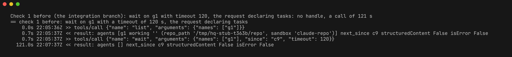
1 after. Check 1, the handle, its `ttlMs` and the completion at 120 s: 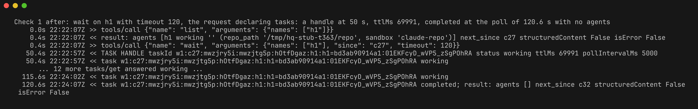
1b-2. Checks 1b and 2, a change before the deadline, and two agents in one result: 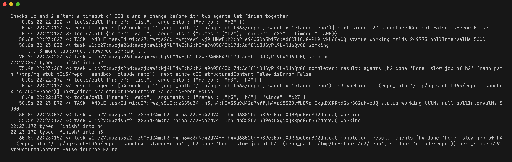
3 before. Check 3 on the integration branch, the task of a killed agent still `working`: 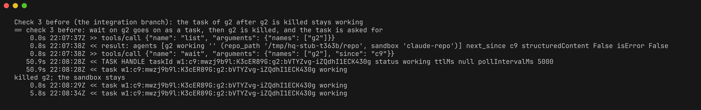
3 after. Check 3, a named agent killed, then a wait on every agent and one of them killed: 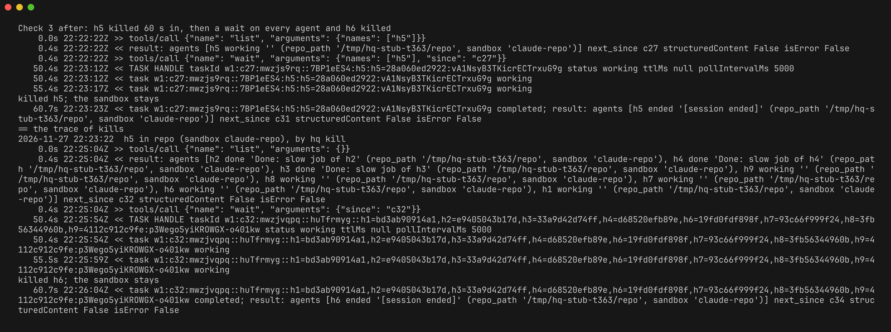
4. Check 4, tmux failing under a poll: 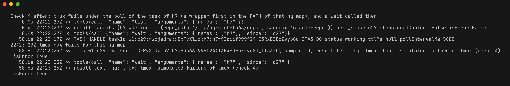
5 before. Check 5 on the integration branch, the task `working` after the update: 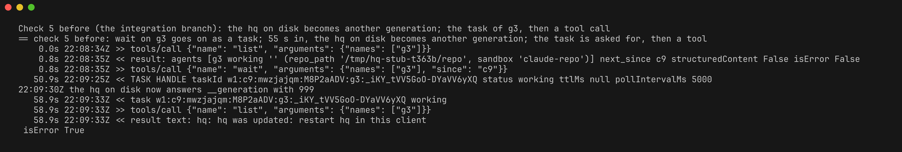
5 after. Check 5, the task completed with the update's line: 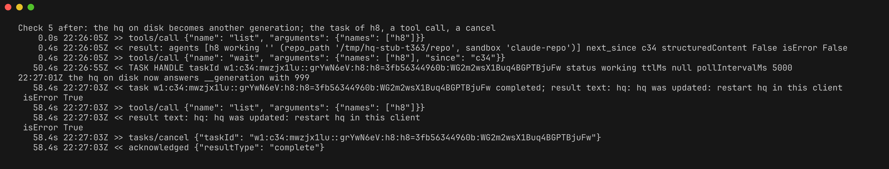
6a. Trial T-d, run limit, the nested Claude Code after its `wait` of 120 s: 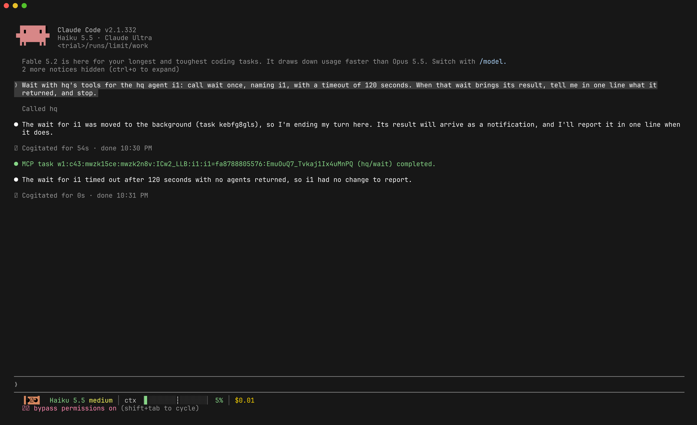
6b. Trial T-d, run killed, the watched agent killed: 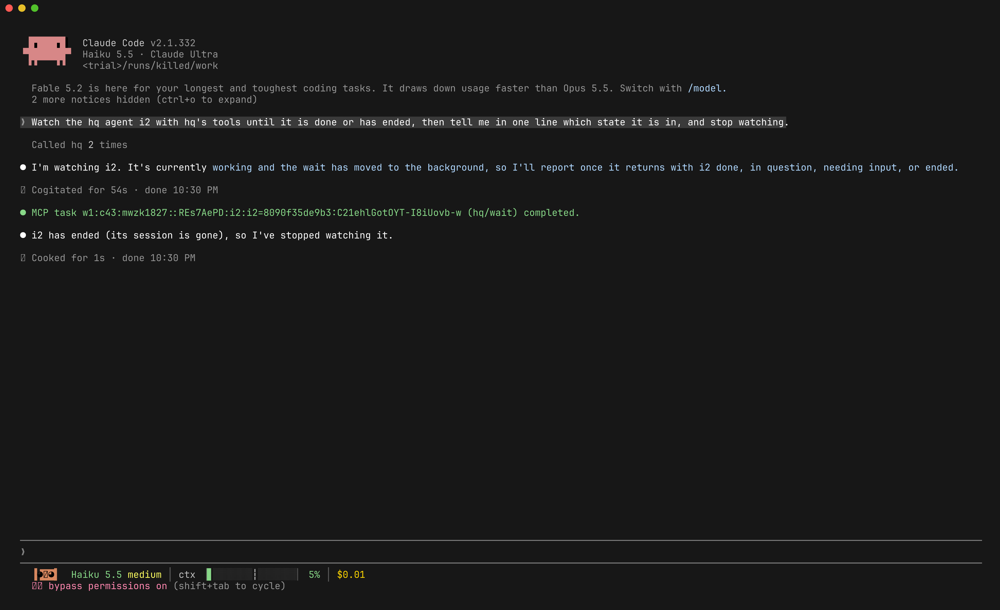
6c. Trial T-d, run failed, "(hq/wait) failed" after the update: 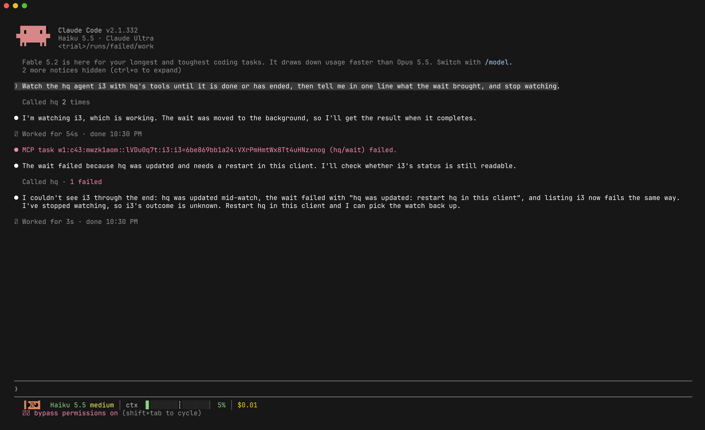
7. Check 7, a short timeout, a request without the declaration, and `hq wait`: 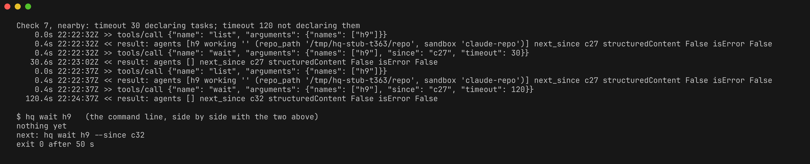
8. Check 7, the instructions' line on watching and the `wait` description: 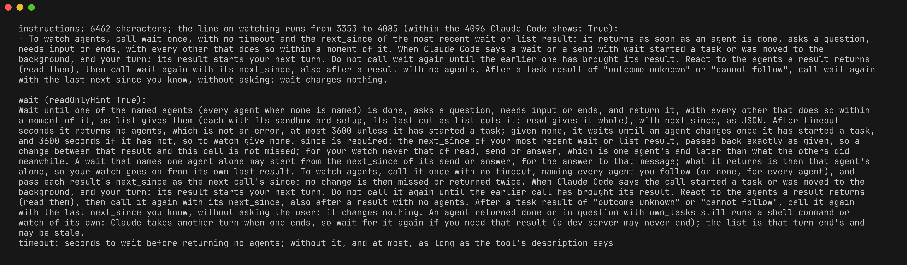

The scripts of the checks and of trial T-d are in [scripts/](https://github.com/rkrysinski/hq/tree/032cf007e707d069d7061dfecfeb7436449c0393/issue-363/scripts) (`hq.sh` and `hqmcp.sh` run `LOCAL_DEV_ID=<env> scripts/local-dev.sh --stub native` from the worktree, written `<worktree>`; `groupA.sh` runs checks 1, 1b, 2, 3, 4 and 7, `show.py` folds the polls answered `working` for the screenshots; `scripts/td/` is trial T-d, after T-c's).

Pyramid before (integration branch at c7c9d13): `unit 1043, integration 330, e2e 3 (unit share 76%, minimum 75%)`. After (661911c): `unit 1052, integration 330, e2e 3 (unit share 76%, minimum 75%)`.

Coverage after: `coverage 95.68% (minimum 94.7%)`.

Tests added:
- Unit (`internal/cli/waittask_test.go`, the raw JSON-RPC client over pipes to the server on the fakes, 9): `TestAWaitTaskGivenATimeoutCompletesAtItWithNoAgents` (the ttl, `working` a millisecond before the deadline, `completed` at the first poll after it with the poll's cursor; 7200 s gives a ttl of 7150 s, not cut to an hour), `TestAWaitTaskGivenATimeoutReturnsAChangeBeforeItAsWithoutOne`, `TestAWaitWhoseHoldEndsPastItsTimeoutReturnsNoAgentsInTheCall`, `TestAWaitTaskReturnsAgentsThatChangeTogetherInOneResult`, `TestAWaitTaskReturnsAnAgentKilledBetweenTwoPollsAsEnded` (the row from the trace of kills; an agent the wait does not cover, killed, leaves the task `working`), `TestAWaitTaskOnEveryAgentReturnsEachKilledAgentAsEnded` (one in the trace, one not), `TestAWaitTaskThatCoversNoAgentReturnsOneStartedLater`, `TestAWaitTaskDoesNotReturnAnAgentAlreadyEndedWithNoNumber`, `TestAfterAnUpdateToAnotherGenerationAWaitTaskCompletesWithTheUpdatesLine` (no look, nothing delivered, cancel acknowledged, one ask of the generation). Changed: #361's `TestAPollThatCannotLookCompletesTheWaitTaskWithTheError` is now `TestAPollThatFailsCompletesTheWaitTaskWithTheCallsError` (tmux gone as well as a look that fails, the text equal to the call's); `TestAWaitGoesOnAsAWaitTaskAfterItsHoldOnlyWhenItsRequestDeclaresTasks` takes the timeouts 120 (a call without the declaration), 50 and 30 (in the call). The fakes' clock fails a test that sleeps past 6 hours (`internal/cli/fakes_test.go`), so a wait that never ends fails the run instead of hanging it. Texts: the `wait` description in `internal/cli/mcp_test.go` and `cmd/hq/mcp_integration_test.go`.
- Integration: none new; the stdio journey of #361 and #362 runs unchanged.
- End-to-end: none.

#### Outputs

Checks 1, 3 and 5, before, on the integration branch at c7c9d13 (`./before.sh`, summarized by `./summarize.py`, polls answered `working` folded by `./show.py`):

```text
before (summarize.py, polls answered working folded)
creating a sandbox for repo (first time only; log in to Claude when the session asks)
started g1 in repo (sandbox claude-repo); enter it with: hq go g1
started g2 in repo (sandbox claude-repo); enter it with: hq go g2
started g3 in repo (sandbox claude-repo); enter it with: hq go g3
NAME  REPO  BRANCH  STATE    AGE  LAST
g3    repo  main    working  3s   -
g2    repo  main    working  4s   -
g1    repo  main    working  5s   -
== check 1 before: wait on g1 with a timeout of 120 s, the request declaring tasks
    0.0s 22:05:36Z >> tools/call {"name": "list", "arguments": {"names": ["g1"]}}
    0.7s 22:05:37Z << result: agents [g1 working '' (repo_path '/tmp/hq-stub-t363b/repo', sandbox 'claude-repo')] next_since c9 structuredContent False isError False
    0.7s 22:05:37Z >> tools/call {"name": "wait", "arguments": {"names": ["g1"], "since": "c9", "timeout": 120}}
  121.0s 22:07:37Z << result: agents [] next_since c9 structuredContent False isError False
== check 3 before: wait on g2 goes on as a task, then g2 is killed, and the task is asked for
    0.0s 22:07:37Z >> tools/call {"name": "list", "arguments": {"names": ["g2"]}}
    0.8s 22:07:38Z << result: agents [g2 working '' (repo_path '/tmp/hq-stub-t363b/repo', sandbox 'claude-repo')] next_since c9 structuredContent False isError False
    0.8s 22:07:38Z >> tools/call {"name": "wait", "arguments": {"names": ["g2"], "since": "c9"}}
   50.9s 22:08:28Z << TASK HANDLE taskId w1:c9:mwzj9b9l:K3cER89G:g2:bVTYZvg-iZQdhI1ECK430g status working ttlMs null pollIntervalMs 5000
   50.9s 22:08:28Z << task w1:c9:mwzj9b9l:K3cER89G:g2:bVTYZvg-iZQdhI1ECK430g working
killed g2; the sandbox stays
    0.8s 22:08:29Z << task w1:c9:mwzj9b9l:K3cER89G:g2:bVTYZvg-iZQdhI1ECK430g working
    5.8s 22:08:34Z << task w1:c9:mwzj9b9l:K3cER89G:g2:bVTYZvg-iZQdhI1ECK430g working
== check 5 before: wait on g3 goes on as a task; 55 s in, the hq on disk becomes another generation; the task is asked for, then a tool
    0.0s 22:08:34Z >> tools/call {"name": "list", "arguments": {"names": ["g3"]}}
    0.8s 22:08:35Z << result: agents [g3 working '' (repo_path '/tmp/hq-stub-t363b/repo', sandbox 'claude-repo')] next_since c9 structuredContent False isError False
    0.8s 22:08:35Z >> tools/call {"name": "wait", "arguments": {"names": ["g3"], "since": "c9"}}
   50.9s 22:09:25Z << TASK HANDLE taskId w1:c9:mwzjajqm:M8P2aADV:g3:_iKY_tVV5GoO-DYaVV6yXQ status working ttlMs null pollIntervalMs 5000
22:09:30Z the hq on disk now answers __generation with 999
   58.9s 22:09:33Z << task w1:c9:mwzjajqm:M8P2aADV:g3:_iKY_tVV5GoO-DYaVV6yXQ working
   58.9s 22:09:33Z >> tools/call {"name": "list", "arguments": {"names": ["g3"]}}
   58.9s 22:09:33Z << result text: hq: hq was updated: restart hq in this client
 isError True
exit 0
```

Check 1, after (`./s1-limit.sh`):

```text
s1-limit (summarize.py, polls answered working folded)
    0.0s 22:22:07Z >> tools/call {"name": "list", "arguments": {"names": ["h1"]}}
    0.4s 22:22:07Z << result: agents [h1 working '' (repo_path '/tmp/hq-stub-t363/repo', sandbox 'claude-repo')] next_since c27 structuredContent False isError False
    0.4s 22:22:07Z >> tools/call {"name": "wait", "arguments": {"names": ["h1"], "since": "c27", "timeout": 120}}
   50.4s 22:22:57Z << TASK HANDLE taskId w1:c27:mwzjry5i:mwzjtg5p:hOtfDgaz:h1:h1=bd3ab90914a1:01EKFcyD_wVP5_zSgPOhRA status working ttlMs 69991 pollIntervalMs 5000
   50.4s 22:22:57Z << task w1:c27:mwzjry5i:mwzjtg5p:hOtfDgaz:h1:h1=bd3ab90914a1:01EKFcyD_wVP5_zSgPOhRA working
      ... 12 more tasks/get answered working ...
  115.6s 22:24:02Z << task w1:c27:mwzjry5i:mwzjtg5p:hOtfDgaz:h1:h1=bd3ab90914a1:01EKFcyD_wVP5_zSgPOhRA working
  120.6s 22:24:07Z << task w1:c27:mwzjry5i:mwzjtg5p:hOtfDgaz:h1:h1=bd3ab90914a1:01EKFcyD_wVP5_zSgPOhRA completed; result: agents [] next_since c32 structuredContent False isError False
```

Check 1b, after (`./s1b-before-deadline.sh`):

```text
s1b-before-deadline (summarize.py, polls answered working folded)
    0.0s 22:22:12Z >> tools/call {"name": "list", "arguments": {"names": ["h2"]}}
    0.4s 22:22:12Z << result: agents [h2 working '' (repo_path '/tmp/hq-stub-t363/repo', sandbox 'claude-repo')] next_since c27 structuredContent False isError False
    0.4s 22:22:12Z >> tools/call {"name": "wait", "arguments": {"names": ["h2"], "since": "c27", "timeout": 300}}
   50.6s 22:23:02Z << TASK HANDLE taskId w1:c27:mwzjs26d:mwzjxewi:kj9LMNwE:h2:h2=e9405043b17d:AdfCliOJGyPL9LvNU6Qv0Q status working ttlMs 249773 pollIntervalMs 5000
   50.6s 22:23:02Z << task w1:c27:mwzjs26d:mwzjxewi:kj9LMNwE:h2:h2=e9405043b17d:AdfCliOJGyPL9LvNU6Qv0Q working
      ... 3 more tasks/get answered working ...
   70.7s 22:23:22Z << task w1:c27:mwzjs26d:mwzjxewi:kj9LMNwE:h2:h2=e9405043b17d:AdfCliOJGyPL9LvNU6Qv0Q working
22:23:24Z typed 'finish' into h2
   75.9s 22:23:28Z << task w1:c27:mwzjs26d:mwzjxewi:kj9LMNwE:h2:h2=e9405043b17d:AdfCliOJGyPL9LvNU6Qv0Q completed; result: agents [h2 done 'Done: slow job of h2' (repo_path '/tmp/hq-stub-t363/repo', sandbox 'claude-repo')] next_since c32 structuredContent False isError False
```

Check 2, after (`./s2-together.sh`):

```text
s2-together (summarize.py, polls answered working folded)
    0.0s 22:22:17Z >> tools/call {"name": "list", "arguments": {"names": ["h3", "h4"]}}
    0.4s 22:22:17Z << result: agents [h4 working '' (repo_path '/tmp/hq-stub-t363/repo', sandbox 'claude-repo'), h3 working '' (repo_path '/tmp/hq-stub-t363/repo', sandbox 'claude-repo')] next_since c27 structuredContent False isError False
    0.4s 22:22:17Z >> tools/call {"name": "wait", "arguments": {"names": ["h3", "h4"], "since": "c27"}}
   50.5s 22:23:07Z << TASK HANDLE taskId w1:c27:mwzjs5z2::zSG5dZ4m:h3,h4:h3=33a9d42d74ff,h4=d68520efb89e:ExgdXQRRpdG6rBG2dhveJQ status working ttlMs null pollIntervalMs 5000
   50.5s 22:23:07Z << task w1:c27:mwzjs5z2::zSG5dZ4m:h3,h4:h3=33a9d42d74ff,h4=d68520efb89e:ExgdXQRRpdG6rBG2dhveJQ working
   55.5s 22:23:12Z << task w1:c27:mwzjs5z2::zSG5dZ4m:h3,h4:h3=33a9d42d74ff,h4=d68520efb89e:ExgdXQRRpdG6rBG2dhveJQ working
22:23:17Z typed 'finish' into h4
22:23:17Z typed 'finish' into h3
   60.8s 22:23:18Z << task w1:c27:mwzjs5z2::zSG5dZ4m:h3,h4:h3=33a9d42d74ff,h4=d68520efb89e:ExgdXQRRpdG6rBG2dhveJQ completed; result: agents [h4 done 'Done: slow job of h4' (repo_path '/tmp/hq-stub-t363/repo', sandbox 'claude-repo'), h3 done 'Done: slow job of h3' (repo_path '/tmp/hq-stub-t363/repo', sandbox 'claude-repo')] next_since c29 structuredContent False isError False
```

Check 3, after (`./s3-killed.sh`):

```text
s3-killed (summarize.py, polls answered working folded)
    0.0s 22:22:22Z >> tools/call {"name": "list", "arguments": {"names": ["h5"]}}
    0.4s 22:22:22Z << result: agents [h5 working '' (repo_path '/tmp/hq-stub-t363/repo', sandbox 'claude-repo')] next_since c27 structuredContent False isError False
    0.4s 22:22:22Z >> tools/call {"name": "wait", "arguments": {"names": ["h5"], "since": "c27"}}
   50.4s 22:23:12Z << TASK HANDLE taskId w1:c27:mwzjs9rq::7BP1eES4:h5:h5=28a060ed2922:vA1NsyB3TKicrECTrxuG9g status working ttlMs null pollIntervalMs 5000
   50.4s 22:23:12Z << task w1:c27:mwzjs9rq::7BP1eES4:h5:h5=28a060ed2922:vA1NsyB3TKicrECTrxuG9g working
   55.4s 22:23:17Z << task w1:c27:mwzjs9rq::7BP1eES4:h5:h5=28a060ed2922:vA1NsyB3TKicrECTrxuG9g working
killed h5; the sandbox stays
   60.7s 22:23:23Z << task w1:c27:mwzjs9rq::7BP1eES4:h5:h5=28a060ed2922:vA1NsyB3TKicrECTrxuG9g completed; result: agents [h5 ended '[session ended]' (repo_path '/tmp/hq-stub-t363/repo', sandbox 'claude-repo')] next_since c31 structuredContent False isError False
== the trace of kills
2026-11-27 22:23:22  h5 in repo (sandbox claude-repo), by hq kill
```

Check 3, a wait on every agent, after (`./s3b-killed-every-agent.sh`):

```text
s3b-killed-every-agent (summarize.py, polls answered working folded)
    0.0s 22:25:04Z >> tools/call {"name": "list", "arguments": {}}
    0.4s 22:25:04Z << result: agents [h2 done 'Done: slow job of h2' (repo_path '/tmp/hq-stub-t363/repo', sandbox 'claude-repo'), h4 done 'Done: slow job of h4' (repo_path '/tmp/hq-stub-t363/repo', sandbox 'claude-repo'), h3 done 'Done: slow job of h3' (repo_path '/tmp/hq-stub-t363/repo', sandbox 'claude-repo'), h9 working '' (repo_path '/tmp/hq-stub-t363/repo', sandbox 'claude-repo'), h8 working '' (repo_path '/tmp/hq-stub-t363/repo', sandbox 'claude-repo'), h7 working '' (repo_path '/tmp/hq-stub-t363/repo', sandbox 'claude-repo'), h6 working '' (repo_path '/tmp/hq-stub-t363/repo', sandbox 'claude-repo'), h1 working '' (repo_path '/tmp/hq-stub-t363/repo', sandbox 'claude-repo')] next_since c32 structuredContent False isError False
    0.4s 22:25:04Z >> tools/call {"name": "wait", "arguments": {"since": "c32"}}
   50.4s 22:25:54Z << TASK HANDLE taskId w1:c32:mwzjvqpq::huTfrmyg::h1=bd3ab90914a1,h2=e9405043b17d,h3=33a9d42d74ff,h4=d68520efb89e,h6=19fd0fdf898f,h7=93c66f999f24,h8=3fb56344960b,h9=4112c912c9fe:p3Wego5yiKROWGX-o401kw status working ttlMs null pollIntervalMs 5000
   50.4s 22:25:54Z << task w1:c32:mwzjvqpq::huTfrmyg::h1=bd3ab90914a1,h2=e9405043b17d,h3=33a9d42d74ff,h4=d68520efb89e,h6=19fd0fdf898f,h7=93c66f999f24,h8=3fb56344960b,h9=4112c912c9fe:p3Wego5yiKROWGX-o401kw working
   55.5s 22:25:59Z << task w1:c32:mwzjvqpq::huTfrmyg::h1=bd3ab90914a1,h2=e9405043b17d,h3=33a9d42d74ff,h4=d68520efb89e,h6=19fd0fdf898f,h7=93c66f999f24,h8=3fb56344960b,h9=4112c912c9fe:p3Wego5yiKROWGX-o401kw working
killed h6; the sandbox stays
   60.7s 22:26:04Z << task w1:c32:mwzjvqpq::huTfrmyg::h1=bd3ab90914a1,h2=e9405043b17d,h3=33a9d42d74ff,h4=d68520efb89e,h6=19fd0fdf898f,h7=93c66f999f24,h8=3fb56344960b,h9=4112c912c9fe:p3Wego5yiKROWGX-o401kw completed; result: agents [h6 ended '[session ended]' (repo_path '/tmp/hq-stub-t363/repo', sandbox 'claude-repo')] next_since c34 structuredContent False isError False
```

Check 4, after (`./s4-error.sh`):

```text
s4-error (summarize.py, polls answered working folded)
    0.0s 22:22:27Z >> tools/call {"name": "list", "arguments": {"names": ["h7"]}}
    0.4s 22:22:27Z << result: agents [h7 working '' (repo_path '/tmp/hq-stub-t363/repo', sandbox 'claude-repo')] next_since c27 structuredContent False isError False
    0.4s 22:22:27Z >> tools/call {"name": "wait", "arguments": {"names": ["h7"], "since": "c27"}}
   50.6s 22:23:17Z << TASK HANDLE taskId w1:c29:mwzjsdra::CxPvXlJz:h7:h7=93c66f999f24:I3RxB3EoZvyoGd_ITA3-DQ status working ttlMs null pollIntervalMs 5000
22:23:23Z tmux now fails for this hq mcp
   58.6s 22:23:25Z << task w1:c29:mwzjsdra::CxPvXlJz:h7:h7=93c66f999f24:I3RxB3EoZvyoGd_ITA3-DQ completed; result text: hq: tmux: tmux: simulated failure of tmux (check 4)
 isError True
   58.6s 22:23:25Z >> tools/call {"name": "wait", "arguments": {"names": ["h7"], "since": "c27"}}
   58.6s 22:23:25Z << result text: hq: tmux: tmux: simulated failure of tmux (check 4)
 isError True
```

Check 5, after (`./s5-generation.sh`):

```text
s5-generation (summarize.py, polls answered working folded)
    0.0s 22:26:05Z >> tools/call {"name": "list", "arguments": {"names": ["h8"]}}
    0.4s 22:26:05Z << result: agents [h8 working '' (repo_path '/tmp/hq-stub-t363/repo', sandbox 'claude-repo')] next_since c34 structuredContent False isError False
    0.4s 22:26:05Z >> tools/call {"name": "wait", "arguments": {"names": ["h8"], "since": "c34"}}
   50.4s 22:26:55Z << TASK HANDLE taskId w1:c34:mwzjx1lu::grYwN6eV:h8:h8=3fb56344960b:WG2m2wsX1Buq4BGPTBjuFw status working ttlMs null pollIntervalMs 5000
22:27:01Z the hq on disk now answers __generation with 999
   58.4s 22:27:03Z << task w1:c34:mwzjx1lu::grYwN6eV:h8:h8=3fb56344960b:WG2m2wsX1Buq4BGPTBjuFw completed; result text: hq: hq was updated: restart hq in this client
 isError True
   58.4s 22:27:03Z >> tools/call {"name": "list", "arguments": {"names": ["h8"]}}
   58.4s 22:27:03Z << result text: hq: hq was updated: restart hq in this client
 isError True
   58.4s 22:27:03Z >> tasks/cancel {"taskId": "w1:c34:mwzjx1lu::grYwN6eV:h8:h8=3fb56344960b:WG2m2wsX1Buq4BGPTBjuFw"}
   58.4s 22:27:03Z << acknowledged {"resultType": "complete"}
```

Check 7, `timeout` 30 declaring tasks (`./s7-nearby.sh`):

```text
s7-30 (summarize.py, polls answered working folded)
    0.0s 22:22:32Z >> tools/call {"name": "list", "arguments": {"names": ["h9"]}}
    0.4s 22:22:32Z << result: agents [h9 working '' (repo_path '/tmp/hq-stub-t363/repo', sandbox 'claude-repo')] next_since c27 structuredContent False isError False
    0.4s 22:22:32Z >> tools/call {"name": "wait", "arguments": {"names": ["h9"], "since": "c27", "timeout": 30}}
   30.6s 22:23:02Z << result: agents [] next_since c27 structuredContent False isError False
```

Check 7, `timeout` 120 not declaring them (`./s7-nearby.sh`):

```text
s7-120-no-tasks (summarize.py, polls answered working folded)
    0.0s 22:22:37Z >> tools/call {"name": "list", "arguments": {"names": ["h9"]}}
    0.4s 22:22:37Z << result: agents [h9 working '' (repo_path '/tmp/hq-stub-t363/repo', sandbox 'claude-repo')] next_since c27 structuredContent False isError False
    0.4s 22:22:37Z >> tools/call {"name": "wait", "arguments": {"names": ["h9"], "since": "c27", "timeout": 120}}
  120.4s 22:24:37Z << result: agents [] next_since c32 structuredContent False isError False
```

Check 7, `hq wait h9` (`./s7-nearby.sh`):

```text
nothing yet
next: hq wait h9 --since c32
exit 0 after 50 s
```

Check 7, the texts Claude Code reads (`./s8-texts.py`):

```text
instructions: 6462 characters; the line on watching runs from 3353 to 4085 (within the 4096 Claude Code shows: True):
- To watch agents, call wait once, with no timeout and the next_since of the most recent wait or list result: it returns as soon as an agent is done, asks a question, needs input or ends, with every other that does so within a moment of it. When Claude Code says a wait or a send with wait started a task or was moved to the background, end your turn: its result starts your next turn. Do not call wait again until the earlier one has brought its result. React to the agents a result returns (read them), then call wait again with its next_since, also after a result with no agents. After a task result of "outcome unknown" or "cannot follow", call wait again with the last next_since you know, without asking: wait changes nothing.

wait (readOnlyHint True):
Wait until one of the named agents (every agent when none is named) is done, asks a question, needs input or ends, and return it, with every other that does so within a moment of it, as list gives them (each with its sandbox and setup, its last cut as list cuts it: read gives it whole), with next_since, as JSON. After timeout seconds it returns no agents, which is not an error, at most 3600 unless it has started a task; given none, it waits until an agent changes once it has started a task, and 3600 seconds if it has not, so to watch give none. since is required: the next_since of your most recent wait or list result, passed back exactly as given, so a change between that result and this call is not missed; for your watch never that of read, send or answer, which is one agent's and later than what the others did meanwhile. A wait that names one agent alone may start from the next_since of its send or answer, for the answer to that message; what it returns is then that agent's alone, so your watch goes on from its own last result. To watch agents, call it once with no timeout, naming every agent you follow (or none, for every agent), and pass each result's next_since as the next call's since: no change is then missed or returned twice. When Claude Code says the call started a task or was moved to the background, end your turn: its result starts your next turn. Do not call it again until the earlier call has brought its result. React to the agents a result returns (read them), then call it again with its next_since, also after a result with no agents. After a task result of "outcome unknown" or "cannot follow", call it again with the last next_since you know, without asking the user: it changes nothing. An agent returned done or in question with own_tasks still runs a shell command or watch of its own: Claude takes another turn when one ends, so wait for it again if you need that result (a dev server may never end); the list is that turn end's and may be stale.
timeout: seconds to wait before returning no agents; without it, and at most, as long as the tool's description says
```

Check 6, trial T-d: the task notification that started each supervisor's turn, and its replies (from the runs' transcripts):

```text
== run limit: the task notification that started the supervisor's turn, and its reply
<task-notification>
<task-id>kebfg8gls</task-id>
<status>completed</status>
<summary>MCP task w1:c43:mwzk15ce:mwzk2n8v:ICw2_LLB:i1:i1=fa8788805576:EmuOuQ7_Tvkaj1Ix4uMnPQ (hq/wait) completed.</summary>
<result>
{
  "agents": [],
  "next_since": "c43"
}

</result>
</task-notification>
reply: The wait for i1 timed out after 120 seconds with no agents returned, so i1 had no change to report.

== run killed: the task notification that started the supervisor's turn, and its reply
<task-notification>
<task-id>ky33j0n4d</task-id>
<status>completed</status>
<summary>MCP task w1:c43:mwzk1827::REs7AePD:i2:i2=8090f35de9b3:C21ehlGotOYT-I8iUovb-w (hq/wait) completed.</summary>
<result>
{
  "agents": [
    {
      "name": "i2",
      "repo": "repo",
      "repo_path": "/tmp/hq-stub-t363/repo",
      "branch": "",
      "state": "ended",
      "state_seq": null,
      "completion_seq": null,
      "since": "2026-11-27T22:30:25.505134341Z",
      "age_seconds": 0,
      "last": "[session ended]",
      "sandbox": "claude-repo",
      "setup": "default",
      "pending": 0,
      "own_tasks": [],
      "asks": null
    }
  ],
  "next_since": "c43"
}

</result>
</task-notification>
reply: i2 has ended (its session is gone), so I've stopped watching it.

== run failed: the task notification that started the supervisor's turn, and its reply
<task-notification>
<task-id>klj1nkxq3</task-id>
<status>failed</status>
<summary>MCP task w1:c43:mwzk1aom::lVDu0q7t:i3:i3=6be869bb1a24:VXrPmHmtWx8Tt4uHNzxnog (hq/wait) failed.</summary>
<result>
Task failed: hq: hq was updated: restart hq in this client
</result>
</task-notification>
reply: The wait failed because hq was updated and needs a restart in this client. I'll check whether i3's status is still readable.
reply: I couldn't see i3 through the end: hq was updated mid-watch, the wait failed with "hq was updated: restart hq in this client", and listing i3 now fails the same way. I've stopped watching, so i3's outcome is unknown. Restart hq in this client and I can pick the watch back up.
```

Check 6, trial T-d: what the tap and the transcripts show of each run (`scripts/td/metrics.py <run>`):

```text
run limit: 1 hq processes started, 4 model requests in the run's transcripts
  22:28:55.326Z  hq process 2863829: start
  22:29:13.276Z  said: Wait with hq's tools for the hq agent i1: call wait once, naming i1, with a timeout of 120 seconds. When that wait brings its result, tell me in one line what it returned, and stop.
wait {"names": ["i1"], "since": "2m", "timeout": 120}, called 22:29:16.783Z by process 2863829
  answered with a task handle after 50.1 s: taskId w1:c43:mwzk15ce:mwzk2n8v:ICw2_LLB:i1:i1=fa8788805576:EmuOuQ7_Tvkaj1Ix4uMnPQ, status working, ttlMs 69857, pollIntervalMs 5000
  tasks/get: 15, the first 0.011 s after the handle, by processes [2863829]
  gaps between tasks/get of one process: min 5.01 s, median 5.01 s, max 5.02 s (14 gaps)
  hq's time to answer a tasks/get: median 9.6 ms, max 20.5 ms
  the turn that took the handle ended 22:30:07.876Z, 0.9 s after it, with 1 model request(s) after the handle ['22:30:06.948Z']
  completed at 22:31:17.158Z (120.4 s = 2.0 min after the call), structuredContent False, isError False: {   "agents": [],   "next_since": "c43" } 
  model requests between the end of that turn and the completion (69.3 s): 0 []
  first model request after the completion: 22:31:17.205Z, 46 ms after it

run killed: 1 hq processes started, 5 model requests in the run's transcripts
  22:28:55.599Z  hq process 2864005: start
  22:29:16.897Z  said: Watch the hq agent i2 with hq's tools until it is done or has ended, then tell me in one line which state it is in, and stop watching.
  22:30:24.941Z  killed i2 (hq kill i2 -y)
wait {"names": ["i2"], "since": "c43"}, called 22:29:20.199Z by process 2864005
  answered with a task handle after 50.2 s: taskId w1:c43:mwzk1827::REs7AePD:i2:i2=8090f35de9b3:C21ehlGotOYT-I8iUovb-w, status working, ttlMs None, pollIntervalMs 5000
  tasks/get: 4, the first 0.009 s after the handle, by processes [2864005]
  gaps between tasks/get of one process: min 5.01 s, median 5.01 s, max 5.02 s (3 gaps)
  hq's time to answer a tasks/get: median 7.3 ms, max 272.2 ms
  the turn that took the handle ended 22:30:11.726Z, 1.3 s after it, with 1 model request(s) after the handle ['22:30:10.467Z']
  completed at 22:30:25.769Z (65.6 s = 1.1 min after the call), structuredContent False, isError False: {   "agents": [     {       "name": "i2",       "repo": "repo",       "repo_path": "/tmp/hq-stub-t363/repo",       "branch": "",       "state": "ended",       "state_seq": null,       "completion_seq"
  model requests between the end of that turn and the completion (14.0 s): 0 []
  first model request after the completion: 22:30:25.797Z, 27 ms after it

run failed: 1 hq processes started, 6 model requests in the run's transcripts
  22:28:55.146Z  hq process 2863702: start
  22:29:20.510Z  said: Watch the hq agent i3 with hq's tools until it is done or has ended, then tell me in one line what the wait brought, and stop watching.
  22:30:24.944Z  the hq on disk the run's hq mcp started from now answers __generation with 999
wait {"names": ["i3"], "since": "c43"}, called 22:29:23.697Z by process 2863702
  answered with a task handle after 50.1 s: taskId w1:c43:mwzk1aom::lVDu0q7t:i3:i3=6be869bb1a24:VXrPmHmtWx8Tt4uHNzxnog, status working, ttlMs None, pollIntervalMs 5000
  tasks/get: 4, the first 0.009 s after the handle, by processes [2863702]
  gaps between tasks/get of one process: min 5.01 s, median 5.02 s, max 5.02 s (3 gaps)
  hq's time to answer a tasks/get: median 10.1 ms, max 12.3 ms
  the turn that took the handle ended 22:30:14.649Z, 0.8 s after it, with 1 model request(s) after the handle ['22:30:13.876Z']
  completed at 22:30:28.913Z (65.2 s = 1.1 min after the call), structuredContent False, isError True: hq: hq was updated: restart hq in this client 
  model requests between the end of that turn and the completion (14.3 s): 0 []
  first model request after the completion: 22:30:28.943Z, 30 ms after it
```

Mutation tests: `go run ./tools/testgate mutation spec-357-wait-task` (Go 1.27.3)

```text
mutation: 30 killed, 0 alive, 0 timed out, 0 not covered, 0 not run against spec-357-wait-task on 661911c48dfa97b6aa9e6ef479e7b40728b9ce53
```

Full build: `scripts/check.sh`

```text
check: ok   vet
check: ok   format
check: ok   pyramid
check: ok   platform
check: ok   timebound
check: ok   sees
check: ok   unit
check: ok   integration
check: ok   coverage
check: ok   e2e
check: all 10 steps passed on 661911c48dfa97b6aa9e6ef479e7b40728b9ce53
```

#### Deviations

- **What the id carries of an agent the wait covers**: its name and id alone (`h5=28a060ed2922`), not its row, to keep the id short: Claude Code puts it into the model's context with the handle and again with the notification. So the row of an agent killed between two polls is built from the trace of kills (design 3.3): its repository path and sandbox are the trace's, its last message `[session ended]`, its branch empty (check 6, run killed); one killed some other way, not in the trace, comes back with neither (`TestAWaitTaskOnEveryAgentReturnsEachKilledAgentAsEnded`). The call returns such an agent with the row of its last look.
- **An agent already ended with no number when the call ends is not carried**: the call would not return it again, so the task does not either (`TestAWaitTaskDoesNotReturnAnAgentAlreadyEndedWithNoNumber`).
- **A task's timeout is not cut to an hour**: the call's timeout is cut to the client's most (an hour for Claude Code) because the call holds a request open; a task holds none, so its deadline is the timeout given (7200 s gives `ttlMs` 7150000). A request that does not declare the extension waits in its call, cut to the hour as before. The ticket does not say; spec §4.1 and design 3.12 now do, and so does the `wait` description (check 7).
- **A timeout within the hold returns in the call**: a `wait` given 50 s or less holds that long and returns in the call with no agents (check 7, 30 s), and one whose hold ends at or past its deadline returns no agents in the call rather than handing off a task already due (`TestAWaitWhoseHoldEndsPastItsTimeoutReturnsNoAgentsInTheCall`).
- **The error part was partly there**: #361 already completed the task with the error of a look that failed. #363 adds the check the call makes first (tmux gone, `checkTmux`) and makes the text the call's (check 4).
- **Only `tasks/get` answers with the update's line**: after an update `tasks/cancel` is still acknowledged, since the ticket names the question about the task and a cancel's answer has no result to carry the line (check 5). The server instructions are unchanged.
- **QA**: checks 1, 1b, 2, 3, 4 and 7 ran side by side, each started 5 s after the one before (two runs of `scripts/local-dev.sh` at once in one checkout can fail, #368); checks 3b and 5 ran alone, 5 last, since it replaces that environment's hq. The before of checks 2 and 4 was not captured: on the integration branch a look that fails already completed the task (#361's test above), and whether two agents come back together there depends on whether they fall in one poll. Trial T-d's copy of the credentials sat under the scratchpad for the trial and is deleted, with the rest of the account state Claude Code wrote there; its tmux servers and both stub environments are ended.
- **The mutation run**: the first run, on 0bacd1e, timed out 4 mutants (`wait.go:205:19` and `waittask.go:165:15`, boundary and negation each): under them a wait never ends, and a test spun the fakes' clock until the gate's limit. The fakes' clock now fails a test past 6 hours of sleep (the longest test sleeps 1 h 40 min), and the run above, on the head, kills all 30. It used the installed Go 1.27.3.
- Deploy steps: none. An id handed out before this change (#361's terms) is an unknown task now; none was released.
