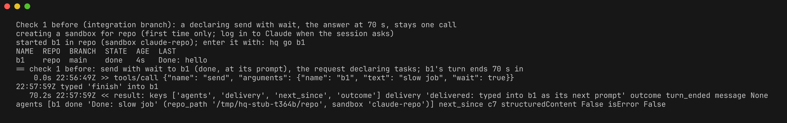
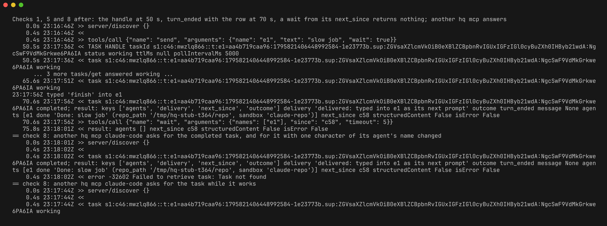
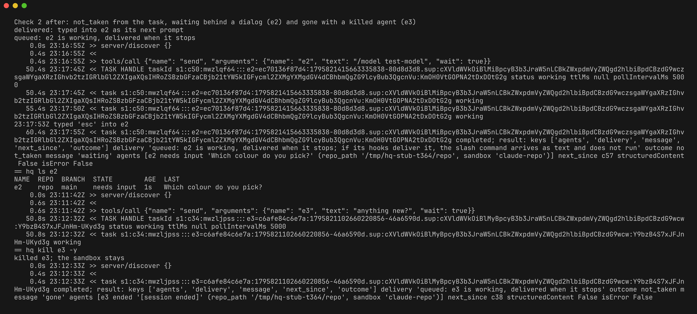
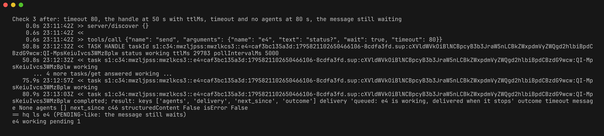
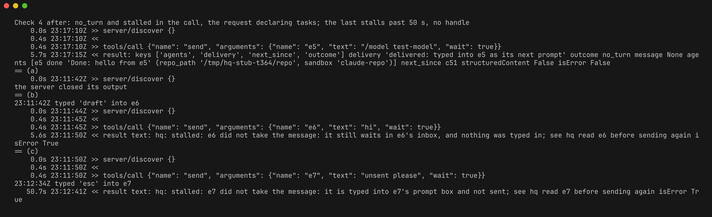
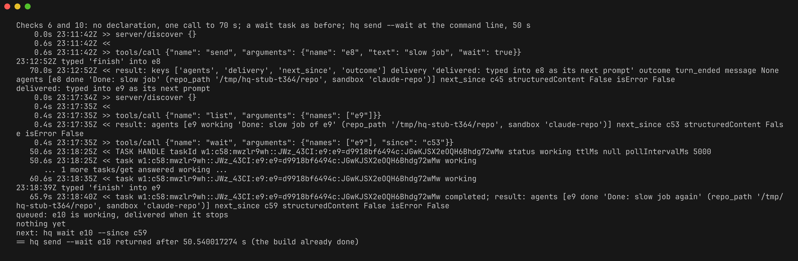
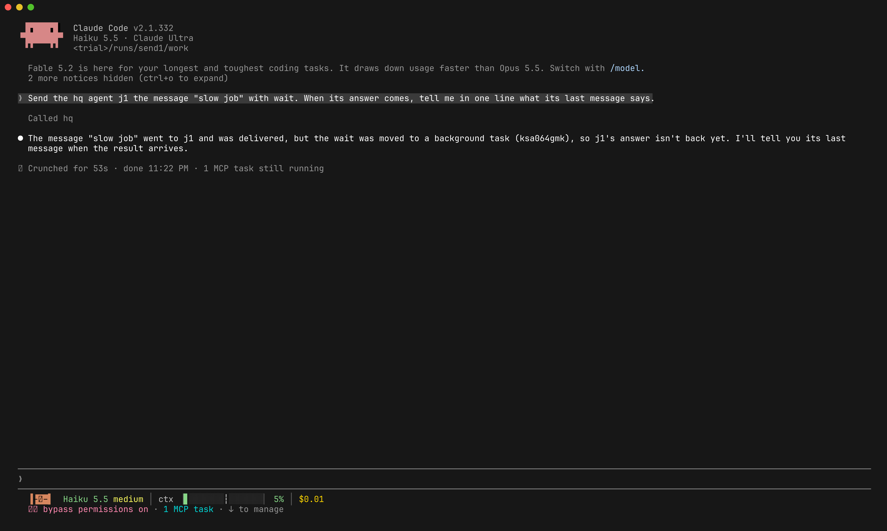
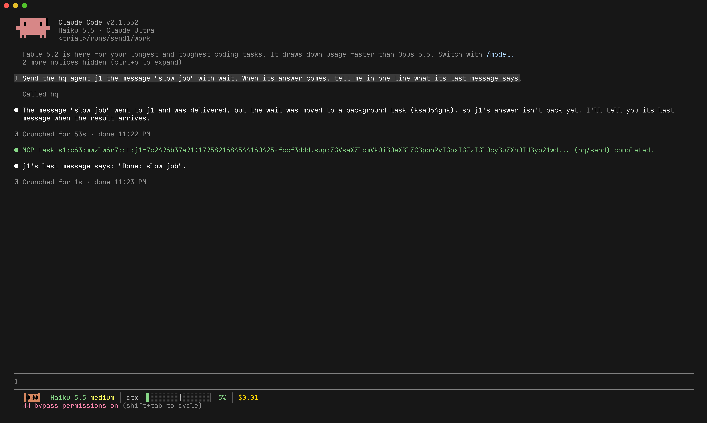

### #364 `send` z `wait` po 50 s czeka dalej jako zadanie na odpowiedź na tę jedną wiadomość

Checks 1-8 and 10 ran against `hq mcp claude-code` built from `issue-364-send-wait-task` at 4003a0f with `scripts/local-dev.sh --stub native`. That is the stub `sbx` and the fake claude, in stub environment t364: agents at their prompt, or working on a "slow job" until a line typed into their pane lets them finish, or `esc` interrupts them. The client was #361's raw MCP client (`qac.py`), over standard input and output, speaking protocol 2026-07-28 as Claude Code 2.1.332 does: the Tasks extension declared in each request's `_meta`, or not where a check says so. The before of checks 1 and 7 is the integration branch `spec-357-wait-task` at 661911c, run the same way in a stub environment of its own (t364b). Check 9 is trial T-e: a nested Claude Code 2.1.332 (Haiku 5.5, hooks off, a configuration directory of its own, after trial T-c's recipe) with the after build as its `hq` server, every line between them tapped. The commits after 4003a0f change the design document only.

| # | Check | Expected | Result | Evidence |
|---|---|---|---|---|
| 1 | After 50 s with no answer, a declaring request gets a handle, and the agent's answer completes the task with `turn_ended` and its row (story 17) | `send` with `wait` to e1, which is at its prompt. "slow job" starts a turn that is let finish 70 s in. Expected: a handle at 50 s (`ttlMs` null, poll 5000); `working` while the turn runs; then `completed` with `{delivery, outcome: turn_ended, agents: [e1 done], next_since}`; a `wait` on e1 from that `next_since` returns nothing. Before: no handle, the call returns at 70 s | ✅ pass. Before: no handle; the call returned `turn_ended` at 70.2 s. After: the handle at 50.5 s, with id `s1:c46:mwzlq866::t:e1=aa4b719caa96:1795821406448992584-1e23773b.sup:ZGVsaXZl…:NgcSwF9VdMkGrkwe6PA6IA` (`t`: the call saw the message typed in). Four polls answered `working`. e1 was let finish at 23:17:56, and the poll at 70.6 s `completed` with `turn_ended`, `e1 done "Done: slow job"`, `next_since` c58. A `wait` on e1 from c58 (timeout 5) returned `agents: []` | [s1-task-summary.txt](https://github.com/rkrysinski/hq/blob/d4c4188ad39431148a8050f6e719b7e9a8acc888/issue-364/s1-task-summary.txt), [raw](https://github.com/rkrysinski/hq/blob/d4c4188ad39431148a8050f6e719b7e9a8acc888/issue-364/s1-task.txt), [before](https://github.com/rkrysinski/hq/blob/d4c4188ad39431148a8050f6e719b7e9a8acc888/issue-364/before-summary.txt), screenshots 1 before, 1 after |
| 2 | `not_taken` from the task, with where the message is (story 18) | (a) e2 works on a slow job, with a plain send "input please" queued, then a declaring `send` with `wait` of `/model test-model` held behind it. After the handle, e2's turn is interrupted (`esc`, no hook); a poll types "input please" in, which opens a question dialog: `not_taken`, message `waiting`. (b) e3 works; after the handle, `hq kill e3 -y`: `not_taken`, message `gone`, e3 `ended` | ✅ pass. (a): handle at 50.4 s, `esc` at 23:17:53. The poll at 60.4 s `completed`: `not_taken`, `message` `waiting`, `e2 needs input "Which colour do you pick?"`. (b): handle at 50.8 s, e3 killed. A new `hq mcp`'s first poll `completed`: `not_taken`, `message` `gone`, `e3 ended "[session ended]"` with its repository path and sandbox, `next_since` c38 | [s2a-not-taken-summary.txt](https://github.com/rkrysinski/hq/blob/d4c4188ad39431148a8050f6e719b7e9a8acc888/issue-364/s2a-not-taken-summary.txt), [raw](https://github.com/rkrysinski/hq/blob/d4c4188ad39431148a8050f6e719b7e9a8acc888/issue-364/s2a-not-taken.txt), [s2b-killed-summary.txt](https://github.com/rkrysinski/hq/blob/d4c4188ad39431148a8050f6e719b7e9a8acc888/issue-364/s2b-killed-summary.txt), [raw](https://github.com/rkrysinski/hq/blob/d4c4188ad39431148a8050f6e719b7e9a8acc888/issue-364/s2b-killed.txt), screenshot 2 |
| 3 | A timeout gives `timeout` (story 18) | e4 works; a declaring `send` with `wait` and `timeout` 80. Expected: a handle at 50 s with `ttlMs` about 30000; `completed` at 80 s with `timeout`, `agents: []` and a `next_since`; the message still waits | ✅ pass. Handle at 50.8 s with `ttlMs` 29783 (the id carries the deadline `mwzlkcs3`). The poll at 80.9 s `completed`: `timeout`, no `message`, `agents: []`, `next_since` c46. `hq ls e4 --json` then showed e4 `working` with `pending` 1 | [s3-timeout-summary.txt](https://github.com/rkrysinski/hq/blob/d4c4188ad39431148a8050f6e719b7e9a8acc888/issue-364/s3-timeout-summary.txt), [raw](https://github.com/rkrysinski/hq/blob/d4c4188ad39431148a8050f6e719b7e9a8acc888/issue-364/s3-timeout.txt), screenshot 3 |
| 4 | A stalled message and `no_turn` stay the call's error and outcome (story 19) | All with the request declaring tasks. (a) `/model test-model` to e5, at its prompt: `no_turn` in the call at about 5 s. (b) "hi" to e6, whose box holds a draft: the stalled error in the call at about 5 s. (c) "unsent please" to e7, which works on a slow job. 44 s in, its turn is interrupted, the call types the message in, and Claude leaves it in the box: the stalled error in the call, past 50 s, never a handle | ✅ pass. (a) `no_turn` at 5.7 s, e5's row. (b) at 5.6 s, `isError`: `hq: stalled: e6 did not take the message: it still waits in e6's inbox, and nothing was typed in; see hq read e6 before sending again`. (c) `esc` at 23:12:34. At 50.7 s, `isError`: `hq: stalled: e7 did not take the message: it is typed into e7's prompt box and not sent; see hq read e7 before sending again`, no handle | [s4a-no-turn-summary.txt](https://github.com/rkrysinski/hq/blob/d4c4188ad39431148a8050f6e719b7e9a8acc888/issue-364/s4a-no-turn-summary.txt), [raw](https://github.com/rkrysinski/hq/blob/d4c4188ad39431148a8050f6e719b7e9a8acc888/issue-364/s4a-no-turn.txt), [s4bc-stalled-summary.txt](https://github.com/rkrysinski/hq/blob/d4c4188ad39431148a8050f6e719b7e9a8acc888/issue-364/s4bc-stalled-summary.txt), [raw](https://github.com/rkrysinski/hq/blob/d4c4188ad39431148a8050f6e719b7e9a8acc888/issue-364/s4bc-stalled.txt), screenshot 4 |
| 5 | The task's result has the shape of `send` with `wait`'s | The keys and the delivery line of check 1's task result against check 6's call result | ✅ pass. Both have keys `agents, delivery, next_since, outcome`, and a `not_taken` result adds `message` (check 2). The delivery lines are `delivered: typed into e1 as its next prompt` (task) and `delivered: typed into e8 as its next prompt` (call). The task's text is the call's JSON (`structuredContent` absent and `isError` false in both) | [s1-task-summary.txt](https://github.com/rkrysinski/hq/blob/d4c4188ad39431148a8050f6e719b7e9a8acc888/issue-364/s1-task-summary.txt), [s6-no-tasks-summary.txt](https://github.com/rkrysinski/hq/blob/d4c4188ad39431148a8050f6e719b7e9a8acc888/issue-364/s6-no-tasks-summary.txt) |
| 6 | Without the declaration, the call goes on | `send` with `wait` to e8, at its prompt, whose slow turn ends 70 s in; the request does not declare tasks: one call, `turn_ended` at 70 s, no handle | ✅ pass. `turn_ended` with `e8 done "Done: slow job"` at 70.0 s, in the call | [s6-no-tasks-summary.txt](https://github.com/rkrysinski/hq/blob/d4c4188ad39431148a8050f6e719b7e9a8acc888/issue-364/s6-no-tasks-summary.txt), [raw](https://github.com/rkrysinski/hq/blob/d4c4188ad39431148a8050f6e719b7e9a8acc888/issue-364/s6-no-tasks.txt), screenshot 6-10 |
| 7 | Claude Code's `send` description says that after 50 s the wait goes on as a task, and what to do then | `tools/list` of `hq mcp claude-code`, `claude-desktop` and `sbx`, against the before | ✅ pass. Claude Code's says: "A send with wait whose answer has not come within 50 seconds goes on as a task: when Claude Code says the call started a task or was moved to the background, end your turn: its result, what the call would have returned, starts your next turn." Its timeout clause says: "the delivery included; at most 3600 unless it has started a task, and given none, with no limit once it has started a task and 3600 seconds if it has not". Before, it said only "(default and at most 3600, the delivery included)" and "When Claude Code says a send with wait was moved to the background, end your turn…". Claude Desktop's and the gateway's are unchanged | [s7-texts.txt](https://github.com/rkrysinski/hq/blob/d4c4188ad39431148a8050f6e719b7e9a8acc888/issue-364/s7-texts.txt), [before](https://github.com/rkrysinski/hq/blob/d4c4188ad39431148a8050f6e719b7e9a8acc888/issue-364/s7-texts-before.txt) |
| 8 | Nearby: another `hq mcp` answers for the task, and a changed id is unknown | A second `hq mcp claude-code` asks for check 1's task while it works and after it completed; then for its id with the agent's name changed (`e1=` into `e9=`) | ✅ pass. At 58 s: `working`. After: `completed` with the same result. The changed id: `-32602 Failed to retrieve task: Task not found` | [s8-other-working.txt](https://github.com/rkrysinski/hq/blob/d4c4188ad39431148a8050f6e719b7e9a8acc888/issue-364/s8-other-working.txt), [s1-task-summary.txt](https://github.com/rkrysinski/hq/blob/d4c4188ad39431148a8050f6e719b7e9a8acc888/issue-364/s1-task-summary.txt) |
| 9 | QA in a nested Claude Code: `send` with `wait` to an agent that answers after more than 50 s; the answer starts a turn with the result | Trial T-e. The supervisor is asked to send j1, at its prompt, "slow job" with wait and to say its last message. j1 is let finish about 100 s after the call. Expected: the call is answered with a handle at 50 s; the supervisor ends its turn; Claude Code polls with no model request; the completion starts a turn with `turn_ended` and j1's last message | ✅ pass. `send {"name": "j1", "text": "slow job", "wait": true}`, answered with a handle after 50.2 s. The turn ended 1.1 s later ("the wait was moved to a background task… I'll tell you its last message when the result arrives"), with "1 MCP task still running". 12 `tasks/get`, 5.01-5.03 s apart, answered in a median 14.8 ms. No model request in the 54.1 s between that turn's end and the completion. The task completed 1.81 s after j1 was let finish, with `turn_ended`. The next model request came 27 ms later, and the supervisor said `j1's last message says: "Done: slow job".` | [te-metrics.txt](https://github.com/rkrysinski/hq/blob/d4c4188ad39431148a8050f6e719b7e9a8acc888/issue-364/te-metrics.txt), screenshots 9a, 9b |
| 10 | Nearby: a `wait` task and `hq send --wait` unchanged | A declaring `wait` on e9 (working), let finish 65 s in; `hq send --wait e10 hi` at the command line, e10 working | ✅ pass. The `wait`: handle at 50.6 s (`w1:…`), `completed` at 65.9 s with `e9 done`. `hq send --wait`: `queued: e10 is working, delivered when it stops`, `nothing yet`, `next: hq wait e10 --since c59` after 50.5 s | [s10-wait-task-summary.txt](https://github.com/rkrysinski/hq/blob/d4c4188ad39431148a8050f6e719b7e9a8acc888/issue-364/s10-wait-task-summary.txt), [raw](https://github.com/rkrysinski/hq/blob/d4c4188ad39431148a8050f6e719b7e9a8acc888/issue-364/s10-wait-task.txt), [s10-cli.txt](https://github.com/rkrysinski/hq/blob/d4c4188ad39431148a8050f6e719b7e9a8acc888/issue-364/s10-cli.txt), screenshot 6-10 |

Screenshots:

1 before. Check 1 on the integration branch, the declaring `send` with `wait` that stays one call to 70 s: 
1 after. Checks 1, 5 and 8: the handle at 50 s, `turn_ended` at 70 s, the `wait` that returns nothing, the other `hq mcp`: 
2. Check 2, `not_taken` behind a dialog and with a killed agent: 
3. Check 3, the timeout: 
4. Check 4, `no_turn` and the stalled errors in the call: 
6-10. Checks 6 and 10, no declaration, a wait task and `hq send --wait`: 
9a. Trial T-e, the supervisor's turn ended on the handle, "1 MCP task still running": 
9b. Trial T-e, the task completed and the turn it started: 

The scripts of the checks and of trial T-e are in [scripts/](https://github.com/rkrysinski/hq/tree/d4c4188ad39431148a8050f6e719b7e9a8acc888/issue-364/scripts). `hq.sh` and `hqmcp.sh` run `LOCAL_DEV_ID=<env> scripts/local-dev.sh --stub native` from the worktree, written `<worktree>`. `summarize.py` and `show.py` print the logs short. `scripts/te/` is trial T-e, after T-c's, with its folder written `<trial>`.

Pyramid before (integration branch at 661911c): `unit 1052, integration 330, e2e 3 (unit share 76%, minimum 75%)`. After (fe29725): `unit 1065, integration 330, e2e 3 (unit share 76%, minimum 75%)`.

Coverage after: `coverage 95.73% (minimum 94.7%)`.

Tests added:
- Unit (`internal/cli/sendtask_test.go`, 13 tests, through the raw JSON-RPC client over pipes to the server on the fakes, as #361's):
  - `TestASendWithWaitAnsweredWithinItsHoldReturnsItInTheCall`
  - `TestASendWithWaitGoesOnAsAWaitTaskAfterItsHoldOnlyWhenItsRequestDeclaresTasks`: without the declaration, one call to its end.
  - `TestASendsWaitTaskCompletesWithTheTurnThatTookTheMessage`: taken by the hooks after the handoff, and typed in by a poll; the keys equal the call's.
  - `TestASendsWaitTaskCompletesNotTakenWhenTheAgentStopsBeforeTakingIt`: needs input, ended with its message kept, killed.
  - `TestASendsWaitTaskReturnsAnAgentKilledAfterTakingTheMessageAsItsTurnsEnd`
  - `TestASendWithWaitWhoseHoldEndsAtItsTimeoutReturnsInTheCall`
  - `TestASendsWaitTaskGivenATimeoutCompletesAtItWithNoAgents`: the ttl; 7200 s is not cut to an hour; no typing past the deadline.
  - `TestAStallAndNoTurnStayInTheCall`: also a stall whose 5 s run past the hold.
  - `TestAnotherHqMcpAnswersForASendsWaitTask`: a changed id is unknown.
  - `TestASendsWaitTaskFailsAsTheCallWould`: tmux gone, a look that fails, an update to another generation.
  - `TestASendWithWaitThatCannotSignItsTaskFailsInTheCall`
  - `TestASendsWaitTaskKnowsItsAgentById`
  - `TestAWaitedSendReadsTheEventsAboveItsCursor`
- Changed: `TestEachClientIsTaughtToWatchItsOwnWay` (`internal/cli/mcp_test.go`), for Claude Code's new `send` text.
- Integration: none. The spec's one stdio journey is the wait's (#361, #362), and it runs unchanged.
- End-to-end: none.

Docs: spec §4.1 and Phase 2 (*Asking an agent is a message*, and the QA line of *Watching is waiting*); design 3.4 (*Waiting for the answer*), 3.12 (the `send` row, *The send's wait task*) and a section 10 line; README (Claude Code); the glossary's *Wait task*.

#### Outputs

Check 1, before, on the integration branch at 661911c (`./before.sh`, in stub environment t364b):

```text
before (summarize.py)
creating a sandbox for repo (first time only; log in to Claude when the session asks)
started b1 in repo (sandbox claude-repo); enter it with: hq go b1
NAME  REPO  BRANCH  STATE  AGE  LAST
b1    repo  main    done   4s   Done: hello
== check 1 before: send with wait to b1 (done, at its prompt), the request declaring tasks; b1's turn ends 70 s in
    0.0s 22:56:49Z >> tools/call {"name": "send", "arguments": {"name": "b1", "text": "slow job", "wait": true}}
22:57:59Z typed 'finish' into b1
   70.2s 22:57:59Z << result: keys ['agents', 'delivery', 'next_since', 'outcome'] delivery 'delivered: typed into b1 as its next prompt' outcome turn_ended message None agents [b1 done 'Done: slow job' (repo_path '/tmp/hq-stub-t364b/repo', sandbox 'claude-repo')] next_since c7 structuredContent False isError False
```

Checks 1, 5 and 8, after (`./s1-task.sh`; the poll of another `hq mcp` while the task works is `s8-other-working.txt`):

```text
s1-task (summarize.py, polls answered working folded)
    0.0s 23:16:46Z >> server/discover {}
    0.4s 23:16:46Z << 
    0.4s 23:16:46Z >> tools/call {"name": "send", "arguments": {"name": "e1", "text": "slow job", "wait": true}}
   50.5s 23:17:36Z << TASK HANDLE taskId s1:c46:mwzlq866::t:e1=aa4b719caa96:1795821406448992584-1e23773b.sup:ZGVsaXZlcmVkOiB0eXBlZCBpbnRvIGUxIGFzIGl0cyBuZXh0IHByb21wdA:NgcSwF9VdMkGrkwe6PA6IA status working ttlMs null pollIntervalMs 5000
   50.5s 23:17:36Z << task s1:c46:mwzlq866::t:e1=aa4b719caa96:1795821406448992584-1e23773b.sup:ZGVsaXZlcmVkOiB0eXBlZCBpbnRvIGUxIGFzIGl0cyBuZXh0IHByb21wdA:NgcSwF9VdMkGrkwe6PA6IA working
      ... 3 more tasks/get answered working ...
   65.6s 23:17:51Z << task s1:c46:mwzlq866::t:e1=aa4b719caa96:1795821406448992584-1e23773b.sup:ZGVsaXZlcmVkOiB0eXBlZCBpbnRvIGUxIGFzIGl0cyBuZXh0IHByb21wdA:NgcSwF9VdMkGrkwe6PA6IA working
23:17:56Z typed 'finish' into e1
   70.6s 23:17:56Z << task s1:c46:mwzlq866::t:e1=aa4b719caa96:1795821406448992584-1e23773b.sup:ZGVsaXZlcmVkOiB0eXBlZCBpbnRvIGUxIGFzIGl0cyBuZXh0IHByb21wdA:NgcSwF9VdMkGrkwe6PA6IA completed; result: keys ['agents', 'delivery', 'next_since', 'outcome'] delivery 'delivered: typed into e1 as its next prompt' outcome turn_ended message None agents [e1 done 'Done: slow job' (repo_path '/tmp/hq-stub-t364/repo', sandbox 'claude-repo')] next_since c58 structuredContent False isError False
   70.6s 23:17:56Z >> tools/call {"name": "wait", "arguments": {"names": ["e1"], "since": "c58", "timeout": 5}}
   75.8s 23:18:01Z << result: agents [] next_since c58 structuredContent False isError False
== check 8: another hq mcp claude-code asks for the completed task, and for it with one character of its agent's name changed
    0.0s 23:18:01Z >> server/discover {}
    0.4s 23:18:02Z << 
    0.4s 23:18:02Z << task s1:c46:mwzlq866::t:e1=aa4b719caa96:1795821406448992584-1e23773b.sup:ZGVsaXZlcmVkOiB0eXBlZCBpbnRvIGUxIGFzIGl0cyBuZXh0IHByb21wdA:NgcSwF9VdMkGrkwe6PA6IA completed; result: keys ['agents', 'delivery', 'next_since', 'outcome'] delivery 'delivered: typed into e1 as its next prompt' outcome turn_ended message None agents [e1 done 'Done: slow job' (repo_path '/tmp/hq-stub-t364/repo', sandbox 'claude-repo')] next_since c58 structuredContent False isError False
    0.4s 23:18:02Z << error -32602 Failed to retrieve task: Task not found
== check 8: another hq mcp claude-code asks for the task while it works
    0.0s 23:17:44Z >> server/discover {}
    0.4s 23:17:44Z << 
    0.4s 23:17:44Z << task s1:c46:mwzlq866::t:e1=aa4b719caa96:1795821406448992584-1e23773b.sup:ZGVsaXZlcmVkOiB0eXBlZCBpbnRvIGUxIGFzIGl0cyBuZXh0IHByb21wdA:NgcSwF9VdMkGrkwe6PA6IA working
```

Check 2, after (`./s2a-not-taken.sh`, `./s2b-killed.sh`):

```text
s2a-not-taken and s2b-killed (summarize.py, polls answered working folded)
delivered: typed into e2 as its next prompt
queued: e2 is working, delivered when it stops
    0.0s 23:16:55Z >> server/discover {}
    0.4s 23:16:55Z << 
    0.4s 23:16:55Z >> tools/call {"name": "send", "arguments": {"name": "e2", "text": "/model test-model", "wait": true}}
   50.4s 23:17:45Z << TASK HANDLE taskId s1:c50:mwzlqf64:::e2=ec70136f87d4:1795821415663335838-80d8d3d8.sup:cXVldWVkOiBlMiBpcyB3b3JraW5nLCBkZWxpdmVyZWQgd2hlbiBpdCBzdG9wczsgaWYgaXRzIGhvb2tzIGRlbGl2ZXIgaXQsIHRoZSBzbGFzaCBjb21tYW5kIGFycml2ZXMgYXMgdGV4dCBhbmQgZG9lcyBub3QgcnVu:KmOH0VtGOPNA2tDxDOtG2g status working ttlMs null pollIntervalMs 5000
   50.4s 23:17:45Z << task s1:c50:mwzlqf64:::e2=ec70136f87d4:1795821415663335838-80d8d3d8.sup:cXVldWVkOiBlMiBpcyB3b3JraW5nLCBkZWxpdmVyZWQgd2hlbiBpdCBzdG9wczsgaWYgaXRzIGhvb2tzIGRlbGl2ZXIgaXQsIHRoZSBzbGFzaCBjb21tYW5kIGFycml2ZXMgYXMgdGV4dCBhbmQgZG9lcyBub3QgcnVu:KmOH0VtGOPNA2tDxDOtG2g working
   55.4s 23:17:50Z << task s1:c50:mwzlqf64:::e2=ec70136f87d4:1795821415663335838-80d8d3d8.sup:cXVldWVkOiBlMiBpcyB3b3JraW5nLCBkZWxpdmVyZWQgd2hlbiBpdCBzdG9wczsgaWYgaXRzIGhvb2tzIGRlbGl2ZXIgaXQsIHRoZSBzbGFzaCBjb21tYW5kIGFycml2ZXMgYXMgdGV4dCBhbmQgZG9lcyBub3QgcnVu:KmOH0VtGOPNA2tDxDOtG2g working
23:17:53Z typed 'esc' into e2
   60.4s 23:17:55Z << task s1:c50:mwzlqf64:::e2=ec70136f87d4:1795821415663335838-80d8d3d8.sup:cXVldWVkOiBlMiBpcyB3b3JraW5nLCBkZWxpdmVyZWQgd2hlbiBpdCBzdG9wczsgaWYgaXRzIGhvb2tzIGRlbGl2ZXIgaXQsIHRoZSBzbGFzaCBjb21tYW5kIGFycml2ZXMgYXMgdGV4dCBhbmQgZG9lcyBub3QgcnVu:KmOH0VtGOPNA2tDxDOtG2g completed; result: keys ['agents', 'delivery', 'message', 'next_since', 'outcome'] delivery 'queued: e2 is working, delivered when it stops; if its hooks deliver it, the slash command arrives as text and does not run' outcome not_taken message 'waiting' agents [e2 needs input 'Which colour do you pick?' (repo_path '/tmp/hq-stub-t364/repo', sandbox 'claude-repo')] next_since c57 structuredContent False isError False
== hq ls e2
NAME  REPO  BRANCH  STATE        AGE  LAST
e2    repo  main    needs input  1s   Which colour do you pick?
    0.0s 23:11:42Z >> server/discover {}
    0.6s 23:11:42Z << 
    0.6s 23:11:42Z >> tools/call {"name": "send", "arguments": {"name": "e3", "text": "anything new?", "wait": true}}
   50.8s 23:12:32Z << TASK HANDLE taskId s1:c34:mwzljpss:::e3=c6afe84c6e7a:1795821102660220856-46a6590d.sup:cXVldWVkOiBlMyBpcyB3b3JraW5nLCBkZWxpdmVyZWQgd2hlbiBpdCBzdG9wcw:Y9bzB4S7xJFJnHm-UKyd3g status working ttlMs null pollIntervalMs 5000
   50.8s 23:12:32Z << task s1:c34:mwzljpss:::e3=c6afe84c6e7a:1795821102660220856-46a6590d.sup:cXVldWVkOiBlMyBpcyB3b3JraW5nLCBkZWxpdmVyZWQgd2hlbiBpdCBzdG9wcw:Y9bzB4S7xJFJnHm-UKyd3g working
== hq kill e3 -y
killed e3; the sandbox stays
    0.0s 23:12:33Z >> server/discover {}
    0.4s 23:12:33Z << 
    0.4s 23:12:33Z << task s1:c34:mwzljpss:::e3=c6afe84c6e7a:1795821102660220856-46a6590d.sup:cXVldWVkOiBlMyBpcyB3b3JraW5nLCBkZWxpdmVyZWQgd2hlbiBpdCBzdG9wcw:Y9bzB4S7xJFJnHm-UKyd3g completed; result: keys ['agents', 'delivery', 'message', 'next_since', 'outcome'] delivery 'queued: e3 is working, delivered when it stops' outcome not_taken message 'gone' agents [e3 ended '[session ended]' (repo_path '/tmp/hq-stub-t364/repo', sandbox 'claude-repo')] next_since c38 structuredContent False isError False
```

Check 3, after (`./s3-timeout.sh`):

```text
s3-timeout (summarize.py, polls answered working folded)
    0.0s 23:11:42Z >> server/discover {}
    0.6s 23:11:42Z << 
    0.6s 23:11:42Z >> tools/call {"name": "send", "arguments": {"name": "e4", "text": "status?", "wait": true, "timeout": 80}}
   50.8s 23:12:32Z << TASK HANDLE taskId s1:c34:mwzljpss:mwzlkcs3::e4=caf3bc135a3d:1795821102650466106-8cdfa3fd.sup:cXVldWVkOiBlNCBpcyB3b3JraW5nLCBkZWxpdmVyZWQgd2hlbiBpdCBzdG9wcw:QI-MpsKeiuIvcs3WMzBplw status working ttlMs 29783 pollIntervalMs 5000
   50.8s 23:12:32Z << task s1:c34:mwzljpss:mwzlkcs3::e4=caf3bc135a3d:1795821102650466106-8cdfa3fd.sup:cXVldWVkOiBlNCBpcyB3b3JraW5nLCBkZWxpdmVyZWQgd2hlbiBpdCBzdG9wcw:QI-MpsKeiuIvcs3WMzBplw working
      ... 4 more tasks/get answered working ...
   75.9s 23:12:57Z << task s1:c34:mwzljpss:mwzlkcs3::e4=caf3bc135a3d:1795821102650466106-8cdfa3fd.sup:cXVldWVkOiBlNCBpcyB3b3JraW5nLCBkZWxpdmVyZWQgd2hlbiBpdCBzdG9wcw:QI-MpsKeiuIvcs3WMzBplw working
   80.9s 23:13:03Z << task s1:c34:mwzljpss:mwzlkcs3::e4=caf3bc135a3d:1795821102650466106-8cdfa3fd.sup:cXVldWVkOiBlNCBpcyB3b3JraW5nLCBkZWxpdmVyZWQgd2hlbiBpdCBzdG9wcw:QI-MpsKeiuIvcs3WMzBplw completed; result: keys ['agents', 'delivery', 'next_since', 'outcome'] delivery 'queued: e4 is working, delivered when it stops' outcome timeout message None agents [] next_since c46 structuredContent False isError False
== hq ls e4 (PENDING-like: the message still waits)
e4 working pending 1
```

Check 4, after (`./s4a-no-turn.sh`; (b) and (c) from `./s4-call.sh`, whose (a) failed to start, #368, and ran again as `s4a`):

```text
s4a-no-turn and s4bc-stalled (summarize.py)
    0.0s 23:17:10Z >> server/discover {}
    0.4s 23:17:10Z << 
    0.4s 23:17:10Z >> tools/call {"name": "send", "arguments": {"name": "e5", "text": "/model test-model", "wait": true}}
    5.7s 23:17:15Z << result: keys ['agents', 'delivery', 'next_since', 'outcome'] delivery 'delivered: typed into e5 as its next prompt' outcome no_turn message None agents [e5 done 'Done: hello from e5' (repo_path '/tmp/hq-stub-t364/repo', sandbox 'claude-repo')] next_since c51 structuredContent False isError False
== (a)
    0.0s 23:11:42Z >> server/discover {}
the server closed its output
== (b)
23:11:42Z typed 'draft' into e6
    0.0s 23:11:44Z >> server/discover {}
    0.4s 23:11:45Z << 
    0.4s 23:11:45Z >> tools/call {"name": "send", "arguments": {"name": "e6", "text": "hi", "wait": true}}
    5.6s 23:11:50Z << result text: hq: stalled: e6 did not take the message: it still waits in e6's inbox, and nothing was typed in; see hq read e6 before sending again isError True
== (c)
    0.0s 23:11:50Z >> server/discover {}
    0.4s 23:11:50Z << 
    0.4s 23:11:50Z >> tools/call {"name": "send", "arguments": {"name": "e7", "text": "unsent please", "wait": true}}
23:12:34Z typed 'esc' into e7
   50.7s 23:12:41Z << result text: hq: stalled: e7 did not take the message: it is typed into e7's prompt box and not sent; see hq read e7 before sending again isError True
```

Check 6, after (`./s6-no-tasks.sh`):

```text
s6-no-tasks (summarize.py)
    0.0s 23:11:42Z >> server/discover {}
    0.6s 23:11:42Z << 
    0.6s 23:11:42Z >> tools/call {"name": "send", "arguments": {"name": "e8", "text": "slow job", "wait": true}}
23:12:52Z typed 'finish' into e8
   70.0s 23:12:52Z << result: keys ['agents', 'delivery', 'next_since', 'outcome'] delivery 'delivered: typed into e8 as its next prompt' outcome turn_ended message None agents [e8 done 'Done: slow job' (repo_path '/tmp/hq-stub-t364/repo', sandbox 'claude-repo')] next_since c45 structuredContent False isError False
```

Check 10, after (`./s10-nearby.sh`, `./s10-cli.sh`):

```text
s10 (summarize.py, polls answered working folded)
delivered: typed into e9 as its next prompt
    0.0s 23:17:34Z >> server/discover {}
    0.4s 23:17:35Z << 
    0.4s 23:17:35Z >> tools/call {"name": "list", "arguments": {"names": ["e9"]}}
    0.4s 23:17:35Z << result: agents [e9 working 'Done: slow job of e9' (repo_path '/tmp/hq-stub-t364/repo', sandbox 'claude-repo')] next_since c53 structuredContent False isError False
    0.4s 23:17:35Z >> tools/call {"name": "wait", "arguments": {"names": ["e9"], "since": "c53"}}
   50.6s 23:18:25Z << TASK HANDLE taskId w1:c58:mwzlr9wh::JWz_43CI:e9:e9=d9918bf6494c:JGwKJSX2eOQH6Bhdg72wMw status working ttlMs null pollIntervalMs 5000
   50.6s 23:18:25Z << task w1:c58:mwzlr9wh::JWz_43CI:e9:e9=d9918bf6494c:JGwKJSX2eOQH6Bhdg72wMw working
      ... 1 more tasks/get answered working ...
   60.6s 23:18:35Z << task w1:c58:mwzlr9wh::JWz_43CI:e9:e9=d9918bf6494c:JGwKJSX2eOQH6Bhdg72wMw working
23:18:39Z typed 'finish' into e9
   65.9s 23:18:40Z << task w1:c58:mwzlr9wh::JWz_43CI:e9:e9=d9918bf6494c:JGwKJSX2eOQH6Bhdg72wMw completed; result: agents [e9 done 'Done: slow job again' (repo_path '/tmp/hq-stub-t364/repo', sandbox 'claude-repo')] next_since c59 structuredContent False isError False
queued: e10 is working, delivered when it stops
nothing yet
next: hq wait e10 --since c59
== hq send --wait e10 returned after 50.540017274 s (the build already done)
```

The limit under Deviations: the first run of check 2 (a), whose plain send failed to start (#368), so the slash command was typed in by a poll after the handoff and started no turn; the task still answered `working` when it was stopped (`s2a-after-handoff.txt`):

```text
s2a-after-handoff (summarize.py, polls answered working folded)
    0.0s 23:11:42Z >> server/discover {}
the server closed its output
    0.0s 23:11:42Z >> server/discover {}
    0.4s 23:11:42Z << 
    0.4s 23:11:42Z >> tools/call {"name": "send", "arguments": {"name": "e2", "text": "/model test-model", "wait": true}}
   50.7s 23:12:33Z << TASK HANDLE taskId s1:c35:mwzljpzu:::e2=ec70136f87d4:1795821102909989898-99eb4c63.sup:cXVldWVkOiBlMiBpcyB3b3JraW5nLCBkZWxpdmVyZWQgd2hlbiBpdCBzdG9wczsgaWYgaXRzIGhvb2tzIGRlbGl2ZXIgaXQsIHRoZSBzbGFzaCBjb21tYW5kIGFycml2ZXMgYXMgdGV4dCBhbmQgZG9lcyBub3QgcnVu:QqabGT6loOeKqoO5cJ4OXw status working ttlMs null pollIntervalMs 5000
   50.7s 23:12:33Z << task s1:c35:mwzljpzu:::e2=ec70136f87d4:1795821102909989898-99eb4c63.sup:cXVldWVkOiBlMiBpcyB3b3JraW5nLCBkZWxpdmVyZWQgd2hlbiBpdCBzdG9wczsgaWYgaXRzIGhvb2tzIGRlbGl2ZXIgaXQsIHRoZSBzbGFzaCBjb21tYW5kIGFycml2ZXMgYXMgdGV4dCBhbmQgZG9lcyBub3QgcnVu:QqabGT6loOeKqoO5cJ4OXw working
23:12:37Z typed 'esc' into e2
   55.7s 23:12:38Z << task s1:c35:mwzljpzu:::e2=ec70136f87d4:1795821102909989898-99eb4c63.sup:cXVldWVkOiBlMiBpcyB3b3JraW5nLCBkZWxpdmVyZWQgd2hlbiBpdCBzdG9wczsgaWYgaXRzIGhvb2tzIGRlbGl2ZXIgaXQsIHRoZSBzbGFzaCBjb21tYW5kIGFycml2ZXMgYXMgdGV4dCBhbmQgZG9lcyBub3QgcnVu:QqabGT6loOeKqoO5cJ4OXw working
      ... 37 more tasks/get answered working ...
  246.2s 23:15:48Z << task s1:c35:mwzljpzu:::e2=ec70136f87d4:1795821102909989898-99eb4c63.sup:cXVldWVkOiBlMiBpcyB3b3JraW5nLCBkZWxpdmVyZWQgd2hlbiBpdCBzdG9wczsgaWYgaXRzIGhvb2tzIGRlbGl2ZXIgaXQsIHRoZSBzbGFzaCBjb21tYW5kIGFycml2ZXMgYXMgdGV4dCBhbmQgZG9lcyBub3QgcnVu:QqabGT6loOeKqoO5cJ4OXw working
Terminated
== hq ls e2
NAME  REPO  BRANCH  STATE  AGE  LAST
e2    repo  main    done   3m   Interrupted
```

Trial T-e, check 9 (`python3 metrics.py send1`, from the run's tap and transcript):

```text
run send1: 1 hq processes started, 4 model requests in the run's transcripts
  23:21:09.362Z  hq process 4025724: start
  23:21:22.543Z  said: Send the hq agent j1 the message "slow job" with wait. When its answer comes, tell me in one line what its last message says.
  23:23:08.164Z  finished j1
send {"name": "j1", "text": "slow job", "wait": true}, called 23:21:24.534Z by process 4025724
  answered with a task handle after 50.2 s: taskId s1:c63:mwzlw6r7::t:j1=7c2496b37a91:1795821684544160425-fccf3ddd.sup:ZGVsaXZlcmVkOiB0eXBlZCBpbnRvIGoxIGFzIGl0cyBuZXh0IHByb21wdA:OyW71b6RU1vl6JwkGK8p2g, status working, ttlMs None, pollIntervalMs 5000
  tasks/get: 12, the first 0.015 s after the handle, by processes [4025724]
  gaps between tasks/get of one process: min 5.01 s, median 5.02 s, max 5.03 s (11 gaps)
  hq's time to answer a tasks/get: median 14.8 ms, max 22.5 ms
  the turn that took the handle ended 23:22:15.828Z, 1.1 s after it, with 1 model request(s) after the handle ['23:22:14.737Z']
  completed at 23:23:09.977Z (105.4 s = 1.8 min after the call), structuredContent False, isError False: {   "delivery": "delivered: typed into j1 as its next prompt",   "outcome": "turn_ended",   "agents": [     {       "name": "j1",       "repo": "repo",       "repo_path": "/tmp/hq-stub-t364/repo",    
  model requests between the end of that turn and the completion (54.1 s): 0 []
  first model request after the completion: 23:23:10.004Z, 27 ms after it
  completed 1.81 s after the agent was let finish (23:23:08.164Z)
```

Mutation tests, the first run (Go 1.27.3, on 169fe4b; see Deviations):

```text
$ go run ./tools/testgate mutation spec-357-wait-task   # on 169fe4b, Go 1.27.3
not run    internal/cli/mcp.go:730
alive      internal/cli/send.go:187:52 conditionals boundary
not run    internal/cli/sendwait.go:269
not run    internal/cli/sendwait.go:272
not covered internal/cli/sendwait.go:272:32 conditionals negation
alive      internal/cli/sendwait.go:318:15 conditionals boundary
mutation: 42 killed, 2 alive, 0 timed out, 1 not covered, 3 not run against spec-357-wait-task on 169fe4b1dc51ea6374d9ad22b159950ccc90fb23
mutation: staging the tree in /tmp/hq-mutation-401408633
mutation: installing go-gremlins v0.6.0
mutation: running the unit tests once, then once per mutant
mutation: done in 47s
mutation: 3 changed lines are not run so far, running the integration tests once with coverage
mutation: the integration tests done in 2m46s
mutation: 3 changed lines are not run so far, running the journeys once with coverage
mutation: the journeys done in 17s
exit status 1
```

Mutation tests on the head:

```text
$ GOTOOLCHAIN=go1.26.0 go run ./tools/testgate mutation spec-357-wait-task   # on fe29725
not covered internal/cli/sendwait.go:272:32 conditionals negation
mutation: 41 killed, 0 alive, 0 timed out, 1 not covered, 0 not run against spec-357-wait-task on fe29725a9ad134dd0285c281978a9c99172f4f94
mutation: staging the tree in /tmp/hq-mutation-4153386038
mutation: installing go-gremlins v0.6.0
mutation: running the unit tests once, then once per mutant
mutation: done in 46s
```

Pyramid and coverage:

```text
$ go run ./tools/testgate pyramid   # before, on the integration branch at 661911c
unit 1052, integration 330, e2e 3 (unit share 76%, minimum 75%)
$ GOTOOLCHAIN=go1.26.0 go run ./tools/testgate pyramid   # after, on fe29725
unit 1065, integration 330, e2e 3 (unit share 76%, minimum 75%)
$ GOTOOLCHAIN=go1.26.0 go test -count=1 -tags integration -coverpkg=./internal/... -coverprofile=cover.out ./... && go run ./tools/testgate coverage cover.out   # on fe29725
coverage 95.73% (minimum 94.7%)
```

Full build (`GOTOOLCHAIN=go1.26.0 scripts/check.sh`):

```text
check: ok   vet
check: ok   format
check: ok   pyramid
check: ok   platform
check: ok   timebound
check: ok   sees
check: ok   unit
check: ok   integration
check: ok   coverage
check: ok   e2e
check: all 10 steps passed on fe29725a9ad134dd0285c281978a9c99172f4f94
```

#### Deviations

- **When the call goes on as a task**: at the first look at or past the 50 s whose stall bound is not running. Telling a stall or `no_turn` needs 5 s of the agent at its prompt without a break, and a poll is one look, so it cannot measure that; both are told in the call only. When their 5 s began before the 50 s, the call holds on to tell them, at most 5 s more. Check 4 (c) stalled at 50.7 s with no handle; so do `TestAStallAndNoTurnStayInTheCall` (53 s) and the typed-in case.
- **A stall or `no_turn` that arises only after the handoff is told by no one**. This happens when a later look types the message in: the agent's turn ended with no hook to deliver it, as when the user interrupts it, or the message was held behind an earlier prompt. If Claude then leaves it in the box, the task waits until the agent next stops. If it is a slash command that starts no turn, the task waits until the agent's next turn ends, and returns that turn as the answer. The ticket says only that these stay the call's (story 19). Telling them from a task needs a rule that a poll can apply on its own, so it is left out, and design 3.12 says so. Check 2 (a)'s first run showed it (`s2a-after-handoff.txt`, the last block of Outputs): `/model test-model` was typed in by a poll after the handoff and started no turn, and the task answered `working` for over 3 min, until it was stopped.
- **What the id carries beyond the ticket's list** (agent, message, cursor, deadline):
  - `t` when the call saw the message taken. `hq kill` removes the agent's journal, and only the flag can then tell a message taken before the handoff (`turn_ended`, the agent gone) from one never taken (`not_taken`, `gone`). A message taken after the handoff by an agent killed before the next poll still comes back `not_taken`, `gone`, because no poll can tell otherwise (`TestASendsWaitTaskReturnsAnAgentKilledAfterTakingTheMessageAsItsTurnsEnd`, the journal removed).
  - The delivery line, in base64url, because it holds colons and spaces, so the result's `delivery` is the call's. With it, an id is 150-260 characters (149 in check 1, 254 in check 2 (a)), and Claude Code shows it in the model's context with the handle and the notification.
- **The task's timeout is not cut to an hour**, as #363 decided for a `wait` task: the timeout of a declaring request is the one given, and with none given the task stands until the answer. A timeout of 50 s or less, or one the 50 s reach to the millisecond, ends in the call (`TestASendWithWaitWhoseHoldEndsAtItsTimeoutReturnsInTheCall`). Claude Code's `send` description says so (check 7).
- **Polls deliver the task's own message too**, as each look of the call does, until its deadline; after it, only the others' messages (`TestASendsWaitTaskGivenATimeoutCompletesAtItWithNoAgents`). Check 2 (a)'s dialog came from a poll typing "input please" in.
- **A shared question**: whether a look ends the waited send (its agent killed, or settled) is now one method, `waitedSend.endAt`. The call asks it at each look and the task at each poll. `waitTask` and `sendWaitTask` meet behind one interface (`pendingWait`) for the task store.
- **Seams**: the spec's raw JSON-RPC client in memory (unit), as #361's. No integration test: the spec names one stdio journey, the wait's.
- **QA**:
  - Checks 1-6, 8 and 10 first ran side by side, all started at once. Two runs of `scripts/local-dev.sh` at once in one checkout can fail (#368), and checks 1, 2 (a), 4 (a) and 10's `wait` failed to start. They ran again, started 8 s or more apart; their outputs here are those of the second run, and 4 (b) and (c) are those of the first.
  - Trial T-e's copy of the credentials sat under the scratchpad for the trial and is deleted, with the account state Claude Code wrote there. The trial's model requests: 4 to Haiku, shown as $0.01 by Claude Code.
  - The trial's tmux servers, the screenshot server and both stub environments (t364, t364b) are ended.
- **The mutation runs**:
  - The first, on 169fe4b with the installed Go 1.27.3 (`mutation-1.txt`), found 2 alive. `send.go:187:52` was a condition the next commit removed: the hold is now set whatever the timeout, and a timeout within it ends the call first. `sendwait.go:318:15` was the boundary of `above`, killed by `TestAWaitedSendReadsTheEventsAboveItsCursor`.
  - The same run listed 3 `case` lines as not run: `mcp.go:730`, `sendwait.go:269`, `:272`. These are #349, Go 1.27 writing a case body's block from its first statement. The run in Outputs is on the head with `GOTOOLCHAIN=go1.26.0`, as #349 says, and lists none.
  - The run on the head leaves one mutant not covered, `sendwait.go:272:32` (`key == ""` into `key != ""`), which does not fail a run. With it applied by hand, the unit tests of `internal/cli` fail: the call never goes on as a task, and the fakes' clock fails the test.
- Deploy steps: none.
